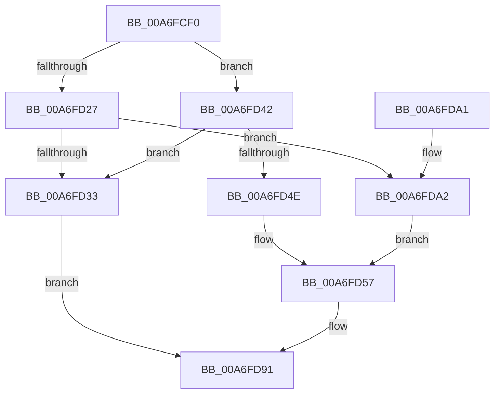

# PspSetBackgroundJobTree

- RVA: `0x00A6FCF0`–`0x00A6FDAD` (길이 `189` bytes)
- VA: `0x0000000140A6FCF0`
- 실행 섹션: `PAGE`
- PDB 이름 있음: `예`; PDB Function 태그: `아니요`
- unwind 정보 RVA: `0x000B4ECC`
- 디코드: `45`개 명령, `189/189` bytes 표시
- 미해석 바이트: `0` (있으면 어셈블리에 `.byte`로 보존)

> 이 문서는 커널 이미지의 기계어와 PDB 기호를 분석해 생성했습니다. 4번과 5번은 함수 원형과 자료형을 바이너리 사용 방식에서 추정한 C 해석이며 원본 소스 복구 결과는 아닙니다.

## 1. Dependencies

- 직접 호출 지점: **4**; 고유 호출 대상: **3**
- 직접 호출자로 확인된 함수: **1**
- RIP 상대 이미지 참조: **2**

### Outgoing calls
- `0x00A6FD1D` → [ExAcquireResourceExclusiveLite](../../text/21/ExAcquireResourceExclusiveLite_function_00214E20.md) (function, `0x00214E20`)
- `0x00A6FD36` → [ExReleaseResourceLite](../../text/25/ExReleaseResourceLite_function_0025FA10.md) (function, `0x0025FA10`)
- `0x00A6FD82` → [PspEnumJobsAndProcessesInJobHierarchy](../91/PspEnumJobsAndProcessesInJobHierarchy_function_0091A1EC.md) (function, `0x0091A1EC`)
- `0x00A6FD8A` → [ExReleaseResourceLite](../../text/25/ExReleaseResourceLite_function_0025FA10.md) (function, `0x0025FA10`)

### Direct callers
- [NtSetInformationJobObject](../9F/NtSetInformationJobObject_function_009F84C0.md) at `0x009F9C76`

### Static image references
- `0x00A6FD64` → RVA `0x00A7E310` (`PspSetProcessBackgroundCountCallback`; read)
- `0x00A6FD78` → RVA `0x0087EA80` (`PspSetJobBackgroundCountCallback`; read)

## 2. Other-region calls and transfers

- 다른 실행 섹션으로 향하는 call: **3**
  - `0x00A6FD1D` → [ExAcquireResourceExclusiveLite](../../text/21/ExAcquireResourceExclusiveLite_function_00214E20.md) (`PAGE` → `.text`)
  - `0x00A6FD36` → [ExReleaseResourceLite](../../text/25/ExReleaseResourceLite_function_0025FA10.md) (`PAGE` → `.text`)
  - `0x00A6FD8A` → [ExReleaseResourceLite](../../text/25/ExReleaseResourceLite_function_0025FA10.md) (`PAGE` → `.text`)
- 별도 외부 분기/꼬리 이동을 확인하지 못했습니다.

## 3. Assembly (complete function range)

```asm
00A6FCF0  48 89 5C 24 10                  mov qword ptr [rsp + 0x10], rbx
00A6FCF5  48 89 74 24 18                  mov qword ptr [rsp + 0x18], rsi
00A6FCFA  57                              push rdi
00A6FCFB  48 83 EC 30                     sub rsp, 0x30
00A6FCFF  33 C0                           xor eax, eax
00A6FD01  48 8D 79 38                     lea rdi, [rcx + 0x38]
00A6FD05  40 8A F2                        mov sil, dl
00A6FD08  66 89 44 24 41                  mov word ptr [rsp + 0x41], ax
00A6FD0D  48 8B D9                        mov rbx, rcx
00A6FD10  88 44 24 43                     mov byte ptr [rsp + 0x43], al
00A6FD14  21 44 24 41                     and dword ptr [rsp + 0x41], eax
00A6FD18  48 8B CF                        mov rcx, rdi
00A6FD1B  B2 01                           mov dl, 1
00A6FD1D  E8 FE 50 7A FF                  call 0x140214e20
00A6FD22  40 84 F6                        test sil, sil
00A6FD25  75 1B                           jne 0x140a6fd42
00A6FD27  F7 83 10 06 00 00 00 04 00 00   test dword ptr [rbx + 0x610], 0x400
00A6FD31  75 6F                           jne 0x140a6fda2
00A6FD33  48 8B CF                        mov rcx, rdi
00A6FD36  E8 D5 FC 7E FF                  call 0x14025fa10
00A6FD3B  B8 0D 00 00 C0                  mov eax, 0xc000000d
00A6FD40  EB 4F                           jmp 0x140a6fd91
00A6FD42  F7 83 10 06 00 00 00 04 00 00   test dword ptr [rbx + 0x610], 0x400
00A6FD4C  75 E5                           jne 0x140a6fd33
00A6FD4E  F0 0F BA AB 10 06 00 00 0A      lock bts dword ptr [rbx + 0x610], 0xa
00A6FD57  48 8D 44 24 40                  lea rax, [rsp + 0x40]
00A6FD5C  C7 44 24 28 05 00 00 00         mov dword ptr [rsp + 0x28], 5
00A6FD64  4C 8D 0D A5 E5 00 00            lea r9, [rip + 0xe5a5]
00A6FD6B  48 89 44 24 20                  mov qword ptr [rsp + 0x20], rax
00A6FD70  45 33 C0                        xor r8d, r8d
00A6FD73  40 88 74 24 40                  mov byte ptr [rsp + 0x40], sil
00A6FD78  48 8D 15 01 ED E0 FF            lea rdx, [rip - 0x1f12ff]
00A6FD7F  48 8B CB                        mov rcx, rbx
00A6FD82  E8 65 A4 EA FF                  call 0x14091a1ec
00A6FD87  48 8B CF                        mov rcx, rdi
00A6FD8A  E8 81 FC 7E FF                  call 0x14025fa10
00A6FD8F  33 C0                           xor eax, eax
00A6FD91  48 8B 5C 24 48                  mov rbx, qword ptr [rsp + 0x48]
00A6FD96  48 8B 74 24 50                  mov rsi, qword ptr [rsp + 0x50]
00A6FD9B  48 83 C4 30                     add rsp, 0x30
00A6FD9F  5F                              pop rdi
00A6FDA0  C3                              ret
00A6FDA1  CC                              int3
00A6FDA2  F0 0F BA B3 10 06 00 00 0A      lock btr dword ptr [rbx + 0x610], 0xa
00A6FDAB  EB AA                           jmp 0x140a6fd57
```

## 4. C-style interpretation (structured pseudocode)

```c
__int64 __fastcall PspSetBackgroundJobTree(__int64 a1, unsigned __int8 a2, int a3)
{
    __int64 result;
    __int64 v_rsp;
    unsigned int v_stack_m10;
    unsigned __int64 v_stack_m18;
    unsigned __int64 v_stack_p10;
    unsigned __int64 v_stack_p18;
    unsigned __int64 v_stack_p8;
    unsigned __int16 v_stack_p9;
    unsigned __int8 v_stack_pB;

    v_stack_p10 = v_rbx;
    v_stack_p18 = v_rsi;
    v_rsp = (v_rsp) - (48);
    result = 0;
    v_stack_p9 = 0;
    v_stack_pB = 0;
    result = ExAcquireResourceExclusiveLite(a1 + 56, 1, a3, a4);
    if (a2 != 0) goto loc_00A6FD42;
    if (((*(unsigned int *)(a1 + 1552)) & (0x400ULL)) != 0) goto loc_00A6FDA2;
loc_00A6FD33:
    result = ExReleaseResourceLite(a1 + 56, 1, a3, a4);
    goto loc_00A6FD91;
loc_00A6FD42:
    if (((*(unsigned int *)(a1 + 1552)) & (0x400ULL)) != 0) goto loc_00A6FD33;
loc_00A6FD57:
    v_stack_m10 = 5;
    v_stack_m18 = v_stack_p8;
    a3 = 0;
    v_stack_p8 = a2;
    result = PspEnumJobsAndProcessesInJobHierarchy(a1, v_rip - 2036479, a3, v_rip + 58789);
    result = ExReleaseResourceLite(a1 + 56, v_rip - 2036479, a3, v_rip + 58789);
    result = 0;
loc_00A6FD91:
    v_rsp = (v_rsp) + (48);
    return result;
loc_00A6FDA2:
    goto loc_00A6FD57;
}
```

## 5. (Beta) C Style

```c
int64_t PspSetBackgroundJobTree(void *Arg1, uint8_t Arg2, int32_t Arg3)
{
    uint8_t *arg1 = (uint8_t *)Arg1;

    int64_t result;
    int64_t local_rsp;
    uint32_t v_stack_m10;
    uint64_t v_stack_m18;
    uint64_t v_stack_p10;
    uint64_t v_stack_p18;
    uint64_t v_stack_p8;
    uint16_t v_stack_p9;
    uint8_t v_stack_pB;

    v_stack_p10 = local_rbx;
    v_stack_p18 = local_rsi;
    local_rsp = (local_rsp) - (48);
    result = 0;
    v_stack_p9 = 0;
    v_stack_pB = 0;
    result = ExAcquireResourceExclusiveLite(Arg1 + 56, 1, Arg3, a4);
    if (Arg2 != 0) goto loc_00A6FD42;
    if (((*(uint32_t *)(arg1 + 0x610)) & (0x400ULL)) != 0) goto loc_00A6FDA2;
loc_00A6FD33:
    result = ExReleaseResourceLite(Arg1 + 56, 1, Arg3, a4);
    goto loc_00A6FD91;
loc_00A6FD42:
    if (((*(uint32_t *)(arg1 + 0x610)) & (0x400ULL)) != 0) goto loc_00A6FD33;
loc_00A6FD57:
    v_stack_m10 = 5;
    v_stack_m18 = v_stack_p8;
    Arg3 = 0;
    v_stack_p8 = Arg2;
    result = PspEnumJobsAndProcessesInJobHierarchy(Arg1, v_rip - 2036479, Arg3, v_rip + 58789);
    result = ExReleaseResourceLite(Arg1 + 56, v_rip - 2036479, Arg3, v_rip + 58789);
    result = 0;
loc_00A6FD91:
    local_rsp = (local_rsp) + (48);
    return result;
loc_00A6FDA2:
    goto loc_00A6FD57;
}
```

### 관측된 메모리 오프셋

구조체 형식이 확인되지 않은 접근은 인자 기준의 오프셋으로만 기록했습니다.

| 기준 인자 | 오프셋 표현 | 폭 (bit) | 접근 |
|---|---:|---:|---|
| `Arg1` | `+ 0x38` | `64` | `R` |
| `Arg1` | `+ 0x610` | `32` | `R` |
| `Arg1` | `+ 0x610` | `32` | `R/W` |

## 6. Execution-region graph

[열기: 2D/3D 그래프와 함수 탐색 컨트롤 패널](../../../control-panel.html?section=page&rva=0x00A6FCF0&view=graph)

- 2D 그래프는 위에서 아래로 흐르고, 3D 그래프는 빈 공간을 드래그해 회전합니다. Shift+드래그는 이동, 휠은 확대·축소, 함수 노드 선택은 대상 보고서 이동입니다.

### Static fallback


