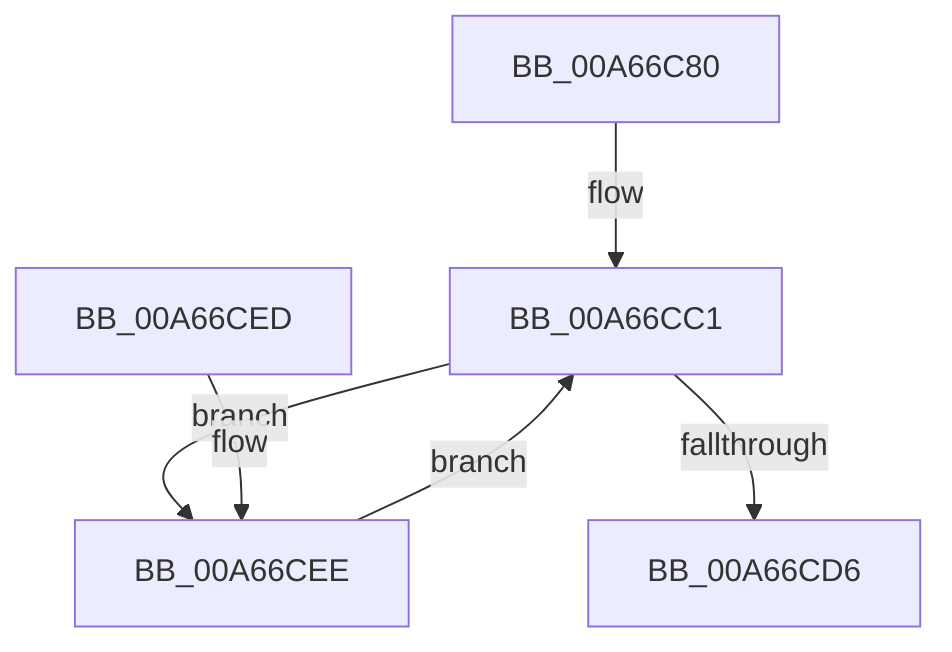

# PspSetCpuRateControlJobPostCallback

- RVA: `0x00A66C80`–`0x00A66D01` (길이 `129` bytes)
- VA: `0x0000000140A66C80`
- 실행 섹션: `PAGE`
- PDB 이름 있음: `예`; PDB Function 태그: `아니요`
- unwind 정보 RVA: `0x000B3AF0`
- 디코드: `37`개 명령, `129/129` bytes 표시
- 미해석 바이트: `0` (있으면 어셈블리에 `.byte`로 보존)

> 이 문서는 커널 이미지의 기계어와 PDB 기호를 분석해 생성했습니다. 4번과 5번은 함수 원형과 자료형을 바이너리 사용 방식에서 추정한 C 해석이며 원본 소스 복구 결과는 아닙니다.

## 1. Dependencies

- 직접 호출 지점: **2**; 고유 호출 대상: **2**
- 직접 호출자로 확인된 함수: **0**
- RIP 상대 이미지 참조: **0**

### Outgoing calls
- `0x00A66CC9` → [PspGetNextJobProcess](../91/PspGetNextJobProcess_function_00918450.md) (function, `0x00918450`)
- `0x00A66CF4` → [PspSetProcessSchedulingGroup](PspSetProcessSchedulingGroup_function_00A66D08.md) (function, `0x00A66D08`)

### Direct callers
- 이 함수 시작 RVA로 연결되는 직접 call은 확인되지 않았습니다. 간접 호출은 완전히 역산할 수 없습니다.

### Static image references
- 디코드된 RIP-relative 메모리 참조가 없습니다.

## 2. Other-region calls and transfers

- 다른 실행 섹션으로 향하는 call: **0**
- 별도 외부 분기/꼬리 이동을 확인하지 못했습니다.

## 3. Assembly (complete function range)

```asm
00A66C80  4C 8B DC                        mov r11, rsp
00A66C83  49 89 5B 08                     mov qword ptr [r11 + 8], rbx
00A66C87  49 89 6B 10                     mov qword ptr [r11 + 0x10], rbp
00A66C8B  49 89 73 18                     mov qword ptr [r11 + 0x18], rsi
00A66C8F  57                              push rdi
00A66C90  48 83 EC 40                     sub rsp, 0x40
00A66C94  33 C0                           xor eax, eax
00A66C96  0F 57 C0                        xorps xmm0, xmm0
00A66C99  0F 11 44 24 20                  movups xmmword ptr [rsp + 0x20], xmm0
00A66C9E  49 89 43 E8                     mov qword ptr [r11 - 0x18], rax
00A66CA2  48 8B F1                        mov rsi, rcx
00A66CA5  65 48 8B 2C 25 88 01 00 00      mov rbp, qword ptr gs:[0x188]
00A66CAE  48 8D 82 80 00 00 00            lea rax, [rdx + 0x80]
00A66CB5  48 F7 DA                        neg rdx
00A66CB8  48 1B FF                        sbb rdi, rdi
00A66CBB  48 23 F8                        and rdi, rax
00A66CBE  45 33 C9                        xor r9d, r9d
00A66CC1  4C 8D 44 24 20                  lea r8, [rsp + 0x20]
00A66CC6  48 8B D5                        mov rdx, rbp
00A66CC9  E8 82 17 EB FF                  call 0x140918450
00A66CCE  48 8B D8                        mov rbx, rax
00A66CD1  48 85 C0                        test rax, rax
00A66CD4  75 18                           jne 0x140a66cee
00A66CD6  48 8B 5C 24 50                  mov rbx, qword ptr [rsp + 0x50]
00A66CDB  33 C0                           xor eax, eax
00A66CDD  48 8B 6C 24 58                  mov rbp, qword ptr [rsp + 0x58]
00A66CE2  48 8B 74 24 60                  mov rsi, qword ptr [rsp + 0x60]
00A66CE7  48 83 C4 40                     add rsp, 0x40
00A66CEB  5F                              pop rdi
00A66CEC  C3                              ret
00A66CED  CC                              int3
00A66CEE  48 8B D7                        mov rdx, rdi
00A66CF1  48 8B CB                        mov rcx, rbx
00A66CF4  E8 0F 00 00 00                  call 0x140a66d08
00A66CF9  4C 8B CB                        mov r9, rbx
00A66CFC  48 8B CE                        mov rcx, rsi
00A66CFF  EB C0                           jmp 0x140a66cc1
```

## 4. C-style interpretation (structured pseudocode)

```c
__int64 __fastcall PspSetCpuRateControlJobPostCallback(__int64 a1, __int64 a2, __int64 a3, int a4)
{
    __int64 result;
    __int64 v_rdi;
    __int64 v_rsp;
    unsigned __int64 v_stack_m28;
    unsigned __int64 v_stack_p10;
    unsigned __int64 v_stack_p18;
    unsigned __int64 v_stack_p8;

    *(unsigned __int64 *)(v_rsp + 8) = v_rbx;
    *(unsigned __int64 *)(v_rsp + 16) = v_rbp;
    *(unsigned __int64 *)(v_rsp + 24) = v_rsi;
    v_rsp = (v_rsp) - (64);
    result = 0;
    v_stack_m28 = v_xmm0;
    *(unsigned __int64 *)(v_rsp - 24) = 0;
    a2 = -(a2);
    v_rdi = (v_rdi) & (a2 + 128);
    a4 = 0;
loc_00A66CC1:
    result = PspGetNextJobProcess(a1, *(unsigned __int64 *)(gs_base + (0 + 392)), v_stack_m28, a4);
    if (result != 0) goto loc_00A66CEE;
    result = 0;
    v_rsp = (v_rsp) + (64);
    return result;
loc_00A66CEE:
    result = PspSetProcessSchedulingGroup(v_stack_p8, v_rdi, v_stack_m28, a4);
    goto loc_00A66CC1;
}
```

## 5. (Beta) C Style

```c
int64_t PspSetCpuRateControlJobPostCallback(int64_t Arg1, void *Arg2, int64_t Arg3, int32_t Arg4)
{
    uint8_t *arg2 = (uint8_t *)Arg2;

    int64_t result;
    int64_t local_rdi;
    int64_t local_rsp;
    uint64_t v_stack_m28;
    uint64_t v_stack_p10;
    uint64_t v_stack_p18;
    uint64_t v_stack_p8;

    *(uint64_t *)(local_rsp + 0x8) = local_rbx;
    *(uint64_t *)(local_rsp + 0x10) = local_rbp;
    *(uint64_t *)(local_rsp + 0x18) = local_rsi;
    local_rsp = (local_rsp) - (64);
    result = 0;
    v_stack_m28 = v_xmm0;
    *(uint64_t *)(local_rsp - 0x18) = 0;
    Arg2 = -(Arg2);
    local_rdi = (local_rdi) & (Arg2 + 128);
    Arg4 = 0;
loc_00A66CC1:
    result = PspGetNextJobProcess(Arg1, *(uint64_t *)(gs_base + (0 + 0x188)), v_stack_m28, Arg4);
    if (result != 0) goto loc_00A66CEE;
    result = 0;
    local_rsp = (local_rsp) + (64);
    return result;
loc_00A66CEE:
    result = PspSetProcessSchedulingGroup(v_stack_p8, local_rdi, v_stack_m28, Arg4);
    goto loc_00A66CC1;
}
```

### 관측된 메모리 오프셋

구조체 형식이 확인되지 않은 접근은 인자 기준의 오프셋으로만 기록했습니다.

| 기준 인자 | 오프셋 표현 | 폭 (bit) | 접근 |
|---|---:|---:|---|
| `Arg2` | `+ 0x80` | `64` | `R` |

## 6. Execution-region graph

[열기: 2D/3D 그래프와 함수 탐색 컨트롤 패널](../../../control-panel.html?section=page&rva=0x00A66C80&view=graph)

- 2D 그래프는 위에서 아래로 흐르고, 3D 그래프는 빈 공간을 드래그해 회전합니다. Shift+드래그는 이동, 휠은 확대·축소, 함수 노드 선택은 대상 보고서 이동입니다.

### Static fallback


