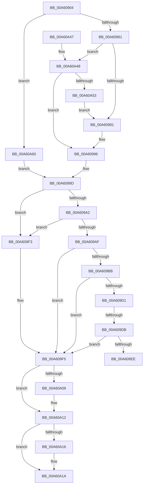

# PspSetProcessAffinitySafe

- RVA: `0x00A60904`–`0x00A60A72` (길이 `366` bytes)
- VA: `0x0000000140A60904`
- 실행 섹션: `PAGE`
- PDB 이름 있음: `예`; PDB Function 태그: `예`
- unwind 정보 RVA: `0x000B2FC0`
- 디코드: `97`개 명령, `366/366` bytes 표시
- 미해석 바이트: `0` (있으면 어셈블리에 `.byte`로 보존)

> 이 문서는 커널 이미지의 기계어와 PDB 기호를 분석해 생성했습니다. 4번과 5번은 함수 원형과 자료형을 바이너리 사용 방식에서 추정한 C 해석이며 원본 소스 복구 결과는 아닙니다.

## 1. Dependencies

- 직접 호출 지점: **7**; 고유 호출 대상: **6**
- 직접 호출자로 확인된 함수: **4**
- RIP 상대 이미지 참조: **1**

### Outgoing calls
- `0x00A6094E` → [memset](../../text/6C/memset_function_006C6C40.md) (function, `0x006C6C40`)
- `0x00A6097A` → [memset](../../text/6C/memset_function_006C6C40.md) (function, `0x006C6C40`)
- `0x00A609C2` → [ExAcquireResourceSharedLite](../../text/21/ExAcquireResourceSharedLite_function_00211BC0.md) (function, `0x00211BC0`)
- `0x00A609E5` → [KeIsSubsetAffinityEx](../../text/2C/KeIsSubsetAffinityEx_function_002CDC80.md) (function, `0x002CDC80`)
- `0x00A609FD` → [KeSetAffinityProcess](../../text/3C/KeSetAffinityProcess_function_003C0A60.md) (function, `0x003C0A60`)
- `0x00A60A0D` → [ExReleaseResourceLite](../../text/25/ExReleaseResourceLite_function_0025FA10.md) (function, `0x0025FA10`)
- `0x00A60A27` → [_security_check_cookie](../../text/6A/_security_check_cookie_function_006AC640.md) (function, `0x006AC640`)

### Direct callers
- [PspUpdateSingleProcessAffinity](../78/PspUpdateSingleProcessAffinity_function_00782B00.md) at `0x00782B9B`
- [PspAllocateProcess](../A1/PspAllocateProcess_function_00A13B3C.md) at `0x00A15EA6`
- [PspApplyJobLimitsToProcess](../A5/PspApplyJobLimitsToProcess_function_00A57274.md) at `0x00A57398`
- [NtSetInformationProcess](../AE/NtSetInformationProcess_function_00AE5370.md) at `0x00AE65B0`

### Static image references
- `0x00A6091B` → RVA `0x00E0A740` (`.data`; read)

## 2. Other-region calls and transfers

- 다른 실행 섹션으로 향하는 call: **7**
  - `0x00A6094E` → [memset](../../text/6C/memset_function_006C6C40.md) (`PAGE` → `.text`)
  - `0x00A6097A` → [memset](../../text/6C/memset_function_006C6C40.md) (`PAGE` → `.text`)
  - `0x00A609C2` → [ExAcquireResourceSharedLite](../../text/21/ExAcquireResourceSharedLite_function_00211BC0.md) (`PAGE` → `.text`)
  - `0x00A609E5` → [KeIsSubsetAffinityEx](../../text/2C/KeIsSubsetAffinityEx_function_002CDC80.md) (`PAGE` → `.text`)
  - `0x00A609FD` → [KeSetAffinityProcess](../../text/3C/KeSetAffinityProcess_function_003C0A60.md) (`PAGE` → `.text`)
  - `0x00A60A0D` → [ExReleaseResourceLite](../../text/25/ExReleaseResourceLite_function_0025FA10.md) (`PAGE` → `.text`)
  - `0x00A60A27` → [_security_check_cookie](../../text/6A/_security_check_cookie_function_006AC640.md) (`PAGE` → `.text`)
- call이 아닌 외부 분기/꼬리 이동: **2**
  - `0x00A609D5` → [sub_00B3E23E](../B3/Unknown_function_00B3E23E.md) (`tail-transfer`)
  - `0x00A609EE` → [sub_00B3E23E](../B3/Unknown_function_00B3E23E.md) (`tail-transfer`)

## 3. Assembly (complete function range)

```asm
00A60904  48 89 5C 24 10                  mov qword ptr [rsp + 0x10], rbx
00A60909  55                              push rbp
00A6090A  56                              push rsi
00A6090B  57                              push rdi
00A6090C  41 54                           push r12
00A6090E  41 55                           push r13
00A60910  41 56                           push r14
00A60912  41 57                           push r15
00A60914  48 81 EC 50 01 00 00            sub rsp, 0x150
00A6091B  48 8B 05 1E 9E 3A 00            mov rax, qword ptr [rip + 0x3a9e1e]
00A60922  48 33 C4                        xor rax, rsp
00A60925  48 89 84 24 40 01 00 00         mov qword ptr [rsp + 0x140], rax
00A6092D  4C 8B AC 24 B0 01 00 00         mov r13, qword ptr [rsp + 0x1b0]
00A60935  4D 8B F0                        mov r14, r8
00A60938  44 8B E2                        mov r12d, edx
00A6093B  4C 8B F9                        mov r15, rcx
00A6093E  33 D2                           xor edx, edx
00A60940  48 8D 4C 24 30                  lea rcx, [rsp + 0x30]
00A60945  41 B8 08 01 00 00               mov r8d, 0x108
00A6094B  49 8B D9                        mov rbx, r9
00A6094E  E8 ED 62 C6 FF                  call 0x1406c6c40
00A60953  33 ED                           xor ebp, ebp
00A60955  8D 7D 01                        lea edi, [rbp + 1]
00A60958  48 85 DB                        test rbx, rbx
00A6095B  0F 84 FF 00 00 00               je 0x140a60a60
00A60961  21 6C 24 34                     and dword ptr [rsp + 0x34], ebp
00A60965  48 8D 4C 24 38                  lea rcx, [rsp + 0x38]
00A6096A  33 D2                           xor edx, edx
00A6096C  C7 44 24 30 01 00 20 00         mov dword ptr [rsp + 0x30], 0x200001
00A60974  41 B8 00 01 00 00               mov r8d, 0x100
00A6097A  E8 C1 62 C6 FF                  call 0x1406c6c40
00A6097F  0F B7 4B 08                     movzx ecx, word ptr [rbx + 8]
00A60983  48 8B 13                        mov rdx, qword ptr [rbx]
00A60986  66 39 4C 24 30                  cmp word ptr [rsp + 0x30], cx
00A6098B  0F 86 B7 00 00 00               jbe 0x140a60a48
00A60991  48 09 54 CC 38                  or qword ptr [rsp + rcx*8 + 0x38], rdx
00A60996  4C 8D 74 24 30                  lea r14, [rsp + 0x30]
00A6099B  8B F7                           mov esi, edi
00A6099D  44 84 E7                        test dil, r12b
00A609A0  75 51                           jne 0x140a609f3
00A609A2  41 F7 87 FC 05 00 00 00 10 00 00  test dword ptr [r15 + 0x5fc], 0x1000
00A609AD  75 44                           jne 0x140a609f3
00A609AF  49 8B 9F A0 02 00 00            mov rbx, qword ptr [r15 + 0x2a0]
00A609B6  48 85 DB                        test rbx, rbx
00A609B9  74 3A                           je 0x140a609f5
00A609BB  48 8D 4B 38                     lea rcx, [rbx + 0x38]
00A609BF  40 8A D7                        mov dl, dil
00A609C2  E8 F9 11 7B FF                  call 0x140211bc0
00A609C7  8B 83 20 04 00 00               mov eax, dword ptr [rbx + 0x420]
00A609CD  A8 10                           test al, 0x10
00A609CF  74 24                           je 0x140a609f5
00A609D1  0F BA E0 0E                     bt eax, 0xe
00A609D5  0F 83 63 D8 0D 00               jae 0x140b3e23e
00A609DB  48 8D 93 D8 02 00 00            lea rdx, [rbx + 0x2d8]
00A609E2  49 8B CE                        mov rcx, r14
00A609E5  E8 96 D2 86 FF                  call 0x1402cdc80
00A609EA  85 C0                           test eax, eax
00A609EC  75 07                           jne 0x140a609f5
00A609EE  E9 4B D8 0D 00                  jmp 0x140b3e23e
00A609F3  33 DB                           xor ebx, ebx
00A609F5  4D 8B C6                        mov r8, r14
00A609F8  8B D6                           mov edx, esi
00A609FA  49 8B CF                        mov rcx, r15
00A609FD  E8 5E 00 96 FF                  call 0x1403c0a60
00A60A02  8B E8                           mov ebp, eax
00A60A04  48 85 DB                        test rbx, rbx
00A60A07  74 09                           je 0x140a60a12
00A60A09  48 8D 4B 38                     lea rcx, [rbx + 0x38]
00A60A0D  E8 FE EF 7F FF                  call 0x14025fa10
00A60A12  85 ED                           test ebp, ebp
00A60A14  78 04                           js 0x140a60a1a
00A60A16  41 89 7D 00                     mov dword ptr [r13], edi
00A60A1A  8B C5                           mov eax, ebp
00A60A1C  48 8B 8C 24 40 01 00 00         mov rcx, qword ptr [rsp + 0x140]
00A60A24  48 33 CC                        xor rcx, rsp
00A60A27  E8 14 BC C4 FF                  call 0x1406ac640
00A60A2C  48 8B 9C 24 98 01 00 00         mov rbx, qword ptr [rsp + 0x198]
00A60A34  48 81 C4 50 01 00 00            add rsp, 0x150
00A60A3B  41 5F                           pop r15
00A60A3D  41 5E                           pop r14
00A60A3F  41 5D                           pop r13
00A60A41  41 5C                           pop r12
00A60A43  5F                              pop rdi
00A60A44  5E                              pop rsi
00A60A45  5D                              pop rbp
00A60A46  C3                              ret
00A60A47  CC                              int3
00A60A48  66 39 4C 24 32                  cmp word ptr [rsp + 0x32], cx
00A60A4D  0F 86 43 FF FF FF               jbe 0x140a60996
00A60A53  8D 04 0F                        lea eax, [rdi + rcx]
00A60A56  66 89 44 24 30                  mov word ptr [rsp + 0x30], ax
00A60A5B  E9 31 FF FF FF                  jmp 0x140a60991
00A60A60  B8 02 00 00 00                  mov eax, 2
00A60A65  8B F5                           mov esi, ebp
00A60A67  44 84 E0                        test al, r12b
00A60A6A  0F 45 F0                        cmovne esi, eax
00A60A6D  E9 2B FF FF FF                  jmp 0x140a6099d
```

## 4. C-style interpretation (structured pseudocode)

```c
__int64 __fastcall PspSetProcessAffinitySafe(__int64 a1, int a2, __int64 a3, __int64 a4, __int64 a5)
{
    __int64 result;
    __int64 v_rbp;
    __int64 v_rbx;
    __int64 v_rsi;
    __int64 v_rsp;
    unsigned __int64 v_stack_m150;
    unsigned int v_stack_m154;
    unsigned __int64 v_stack_m158;
    unsigned __int64 v_stack_m48;
    unsigned __int64 v_stack_p10;
    unsigned __int16 v_stack_p30;
    unsigned __int16 v_stack_p32;

    v_stack_p10 = v_rbx;
    v_rsp = (v_rsp) - (336);
    result = (*(unsigned __int64 *)(v_rip + 3841566)) ^ (v_rsp);
    v_stack_m48 = result;
    a2 = 0;
    result = memset(v_stack_m158, a2, 264, a4);
    v_rbp = 0;
    if (a4 == 0) goto loc_00A60A60;
    a2 = 0;
    v_stack_m158 = 0x200001ULL;
    result = memset(v_stack_m150, a2, 256, a4);
    if (v_stack_m158 <= ((unsigned __int16)(*(unsigned __int16 *)(a4 + 8)))) goto loc_00A60A48;
loc_00A60991:
loc_00A60996:
loc_00A6099D:
    if ((((unsigned __int8)(v_rbp + 1)) & ((unsigned __int8)((unsigned int)(a2)))) != 0) goto loc_00A609F3;
    if (((*(unsigned int *)(a1 + 1532)) & (0x1000ULL)) != 0) goto loc_00A609F3;
    if (*(unsigned __int64 *)(a1 + 672) == 0) goto loc_00A609F5;
    result = ExAcquireResourceSharedLite(*(unsigned __int64 *)(a1 + 672) + 56, (unsigned __int8)(v_rbp + 1), 256, a4);
    if ((((unsigned __int8)((unsigned int)(*(unsigned int *)(*(unsigned __int64 *)(a1 + 672) + 1056)))) & (16)) == 0) goto loc_00A609F5;
    result = KeIsSubsetAffinityEx(v_stack_m158, *(unsigned __int64 *)(a1 + 672) + 728, 256, a4);
    if ((unsigned int)(result) != 0) goto loc_00A609F5;
loc_00A609F3:
    v_rbx = 0;
loc_00A609F5:
    result = KeSetAffinityProcess(a1, (unsigned int)((unsigned int)((unsigned int)((unsigned int)(v_rbp + 1)))), v_stack_m158, a4);
    if (0 != 0) {
        a1 = v_rbx + 56;
        result = ExReleaseResourceLite(a1, (unsigned int)((unsigned int)((unsigned int)((unsigned int)(v_rbp + 1)))), v_stack_m158, a4);
    }
    if (!(sign_flag)) {
        *(unsigned int *)(a5) = (unsigned int)(v_rbp + 1);
    }
    a1 = (v_stack_m48) ^ (v_rsp);
    result = _security_check_cookie(a1, (unsigned int)((unsigned int)((unsigned int)((unsigned int)(v_rbp + 1)))), v_stack_m158, a4);
    v_rsp = (v_rsp) + (336);
    return result;
loc_00A60A48:
    if (v_stack_p32 <= ((unsigned __int16)(a1))) goto loc_00A60996;
    v_stack_p30 = (unsigned __int16)(v_rbp + 1 + a1 * 1);
    goto loc_00A60991;
loc_00A60A60:
    v_rsi = (unsigned int)((unsigned int)((unsigned int)((unsigned int)(result))));
    if (((2) & ((unsigned __int8)((unsigned int)(a2)))) != 0) { v_rsi = 2; }
    goto loc_00A6099D;
}
```

## 5. (Beta) C Style

```c
int64_t PspSetProcessAffinitySafe(void *Arg1, int32_t Arg2, int64_t Arg3, int64_t Arg4, void *Arg5)
{
    uint8_t *arg1 = (uint8_t *)Arg1;
    uint8_t *arg5 = (uint8_t *)Arg5;

    int64_t result;
    int64_t local_rbp;
    int64_t local_rbx;
    int64_t local_rsi;
    int64_t local_rsp;
    uint64_t v_stack_m150;
    uint32_t v_stack_m154;
    uint64_t v_stack_m158;
    uint64_t v_stack_m48;
    uint64_t v_stack_p10;
    uint16_t v_stack_p30;
    uint16_t v_stack_p32;

    v_stack_p10 = local_rbx;
    local_rsp = (local_rsp) - (336);
    result = (*(uint64_t *)(v_rip + 0x3A9E1E)) ^ (local_rsp);
    v_stack_m48 = result;
    Arg2 = 0;
    result = memset(v_stack_m158, Arg2, 264, Arg4);
    local_rbp = 0;
    if (Arg4 == 0) goto loc_00A60A60;
    Arg2 = 0;
    v_stack_m158 = 0x200001ULL;
    result = memset(v_stack_m150, Arg2, 256, Arg4);
    if (v_stack_m158 <= ((uint16_t)(*(uint16_t *)(Arg4 + 0x8)))) goto loc_00A60A48;
loc_00A60991:
loc_00A60996:
loc_00A6099D:
    if ((((uint8_t)(local_rbp + 1)) & ((uint8_t)((uint32_t)(Arg2)))) != 0) goto loc_00A609F3;
    if (((*(uint32_t *)(arg1 + 0x5FC)) & (0x1000ULL)) != 0) goto loc_00A609F3;
    if (*(uint64_t *)(arg1 + 0x2A0) == 0) goto loc_00A609F5;
    result = ExAcquireResourceSharedLite(*(uint64_t *)(arg1 + 0x2A0) + 56, (uint8_t)(local_rbp + 1), 256, Arg4);
    if ((((uint8_t)((uint32_t)(*(uint32_t *)(*(uint64_t *)(arg1 + 0x2A0) + 0x420)))) & (16)) == 0) goto loc_00A609F5;
    result = KeIsSubsetAffinityEx(v_stack_m158, *(uint64_t *)(arg1 + 0x2A0) + 728, 256, Arg4);
    if ((uint32_t)(result) != 0) goto loc_00A609F5;
loc_00A609F3:
    local_rbx = 0;
loc_00A609F5:
    result = KeSetAffinityProcess(Arg1, (uint32_t)((uint32_t)((uint32_t)((uint32_t)(local_rbp + 1)))), v_stack_m158, Arg4);
    if (0 != 0) {
        Arg1 = local_rbx + 56;
        result = ExReleaseResourceLite(Arg1, (uint32_t)((uint32_t)((uint32_t)((uint32_t)(local_rbp + 1)))), v_stack_m158, Arg4);
    }
    if (!(sign_flag)) {
        *(uint32_t *)(arg5) = (uint32_t)(local_rbp + 1);
    }
    Arg1 = (v_stack_m48) ^ (local_rsp);
    result = _security_check_cookie(Arg1, (uint32_t)((uint32_t)((uint32_t)((uint32_t)(local_rbp + 1)))), v_stack_m158, Arg4);
    local_rsp = (local_rsp) + (336);
    return result;
loc_00A60A48:
    if (v_stack_p32 <= ((uint16_t)(Arg1))) goto loc_00A60996;
    v_stack_p30 = (uint16_t)(local_rbp + 1 + Arg1 * 1);
    goto loc_00A60991;
loc_00A60A60:
    local_rsi = (uint32_t)((uint32_t)((uint32_t)((uint32_t)(result))));
    if (((2) & ((uint8_t)((uint32_t)(Arg2)))) != 0) { local_rsi = 2; }
    goto loc_00A6099D;
}
```

### 관측된 메모리 오프셋

구조체 형식이 확인되지 않은 접근은 인자 기준의 오프셋으로만 기록했습니다.

| 기준 인자 | 오프셋 표현 | 폭 (bit) | 접근 |
|---|---:|---:|---|
| `Arg1` | `+ 0x2A0` | `64` | `R` |
| `Arg1` | `+ 0x5FC` | `32` | `R` |
| `Arg5` | `+ 0x0` | `32` | `W` |

## 6. Execution-region graph

[열기: 2D/3D 그래프와 함수 탐색 컨트롤 패널](../../../control-panel.html?section=page&rva=0x00A60904&view=graph)

- 2D 그래프는 위에서 아래로 흐르고, 3D 그래프는 빈 공간을 드래그해 회전합니다. Shift+드래그는 이동, 휠은 확대·축소, 함수 노드 선택은 대상 보고서 이동입니다.

### Static fallback


