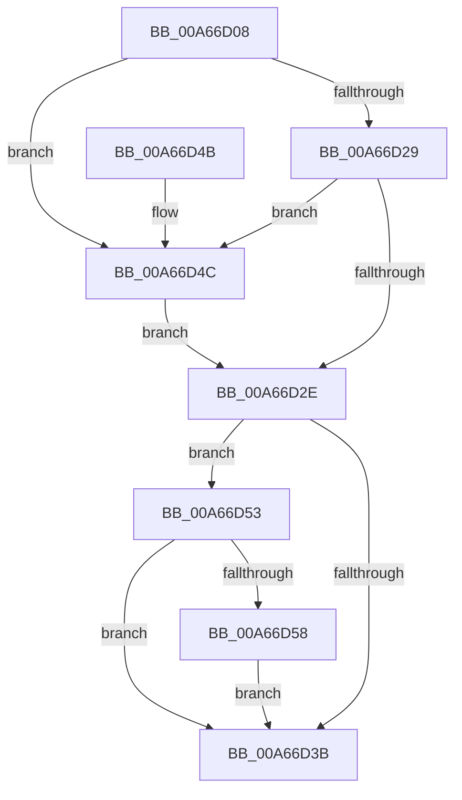

# PspSetProcessSchedulingGroup

- RVA: `0x00A66D08`–`0x00A66D64` (길이 `92` bytes)
- VA: `0x0000000140A66D08`
- 실행 섹션: `PAGE`
- PDB 이름 있음: `예`; PDB Function 태그: `아니요`
- unwind 정보 RVA: `0x000684A0`
- 디코드: `30`개 명령, `92/92` bytes 표시
- 미해석 바이트: `0` (있으면 어셈블리에 `.byte`로 보존)

> 이 문서는 커널 이미지의 기계어와 PDB 기호를 분석해 생성했습니다. 4번과 5번은 함수 원형과 자료형을 바이너리 사용 방식에서 추정한 C 해석이며 원본 소스 복구 결과는 아닙니다.

## 1. Dependencies

- 직접 호출 지점: **2**; 고유 호출 대상: **1**
- 직접 호출자로 확인된 함수: **2**
- RIP 상대 이미지 참조: **0**

### Outgoing calls
- `0x00A66D4C` → [KeSetProcessSchedulingGroup](../../text/46/KeSetProcessSchedulingGroup_function_0046E378.md) (function, `0x0046E378`)
- `0x00A66D5D` → [KeSetProcessSchedulingGroup](../../text/46/KeSetProcessSchedulingGroup_function_0046E378.md) (function, `0x0046E378`)

### Direct callers
- [PspApplyJobChainLimitsToProcess](../87/PspApplyJobChainLimitsToProcess_function_0087EB5C.md) at `0x0087EBA5`
- [PspApplyJobChainLimitsToProcess](../87/PspApplyJobChainLimitsToProcess_function_0087EB5C.md) at `0x0087EBB4`
- [PspSetCpuRateControlJobPostCallback](PspSetCpuRateControlJobPostCallback_function_00A66C80.md) at `0x00A66CF4`

### Static image references
- 디코드된 RIP-relative 메모리 참조가 없습니다.

## 2. Other-region calls and transfers

- 다른 실행 섹션으로 향하는 call: **2**
  - `0x00A66D4C` → [KeSetProcessSchedulingGroup](../../text/46/KeSetProcessSchedulingGroup_function_0046E378.md) (`PAGE` → `.text`)
  - `0x00A66D5D` → [KeSetProcessSchedulingGroup](../../text/46/KeSetProcessSchedulingGroup_function_0046E378.md) (`PAGE` → `.text`)
- 별도 외부 분기/꼬리 이동을 확인하지 못했습니다.

## 3. Assembly (complete function range)

```asm
00A66D08  48 89 5C 24 08                  mov qword ptr [rsp + 8], rbx
00A66D0D  48 89 74 24 10                  mov qword ptr [rsp + 0x10], rsi
00A66D12  57                              push rdi
00A66D13  48 83 EC 20                     sub rsp, 0x20
00A66D17  8B B1 F4 01 00 00               mov esi, dword ptr [rcx + 0x1f4]
00A66D1D  48 8B FA                        mov rdi, rdx
00A66D20  48 8B D9                        mov rbx, rcx
00A66D23  90                              nop
00A66D24  83 E6 08                        and esi, 8
00A66D27  74 23                           je 0x140a66d4c
00A66D29  48 85 D2                        test rdx, rdx
00A66D2C  74 1E                           je 0x140a66d4c
00A66D2E  8B 83 F4 01 00 00               mov eax, dword ptr [rbx + 0x1f4]
00A66D34  83 E0 08                        and eax, 8
00A66D37  3B F0                           cmp esi, eax
00A66D39  75 18                           jne 0x140a66d53
00A66D3B  48 8B 5C 24 30                  mov rbx, qword ptr [rsp + 0x30]
00A66D40  48 8B 74 24 38                  mov rsi, qword ptr [rsp + 0x38]
00A66D45  48 83 C4 20                     add rsp, 0x20
00A66D49  5F                              pop rdi
00A66D4A  C3                              ret
00A66D4B  CC                              int3
00A66D4C  E8 27 76 A0 FF                  call 0x14046e378
00A66D51  EB DB                           jmp 0x140a66d2e
00A66D53  48 85 FF                        test rdi, rdi
00A66D56  74 E3                           je 0x140a66d3b
00A66D58  33 D2                           xor edx, edx
00A66D5A  48 8B CB                        mov rcx, rbx
00A66D5D  E8 16 76 A0 FF                  call 0x14046e378
00A66D62  EB D7                           jmp 0x140a66d3b
```

## 4. C-style interpretation (structured pseudocode)

```c
__int64 __fastcall PspSetProcessSchedulingGroup(__int64 a1, __int64 a2)
{
    __int64 result;
    __int64 v_rsi;
    __int64 v_rsp;
    unsigned __int64 v_stack_p10;
    unsigned __int64 v_stack_p8;

    v_stack_p8 = v_rbx;
    v_stack_p10 = v_rsi;
    v_rsp = (v_rsp) - (32);
    v_rsi = (unsigned int)(((unsigned int)(*(unsigned int *)(a1 + 500))) & (8));
    if (condition_is_equal) goto loc_00A66D4C;
    if (a2 == 0) goto loc_00A66D4C;
loc_00A66D2E:
    result = (unsigned int)(((unsigned int)(*(unsigned int *)(a1 + 500))) & (8));
    if (((unsigned int)(v_rsi)) != ((unsigned int)(result))) goto loc_00A66D53;
loc_00A66D3B:
    v_rsp = (v_rsp) + (32);
    return result;
loc_00A66D4C:
    result = KeSetProcessSchedulingGroup(a1, a2, a3, a4);
    goto loc_00A66D2E;
loc_00A66D53:
    if (a2 == 0) goto loc_00A66D3B;
    a2 = 0;
    result = KeSetProcessSchedulingGroup(v_stack_p8, a2, a3, a4);
    goto loc_00A66D3B;
}
```

## 5. (Beta) C Style

```c
int64_t PspSetProcessSchedulingGroup(void *Arg1, int64_t Arg2)
{
    uint8_t *arg1 = (uint8_t *)Arg1;

    int64_t result;
    int64_t local_rsi;
    int64_t local_rsp;
    uint64_t v_stack_p10;
    uint64_t v_stack_p8;

    v_stack_p8 = local_rbx;
    v_stack_p10 = local_rsi;
    local_rsp = (local_rsp) - (32);
    local_rsi = (uint32_t)(((uint32_t)(*(uint32_t *)(arg1 + 0x1F4))) & (8));
    if (condition_is_equal) goto loc_00A66D4C;
    if (Arg2 == 0) goto loc_00A66D4C;
loc_00A66D2E:
    result = (uint32_t)(((uint32_t)(*(uint32_t *)(arg1 + 0x1F4))) & (8));
    if (((uint32_t)(local_rsi)) != ((uint32_t)(result))) goto loc_00A66D53;
loc_00A66D3B:
    local_rsp = (local_rsp) + (32);
    return result;
loc_00A66D4C:
    result = KeSetProcessSchedulingGroup(Arg1, Arg2, a3, a4);
    goto loc_00A66D2E;
loc_00A66D53:
    if (Arg2 == 0) goto loc_00A66D3B;
    Arg2 = 0;
    result = KeSetProcessSchedulingGroup(v_stack_p8, Arg2, a3, a4);
    goto loc_00A66D3B;
}
```

### 관측된 메모리 오프셋

구조체 형식이 확인되지 않은 접근은 인자 기준의 오프셋으로만 기록했습니다.

| 기준 인자 | 오프셋 표현 | 폭 (bit) | 접근 |
|---|---:|---:|---|
| `Arg1` | `+ 0x1F4` | `32` | `R` |

## 6. Execution-region graph

[열기: 2D/3D 그래프와 함수 탐색 컨트롤 패널](../../../control-panel.html?section=page&rva=0x00A66D08&view=graph)

- 2D 그래프는 위에서 아래로 흐르고, 3D 그래프는 빈 공간을 드래그해 회전합니다. Shift+드래그는 이동, 휠은 확대·축소, 함수 노드 선택은 대상 보고서 이동입니다.

### Static fallback


