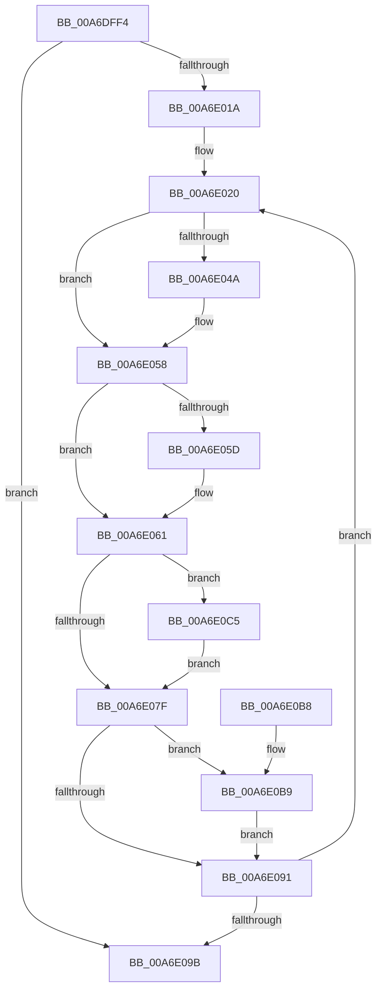

# PspStorageEmptyArray

- RVA: `0x00A6DFF4`–`0x00A6E0CF` (길이 `219` bytes)
- VA: `0x0000000140A6DFF4`
- 실행 섹션: `PAGE`
- PDB 이름 있음: `예`; PDB Function 태그: `아니요`
- unwind 정보 RVA: `0x00083650`
- 디코드: `62`개 명령, `219/219` bytes 표시
- 미해석 바이트: `0` (있으면 어셈블리에 `.byte`로 보존)

> 이 문서는 커널 이미지의 기계어와 PDB 기호를 분석해 생성했습니다. 4번과 5번은 함수 원형과 자료형을 바이너리 사용 방식에서 추정한 C 해석이며 원본 소스 복구 결과는 아닙니다.

## 1. Dependencies

- 직접 호출 지점: **6**; 고유 호출 대상: **6**
- 직접 호출자로 확인된 함수: **1**
- RIP 상대 이미지 참조: **0**

### Outgoing calls
- `0x00A6E03A` → [KeAbPreAcquire](../../text/21/KeAbPreAcquire_function_00210230.md) (function, `0x00210230`)
- `0x00A6E053` → [ExfAcquirePushLockExclusiveEx](../../text/20/ExfAcquirePushLockExclusiveEx_function_0020FC90.md) (function, `0x0020FC90`)
- `0x00A6E082` → [KeAbPostRelease](../../text/2E/KeAbPostRelease_function_002E1600.md) (function, `0x002E1600`)
- `0x00A6E087` → [KeLeaveCriticalRegion](../../text/25/KeLeaveCriticalRegion_function_0025D8B0.md) (function, `0x0025D8B0`)
- `0x00A6E0BC` → [ObfDereferenceObject](../../text/2F/ObfDereferenceObject_function_002F9350.md) (function, `0x002F9350`)
- `0x00A6E0C8` → [ExfTryToWakePushLock](../../text/26/ExfTryToWakePushLock_function_00265DD0.md) (function, `0x00265DD0`)

### Direct callers
- [PspJobDeleteStorageArrays](PspJobDeleteStorageArrays_function_00A6DF30.md) at `0x00A6DF5D`
- [PspJobDeleteStorageArrays](PspJobDeleteStorageArrays_function_00A6DF30.md) at `0x00A6DF89`

### Static image references
- 디코드된 RIP-relative 메모리 참조가 없습니다.

## 2. Other-region calls and transfers

- 다른 실행 섹션으로 향하는 call: **6**
  - `0x00A6E03A` → [KeAbPreAcquire](../../text/21/KeAbPreAcquire_function_00210230.md) (`PAGE` → `.text`)
  - `0x00A6E053` → [ExfAcquirePushLockExclusiveEx](../../text/20/ExfAcquirePushLockExclusiveEx_function_0020FC90.md) (`PAGE` → `.text`)
  - `0x00A6E082` → [KeAbPostRelease](../../text/2E/KeAbPostRelease_function_002E1600.md) (`PAGE` → `.text`)
  - `0x00A6E087` → [KeLeaveCriticalRegion](../../text/25/KeLeaveCriticalRegion_function_0025D8B0.md) (`PAGE` → `.text`)
  - `0x00A6E0BC` → [ObfDereferenceObject](../../text/2F/ObfDereferenceObject_function_002F9350.md) (`PAGE` → `.text`)
  - `0x00A6E0C8` → [ExfTryToWakePushLock](../../text/26/ExfTryToWakePushLock_function_00265DD0.md) (`PAGE` → `.text`)
- 별도 외부 분기/꼬리 이동을 확인하지 못했습니다.

## 3. Assembly (complete function range)

```asm
00A6DFF4  48 8B C4                        mov rax, rsp
00A6DFF7  48 89 58 08                     mov qword ptr [rax + 8], rbx
00A6DFFB  48 89 68 10                     mov qword ptr [rax + 0x10], rbp
00A6DFFF  48 89 70 18                     mov qword ptr [rax + 0x18], rsi
00A6E003  48 89 78 20                     mov qword ptr [rax + 0x20], rdi
00A6E007  41 56                           push r14
00A6E009  48 83 EC 20                     sub rsp, 0x20
00A6E00D  33 FF                           xor edi, edi
00A6E00F  48 8B D9                        mov rbx, rcx
00A6E012  85 D2                           test edx, edx
00A6E014  0F 84 81 00 00 00               je 0x140a6e09b
00A6E01A  8B EA                           mov ebp, edx
00A6E01C  49 83 CE FF                     or r14, 0xffffffffffffffff
00A6E020  65 48 8B 04 25 88 01 00 00      mov rax, qword ptr gs:[0x188]
00A6E029  45 33 C0                        xor r8d, r8d
00A6E02C  33 D2                           xor edx, edx
00A6E02E  48 8B CB                        mov rcx, rbx
00A6E031  66 44 01 B0 E4 01 00 00         add word ptr [rax + 0x1e4], r14w
00A6E039  90                              nop
00A6E03A  E8 F1 21 7A FF                  call 0x140210230
00A6E03F  F0 48 0F BA 2B 00               lock bts qword ptr [rbx], 0
00A6E045  48 8B F0                        mov rsi, rax
00A6E048  73 0E                           jae 0x140a6e058
00A6E04A  4C 8B C3                        mov r8, rbx
00A6E04D  48 8B D0                        mov rdx, rax
00A6E050  48 8B CB                        mov rcx, rbx
00A6E053  E8 38 1C 7A FF                  call 0x14020fc90
00A6E058  48 85 F6                        test rsi, rsi
00A6E05B  74 04                           je 0x140a6e061
00A6E05D  C6 46 0A 01                     mov byte ptr [rsi + 0xa], 1
00A6E061  48 8B 73 08                     mov rsi, qword ptr [rbx + 8]
00A6E065  49 8B C6                        mov rax, r14
00A6E068  48 83 E6 FE                     and rsi, 0xfffffffffffffffe
00A6E06C  48 C7 43 08 01 00 00 00         mov qword ptr [rbx + 8], 1
00A6E074  F0 48 0F C1 03                  lock xadd qword ptr [rbx], rax
00A6E079  24 06                           and al, 6
00A6E07B  3C 02                           cmp al, 2
00A6E07D  74 46                           je 0x140a6e0c5
00A6E07F  48 8B CB                        mov rcx, rbx
00A6E082  E8 79 35 87 FF                  call 0x1402e1600
00A6E087  E8 24 F8 7E FF                  call 0x14025d8b0
00A6E08C  48 85 F6                        test rsi, rsi
00A6E08F  75 28                           jne 0x140a6e0b9
00A6E091  48 83 C3 10                     add rbx, 0x10
00A6E095  48 83 ED 01                     sub rbp, 1
00A6E099  75 85                           jne 0x140a6e020
00A6E09B  48 8B 5C 24 30                  mov rbx, qword ptr [rsp + 0x30]
00A6E0A0  8B C7                           mov eax, edi
00A6E0A2  48 8B 7C 24 48                  mov rdi, qword ptr [rsp + 0x48]
00A6E0A7  48 8B 6C 24 38                  mov rbp, qword ptr [rsp + 0x38]
00A6E0AC  48 8B 74 24 40                  mov rsi, qword ptr [rsp + 0x40]
00A6E0B1  48 83 C4 20                     add rsp, 0x20
00A6E0B5  41 5E                           pop r14
00A6E0B7  C3                              ret
00A6E0B8  CC                              int3
00A6E0B9  48 8B CE                        mov rcx, rsi
00A6E0BC  E8 8F B2 88 FF                  call 0x1402f9350
00A6E0C1  FF C7                           inc edi
00A6E0C3  EB CC                           jmp 0x140a6e091
00A6E0C5  48 8B CB                        mov rcx, rbx
00A6E0C8  E8 03 7D 7F FF                  call 0x140265dd0
00A6E0CD  EB B0                           jmp 0x140a6e07f
```

## 4. C-style interpretation (structured pseudocode)

```c
__int64 __fastcall PspStorageEmptyArray(__int64 a1, int a2, int a3)
{
    __int64 result;
    __int64 v_r14;
    __int64 v_rbp;
    __int64 v_rbx;
    __int64 v_rdi;
    __int64 v_rsi;
    __int64 v_rsp;
    unsigned __int64 v_stack_p10;
    unsigned __int64 v_stack_p18;
    unsigned __int64 v_stack_p20;
    unsigned __int64 v_stack_p8;

    *(unsigned __int64 *)(v_rsp + 8) = v_rbx;
    *(unsigned __int64 *)(v_rsp + 16) = v_rbp;
    *(unsigned __int64 *)(v_rsp + 24) = v_rsi;
    *(unsigned __int64 *)(v_rsp + 32) = v_rdi;
    v_rsp = (v_rsp) - (32);
    v_rdi = 0;
    if (a2 == 0) goto loc_00A6E09B;
    v_r14 = (v_r14) | (-1);
loc_00A6E020:
    a3 = 0;
    a2 = 0;
    result = KeAbPreAcquire(a1, a2, a3, a4);
    if (!(condition_is_above_or_equal)) {
        a3 = a1;
        a2 = result;
        a1 = a1;
        result = ExfAcquirePushLockExclusiveEx(a1, a2, a3, a4);
    }
    if (result != 0) {
        *(unsigned __int8 *)(result + 10) = 1;
    }
    v_rsi = (*(unsigned __int64 *)(a1 + 8)) & (-2);
    *(unsigned __int64 *)(a1 + 8) = 1;
    result = (unsigned __int8)((v_r14) & (6));
    if (((unsigned __int8)(result)) == 2) goto loc_00A6E0C5;
loc_00A6E07F:
    result = KeAbPostRelease(a1, a2, a3, a4);
    result = KeLeaveCriticalRegion(a1, a2, a3, a4);
    if (v_rsi != 0) goto loc_00A6E0B9;
loc_00A6E091:
    v_rbx = (a1) + (16);
    v_rbp = ((unsigned int)(a2)) - (1);
    if (condition_is_not_equal) goto loc_00A6E020;
loc_00A6E09B:
    v_rsp = (v_rsp) + (32);
    return 0;
loc_00A6E0B9:
    result = ObfDereferenceObject(v_stack_p18, a2, a3, a4);
    v_rdi = (unsigned int)((v_stack_p20) + 1);
    goto loc_00A6E091;
loc_00A6E0C5:
    result = ExfTryToWakePushLock(v_stack_p8, a2, a3, a4);
    goto loc_00A6E07F;
}
```

## 5. (Beta) C Style

```c
int64_t PspStorageEmptyArray(void *Arg1, int32_t Arg2, int32_t Arg3)
{
    uint8_t *arg1 = (uint8_t *)Arg1;

    int64_t result;
    int64_t local_r14;
    int64_t local_rbp;
    int64_t local_rbx;
    int64_t local_rdi;
    int64_t local_rsi;
    int64_t local_rsp;
    uint64_t v_stack_p10;
    uint64_t v_stack_p18;
    uint64_t v_stack_p20;
    uint64_t v_stack_p8;

    *(uint64_t *)(local_rsp + 0x8) = local_rbx;
    *(uint64_t *)(local_rsp + 0x10) = local_rbp;
    *(uint64_t *)(local_rsp + 0x18) = local_rsi;
    *(uint64_t *)(local_rsp + 0x20) = local_rdi;
    local_rsp = (local_rsp) - (32);
    local_rdi = 0;
    if (Arg2 == 0) goto loc_00A6E09B;
    local_r14 = (local_r14) | (-1);
loc_00A6E020:
    Arg3 = 0;
    Arg2 = 0;
    result = KeAbPreAcquire(Arg1, Arg2, Arg3, a4);
    if (!(condition_is_above_or_equal)) {
        Arg3 = Arg1;
        Arg2 = result;
        Arg1 = Arg1;
        result = ExfAcquirePushLockExclusiveEx(Arg1, Arg2, Arg3, a4);
    }
    if (result != 0) {
        *(uint8_t *)(result + 0xA) = 1;
    }
    local_rsi = (*(uint64_t *)(arg1 + 0x8)) & (-2);
    *(uint64_t *)(arg1 + 0x8) = 1;
    result = (uint8_t)((local_r14) & (6));
    if (((uint8_t)(result)) == 2) goto loc_00A6E0C5;
loc_00A6E07F:
    result = KeAbPostRelease(Arg1, Arg2, Arg3, a4);
    result = KeLeaveCriticalRegion(Arg1, Arg2, Arg3, a4);
    if (local_rsi != 0) goto loc_00A6E0B9;
loc_00A6E091:
    local_rbx = (Arg1) + (16);
    local_rbp = ((uint32_t)(Arg2)) - (1);
    if (condition_is_not_equal) goto loc_00A6E020;
loc_00A6E09B:
    local_rsp = (local_rsp) + (32);
    return 0;
loc_00A6E0B9:
    result = ObfDereferenceObject(v_stack_p18, Arg2, Arg3, a4);
    local_rdi = (uint32_t)((v_stack_p20) + 1);
    goto loc_00A6E091;
loc_00A6E0C5:
    result = ExfTryToWakePushLock(v_stack_p8, Arg2, Arg3, a4);
    goto loc_00A6E07F;
}
```

### 관측된 메모리 오프셋

구조체 형식이 확인되지 않은 접근은 인자 기준의 오프셋으로만 기록했습니다.

| 기준 인자 | 오프셋 표현 | 폭 (bit) | 접근 |
|---|---:|---:|---|
| `Arg1` | `+ 0x0` | `64` | `R/W` |
| `Arg1` | `+ 0x8` | `64` | `R` |
| `Arg1` | `+ 0x8` | `64` | `W` |

## 6. Execution-region graph

[열기: 2D/3D 그래프와 함수 탐색 컨트롤 패널](../../../control-panel.html?section=page&rva=0x00A6DFF4&view=graph)

- 2D 그래프는 위에서 아래로 흐르고, 3D 그래프는 빈 공간을 드래그해 회전합니다. Shift+드래그는 이동, 휠은 확대·축소, 함수 노드 선택은 대상 보고서 이동입니다.

### Static fallback


