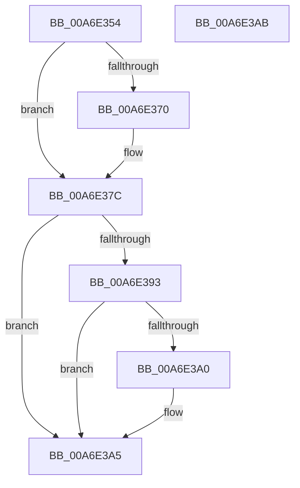

# PspUnlockJobListExclusive

- RVA: `0x00A6E354`–`0x00A6E3AC` (길이 `88` bytes)
- VA: `0x0000000140A6E354`
- 실행 섹션: `PAGE`
- PDB 이름 있음: `예`; PDB Function 태그: `아니요`
- unwind 정보 RVA: `0x0005CF00`
- 디코드: `24`개 명령, `88/88` bytes 표시
- 미해석 바이트: `0` (있으면 어셈블리에 `.byte`로 보존)

> 이 문서는 커널 이미지의 기계어와 PDB 기호를 분석해 생성했습니다. 4번과 5번은 함수 원형과 자료형을 바이너리 사용 방식에서 추정한 C 해석이며 원본 소스 복구 결과는 아닙니다.

## 1. Dependencies

- 직접 호출 지점: **3**; 고유 호출 대상: **3**
- 직접 호출자로 확인된 함수: **2**
- RIP 상대 이미지 참조: **2**

### Outgoing calls
- `0x00A6E377` → [ExfTryToWakePushLock](../../text/26/ExfTryToWakePushLock_function_00265DD0.md) (function, `0x00265DD0`)
- `0x00A6E383` → [KeAbPostRelease](../../text/2E/KeAbPostRelease_function_002E1600.md) (function, `0x002E1600`)
- `0x00A6E3A0` → [KiCheckForKernelApcDelivery](../../text/2E/KiCheckForKernelApcDelivery_function_002E2C80.md) (function, `0x002E2C80`)

### Direct callers
- [PspJobDelete](../../text/4B/PspJobDelete_function_004BF8F0.md) at `0x004BFB02`
- [NtCreateJobObject](../91/NtCreateJobObject_function_009177E0.md) at `0x009179E5`

### Static image references
- `0x00A6E361` → RVA `0x00FD9DA8` (`PAGEDATA`; read/write)
- `0x00A6E370` → RVA `0x00FD9DA8` (`PAGEDATA`; read)

## 2. Other-region calls and transfers

- 다른 실행 섹션으로 향하는 call: **3**
  - `0x00A6E377` → [ExfTryToWakePushLock](../../text/26/ExfTryToWakePushLock_function_00265DD0.md) (`PAGE` → `.text`)
  - `0x00A6E383` → [KeAbPostRelease](../../text/2E/KeAbPostRelease_function_002E1600.md) (`PAGE` → `.text`)
  - `0x00A6E3A0` → [KiCheckForKernelApcDelivery](../../text/2E/KiCheckForKernelApcDelivery_function_002E2C80.md) (`PAGE` → `.text`)
- 별도 외부 분기/꼬리 이동을 확인하지 못했습니다.

## 3. Assembly (complete function range)

```asm
00A6E354  40 53                           push rbx
00A6E356  48 83 EC 20                     sub rsp, 0x20
00A6E35A  48 8B D9                        mov rbx, rcx
00A6E35D  48 83 C8 FF                     or rax, 0xffffffffffffffff
00A6E361  F0 48 0F C1 05 3E BA 56 00      lock xadd qword ptr [rip + 0x56ba3e], rax
00A6E36A  24 06                           and al, 6
00A6E36C  3C 02                           cmp al, 2
00A6E36E  75 0C                           jne 0x140a6e37c
00A6E370  48 8D 0D 31 BA 56 00            lea rcx, [rip + 0x56ba31]
00A6E377  E8 54 7A 7F FF                  call 0x140265dd0
00A6E37C  48 8D 0D 25 BA 56 00            lea rcx, [rip + 0x56ba25]
00A6E383  E8 78 32 87 FF                  call 0x1402e1600
00A6E388  90                              nop
00A6E389  66 83 83 E6 01 00 00 01         add word ptr [rbx + 0x1e6], 1
00A6E391  75 12                           jne 0x140a6e3a5
00A6E393  48 8D 83 98 00 00 00            lea rax, [rbx + 0x98]
00A6E39A  90                              nop
00A6E39B  48 39 00                        cmp qword ptr [rax], rax
00A6E39E  74 05                           je 0x140a6e3a5
00A6E3A0  E8 DB 48 87 FF                  call 0x1402e2c80
00A6E3A5  48 83 C4 20                     add rsp, 0x20
00A6E3A9  5B                              pop rbx
00A6E3AA  C3                              ret
00A6E3AB  CC                              int3
```

## 4. C-style interpretation (structured pseudocode)

```c
__int64 __fastcall PspUnlockJobListExclusive(__int64 a1)
{
    __int64 result;
    __int64 v_rsp;

    v_rsp = (v_rsp) - (32);
    result = (result) | (-1);
    result = (unsigned __int8)((result) & (6));
    if (((unsigned __int8)(result)) == 2) {
        a1 = v_rip + 5683761;
        result = ExfTryToWakePushLock(a1, a2, a3, a4);
    }
    result = KeAbPostRelease(v_rip + 5683749, a2, a3, a4);
    if (((unsigned __int8)(result)) != 2) goto loc_00A6E3A5;
    result = a1 + 152;
    if ((*(unsigned __int64 *)(a1 + 152)) != (a1 + 152)) {
        result = KiCheckForKernelApcDelivery(v_rip + 5683749, a2, a3, a4);
    }
    v_rsp = (v_rsp) + (32);
    return result;
}
```

## 5. (Beta) C Style

```c
int64_t PspUnlockJobListExclusive(void *Arg1)
{
    uint8_t *arg1 = (uint8_t *)Arg1;

    int64_t result;
    int64_t local_rsp;

    local_rsp = (local_rsp) - (32);
    result = (result) | (-1);
    result = (uint8_t)((result) & (6));
    if (((uint8_t)(result)) == 2) {
        Arg1 = v_rip + 5683761;
        result = ExfTryToWakePushLock(Arg1, a2, a3, a4);
    }
    result = KeAbPostRelease(v_rip + 5683749, a2, a3, a4);
    if (((uint8_t)(result)) != 2) goto loc_00A6E3A5;
    result = Arg1 + 152;
    if ((*(uint64_t *)(arg1 + 0x98)) != (Arg1 + 152)) {
        result = KiCheckForKernelApcDelivery(v_rip + 5683749, a2, a3, a4);
    }
    local_rsp = (local_rsp) + (32);
    return result;
}
```

### 관측된 메모리 오프셋

구조체 형식이 확인되지 않은 접근은 인자 기준의 오프셋으로만 기록했습니다.

| 기준 인자 | 오프셋 표현 | 폭 (bit) | 접근 |
|---|---:|---:|---|
| `Arg1` | `+ 0x0` | `64` | `R` |
| `Arg1` | `+ 0x98` | `64` | `R` |
| `Arg1` | `+ 0x1E6` | `16` | `R/W` |

## 6. Execution-region graph

[열기: 2D/3D 그래프와 함수 탐색 컨트롤 패널](../../../control-panel.html?section=page&rva=0x00A6E354&view=graph)

- 2D 그래프는 위에서 아래로 흐르고, 3D 그래프는 빈 공간을 드래그해 회전합니다. Shift+드래그는 이동, 휠은 확대·축소, 함수 노드 선택은 대상 보고서 이동입니다.

### Static fallback


