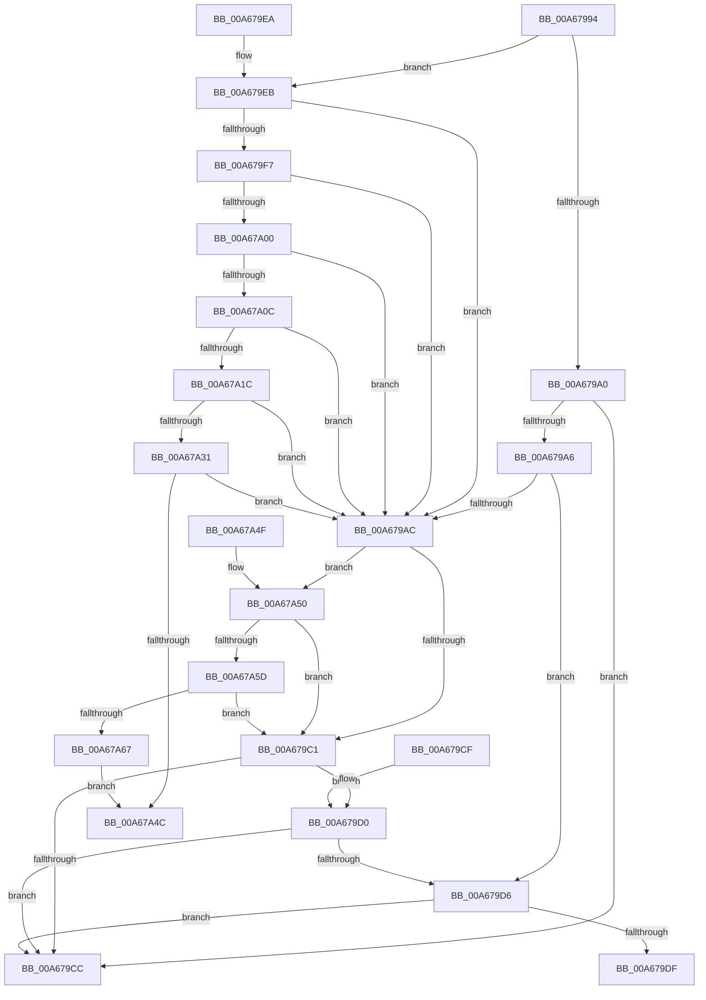

# PspValidateJobAssignmentMemoryPartition

- RVA: `0x00A67994`–`0x00A67A69` (길이 `213` bytes)
- VA: `0x0000000140A67994`
- 실행 섹션: `PAGE`
- PDB 이름 있음: `예`; PDB Function 태그: `아니요`
- unwind 정보 RVA: `0x000DB714`
- 디코드: `52`개 명령, `213/213` bytes 표시
- 미해석 바이트: `0` (있으면 어셈블리에 `.byte`로 보존)

> 이 문서는 커널 이미지의 기계어와 PDB 기호를 분석해 생성했습니다. 4번과 5번은 함수 원형과 자료형을 바이너리 사용 방식에서 추정한 C 해석이며 원본 소스 복구 결과는 아닙니다.

## 1. Dependencies

- 직접 호출 지점: **0**; 고유 호출 대상: **0**
- 직접 호출자로 확인된 함수: **1**
- RIP 상대 이미지 참조: **0**

### Outgoing calls
- 직접 디코드된 call 명령이 없습니다.

### Direct callers
- [PspAssignProcessToJob](../A2/PspAssignProcessToJob_function_00A23370.md) at `0x00A23572`

### Static image references
- 디코드된 RIP-relative 메모리 참조가 없습니다.

## 2. Other-region calls and transfers

- 다른 실행 섹션으로 향하는 call: **0**
- 별도 외부 분기/꼬리 이동을 확인하지 못했습니다.

## 3. Assembly (complete function range)

```asm
00A67994  45 33 DB                        xor r11d, r11d
00A67997  4C 8B D1                        mov r10, rcx
00A6799A  41 83 F9 04                     cmp r9d, 4
00A6799E  74 4B                           je 0x140a679eb
00A679A0  41 83 F9 06                     cmp r9d, 6
00A679A4  74 26                           je 0x140a679cc
00A679A6  41 83 F9 07                     cmp r9d, 7
00A679AA  74 2A                           je 0x140a679d6
00A679AC  49 8B 8A 00 07 00 00            mov rcx, qword ptr [r10 + 0x700]
00A679B3  48 8D 41 FF                     lea rax, [rcx - 1]
00A679B7  48 83 F8 FD                     cmp rax, -3
00A679BB  0F 86 8F 00 00 00               jbe 0x140a67a50
00A679C1  41 8D 41 FC                     lea eax, [r9 - 4]
00A679C5  A9 FC FF FF FF                  test eax, 0xfffffffc
00A679CA  74 04                           je 0x140a679d0
00A679CC  B0 01                           mov al, 1
00A679CE  C3                              ret
00A679CF  CC                              int3
00A679D0  41 83 F9 06                     cmp r9d, 6
00A679D4  74 F6                           je 0x140a679cc
00A679D6  4D 39 9A 00 07 00 00            cmp qword ptr [r10 + 0x700], r11
00A679DD  74 ED                           je 0x140a679cc
00A679DF  4C 39 9A 00 07 00 00            cmp qword ptr [rdx + 0x700], r11
00A679E6  0F 94 C0                        sete al
00A679E9  C3                              ret
00A679EA  CC                              int3
00A679EB  48 8D 81 08 05 00 00            lea rax, [rcx + 0x508]
00A679F2  48 39 00                        cmp qword ptr [rax], rax
00A679F5  75 B5                           jne 0x140a679ac
00A679F7  4C 39 99 00 07 00 00            cmp qword ptr [rcx + 0x700], r11
00A679FE  75 AC                           jne 0x140a679ac
00A67A00  49 8B 80 A0 02 00 00            mov rax, qword ptr [r8 + 0x2a0]
00A67A07  48 85 C0                        test rax, rax
00A67A0A  74 A0                           je 0x140a679ac
00A67A0C  49 8B 80 A0 02 00 00            mov rax, qword ptr [r8 + 0x2a0]
00A67A13  4C 39 98 00 07 00 00            cmp qword ptr [rax + 0x700], r11
00A67A1A  74 90                           je 0x140a679ac
00A67A1C  49 8B 80 A0 02 00 00            mov rax, qword ptr [r8 + 0x2a0]
00A67A23  48 83 B8 00 07 00 00 FF         cmp qword ptr [rax + 0x700], -1
00A67A2B  0F 84 7B FF FF FF               je 0x140a679ac
00A67A31  49 8B 80 A0 02 00 00            mov rax, qword ptr [r8 + 0x2a0]
00A67A38  48 8B 88 00 07 00 00            mov rcx, qword ptr [rax + 0x700]
00A67A3F  49 3B 88 58 07 00 00            cmp rcx, qword ptr [r8 + 0x758]
00A67A46  0F 84 60 FF FF FF               je 0x140a679ac
00A67A4C  32 C0                           xor al, al
00A67A4E  C3                              ret
00A67A4F  CC                              int3
00A67A50  49 39 88 58 07 00 00            cmp qword ptr [r8 + 0x758], rcx
00A67A57  0F 84 64 FF FF FF               je 0x140a679c1
00A67A5D  4C 3B 41 78                     cmp r8, qword ptr [rcx + 0x78]
00A67A61  0F 84 5A FF FF FF               je 0x140a679c1
00A67A67  EB E3                           jmp 0x140a67a4c
```

## 4. C-style interpretation (structured pseudocode)

```c
__int64 __fastcall PspValidateJobAssignmentMemoryPartition(__int64 a1, __int64 a2, __int64 a3, __int64 a4)
{
    __int64 result;
    __int64 v_r11;

    v_r11 = 0;
    if (((unsigned int)(a4)) == 4) goto loc_00A679EB;
    if (((unsigned int)(a4)) == 6) goto loc_00A679CC;
    if (((unsigned int)(a4)) == 7) goto loc_00A679D6;
loc_00A679AC:
    if ((*(unsigned __int64 *)(a1 + 1792) - 1) <= -3) goto loc_00A67A50;
loc_00A679C1:
    if ((((unsigned int)(a4 - 4)) & (0xFFFFFFFCULL)) == 0) goto loc_00A679D0;
loc_00A679CC:
    return 1;
loc_00A679D0:
    if (((unsigned int)(a4)) == 6) goto loc_00A679CC;
loc_00A679D6:
    if ((*(unsigned __int64 *)(a1 + 1792)) == 0) goto loc_00A679CC;
    result = ((*(unsigned __int64 *)(a2 + 1792)) == 0) ? 1 : 0;
    return result;
loc_00A679EB:
    if ((*(unsigned __int64 *)(*(unsigned __int64 *)(a1 + 1792) + 1288)) != (*(unsigned __int64 *)(a1 + 1792) + 1288)) goto loc_00A679AC;
    if ((*(unsigned __int64 *)(*(unsigned __int64 *)(a1 + 1792) + 1792)) != 0) goto loc_00A679AC;
    if (*(unsigned __int64 *)(a3 + 672) == 0) goto loc_00A679AC;
    if ((*(unsigned __int64 *)(*(unsigned __int64 *)(a3 + 672) + 1792)) == 0) goto loc_00A679AC;
    if ((*(unsigned __int64 *)(*(unsigned __int64 *)(a3 + 672) + 1792)) == -1) goto loc_00A679AC;
    if ((*(unsigned __int64 *)(*(unsigned __int64 *)(a3 + 672) + 1792)) == (*(unsigned __int64 *)(a3 + 1880))) goto loc_00A679AC;
loc_00A67A4C:
    result = 0;
    return result;
loc_00A67A50:
    if ((*(unsigned __int64 *)(a3 + 1880)) == (*(unsigned __int64 *)(*(unsigned __int64 *)(a3 + 672) + 1792))) goto loc_00A679C1;
    if (a3 == (*(unsigned __int64 *)(*(unsigned __int64 *)(*(unsigned __int64 *)(a3 + 672) + 1792) + 120))) goto loc_00A679C1;
    goto loc_00A67A4C;
}
```

## 5. (Beta) C Style

```c
int64_t PspValidateJobAssignmentMemoryPartition(void *Arg1, void *Arg2, void *Arg3, int64_t Arg4)
{
    uint8_t *arg1 = (uint8_t *)Arg1;
    uint8_t *arg2 = (uint8_t *)Arg2;
    uint8_t *arg3 = (uint8_t *)Arg3;

    int64_t result;
    int64_t local_r11;

    local_r11 = 0;
    if (((uint32_t)(Arg4)) == 4) goto loc_00A679EB;
    if (((uint32_t)(Arg4)) == 6) goto loc_00A679CC;
    if (((uint32_t)(Arg4)) == 7) goto loc_00A679D6;
loc_00A679AC:
    if ((*(uint64_t *)(arg1 + 0x700) - 1) <= -3) goto loc_00A67A50;
loc_00A679C1:
    if ((((uint32_t)(Arg4 - 4)) & (0xFFFFFFFCULL)) == 0) goto loc_00A679D0;
loc_00A679CC:
    return 1;
loc_00A679D0:
    if (((uint32_t)(Arg4)) == 6) goto loc_00A679CC;
loc_00A679D6:
    if ((*(uint64_t *)(arg1 + 0x700)) == 0) goto loc_00A679CC;
    result = ((*(uint64_t *)(arg2 + 0x700)) == 0) ? 1 : 0;
    return result;
loc_00A679EB:
    if ((*(uint64_t *)(*(uint64_t *)(arg1 + 0x700) + 0x508)) != (*(uint64_t *)(arg1 + 0x700) + 1288)) goto loc_00A679AC;
    if ((*(uint64_t *)(*(uint64_t *)(arg1 + 0x700) + 0x700)) != 0) goto loc_00A679AC;
    if (*(uint64_t *)(arg3 + 0x2A0) == 0) goto loc_00A679AC;
    if ((*(uint64_t *)(*(uint64_t *)(arg3 + 0x2A0) + 0x700)) == 0) goto loc_00A679AC;
    if ((*(uint64_t *)(*(uint64_t *)(arg3 + 0x2A0) + 0x700)) == -1) goto loc_00A679AC;
    if ((*(uint64_t *)(*(uint64_t *)(arg3 + 0x2A0) + 0x700)) == (*(uint64_t *)(arg3 + 0x758))) goto loc_00A679AC;
loc_00A67A4C:
    result = 0;
    return result;
loc_00A67A50:
    if ((*(uint64_t *)(arg3 + 0x758)) == (*(uint64_t *)(*(uint64_t *)(arg3 + 0x2A0) + 0x700))) goto loc_00A679C1;
    if (Arg3 == (*(uint64_t *)(*(uint64_t *)(*(uint64_t *)(arg3 + 0x2A0) + 0x700) + 0x78))) goto loc_00A679C1;
    goto loc_00A67A4C;
}
```

### 관측된 메모리 오프셋

구조체 형식이 확인되지 않은 접근은 인자 기준의 오프셋으로만 기록했습니다.

| 기준 인자 | 오프셋 표현 | 폭 (bit) | 접근 |
|---|---:|---:|---|
| `Arg1` | `+ 0x0` | `64` | `R` |
| `Arg1` | `+ 0x508` | `64` | `R` |
| `Arg1` | `+ 0x700` | `64` | `R` |
| `Arg2` | `+ 0x700` | `64` | `R` |
| `Arg3` | `+ 0x2A0` | `64` | `R` |
| `Arg3` | `+ 0x758` | `64` | `R` |

## 6. Execution-region graph

[열기: 2D/3D 그래프와 함수 탐색 컨트롤 패널](../../../control-panel.html?section=page&rva=0x00A67994&view=graph)

- 2D 그래프는 위에서 아래로 흐르고, 3D 그래프는 빈 공간을 드래그해 회전합니다. Shift+드래그는 이동, 휠은 확대·축소, 함수 노드 선택은 대상 보고서 이동입니다.

### Static fallback


