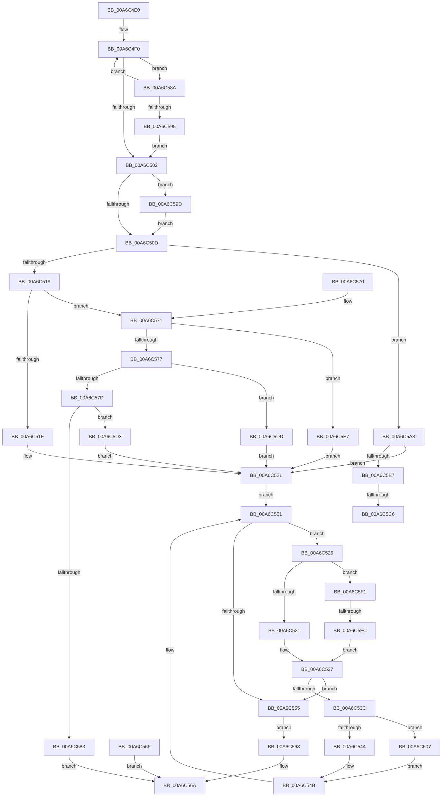

# RtlCharToInteger

- RVA: `0x00A6C4E0`–`0x00A6C614` (길이 `308` bytes)
- VA: `0x0000000140A6C4E0`
- 실행 섹션: `PAGE`
- PDB 이름 있음: `예`; PDB Function 태그: `예`
- unwind 정보 RVA: `0x000B4458`
- 디코드: `91`개 명령, `308/308` bytes 표시
- 미해석 바이트: `0` (있으면 어셈블리에 `.byte`로 보존)

> 이 문서는 커널 이미지의 기계어와 PDB 기호를 분석해 생성했습니다. 4번과 5번은 함수 원형과 자료형을 바이너리 사용 방식에서 추정한 C 해석이며 원본 소스 복구 결과는 아닙니다.

## 1. Dependencies

- 직접 호출 지점: **0**; 고유 호출 대상: **0**
- 직접 호출자로 확인된 함수: **2**
- RIP 상대 이미지 참조: **0**

### Outgoing calls
- 직접 디코드된 call 명령이 없습니다.

### Direct callers
- [IopCheckDiskName](../../text/59/IopCheckDiskName_function_00597EB8.md) at `0x00597F33`
- [EmpParseTargetRuleStringIndexList](../../init/C2/EmpParseTargetRuleStringIndexList_function_00C2795C.md) at `0x00C27BD6`

### Static image references
- 디코드된 RIP-relative 메모리 참조가 없습니다.

## 2. Other-region calls and transfers

- 다른 실행 섹션으로 향하는 call: **0**
- call이 아닌 외부 분기/꼬리 이동: **3**
  - `0x00A6C5C0` → [sub_00B3F334](../B3/Unknown_function_00B3F334.md) (`tail-transfer`)
  - `0x00A6C5CE` → [sub_00B3F334 + 0x1E](../B3/Unknown_function_00B3F334.md) (`tail-transfer`)
  - `0x00A6C5F6` → [sub_00B3F334 + 0x2E](../B3/Unknown_function_00B3F334.md) (`tail-transfer`)

## 3. Assembly (complete function range)

```asm
00A6C4E0  48 89 5C 24 08                  mov qword ptr [rsp + 8], rbx
00A6C4E5  4D 8B D8                        mov r11, r8
00A6C4E8  44 8B D2                        mov r10d, edx
00A6C4EB  4C 8B C9                        mov r9, rcx
00A6C4EE  8A 01                           mov al, byte ptr [rcx]
00A6C4F0  49 8B D1                        mov rdx, r9
00A6C4F3  8A C8                           mov cl, al
00A6C4F5  8A D8                           mov bl, al
00A6C4F7  49 FF C1                        inc r9
00A6C4FA  3C 20                           cmp al, 0x20
00A6C4FC  0F 8E 88 00 00 00               jle 0x140a6c58a
00A6C502  8D 41 D5                        lea eax, [rcx - 0x2b]
00A6C505  A8 FD                           test al, 0xfd
00A6C507  0F 84 90 00 00 00               je 0x140a6c59d
00A6C50D  49 8B C1                        mov rax, r9
00A6C510  45 85 D2                        test r10d, r10d
00A6C513  0F 84 8F 00 00 00               je 0x140a6c5a8
00A6C519  41 83 FA 0A                     cmp r10d, 0xa
00A6C51D  75 52                           jne 0x140a6c571
00A6C51F  33 D2                           xor edx, edx
00A6C521  45 33 C0                        xor r8d, r8d
00A6C524  EB 2B                           jmp 0x140a6c551
00A6C526  8D 41 D0                        lea eax, [rcx - 0x30]
00A6C529  3C 09                           cmp al, 9
00A6C52B  0F 87 C0 00 00 00               ja 0x140a6c5f1
00A6C531  0F BE C1                        movsx eax, cl
00A6C534  83 E8 30                        sub eax, 0x30
00A6C537  41 3B C2                        cmp eax, r10d
00A6C53A  73 19                           jae 0x140a6c555
00A6C53C  85 D2                           test edx, edx
00A6C53E  0F 85 C3 00 00 00               jne 0x140a6c607
00A6C544  45 0F AF C2                     imul r8d, r10d
00A6C548  44 03 C0                        add r8d, eax
00A6C54B  41 8A 09                        mov cl, byte ptr [r9]
00A6C54E  49 FF C1                        inc r9
00A6C551  84 C9                           test cl, cl
00A6C553  75 D1                           jne 0x140a6c526
00A6C555  41 8B C0                        mov eax, r8d
00A6C558  F7 D8                           neg eax
00A6C55A  80 FB 2D                        cmp bl, 0x2d
00A6C55D  41 0F 45 C0                     cmovne eax, r8d
00A6C561  41 89 03                        mov dword ptr [r11], eax
00A6C564  EB 02                           jmp 0x140a6c568
00A6C566  EB 02                           jmp 0x140a6c56a
00A6C568  33 C0                           xor eax, eax
00A6C56A  48 8B 5C 24 08                  mov rbx, qword ptr [rsp + 8]
00A6C56F  C3                              ret
00A6C570  CC                              int3
00A6C571  41 83 FA 02                     cmp r10d, 2
00A6C575  74 70                           je 0x140a6c5e7
00A6C577  41 83 FA 08                     cmp r10d, 8
00A6C57B  74 60                           je 0x140a6c5dd
00A6C57D  41 83 FA 10                     cmp r10d, 0x10
00A6C581  74 50                           je 0x140a6c5d3
00A6C583  B8 0D 00 00 C0                  mov eax, 0xc000000d
00A6C588  EB E0                           jmp 0x140a6c56a
00A6C58A  41 8A 01                        mov al, byte ptr [r9]
00A6C58D  84 C0                           test al, al
00A6C58F  0F 85 5B FF FF FF               jne 0x140a6c4f0
00A6C595  4C 8B CA                        mov r9, rdx
00A6C598  E9 65 FF FF FF                  jmp 0x140a6c502
00A6C59D  41 8A 09                        mov cl, byte ptr [r9]
00A6C5A0  49 FF C1                        inc r9
00A6C5A3  E9 65 FF FF FF                  jmp 0x140a6c50d
00A6C5A8  33 D2                           xor edx, edx
00A6C5AA  44 8D 52 0A                     lea r10d, [rdx + 0xa]
00A6C5AE  80 F9 30                        cmp cl, 0x30
00A6C5B1  0F 85 6A FF FF FF               jne 0x140a6c521
00A6C5B7  41 8A 09                        mov cl, byte ptr [r9]
00A6C5BA  49 FF C1                        inc r9
00A6C5BD  80 F9 78                        cmp cl, 0x78
00A6C5C0  0F 85 6E 2D 0D 00               jne 0x140b3f334
00A6C5C6  41 8D 52 FA                     lea edx, [r10 - 6]
00A6C5CA  44 8D 52 0C                     lea r10d, [rdx + 0xc]
00A6C5CE  E9 7F 2D 0D 00                  jmp 0x140b3f352
00A6C5D3  BA 04 00 00 00                  mov edx, 4
00A6C5D8  E9 44 FF FF FF                  jmp 0x140a6c521
00A6C5DD  BA 03 00 00 00                  mov edx, 3
00A6C5E2  E9 3A FF FF FF                  jmp 0x140a6c521
00A6C5E7  BA 01 00 00 00                  mov edx, 1
00A6C5EC  E9 30 FF FF FF                  jmp 0x140a6c521
00A6C5F1  8D 41 BF                        lea eax, [rcx - 0x41]
00A6C5F4  3C 05                           cmp al, 5
00A6C5F6  0F 87 66 2D 0D 00               ja 0x140b3f362
00A6C5FC  0F BE C1                        movsx eax, cl
00A6C5FF  83 E8 37                        sub eax, 0x37
00A6C602  E9 30 FF FF FF                  jmp 0x140a6c537
00A6C607  8B CA                           mov ecx, edx
00A6C609  41 D3 E0                        shl r8d, cl
00A6C60C  44 0B C0                        or r8d, eax
00A6C60F  E9 37 FF FF FF                  jmp 0x140a6c54b
```

## 4. C-style interpretation (structured pseudocode)

```c
__int64 __fastcall RtlCharToInteger(__int64 a1, int a2, __int64 a3)
{
    __int64 result;
    unsigned __int64 v_stack_p8;

    v_stack_p8 = v_rbx;
loc_00A6C4F0:
    a4 = (a1) + 1;
    if (((unsigned __int8)(*(unsigned __int8 *)(a1))) <= 32) goto loc_00A6C58A;
loc_00A6C502:
    if ((((unsigned __int8)((unsigned __int8)(*(unsigned __int8 *)(a1)) - 43)) & (253)) == 0) goto loc_00A6C59D;
loc_00A6C50D:
    if ((unsigned int)((unsigned int)(a2)) == 0) goto loc_00A6C5A8;
    if (((unsigned int)((unsigned int)(a2))) != 10) goto loc_00A6C571;
    a2 = 0;
loc_00A6C521:
    a3 = 0;
    goto loc_00A6C551;
loc_00A6C526:
    if (((unsigned __int8)((unsigned __int8)(*(unsigned __int8 *)(a1)) - 48)) > 9) goto loc_00A6C5F1;
    result = (unsigned int)(((__int8)((unsigned __int8)((unsigned __int8)(*(unsigned __int8 *)(a1))))) - (48));
loc_00A6C537:
    if (((unsigned int)(result)) >= ((unsigned int)((unsigned int)(a2)))) goto loc_00A6C555;
    if (0 != 0) goto loc_00A6C607;
    a3 = (unsigned int)((a3) * ((unsigned int)((unsigned int)(a2))));
    a3 = (unsigned int)((a3) + ((unsigned int)(result)));
loc_00A6C54B:
    a4 = (a4) + 1;
loc_00A6C551:
    if ((unsigned __int8)(*(unsigned __int8 *)(a4)) != 0) goto loc_00A6C526;
loc_00A6C555:
    result = (unsigned int)(-((unsigned int)((unsigned int)(a3))));
    if (((unsigned __int8)((unsigned __int8)(*(unsigned __int8 *)(a1)))) != 45) { result = (unsigned int)(a3); }
    *(unsigned int *)(a3) = (unsigned int)(result);
    goto loc_00A6C568;
loc_00A6C568:
    result = 0;
loc_00A6C56A:
    return result;
loc_00A6C571:
    if (((unsigned int)((unsigned int)(a2))) == 2) goto loc_00A6C5E7;
    if (((unsigned int)((unsigned int)(a2))) == 8) goto loc_00A6C5DD;
    if (((unsigned int)((unsigned int)(a2))) == 16) goto loc_00A6C5D3;
    goto loc_00A6C56A;
loc_00A6C58A:
    if ((unsigned __int8)(*(unsigned __int8 *)(a4)) != 0) goto loc_00A6C4F0;
    goto loc_00A6C502;
loc_00A6C59D:
    a4 = (0) + 1;
    goto loc_00A6C50D;
loc_00A6C5A8:
    a2 = 0;
    if (((unsigned __int8)(*(unsigned __int8 *)(0))) != 48) goto loc_00A6C521;
    a4 = (a4) + 1;
loc_00A6C5D3:
    goto loc_00A6C521;
loc_00A6C5DD:
    goto loc_00A6C521;
loc_00A6C5E7:
    goto loc_00A6C521;
loc_00A6C5F1:
    result = (unsigned int)(((__int8)((unsigned __int8)(*(unsigned __int8 *)(a4)))) - (55));
    goto loc_00A6C537;
loc_00A6C607:
    a3 = (unsigned int)((a3) << (1));
    a3 = (unsigned int)((a3) | ((unsigned int)(result)));
    goto loc_00A6C54B;
}
```

## 5. (Beta) C Style

```c
int64_t RtlCharToInteger(void *Arg1, int32_t Arg2, void *Arg3)
{
    uint8_t *arg1 = (uint8_t *)Arg1;
    uint8_t *arg3 = (uint8_t *)Arg3;

    int64_t result;
    uint64_t v_stack_p8;

    v_stack_p8 = local_rbx;
loc_00A6C4F0:
    a4 = (Arg1) + 1;
    if (((uint8_t)(*(uint8_t *)(arg1))) <= 32) goto loc_00A6C58A;
loc_00A6C502:
    if ((((uint8_t)((uint8_t)(*(uint8_t *)(arg1)) - 43)) & (253)) == 0) goto loc_00A6C59D;
loc_00A6C50D:
    if ((uint32_t)((uint32_t)(Arg2)) == 0) goto loc_00A6C5A8;
    if (((uint32_t)((uint32_t)(Arg2))) != 10) goto loc_00A6C571;
    Arg2 = 0;
loc_00A6C521:
    Arg3 = 0;
    goto loc_00A6C551;
loc_00A6C526:
    if (((uint8_t)((uint8_t)(*(uint8_t *)(arg1)) - 48)) > 9) goto loc_00A6C5F1;
    result = (uint32_t)(((int8_t)((uint8_t)((uint8_t)(*(uint8_t *)(arg1))))) - (48));
loc_00A6C537:
    if (((uint32_t)(result)) >= ((uint32_t)((uint32_t)(Arg2)))) goto loc_00A6C555;
    if (0 != 0) goto loc_00A6C607;
    Arg3 = (uint32_t)((Arg3) * ((uint32_t)((uint32_t)(Arg2))));
    Arg3 = (uint32_t)((Arg3) + ((uint32_t)(result)));
loc_00A6C54B:
    a4 = (a4) + 1;
loc_00A6C551:
    if ((uint8_t)(*(uint8_t *)(a4)) != 0) goto loc_00A6C526;
loc_00A6C555:
    result = (uint32_t)(-((uint32_t)((uint32_t)(Arg3))));
    if (((uint8_t)((uint8_t)(*(uint8_t *)(arg1)))) != 45) { result = (uint32_t)(Arg3); }
    *(uint32_t *)(arg3) = (uint32_t)(result);
    goto loc_00A6C568;
loc_00A6C568:
    result = 0;
loc_00A6C56A:
    return result;
loc_00A6C571:
    if (((uint32_t)((uint32_t)(Arg2))) == 2) goto loc_00A6C5E7;
    if (((uint32_t)((uint32_t)(Arg2))) == 8) goto loc_00A6C5DD;
    if (((uint32_t)((uint32_t)(Arg2))) == 16) goto loc_00A6C5D3;
    goto loc_00A6C56A;
loc_00A6C58A:
    if ((uint8_t)(*(uint8_t *)(a4)) != 0) goto loc_00A6C4F0;
    goto loc_00A6C502;
loc_00A6C59D:
    a4 = (0) + 1;
    goto loc_00A6C50D;
loc_00A6C5A8:
    Arg2 = 0;
    if (((uint8_t)(*(uint8_t *)(0))) != 48) goto loc_00A6C521;
    a4 = (a4) + 1;
loc_00A6C5D3:
    goto loc_00A6C521;
loc_00A6C5DD:
    goto loc_00A6C521;
loc_00A6C5E7:
    goto loc_00A6C521;
loc_00A6C5F1:
    result = (uint32_t)(((int8_t)((uint8_t)(*(uint8_t *)(a4)))) - (55));
    goto loc_00A6C537;
loc_00A6C607:
    Arg3 = (uint32_t)((Arg3) << (1));
    Arg3 = (uint32_t)((Arg3) | ((uint32_t)(result)));
    goto loc_00A6C54B;
}
```

### 관측된 메모리 오프셋

구조체 형식이 확인되지 않은 접근은 인자 기준의 오프셋으로만 기록했습니다.

| 기준 인자 | 오프셋 표현 | 폭 (bit) | 접근 |
|---|---:|---:|---|
| `Arg1` | `+ 0x0` | `8` | `R` |
| `Arg3` | `+ 0x0` | `32` | `W` |

## 6. Execution-region graph

[열기: 2D/3D 그래프와 함수 탐색 컨트롤 패널](../../../control-panel.html?section=page&rva=0x00A6C4E0&view=graph)

- 2D 그래프는 위에서 아래로 흐르고, 3D 그래프는 빈 공간을 드래그해 회전합니다. Shift+드래그는 이동, 휠은 확대·축소, 함수 노드 선택은 대상 보고서 이동입니다.

### Static fallback


