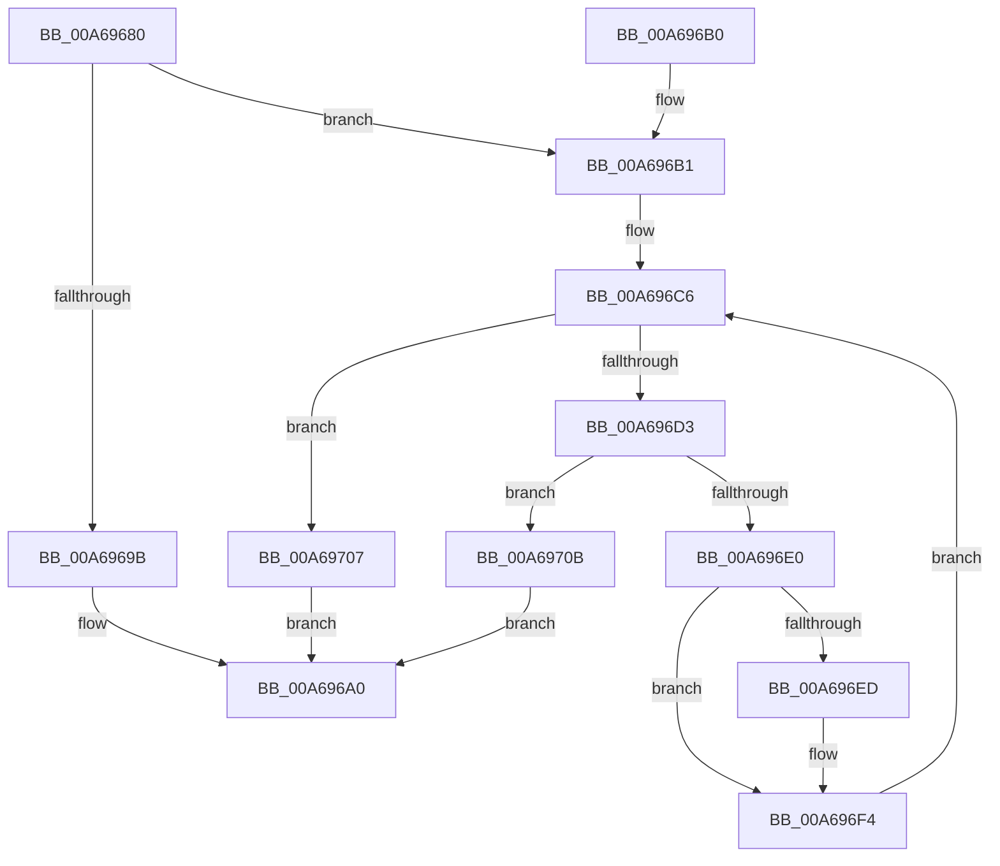

# RtlCopyRangeList

- RVA: `0x00A69680`–`0x00A6971A` (길이 `154` bytes)
- VA: `0x0000000140A69680`
- 실행 섹션: `PAGE`
- PDB 이름 있음: `예`; PDB Function 태그: `아니요`
- unwind 정보 RVA: `0x000B4134`
- 디코드: `48`개 명령, `154/154` bytes 표시
- 미해석 바이트: `0` (있으면 어셈블리에 `.byte`로 보존)

> 이 문서는 커널 이미지의 기계어와 PDB 기호를 분석해 생성했습니다. 4번과 5번은 함수 원형과 자료형을 바이너리 사용 방식에서 추정한 C 해석이며 원본 소스 복구 결과는 아닙니다.

## 1. Dependencies

- 직접 호출 지점: **2**; 고유 호출 대상: **2**
- 직접 호출자로 확인된 함수: **5**
- RIP 상대 이미지 참조: **0**

### Outgoing calls
- `0x00A696D6` → [RtlpCopyRangeListEntry](RtlpCopyRangeListEntry_function_00A69720.md) (function, `0x00A69720`)
- `0x00A6970E` → [RtlFreeRangeList](RtlFreeRangeList_function_00A69850.md) (function, `0x00A69850`)

### Direct callers
- [ArbBootAllocation](../70/ArbBootAllocation_function_0070E290.md) at `0x0070E308`
- [ArbQueryConflict](../70/ArbQueryConflict_function_0070F410.md) at `0x0070F4BC`
- [ArbRetestAllocation](../70/ArbRetestAllocation_function_0070F940.md) at `0x0070F9BE`
- [ArbTestAllocation](../70/ArbTestAllocation_function_0070FD90.md) at `0x0070FDBF`
- [RtlMergeRangeLists](../78/RtlMergeRangeLists_function_0078AA40.md) at `0x0078AA66`

### Static image references
- 디코드된 RIP-relative 메모리 참조가 없습니다.

## 2. Other-region calls and transfers

- 다른 실행 섹션으로 향하는 call: **0**
- 별도 외부 분기/꼬리 이동을 확인하지 못했습니다.

## 3. Assembly (complete function range)

```asm
00A69680  48 89 5C 24 08                  mov qword ptr [rsp + 8], rbx
00A69685  48 89 74 24 10                  mov qword ptr [rsp + 0x10], rsi
00A6968A  57                              push rdi
00A6968B  48 83 EC 20                     sub rsp, 0x20
00A6968F  83 79 14 00                     cmp dword ptr [rcx + 0x14], 0
00A69693  48 8B FA                        mov rdi, rdx
00A69696  48 8B D9                        mov rbx, rcx
00A69699  74 16                           je 0x140a696b1
00A6969B  B8 0D 00 00 C0                  mov eax, 0xc000000d
00A696A0  48 8B 5C 24 30                  mov rbx, qword ptr [rsp + 0x30]
00A696A5  48 8B 74 24 38                  mov rsi, qword ptr [rsp + 0x38]
00A696AA  48 83 C4 20                     add rsp, 0x20
00A696AE  5F                              pop rdi
00A696AF  C3                              ret
00A696B0  CC                              int3
00A696B1  8B 42 10                        mov eax, dword ptr [rdx + 0x10]
00A696B4  89 41 10                        mov dword ptr [rcx + 0x10], eax
00A696B7  8B 42 14                        mov eax, dword ptr [rdx + 0x14]
00A696BA  89 41 14                        mov dword ptr [rcx + 0x14], eax
00A696BD  8B 42 18                        mov eax, dword ptr [rdx + 0x18]
00A696C0  89 41 18                        mov dword ptr [rcx + 0x18], eax
00A696C3  48 8B 02                        mov rax, qword ptr [rdx]
00A696C6  48 83 E8 28                     sub rax, 0x28
00A696CA  48 8D 70 28                     lea rsi, [rax + 0x28]
00A696CE  48 3B FE                        cmp rdi, rsi
00A696D1  74 34                           je 0x140a69707
00A696D3  48 8B C8                        mov rcx, rax
00A696D6  E8 45 00 00 00                  call 0x140a69720
00A696DB  48 85 C0                        test rax, rax
00A696DE  74 2B                           je 0x140a6970b
00A696E0  48 8B 4B 08                     mov rcx, qword ptr [rbx + 8]
00A696E4  48 83 C0 28                     add rax, 0x28
00A696E8  48 39 19                        cmp qword ptr [rcx], rbx
00A696EB  74 07                           je 0x140a696f4
00A696ED  B9 03 00 00 00                  mov ecx, 3
00A696F2  CD 29                           int 0x29
00A696F4  48 89 18                        mov qword ptr [rax], rbx
00A696F7  48 89 48 08                     mov qword ptr [rax + 8], rcx
00A696FB  48 89 01                        mov qword ptr [rcx], rax
00A696FE  48 89 43 08                     mov qword ptr [rbx + 8], rax
00A69702  48 8B 06                        mov rax, qword ptr [rsi]
00A69705  EB BF                           jmp 0x140a696c6
00A69707  33 C0                           xor eax, eax
00A69709  EB 95                           jmp 0x140a696a0
00A6970B  48 8B CB                        mov rcx, rbx
00A6970E  E8 3D 01 00 00                  call 0x140a69850
00A69713  B8 9A 00 00 C0                  mov eax, 0xc000009a
00A69718  EB 86                           jmp 0x140a696a0
```

## 4. C-style interpretation (structured pseudocode)

```c
__int64 __fastcall RtlCopyRangeList(__int64 a1, __int64 a2)
{
    __int64 result;
    __int64 v_rsp;
    unsigned __int64 v_stack_p10;
    unsigned __int64 v_stack_p8;

    v_stack_p8 = v_rbx;
    v_stack_p10 = v_rsi;
    v_rsp = (v_rsp) - (32);
    if ((*(unsigned int *)(a1 + 20)) == 0) goto loc_00A696B1;
loc_00A696A0:
    v_rsp = (v_rsp) + (32);
    return (unsigned int)(0xC000000DULL);
loc_00A696B1:
    *(unsigned int *)(a1 + 16) = (unsigned int)((unsigned int)(*(unsigned int *)(a2 + 16)));
    *(unsigned int *)(a1 + 20) = (unsigned int)((unsigned int)(*(unsigned int *)(a2 + 20)));
    *(unsigned int *)(a1 + 24) = (unsigned int)((unsigned int)(*(unsigned int *)(a2 + 24)));
loc_00A696C6:
    result = (*(unsigned __int64 *)(a2)) - (40);
    if (a2 == (result + 40)) goto loc_00A69707;
    result = RtlpCopyRangeListEntry(result, a2, a3, a4);
    if (result == 0) goto loc_00A6970B;
    result = (result) + (40);
    if ((*(unsigned __int64 *)(*(unsigned __int64 *)(v_stack_p8 + 8))) != v_stack_p8) {
        a1 = 3;
    }
    *(unsigned __int64 *)(result) = v_stack_p8;
    *(unsigned __int64 *)(result + 8) = a1;
    *(unsigned __int64 *)(a1) = result;
    *(unsigned __int64 *)(v_stack_p8 + 8) = result;
    goto loc_00A696C6;
loc_00A69707:
    result = 0;
    goto loc_00A696A0;
loc_00A6970B:
    result = RtlFreeRangeList(v_stack_p8, a2, a3, a4);
    goto loc_00A696A0;
}
```

## 5. (Beta) C Style

```c
int64_t RtlCopyRangeList(void *Arg1, void *Arg2)
{
    uint8_t *arg1 = (uint8_t *)Arg1;
    uint8_t *arg2 = (uint8_t *)Arg2;

    int64_t result;
    int64_t local_rsp;
    uint64_t v_stack_p10;
    uint64_t v_stack_p8;

    v_stack_p8 = local_rbx;
    v_stack_p10 = local_rsi;
    local_rsp = (local_rsp) - (32);
    if ((*(uint32_t *)(arg1 + 0x14)) == 0) goto loc_00A696B1;
loc_00A696A0:
    local_rsp = (local_rsp) + (32);
    return (uint32_t)(0xC000000DULL);
loc_00A696B1:
    *(uint32_t *)(arg1 + 0x10) = (uint32_t)((uint32_t)(*(uint32_t *)(arg2 + 0x10)));
    *(uint32_t *)(arg1 + 0x14) = (uint32_t)((uint32_t)(*(uint32_t *)(arg2 + 0x14)));
    *(uint32_t *)(arg1 + 0x18) = (uint32_t)((uint32_t)(*(uint32_t *)(arg2 + 0x18)));
loc_00A696C6:
    result = (*(uint64_t *)(arg2)) - (40);
    if (Arg2 == (result + 40)) goto loc_00A69707;
    result = RtlpCopyRangeListEntry(result, Arg2, a3, a4);
    if (result == 0) goto loc_00A6970B;
    result = (result) + (40);
    if ((*(uint64_t *)(*(uint64_t *)(v_stack_p8 + 0x8))) != v_stack_p8) {
        Arg1 = 3;
    }
    *(uint64_t *)(result) = v_stack_p8;
    *(void **)(result + 0x8) = Arg1;
    *(uint64_t *)(arg1) = result;
    *(uint64_t *)(v_stack_p8 + 0x8) = result;
    goto loc_00A696C6;
loc_00A69707:
    result = 0;
    goto loc_00A696A0;
loc_00A6970B:
    result = RtlFreeRangeList(v_stack_p8, Arg2, a3, a4);
    goto loc_00A696A0;
}
```

### 관측된 메모리 오프셋

구조체 형식이 확인되지 않은 접근은 인자 기준의 오프셋으로만 기록했습니다.

| 기준 인자 | 오프셋 표현 | 폭 (bit) | 접근 |
|---|---:|---:|---|
| `Arg1` | `+ 0x8` | `64` | `R` |
| `Arg1` | `+ 0x8` | `64` | `W` |
| `Arg1` | `+ 0x10` | `32` | `W` |
| `Arg1` | `+ 0x14` | `32` | `R` |
| `Arg1` | `+ 0x14` | `32` | `W` |
| `Arg1` | `+ 0x18` | `32` | `W` |
| `Arg2` | `+ 0x0` | `64` | `R` |
| `Arg2` | `+ 0x10` | `32` | `R` |
| `Arg2` | `+ 0x14` | `32` | `R` |
| `Arg2` | `+ 0x18` | `32` | `R` |

## 6. Execution-region graph

[열기: 2D/3D 그래프와 함수 탐색 컨트롤 패널](../../../control-panel.html?section=page&rva=0x00A69680&view=graph)

- 2D 그래프는 위에서 아래로 흐르고, 3D 그래프는 빈 공간을 드래그해 회전합니다. Shift+드래그는 이동, 휠은 확대·축소, 함수 노드 선택은 대상 보고서 이동입니다.

### Static fallback


