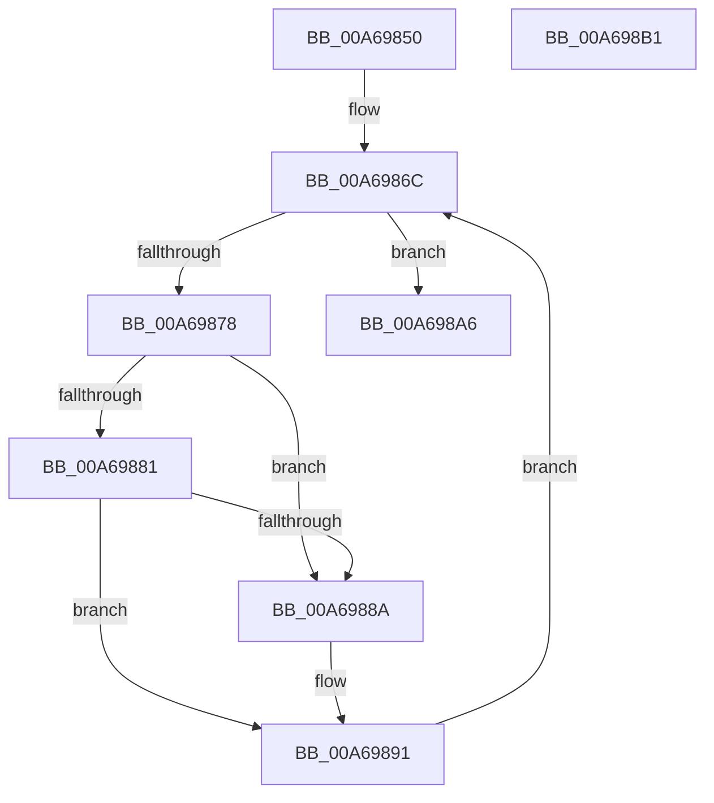

# RtlFreeRangeList

- RVA: `0x00A69850`–`0x00A698B2` (길이 `98` bytes)
- VA: `0x0000000140A69850`
- 실행 섹션: `PAGE`
- PDB 이름 있음: `예`; PDB Function 태그: `아니요`
- unwind 정보 RVA: `0x0005CAAC`
- 디코드: `31`개 명령, `98/98` bytes 표시
- 미해석 바이트: `0` (있으면 어셈블리에 `.byte`로 보존)

> 이 문서는 커널 이미지의 기계어와 PDB 기호를 분석해 생성했습니다. 4번과 5번은 함수 원형과 자료형을 바이너리 사용 방식에서 추정한 C 해석이며 원본 소스 복구 결과는 아닙니다.

## 1. Dependencies

- 직접 호출 지점: **1**; 고유 호출 대상: **1**
- 직접 호출자로 확인된 함수: **10**
- RIP 상대 이미지 참조: **0**

### Outgoing calls
- `0x00A69898` → [RtlpDeleteRangeListEntry](RtlpDeleteRangeListEntry_function_00A698B8.md) (function, `0x00A698B8`)

### Direct callers
- [ArbBootAllocation](../70/ArbBootAllocation_function_0070E290.md) at `0x0070E3EA`
- [ArbBootAllocation](../70/ArbBootAllocation_function_0070E290.md) at `0x0070E3F7`
- [ArbCommitAllocation](../70/ArbCommitAllocation_function_0070E970.md) at `0x0070E97D`
- [ArbInitializeRangeList](../70/ArbInitializeRangeList_function_0070F070.md) at `0x0070F156`
- [ArbQueryConflict](../70/ArbQueryConflict_function_0070F410.md) at `0x0070F71F`
- [ArbQueryConflict](../70/ArbQueryConflict_function_0070F410.md) at `0x0070F776`
- [ArbRetestAllocation](../70/ArbRetestAllocation_function_0070F940.md) at `0x0070FAC8`
- [ArbRollbackAllocation](../70/ArbRollbackAllocation_function_0070FB00.md) at `0x0070FB08`
- [ArbStartArbiter](../70/ArbStartArbiter_function_0070FD40.md) at `0x0070FD54`
- [ArbTestAllocation](../70/ArbTestAllocation_function_0070FD90.md) at `0x0070FEE9`
- [RtlMergeRangeLists](../78/RtlMergeRangeLists_function_0078AA40.md) at `0x0078AB0C`
- [RtlCopyRangeList](RtlCopyRangeList_function_00A69680.md) at `0x00A6970E`

### Static image references
- 디코드된 RIP-relative 메모리 참조가 없습니다.

## 2. Other-region calls and transfers

- 다른 실행 섹션으로 향하는 call: **0**
- 별도 외부 분기/꼬리 이동을 확인하지 못했습니다.

## 3. Assembly (complete function range)

```asm
00A69850  48 89 5C 24 08                  mov qword ptr [rsp + 8], rbx
00A69855  57                              push rdi
00A69856  48 83 EC 20                     sub rsp, 0x20
00A6985A  83 61 10 00                     and dword ptr [rcx + 0x10], 0
00A6985E  48 8B D9                        mov rbx, rcx
00A69861  48 8B 01                        mov rax, qword ptr [rcx]
00A69864  83 61 14 00                     and dword ptr [rcx + 0x14], 0
00A69868  48 8D 48 D8                     lea rcx, [rax - 0x28]
00A6986C  48 8B 38                        mov rdi, qword ptr [rax]
00A6986F  48 83 EF 28                     sub rdi, 0x28
00A69873  48 3B D8                        cmp rbx, rax
00A69876  74 2E                           je 0x140a698a6
00A69878  4C 8B 00                        mov r8, qword ptr [rax]
00A6987B  49 39 40 08                     cmp qword ptr [r8 + 8], rax
00A6987F  75 09                           jne 0x140a6988a
00A69881  48 8B 50 08                     mov rdx, qword ptr [rax + 8]
00A69885  48 39 02                        cmp qword ptr [rdx], rax
00A69888  74 07                           je 0x140a69891
00A6988A  B9 03 00 00 00                  mov ecx, 3
00A6988F  CD 29                           int 0x29
00A69891  4C 89 02                        mov qword ptr [rdx], r8
00A69894  49 89 50 08                     mov qword ptr [r8 + 8], rdx
00A69898  E8 1B 00 00 00                  call 0x140a698b8
00A6989D  48 8B CF                        mov rcx, rdi
00A698A0  48 8D 47 28                     lea rax, [rdi + 0x28]
00A698A4  EB C6                           jmp 0x140a6986c
00A698A6  48 8B 5C 24 30                  mov rbx, qword ptr [rsp + 0x30]
00A698AB  48 83 C4 20                     add rsp, 0x20
00A698AF  5F                              pop rdi
00A698B0  C3                              ret
00A698B1  CC                              int3
```

## 4. C-style interpretation (structured pseudocode)

```c
__int64 __fastcall RtlFreeRangeList(__int64 a1)
{
    __int64 result;
    __int64 v_rdi;
    __int64 v_rsp;
    unsigned __int64 v_stack_p8;

    v_stack_p8 = v_rbx;
    v_rsp = (v_rsp) - (32);
loc_00A6986C:
    v_rdi = (*(unsigned __int64 *)(*(unsigned __int64 *)(a1))) - (40);
    if (a1 == (*(unsigned __int64 *)(a1))) goto loc_00A698A6;
    if ((*(unsigned __int64 *)(*(unsigned __int64 *)(*(unsigned __int64 *)(a1)) + 8)) != (*(unsigned __int64 *)(a1))) goto loc_00A6988A;
    if ((*(unsigned __int64 *)(*(unsigned __int64 *)(*(unsigned __int64 *)(a1) + 8))) != (*(unsigned __int64 *)(a1))) {
        a1 = 3;
    }
    *(unsigned __int64 *)(*(unsigned __int64 *)(*(unsigned __int64 *)(a1) + 8)) = *(unsigned __int64 *)(*(unsigned __int64 *)(a1));
    *(unsigned __int64 *)(*(unsigned __int64 *)(*(unsigned __int64 *)(a1)) + 8) = *(unsigned __int64 *)(*(unsigned __int64 *)(a1) + 8);
    result = RtlpDeleteRangeListEntry(a1, *(unsigned __int64 *)(*(unsigned __int64 *)(a1) + 8), *(unsigned __int64 *)(*(unsigned __int64 *)(a1)), a4);
    goto loc_00A6986C;
loc_00A698A6:
    v_rsp = (v_rsp) + (32);
    return v_rdi + 40;
}
```

## 5. (Beta) C Style

```c
int64_t RtlFreeRangeList(void *Arg1)
{
    uint8_t *arg1 = (uint8_t *)Arg1;

    int64_t result;
    int64_t local_rdi;
    int64_t local_rsp;
    uint64_t v_stack_p8;

    v_stack_p8 = local_rbx;
    local_rsp = (local_rsp) - (32);
loc_00A6986C:
    local_rdi = (*(uint64_t *)(*(uint64_t *)(arg1))) - (40);
    if (Arg1 == (*(uint64_t *)(arg1))) goto loc_00A698A6;
    if ((*(uint64_t *)(*(uint64_t *)(*(uint64_t *)(arg1)) + 0x8)) != (*(uint64_t *)(arg1))) goto loc_00A6988A;
    if ((*(uint64_t *)(*(uint64_t *)(*(uint64_t *)(arg1) + 0x8))) != (*(uint64_t *)(arg1))) {
        Arg1 = 3;
    }
    *(uint64_t *)(*(uint64_t *)(*(uint64_t *)(arg1) + 0x8)) = *(uint64_t *)(*(uint64_t *)(arg1));
    *(uint64_t *)(*(uint64_t *)(*(uint64_t *)(arg1)) + 0x8) = *(uint64_t *)(*(uint64_t *)(arg1) + 0x8);
    result = RtlpDeleteRangeListEntry(Arg1, *(uint64_t *)(*(uint64_t *)(arg1) + 0x8), *(uint64_t *)(*(uint64_t *)(arg1)), a4);
    goto loc_00A6986C;
loc_00A698A6:
    local_rsp = (local_rsp) + (32);
    return local_rdi + 40;
}
```

### 관측된 메모리 오프셋

구조체 형식이 확인되지 않은 접근은 인자 기준의 오프셋으로만 기록했습니다.

| 기준 인자 | 오프셋 표현 | 폭 (bit) | 접근 |
|---|---:|---:|---|
| `Arg1` | `+ 0x0` | `64` | `R` |
| `Arg1` | `+ 0x10` | `32` | `R/W` |
| `Arg1` | `+ 0x14` | `32` | `R/W` |

## 6. Execution-region graph

[열기: 2D/3D 그래프와 함수 탐색 컨트롤 패널](../../../control-panel.html?section=page&rva=0x00A69850&view=graph)

- 2D 그래프는 위에서 아래로 흐르고, 3D 그래프는 빈 공간을 드래그해 회전합니다. Shift+드래그는 이동, 휠은 확대·축소, 함수 노드 선택은 대상 보고서 이동입니다.

### Static fallback


