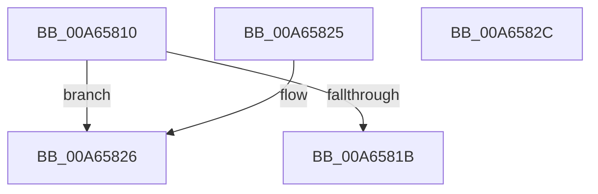

# RtlGetControlSecurityDescriptor

- RVA: `0x00A65810`–`0x00A6582D` (길이 `29` bytes)
- VA: `0x0000000140A65810`
- 실행 섹션: `PAGE`
- PDB 이름 있음: `예`; PDB Function 태그: `아니요`
- unwind 정보 RVA: `0x000DB714`
- 디코드: `12`개 명령, `29/29` bytes 표시
- 미해석 바이트: `0` (있으면 어셈블리에 `.byte`로 보존)

> 이 문서는 커널 이미지의 기계어와 PDB 기호를 분석해 생성했습니다. 4번과 5번은 함수 원형과 자료형을 바이너리 사용 방식에서 추정한 C 해석이며 원본 소스 복구 결과는 아닙니다.

## 1. Dependencies

- 직접 호출 지점: **0**; 고유 호출 대상: **0**
- 직접 호출자로 확인된 함수: **1**
- RIP 상대 이미지 참조: **0**

### Outgoing calls
- 직접 디코드된 call 명령이 없습니다.

### Direct callers
- [AdtpIsSDValidSelfRelative](../../text/4D/AdtpIsSDValidSelfRelative_function_004DF684.md) at `0x004DF6CD`

### Static image references
- 디코드된 RIP-relative 메모리 참조가 없습니다.

## 2. Other-region calls and transfers

- 다른 실행 섹션으로 향하는 call: **0**
- 별도 외부 분기/꼬리 이동을 확인하지 못했습니다.

## 3. Assembly (complete function range)

```asm
00A65810  0F B6 01                        movzx eax, byte ptr [rcx]
00A65813  41 89 00                        mov dword ptr [r8], eax
00A65816  80 39 01                        cmp byte ptr [rcx], 1
00A65819  75 0B                           jne 0x140a65826
00A6581B  0F B7 41 02                     movzx eax, word ptr [rcx + 2]
00A6581F  66 89 02                        mov word ptr [rdx], ax
00A65822  33 C0                           xor eax, eax
00A65824  C3                              ret
00A65825  CC                              int3
00A65826  B8 58 00 00 C0                  mov eax, 0xc0000058
00A6582B  C3                              ret
00A6582C  CC                              int3
```

## 4. C-style interpretation (structured pseudocode)

```c
__int64 __fastcall RtlGetControlSecurityDescriptor(__int64 a1, __int64 a2, __int64 a3)
{
    __int64 result;

    *(unsigned int *)(a3) = (unsigned int)(*(unsigned __int8 *)(a1));
    if ((*(unsigned __int8 *)(a1)) != 1) goto loc_00A65826;
    *(unsigned __int16 *)(a2) = (unsigned __int16)(*(unsigned __int16 *)(a1 + 2));
    result = 0;
    return result;
loc_00A65826:
    return (unsigned int)(0xC0000058ULL);
}
```

## 5. (Beta) C Style

```c
int64_t RtlGetControlSecurityDescriptor(void *Arg1, void *Arg2, void *Arg3)
{
    uint8_t *arg1 = (uint8_t *)Arg1;
    uint8_t *arg2 = (uint8_t *)Arg2;
    uint8_t *arg3 = (uint8_t *)Arg3;

    int64_t result;

    *(uint32_t *)(arg3) = (uint32_t)(*(uint8_t *)(arg1));
    if ((*(uint8_t *)(arg1)) != 1) goto loc_00A65826;
    *(uint16_t *)(arg2) = (uint16_t)(*(uint16_t *)(arg1 + 0x2));
    result = 0;
    return result;
loc_00A65826:
    return (uint32_t)(0xC0000058ULL);
}
```

### 관측된 메모리 오프셋

구조체 형식이 확인되지 않은 접근은 인자 기준의 오프셋으로만 기록했습니다.

| 기준 인자 | 오프셋 표현 | 폭 (bit) | 접근 |
|---|---:|---:|---|
| `Arg1` | `+ 0x0` | `8` | `R` |
| `Arg1` | `+ 0x2` | `16` | `R` |
| `Arg2` | `+ 0x0` | `16` | `W` |
| `Arg3` | `+ 0x0` | `32` | `W` |

## 6. Execution-region graph

[열기: 2D/3D 그래프와 함수 탐색 컨트롤 패널](../../../control-panel.html?section=page&rva=0x00A65810&view=graph)

- 2D 그래프는 위에서 아래로 흐르고, 3D 그래프는 빈 공간을 드래그해 회전합니다. Shift+드래그는 이동, 휠은 확대·축소, 함수 노드 선택은 대상 보고서 이동입니다.

### Static fallback


