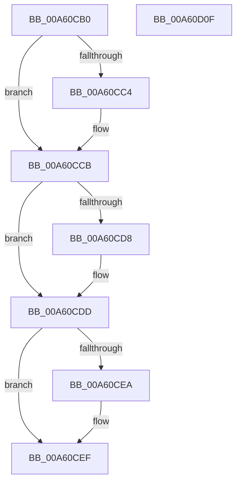

# RtlQueryElevationFlags

- RVA: `0x00A60CB0`–`0x00A60D10` (길이 `96` bytes)
- VA: `0x0000000140A60CB0`
- 실행 섹션: `PAGE`
- PDB 이름 있음: `예`; PDB Function 태그: `아니요`
- unwind 정보 RVA: `0x000DB714`
- 디코드: `29`개 명령, `96/96` bytes 표시
- 미해석 바이트: `0` (있으면 어셈블리에 `.byte`로 보존)

> 이 문서는 커널 이미지의 기계어와 PDB 기호를 분석해 생성했습니다. 4번과 5번은 함수 원형과 자료형을 바이너리 사용 방식에서 추정한 C 해석이며 원본 소스 복구 결과는 아닙니다.

## 1. Dependencies

- 직접 호출 지점: **0**; 고유 호출 대상: **0**
- 직접 호출자로 확인된 함수: **7**
- RIP 상대 이미지 참조: **0**

### Outgoing calls
- 직접 디코드된 call 명령이 없습니다.

### Direct callers
- [SepCreateAppContainerToken](../../text/4F/SepCreateAppContainerToken_function_004F43AC.md) at `0x004F46D6`
- [sub_008CC5C2](../8C/Unknown_function_008CC5C2.md) at `0x008CC66F`
- [SeSubProcessToken](../AA/SeSubProcessToken_function_00AAD570.md) at `0x00AAD7E0`
- [NtCreateLowBoxToken](../AB/NtCreateLowBoxToken_function_00AB9880.md) at `0x00AB9F0E`
- [NtQueryInformationToken](../AE/NtQueryInformationToken_function_00AECDD0.md) at `0x00AED5D3`
- [NtQueryInformationToken](../AE/NtQueryInformationToken_function_00AECDD0.md) at `0x00AEE56C`
- [NtSetInformationToken](../AF/NtSetInformationToken_function_00AF0530.md) at `0x00AF0601`
- [NtSetInformationToken](../AF/NtSetInformationToken_function_00AF0530.md) at `0x00AF1AA5`
- [sub_00B2884E](../B2/Unknown_function_00B2884E.md) at `0x00B28861`

### Static image references
- 디코드된 RIP-relative 메모리 참조가 없습니다.

## 2. Other-region calls and transfers

- 다른 실행 섹션으로 향하는 call: **0**
- 별도 외부 분기/꼬리 이동을 확인하지 못했습니다.

## 3. Assembly (complete function range)

```asm
00A60CB0  33 D2                           xor edx, edx
00A60CB2  4C 8B C1                        mov r8, rcx
00A60CB5  89 11                           mov dword ptr [rcx], edx
00A60CB7  A1 F0 02 00 00 80 F7 FF FF      movabs eax, dword ptr [0xfffff780000002f0]
00A60CC0  A8 02                           test al, 2
00A60CC2  74 07                           je 0x140a60ccb
00A60CC4  BA 01 00 00 00                  mov edx, 1
00A60CC9  89 11                           mov dword ptr [rcx], edx
00A60CCB  A1 F0 02 00 00 80 F7 FF FF      movabs eax, dword ptr [0xfffff780000002f0]
00A60CD4  A8 04                           test al, 4
00A60CD6  74 05                           je 0x140a60cdd
00A60CD8  83 CA 02                        or edx, 2
00A60CDB  89 11                           mov dword ptr [rcx], edx
00A60CDD  A1 F0 02 00 00 80 F7 FF FF      movabs eax, dword ptr [0xfffff780000002f0]
00A60CE6  A8 08                           test al, 8
00A60CE8  74 05                           je 0x140a60cef
00A60CEA  83 CA 04                        or edx, 4
00A60CED  89 11                           mov dword ptr [rcx], edx
00A60CEF  A1 F0 02 00 00 80 F7 FF FF      movabs eax, dword ptr [0xfffff780000002f0]
00A60CF8  25 00 10 00 00                  and eax, 0x1000
00A60CFD  F7 D8                           neg eax
00A60CFF  1B C9                           sbb ecx, ecx
00A60D01  33 C0                           xor eax, eax
00A60D03  83 E1 08                        and ecx, 8
00A60D06  83 C1 08                        add ecx, 8
00A60D09  0B CA                           or ecx, edx
00A60D0B  41 89 08                        mov dword ptr [r8], ecx
00A60D0E  C3                              ret
00A60D0F  CC                              int3
```

## 4. C-style interpretation (structured pseudocode)

```c
__int64 __fastcall RtlQueryElevationFlags(__int64 a1, int a2)
{
    __int64 result;

    a2 = 0;
    *(unsigned int *)(a1) = 0;
    if ((((unsigned __int8)(result)) & (2)) != 0) {
        a2 = 1;
        *(unsigned int *)(a1) = a2;
    }
    if ((((unsigned __int8)(result)) & (4)) != 0) {
        a2 = (unsigned int)((a2) | (2));
        *(unsigned int *)(a1) = a2;
    }
    if ((((unsigned __int8)(result)) & (8)) != 0) {
        a2 = (unsigned int)((a2) | (4));
        *(unsigned int *)(a1) = a2;
    }
    result = (unsigned int)((result) & (0x1000ULL));
    result = (unsigned int)(-(result));
    result = 0;
    a1 = (unsigned int)((a1) & (8));
    a1 = (unsigned int)((a1) + (8));
    a1 = (unsigned int)((a1) | (a2));
    *(unsigned int *)(a1) = (unsigned int)(a1);
    return result;
}
```

## 5. (Beta) C Style

```c
int64_t RtlQueryElevationFlags(void *Arg1, int32_t Arg2)
{
    uint8_t *arg1 = (uint8_t *)Arg1;

    int64_t result;

    Arg2 = 0;
    *(uint32_t *)(arg1) = 0;
    if ((((uint8_t)(result)) & (2)) != 0) {
        Arg2 = 1;
        *(uint32_t *)(arg1) = Arg2;
    }
    if ((((uint8_t)(result)) & (4)) != 0) {
        Arg2 = (uint32_t)((Arg2) | (2));
        *(uint32_t *)(arg1) = Arg2;
    }
    if ((((uint8_t)(result)) & (8)) != 0) {
        Arg2 = (uint32_t)((Arg2) | (4));
        *(uint32_t *)(arg1) = Arg2;
    }
    result = (uint32_t)((result) & (0x1000ULL));
    result = (uint32_t)(-(result));
    result = 0;
    Arg1 = (uint32_t)((Arg1) & (8));
    Arg1 = (uint32_t)((Arg1) + (8));
    Arg1 = (uint32_t)((Arg1) | (Arg2));
    *(uint32_t *)(arg1) = (uint32_t)(Arg1);
    return result;
}
```

### 관측된 메모리 오프셋

구조체 형식이 확인되지 않은 접근은 인자 기준의 오프셋으로만 기록했습니다.

| 기준 인자 | 오프셋 표현 | 폭 (bit) | 접근 |
|---|---:|---:|---|
| `Arg1` | `+ 0x0` | `32` | `W` |

## 6. Execution-region graph

[열기: 2D/3D 그래프와 함수 탐색 컨트롤 패널](../../../control-panel.html?section=page&rva=0x00A60CB0&view=graph)

- 2D 그래프는 위에서 아래로 흐르고, 3D 그래프는 빈 공간을 드래그해 회전합니다. Shift+드래그는 이동, 휠은 확대·축소, 함수 노드 선택은 대상 보고서 이동입니다.

### Static fallback


