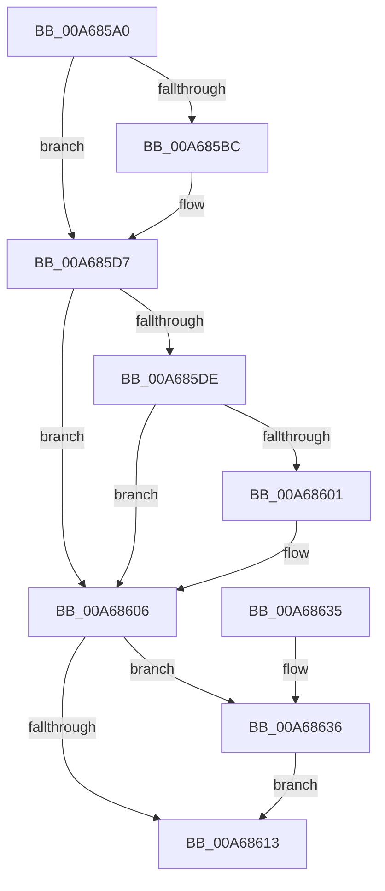

# RtlReleasePrivilege

- RVA: `0x00A685A0`–`0x00A6863F` (길이 `159` bytes)
- VA: `0x0000000140A685A0`
- 실행 섹션: `PAGE`
- PDB 이름 있음: `예`; PDB Function 태그: `아니요`
- unwind 정보 RVA: `0x000B3E98`
- 디코드: `47`개 명령, `159/159` bytes 표시
- 미해석 바이트: `0` (있으면 어셈블리에 `.byte`로 보존)

> 이 문서는 커널 이미지의 기계어와 PDB 기호를 분석해 생성했습니다. 4번과 5번은 함수 원형과 자료형을 바이너리 사용 방식에서 추정한 C 해석이며 원본 소스 복구 결과는 아닙니다.

## 1. Dependencies

- 직접 호출 지점: **6**; 고유 호출 대상: **4**
- 직접 호출자로 확인된 함수: **2**
- RIP 상대 이미지 참조: **0**

### Outgoing calls
- `0x00A685D2` → [ZwAdjustPrivilegesToken](../../text/6A/ZwAdjustPrivilegesToken_function_006AD8F0.md) (function, `0x006AD8F0`)
- `0x00A685F3` → [ZwSetInformationThread](../../text/6A/ZwSetInformationThread_function_006AD270.md) (function, `0x006AD270`)
- `0x00A68601` → [ZwClose](../../text/6A/ZwClose_function_006AD2B0.md) (function, `0x006AD2B0`)
- `0x00A68616` → [ZwClose](../../text/6A/ZwClose_function_006AD2B0.md) (function, `0x006AD2B0`)
- `0x00A68620` → [ExFreePoolWithTag](../../poolcode/B8/ExFreePoolWithTag_function_00B82870.md) (function, `0x00B82870`)
- `0x00A68638` → [ExFreePoolWithTag](../../poolcode/B8/ExFreePoolWithTag_function_00B82870.md) (function, `0x00B82870`)

### Direct callers
- [VhdiAutoAttachOneVhd](../83/VhdiAutoAttachOneVhd_function_0083BCD4.md) at `0x0083BDCD`
- [PspAllocateProcess](../A1/PspAllocateProcess_function_00A13B3C.md) at `0x00A14CE3`
- [PspAllocateProcess](../A1/PspAllocateProcess_function_00A13B3C.md) at `0x00A15D49`

### Static image references
- 디코드된 RIP-relative 메모리 참조가 없습니다.

## 2. Other-region calls and transfers

- 다른 실행 섹션으로 향하는 call: **6**
  - `0x00A685D2` → [ZwAdjustPrivilegesToken](../../text/6A/ZwAdjustPrivilegesToken_function_006AD8F0.md) (`PAGE` → `.text`)
  - `0x00A685F3` → [ZwSetInformationThread](../../text/6A/ZwSetInformationThread_function_006AD270.md) (`PAGE` → `.text`)
  - `0x00A68601` → [ZwClose](../../text/6A/ZwClose_function_006AD2B0.md) (`PAGE` → `.text`)
  - `0x00A68616` → [ZwClose](../../text/6A/ZwClose_function_006AD2B0.md) (`PAGE` → `.text`)
  - `0x00A68620` → [ExFreePoolWithTag](../../poolcode/B8/ExFreePoolWithTag_function_00B82870.md) (`PAGE` → `POOLCODE`)
  - `0x00A68638` → [ExFreePoolWithTag](../../poolcode/B8/ExFreePoolWithTag_function_00B82870.md) (`PAGE` → `POOLCODE`)
- 별도 외부 분기/꼬리 이동을 확인하지 못했습니다.

## 3. Assembly (complete function range)

```asm
00A685A0  4C 8B DC                        mov r11, rsp
00A685A3  49 89 5B 08                     mov qword ptr [r11 + 8], rbx
00A685A7  49 89 73 10                     mov qword ptr [r11 + 0x10], rsi
00A685AB  57                              push rdi
00A685AC  48 83 EC 30                     sub rsp, 0x30
00A685B0  8B 41 20                        mov eax, dword ptr [rcx + 0x20]
00A685B3  48 8B F9                        mov rdi, rcx
00A685B6  24 03                           and al, 3
00A685B8  3C 01                           cmp al, 1
00A685BA  74 1B                           je 0x140a685d7
00A685BC  49 83 63 F0 00                  and qword ptr [r11 - 0x10], 0
00A685C1  45 33 C9                        xor r9d, r9d
00A685C4  4C 8B 41 10                     mov r8, qword ptr [rcx + 0x10]
00A685C8  33 D2                           xor edx, edx
00A685CA  49 83 63 E8 00                  and qword ptr [r11 - 0x18], 0
00A685CF  48 8B 09                        mov rcx, qword ptr [rcx]
00A685D2  E8 19 53 C4 FF                  call 0x1406ad8f0
00A685D7  8B 47 20                        mov eax, dword ptr [rdi + 0x20]
00A685DA  A8 01                           test al, 1
00A685DC  74 28                           je 0x140a68606
00A685DE  41 B9 08 00 00 00               mov r9d, 8
00A685E4  4C 8D 47 08                     lea r8, [rdi + 8]
00A685E8  48 C7 C1 FE FF FF FF            mov rcx, 0xfffffffffffffffe
00A685EF  41 8D 51 FD                     lea edx, [r9 - 3]
00A685F3  E8 78 4C C4 FF                  call 0x1406ad270
00A685F8  48 8B 4F 08                     mov rcx, qword ptr [rdi + 8]
00A685FC  48 85 C9                        test rcx, rcx
00A685FF  74 05                           je 0x140a68606
00A68601  E8 AA 4C C4 FF                  call 0x1406ad2b0
00A68606  48 8B 4F 10                     mov rcx, qword ptr [rdi + 0x10]
00A6860A  48 8D 47 24                     lea rax, [rdi + 0x24]
00A6860E  48 3B C8                        cmp rcx, rax
00A68611  75 23                           jne 0x140a68636
00A68613  48 8B 0F                        mov rcx, qword ptr [rdi]
00A68616  E8 95 4C C4 FF                  call 0x1406ad2b0
00A6861B  33 D2                           xor edx, edx
00A6861D  48 8B CF                        mov rcx, rdi
00A68620  E8 4B A2 11 00                  call 0x140b82870
00A68625  48 8B 5C 24 40                  mov rbx, qword ptr [rsp + 0x40]
00A6862A  48 8B 74 24 48                  mov rsi, qword ptr [rsp + 0x48]
00A6862F  48 83 C4 30                     add rsp, 0x30
00A68633  5F                              pop rdi
00A68634  C3                              ret
00A68635  CC                              int3
00A68636  33 D2                           xor edx, edx
00A68638  E8 33 A2 11 00                  call 0x140b82870
00A6863D  EB D4                           jmp 0x140a68613
```

## 4. C-style interpretation (structured pseudocode)

```c
__int64 __fastcall RtlReleasePrivilege(__int64 a1, int a2, __int64 a3, int a4)
{
    __int64 result;
    __int64 v_rsp;
    unsigned __int64 v_stack_p10;
    unsigned __int64 v_stack_p8;

    *(unsigned __int64 *)(v_rsp + 8) = v_rbx;
    *(unsigned __int64 *)(v_rsp + 16) = v_rsi;
    v_rsp = (v_rsp) - (48);
    result = (unsigned __int8)(((unsigned int)(*(unsigned int *)(a1 + 32))) & (3));
    if (((unsigned __int8)(result)) != 1) {
        a4 = 0;
        a3 = *(unsigned __int64 *)(a1 + 16);
        a2 = 0;
        a1 = *(unsigned __int64 *)(a1);
        result = ZwAdjustPrivilegesToken(a1, a2, a3, a4);
    }
    if ((((unsigned __int8)((unsigned int)(*(unsigned int *)(a1 + 32)))) & (1)) == 0) goto loc_00A68606;
    result = ZwSetInformationThread(-2, 8 - 3, a1 + 8, 8);
    if (*(unsigned __int64 *)(a1 + 8) != 0) {
        result = ZwClose(*(unsigned __int64 *)(a1 + 8), 8 - 3, a1 + 8, 8);
    }
    if ((*(unsigned __int64 *)(a1 + 16)) != (a1 + 36)) goto loc_00A68636;
loc_00A68613:
    result = ZwClose(*(unsigned __int64 *)(a1), 8 - 3, a1 + 8, 8);
    a2 = 0;
    result = ExFreePoolWithTag(a1, a2, a1 + 8, 8);
    v_rsp = (v_rsp) + (48);
    return result;
loc_00A68636:
    a2 = 0;
    result = ExFreePoolWithTag(a1, a2, a1 + 8, 8);
    goto loc_00A68613;
}
```

## 5. (Beta) C Style

```c
int64_t RtlReleasePrivilege(void *Arg1, int32_t Arg2, int64_t Arg3, int32_t Arg4)
{
    uint8_t *arg1 = (uint8_t *)Arg1;

    int64_t result;
    int64_t local_rsp;
    uint64_t v_stack_p10;
    uint64_t v_stack_p8;

    *(uint64_t *)(local_rsp + 0x8) = local_rbx;
    *(uint64_t *)(local_rsp + 0x10) = local_rsi;
    local_rsp = (local_rsp) - (48);
    result = (uint8_t)(((uint32_t)(*(uint32_t *)(arg1 + 0x20))) & (3));
    if (((uint8_t)(result)) != 1) {
        Arg4 = 0;
        Arg3 = *(uint64_t *)(arg1 + 0x10);
        Arg2 = 0;
        Arg1 = *(uint64_t *)(arg1);
        result = ZwAdjustPrivilegesToken(Arg1, Arg2, Arg3, Arg4);
    }
    if ((((uint8_t)((uint32_t)(*(uint32_t *)(arg1 + 0x20)))) & (1)) == 0) goto loc_00A68606;
    result = ZwSetInformationThread(-2, 8 - 3, Arg1 + 8, 8);
    if (*(uint64_t *)(arg1 + 0x8) != 0) {
        result = ZwClose(*(uint64_t *)(arg1 + 0x8), 8 - 3, Arg1 + 8, 8);
    }
    if ((*(uint64_t *)(arg1 + 0x10)) != (Arg1 + 36)) goto loc_00A68636;
loc_00A68613:
    result = ZwClose(*(uint64_t *)(arg1), 8 - 3, Arg1 + 8, 8);
    Arg2 = 0;
    result = ExFreePoolWithTag(Arg1, Arg2, Arg1 + 8, 8);
    local_rsp = (local_rsp) + (48);
    return result;
loc_00A68636:
    Arg2 = 0;
    result = ExFreePoolWithTag(Arg1, Arg2, Arg1 + 8, 8);
    goto loc_00A68613;
}
```

### 관측된 메모리 오프셋

구조체 형식이 확인되지 않은 접근은 인자 기준의 오프셋으로만 기록했습니다.

| 기준 인자 | 오프셋 표현 | 폭 (bit) | 접근 |
|---|---:|---:|---|
| `Arg1` | `+ 0x0` | `64` | `R` |
| `Arg1` | `+ 0x8` | `64` | `R` |
| `Arg1` | `+ 0x10` | `64` | `R` |
| `Arg1` | `+ 0x20` | `32` | `R` |
| `Arg1` | `+ 0x24` | `64` | `R` |

## 6. Execution-region graph

[열기: 2D/3D 그래프와 함수 탐색 컨트롤 패널](../../../control-panel.html?section=page&rva=0x00A685A0&view=graph)

- 2D 그래프는 위에서 아래로 흐르고, 3D 그래프는 빈 공간을 드래그해 회전합니다. Shift+드래그는 이동, 휠은 확대·축소, 함수 노드 선택은 대상 보고서 이동입니다.

### Static fallback


