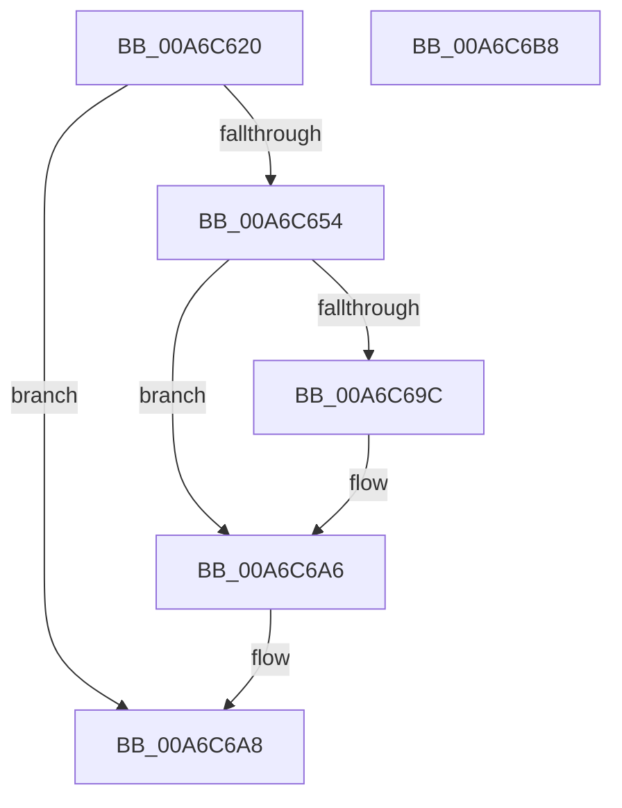

# RtlWriteRegistryValue

- RVA: `0x00A6C620`–`0x00A6C6B9` (길이 `153` bytes)
- VA: `0x0000000140A6C620`
- 실행 섹션: `PAGE`
- PDB 이름 있음: `예`; PDB Function 태그: `아니요`
- unwind 정보 RVA: `0x0007F83C`
- 디코드: `41`개 명령, `153/153` bytes 표시
- 미해석 바이트: `0` (있으면 어셈블리에 `.byte`로 보존)

> 이 문서는 커널 이미지의 기계어와 PDB 기호를 분석해 생성했습니다. 4번과 5번은 함수 원형과 자료형을 바이너리 사용 방식에서 추정한 C 해석이며 원본 소스 복구 결과는 아닙니다.

## 1. Dependencies

- 직접 호출 지점: **4**; 고유 호출 대상: **4**
- 직접 호출자로 확인된 함수: **15**
- RIP 상대 이미지 참조: **0**

### Outgoing calls
- `0x00A6C64B` → [RtlpGetRegistryHandle](../8C/RtlpGetRegistryHandle_function_008C955C.md) (function, `0x008C955C`)
- `0x00A6C65C` → [RtlInitUnicodeString](../../text/42/RtlInitUnicodeString_function_0042A780.md) (function, `0x0042A780`)
- `0x00A6C68F` → [ZwSetValueKey](../../text/6A/ZwSetValueKey_function_006ADCD0.md) (function, `0x006ADCD0`)
- `0x00A6C6A1` → [ZwClose](../../text/6A/ZwClose_function_006AD2B0.md) (function, `0x006AD2B0`)

### Direct callers
- [KseKPSOHookDriverTargeted](../../text/5C/KseKPSOHookDriverTargeted_function_005CD540.md) at `0x005CD573`
- [RtlSetPortableOperatingSystem](../../text/5E/RtlSetPortableOperatingSystem_function_005E7710.md) at `0x005E7740`
- [DifRtlWriteRegistryValueWrapper](../../text/63/DifRtlWriteRegistryValueWrapper_function_0063D050.md) at `0x0063D165`
- [RtlSetActiveTimeBias](../78/RtlSetActiveTimeBias_function_0078FA2C.md) at `0x0078FAD3`
- [RtlpSetTimeZoneInformationWorker](../78/RtlpSetTimeZoneInformationWorker_function_0078FEC8.md) at `0x0078FF89`
- [RtlpSetTimeZoneInformationWorker](../78/RtlpSetTimeZoneInformationWorker_function_0078FEC8.md) at `0x0078FFC1`
- [RtlpSetTimeZoneInformationWorker](../78/RtlpSetTimeZoneInformationWorker_function_0078FEC8.md) at `0x0078FFF1`
- [RtlpSetTimeZoneInformationWorker](../78/RtlpSetTimeZoneInformationWorker_function_0078FEC8.md) at `0x00790021`
- [RtlpSetTimeZoneInformationWorker](../78/RtlpSetTimeZoneInformationWorker_function_0078FEC8.md) at `0x00790054`
- [RtlpSetTimeZoneInformationWorker](../78/RtlpSetTimeZoneInformationWorker_function_0078FEC8.md) at `0x00790087`
- [RtlpSetTimeZoneInformationWorker](../78/RtlpSetTimeZoneInformationWorker_function_0078FEC8.md) at `0x007900BA`
- [RtlpSetTimeZoneInformationWorker](../78/RtlpSetTimeZoneInformationWorker_function_0078FEC8.md) at `0x007900F3`
- [RtlpSetTimeZoneInformationWorker](../78/RtlpSetTimeZoneInformationWorker_function_0078FEC8.md) at `0x00790145`
- [RtlpSetTimeZoneInformationWorker](../78/RtlpSetTimeZoneInformationWorker_function_0078FEC8.md) at `0x0079017F`
- [RtlpUpdateDynamicTimeZones](../79/RtlpUpdateDynamicTimeZones_function_0079019C.md) at `0x007903DB`
- [WmipSaveGuidSecurityDescriptor](../7B/WmipSaveGuidSecurityDescriptor_function_007B4A38.md) at `0x007B4AEA`
- [WmipSaveGuidSecurityDescriptor](../7B/WmipSaveGuidSecurityDescriptor_function_007B4A38.md) at `0x007B4B18`
- [EtwStartAutoLogger](../7B/EtwStartAutoLogger_function_007BD2F8.md) at `0x007BE002`
- [EtwStartAutoLogger](../7B/EtwStartAutoLogger_function_007BD2F8.md) at `0x007BE1F6`
- [EtwpEnumerateAutologgerPath](../7B/EtwpEnumerateAutologgerPath_function_007BE398.md) at `0x007BE5EB`
- [ExpSetTimeZoneInformation](../7C/ExpSetTimeZoneInformation_function_007C5240.md) at `0x007C54C4`
- [ExpSetTimeZoneInformation](../7C/ExpSetTimeZoneInformation_function_007C5240.md) at `0x007C553D`
- [WheaWritePolicyValueToRegistry](../7D/WheaWritePolicyValueToRegistry_function_007D8C2C.md) at `0x007D8C72`
- [EtwpEnableAutoLoggerProvider](../A9/EtwpEnableAutoLoggerProvider_function_00A92B00.md) at `0x00A93164`
- [PerfDiagpSaveActiveDCLLogFileName](../A9/PerfDiagpSaveActiveDCLLogFileName_function_00A9EB80.md) at `0x00A9ECFD`
- [EtwpEnumerateKeyProviders](../AB/EtwpEnumerateKeyProviders_function_00AB029C.md) at `0x00AB03FE`
- [IopStoreBootDriveLetter](../../init/C2/IopStoreBootDriveLetter_function_00C2D5CC.md) at `0x00C2D74C`

### Static image references
- 디코드된 RIP-relative 메모리 참조가 없습니다.

## 2. Other-region calls and transfers

- 다른 실행 섹션으로 향하는 call: **3**
  - `0x00A6C65C` → [RtlInitUnicodeString](../../text/42/RtlInitUnicodeString_function_0042A780.md) (`PAGE` → `.text`)
  - `0x00A6C68F` → [ZwSetValueKey](../../text/6A/ZwSetValueKey_function_006ADCD0.md) (`PAGE` → `.text`)
  - `0x00A6C6A1` → [ZwClose](../../text/6A/ZwClose_function_006AD2B0.md) (`PAGE` → `.text`)
- 별도 외부 분기/꼬리 이동을 확인하지 못했습니다.

## 3. Assembly (complete function range)

```asm
00A6C620  48 8B C4                        mov rax, rsp
00A6C623  48 89 58 08                     mov qword ptr [rax + 8], rbx
00A6C627  48 89 70 10                     mov qword ptr [rax + 0x10], rsi
00A6C62B  57                              push rdi
00A6C62C  48 83 EC 50                     sub rsp, 0x50
00A6C630  48 83 60 D8 00                  and qword ptr [rax - 0x28], 0
00A6C635  41 8B D9                        mov ebx, r9d
00A6C638  49 8B F0                        mov rsi, r8
00A6C63B  4C 8D 48 D8                     lea r9, [rax - 0x28]
00A6C63F  0F 57 C0                        xorps xmm0, xmm0
00A6C642  41 B0 01                        mov r8b, 1
00A6C645  0F 11 40 E0                     movups xmmword ptr [rax - 0x20], xmm0
00A6C649  8B F9                           mov edi, ecx
00A6C64B  E8 0C CF E5 FF                  call 0x1408c955c
00A6C650  85 C0                           test eax, eax
00A6C652  78 54                           js 0x140a6c6a8
00A6C654  48 8B D6                        mov rdx, rsi
00A6C657  48 8D 4C 24 38                  lea rcx, [rsp + 0x38]
00A6C65C  E8 1F E1 9B FF                  call 0x14042a780
00A6C661  8B 84 24 88 00 00 00            mov eax, dword ptr [rsp + 0x88]
00A6C668  48 8D 54 24 38                  lea rdx, [rsp + 0x38]
00A6C66D  48 8B 4C 24 30                  mov rcx, qword ptr [rsp + 0x30]
00A6C672  81 E3 FF FF FF 00               and ebx, 0xffffff
00A6C678  89 44 24 28                     mov dword ptr [rsp + 0x28], eax
00A6C67C  44 8B CB                        mov r9d, ebx
00A6C67F  48 8B 84 24 80 00 00 00         mov rax, qword ptr [rsp + 0x80]
00A6C687  45 33 C0                        xor r8d, r8d
00A6C68A  48 89 44 24 20                  mov qword ptr [rsp + 0x20], rax
00A6C68F  E8 3C 16 C4 FF                  call 0x1406adcd0
00A6C694  8B D8                           mov ebx, eax
00A6C696  0F BA E7 1E                     bt edi, 0x1e
00A6C69A  72 0A                           jb 0x140a6c6a6
00A6C69C  48 8B 4C 24 30                  mov rcx, qword ptr [rsp + 0x30]
00A6C6A1  E8 0A 0C C4 FF                  call 0x1406ad2b0
00A6C6A6  8B C3                           mov eax, ebx
00A6C6A8  48 8B 5C 24 60                  mov rbx, qword ptr [rsp + 0x60]
00A6C6AD  48 8B 74 24 68                  mov rsi, qword ptr [rsp + 0x68]
00A6C6B2  48 83 C4 50                     add rsp, 0x50
00A6C6B6  5F                              pop rdi
00A6C6B7  C3                              ret
00A6C6B8  CC                              int3
```

## 4. C-style interpretation (structured pseudocode)

```c
__int64 __fastcall RtlWriteRegistryValue(int a1, __int64 a2, __int64 a3, int a4, __int64 a5, unsigned int a6)
{
    __int64 result;
    __int64 v_rbx;
    __int64 v_rsp;
    unsigned __int64 v_stack_m20;
    unsigned __int64 v_stack_m28;
    unsigned int v_stack_m30;
    unsigned __int64 v_stack_m38;
    unsigned __int64 v_stack_p10;
    unsigned __int64 v_stack_p8;

    *(unsigned __int64 *)(v_rsp + 8) = v_rbx;
    *(unsigned __int64 *)(v_rsp + 16) = v_rsi;
    v_rsp = (v_rsp) - (80);
    *(unsigned __int64 *)(v_rsp - 32) = v_xmm0;
    result = RtlpGetRegistryHandle(a1, a2, 1, v_rsp - 40);
    if (sign_flag) goto loc_00A6C6A8;
    result = RtlInitUnicodeString(v_stack_m20, a3, 1, v_rsp - 40);
    v_rbx = (unsigned int)(((unsigned int)(a4)) & (0xFFFFFFULL));
    v_stack_m30 = (unsigned int)((unsigned int)(a6));
    a3 = 0;
    v_stack_m38 = a5;
    result = ZwSetValueKey(v_stack_m28, v_stack_m20, a3, (unsigned int)((unsigned int)(v_rbx)));
    if (!(condition_is_below)) {
        a1 = v_stack_m28;
        result = ZwClose(a1, v_stack_m20, a3, (unsigned int)((unsigned int)(v_rbx)));
    }
loc_00A6C6A8:
    v_rsp = (v_rsp) + (80);
    return (unsigned int)((unsigned int)((unsigned int)((unsigned int)(result))));
}
```

## 5. (Beta) C Style

```c
int64_t RtlWriteRegistryValue(int32_t Arg1, int64_t Arg2, int64_t Arg3, int32_t Arg4, int64_t Arg5, uint32_t Arg6)
{
    int64_t result;
    int64_t local_rbx;
    int64_t local_rsp;
    uint64_t v_stack_m20;
    uint64_t v_stack_m28;
    uint32_t v_stack_m30;
    uint64_t v_stack_m38;
    uint64_t v_stack_p10;
    uint64_t v_stack_p8;

    *(uint64_t *)(local_rsp + 0x8) = local_rbx;
    *(uint64_t *)(local_rsp + 0x10) = local_rsi;
    local_rsp = (local_rsp) - (80);
    *(uint64_t *)(local_rsp - 0x20) = v_xmm0;
    result = RtlpGetRegistryHandle(Arg1, Arg2, 1, local_rsp - 40);
    if (sign_flag) goto loc_00A6C6A8;
    result = RtlInitUnicodeString(v_stack_m20, Arg3, 1, local_rsp - 40);
    local_rbx = (uint32_t)(((uint32_t)(Arg4)) & (0xFFFFFFULL));
    v_stack_m30 = (uint32_t)((uint32_t)(Arg6));
    Arg3 = 0;
    v_stack_m38 = Arg5;
    result = ZwSetValueKey(v_stack_m28, v_stack_m20, Arg3, (uint32_t)((uint32_t)(local_rbx)));
    if (!(condition_is_below)) {
        Arg1 = v_stack_m28;
        result = ZwClose(Arg1, v_stack_m20, Arg3, (uint32_t)((uint32_t)(local_rbx)));
    }
loc_00A6C6A8:
    local_rsp = (local_rsp) + (80);
    return (uint32_t)((uint32_t)((uint32_t)((uint32_t)(result))));
}
```

## 6. Execution-region graph

[열기: 2D/3D 그래프와 함수 탐색 컨트롤 패널](../../../control-panel.html?section=page&rva=0x00A6C620&view=graph)

- 2D 그래프는 위에서 아래로 흐르고, 3D 그래프는 빈 공간을 드래그해 회전합니다. Shift+드래그는 이동, 휠은 확대·축소, 함수 노드 선택은 대상 보고서 이동입니다.

### Static fallback


