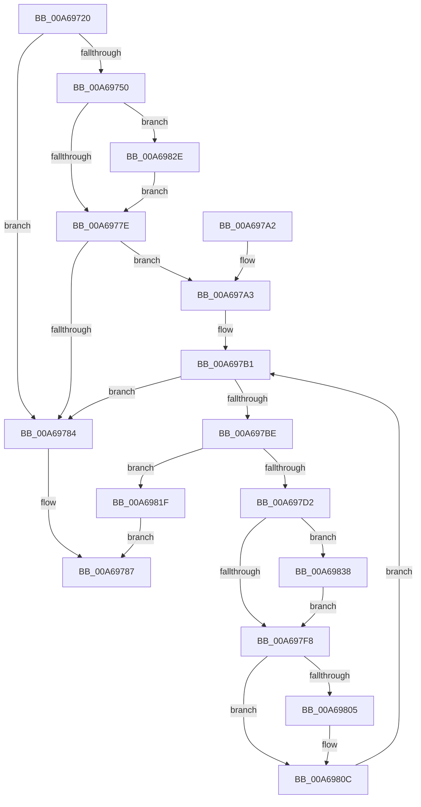

# RtlpCopyRangeListEntry

- RVA: `0x00A69720`–`0x00A69840` (길이 `288` bytes)
- VA: `0x0000000140A69720`
- 실행 섹션: `PAGE`
- PDB 이름 있음: `예`; PDB Function 태그: `아니요`
- unwind 정보 RVA: `0x000B4148`
- 디코드: `80`개 명령, `288/288` bytes 표시
- 미해석 바이트: `0` (있으면 어셈블리에 `.byte`로 보존)

> 이 문서는 커널 이미지의 기계어와 PDB 기호를 분석해 생성했습니다. 4번과 5번은 함수 원형과 자료형을 바이너리 사용 방식에서 추정한 C 해석이며 원본 소스 복구 결과는 아닙니다.

## 1. Dependencies

- 직접 호출 지점: **3**; 고유 호출 대상: **2**
- 직접 호출자로 확인된 함수: **3**
- RIP 상대 이미지 참조: **1**

### Outgoing calls
- `0x00A69743` → [ExAllocateFromPagedLookasideList](../../text/3F/ExAllocateFromPagedLookasideList_function_003FB730.md) (function, `0x003FB730`)
- `0x00A697C5` → [ExAllocateFromPagedLookasideList](../../text/3F/ExAllocateFromPagedLookasideList_function_003FB730.md) (function, `0x003FB730`)
- `0x00A69822` → [RtlpDeleteRangeListEntry](RtlpDeleteRangeListEntry_function_00A698B8.md) (function, `0x00A698B8`)

### Direct callers
- [RtlMergeRangeLists](../78/RtlMergeRangeLists_function_0078AA40.md) at `0x0078AAA3`
- [RtlMergeRangeLists](../78/RtlMergeRangeLists_function_0078AA40.md) at `0x0078AAD2`
- [RtlpAddIntersectingRanges](../78/RtlpAddIntersectingRanges_function_0078AB4C.md) at `0x0078AC03`
- [RtlCopyRangeList](RtlCopyRangeList_function_00A69680.md) at `0x00A696D6`

### Static image references
- `0x00A6973C` → RVA `0x00E28200` (`.data`; read)

## 2. Other-region calls and transfers

- 다른 실행 섹션으로 향하는 call: **2**
  - `0x00A69743` → [ExAllocateFromPagedLookasideList](../../text/3F/ExAllocateFromPagedLookasideList_function_003FB730.md) (`PAGE` → `.text`)
  - `0x00A697C5` → [ExAllocateFromPagedLookasideList](../../text/3F/ExAllocateFromPagedLookasideList_function_003FB730.md) (`PAGE` → `.text`)
- 별도 외부 분기/꼬리 이동을 확인하지 못했습니다.

## 3. Assembly (complete function range)

```asm
00A69720  48 8B C4                        mov rax, rsp
00A69723  48 89 58 08                     mov qword ptr [rax + 8], rbx
00A69727  48 89 70 10                     mov qword ptr [rax + 0x10], rsi
00A6972B  48 89 78 18                     mov qword ptr [rax + 0x18], rdi
00A6972F  4C 89 70 20                     mov qword ptr [rax + 0x20], r14
00A69733  41 57                           push r15
00A69735  48 83 EC 20                     sub rsp, 0x20
00A69739  48 8B F1                        mov rsi, rcx
00A6973C  48 8D 0D BD EA 3B 00            lea rcx, [rip + 0x3beabd]
00A69743  E8 E8 1F 99 FF                  call 0x1403fb730
00A69748  48 8B F8                        mov rdi, rax
00A6974B  48 85 C0                        test rax, rax
00A6974E  74 34                           je 0x140a69784
00A69750  0F 10 06                        movups xmm0, xmmword ptr [rsi]
00A69753  48 8D 58 10                     lea rbx, [rax + 0x10]
00A69757  0F 11 00                        movups xmmword ptr [rax], xmm0
00A6975A  0F 10 4E 10                     movups xmm1, xmmword ptr [rsi + 0x10]
00A6975E  0F 11 48 10                     movups xmmword ptr [rax + 0x10], xmm1
00A69762  0F 10 46 20                     movups xmm0, xmmword ptr [rsi + 0x20]
00A69766  0F 11 40 20                     movups xmmword ptr [rax + 0x20], xmm0
00A6976A  F2 0F 10 4E 30                  movsd xmm1, qword ptr [rsi + 0x30]
00A6976F  F2 0F 11 48 30                  movsd qword ptr [rax + 0x30], xmm1
00A69774  F6 40 21 10                     test byte ptr [rax + 0x21], 0x10
00A69778  0F 85 B0 00 00 00               jne 0x140a6982e
00A6977E  F6 46 22 01                     test byte ptr [rsi + 0x22], 1
00A69782  75 1F                           jne 0x140a697a3
00A69784  48 8B C7                        mov rax, rdi
00A69787  48 8B 5C 24 30                  mov rbx, qword ptr [rsp + 0x30]
00A6978C  48 8B 74 24 38                  mov rsi, qword ptr [rsp + 0x38]
00A69791  48 8B 7C 24 40                  mov rdi, qword ptr [rsp + 0x40]
00A69796  4C 8B 74 24 48                  mov r14, qword ptr [rsp + 0x48]
00A6979B  48 83 C4 20                     add rsp, 0x20
00A6979F  41 5F                           pop r15
00A697A1  C3                              ret
00A697A2  CC                              int3
00A697A3  4C 8D 7E 10                     lea r15, [rsi + 0x10]
00A697A7  48 89 5B 08                     mov qword ptr [rbx + 8], rbx
00A697AB  48 89 1B                        mov qword ptr [rbx], rbx
00A697AE  49 8B 37                        mov rsi, qword ptr [r15]
00A697B1  48 83 EE 28                     sub rsi, 0x28
00A697B5  4C 8D 76 28                     lea r14, [rsi + 0x28]
00A697B9  4D 3B FE                        cmp r15, r14
00A697BC  74 C6                           je 0x140a69784
00A697BE  48 8D 0D 3B EA 3B 00            lea rcx, [rip + 0x3bea3b]
00A697C5  E8 66 1F 99 FF                  call 0x1403fb730
00A697CA  48 8B D0                        mov rdx, rax
00A697CD  48 85 C0                        test rax, rax
00A697D0  74 4D                           je 0x140a6981f
00A697D2  0F 10 06                        movups xmm0, xmmword ptr [rsi]
00A697D5  0F 11 00                        movups xmmword ptr [rax], xmm0
00A697D8  0F 10 4E 10                     movups xmm1, xmmword ptr [rsi + 0x10]
00A697DC  0F 11 48 10                     movups xmmword ptr [rax + 0x10], xmm1
00A697E0  0F 10 46 20                     movups xmm0, xmmword ptr [rsi + 0x20]
00A697E4  0F 11 40 20                     movups xmmword ptr [rax + 0x20], xmm0
00A697E8  F2 0F 10 4E 30                  movsd xmm1, qword ptr [rsi + 0x30]
00A697ED  F2 0F 11 48 30                  movsd qword ptr [rax + 0x30], xmm1
00A697F2  F6 40 21 10                     test byte ptr [rax + 0x21], 0x10
00A697F6  75 40                           jne 0x140a69838
00A697F8  48 8B 43 08                     mov rax, qword ptr [rbx + 8]
00A697FC  48 83 C2 28                     add rdx, 0x28
00A69800  48 39 18                        cmp qword ptr [rax], rbx
00A69803  74 07                           je 0x140a6980c
00A69805  B9 03 00 00 00                  mov ecx, 3
00A6980A  CD 29                           int 0x29
00A6980C  48 89 1A                        mov qword ptr [rdx], rbx
00A6980F  48 89 42 08                     mov qword ptr [rdx + 8], rax
00A69813  48 89 10                        mov qword ptr [rax], rdx
00A69816  48 89 53 08                     mov qword ptr [rbx + 8], rdx
00A6981A  49 8B 36                        mov rsi, qword ptr [r14]
00A6981D  EB 92                           jmp 0x140a697b1
00A6981F  48 8B CF                        mov rcx, rdi
00A69822  E8 91 00 00 00                  call 0x140a698b8
00A69827  33 C0                           xor eax, eax
00A69829  E9 59 FF FF FF                  jmp 0x140a69787
00A6982E  48 8B 03                        mov rax, qword ptr [rbx]
00A69831  FF 00                           inc dword ptr [rax]
00A69833  E9 46 FF FF FF                  jmp 0x140a6977e
00A69838  48 8B 40 10                     mov rax, qword ptr [rax + 0x10]
00A6983C  FF 00                           inc dword ptr [rax]
00A6983E  EB B8                           jmp 0x140a697f8
```

## 4. C-style interpretation (structured pseudocode)

```c
__int64 __fastcall RtlpCopyRangeListEntry(__int64 a1)
{
    __int64 result;
    __int64 v_rsi;
    __int64 v_rsp;
    unsigned __int64 v_stack_p10;
    unsigned __int64 v_stack_p18;
    unsigned __int64 v_stack_p20;
    unsigned __int64 v_stack_p8;

    *(unsigned __int64 *)(v_rsp + 8) = v_rbx;
    *(unsigned __int64 *)(v_rsp + 16) = v_rsi;
    *(unsigned __int64 *)(v_rsp + 24) = v_rdi;
    *(unsigned __int64 *)(v_rsp + 32) = v_r14;
    v_rsp = (v_rsp) - (32);
    result = ExAllocateFromPagedLookasideList(v_rip + 3926717, a2, a3, a4);
    if (result == 0) goto loc_00A69784;
    *(unsigned __int64 *)(result) = v_xmm0;
    *(unsigned __int64 *)(result + 16) = v_xmm1;
    *(unsigned __int64 *)(result + 32) = v_xmm0;
    *(unsigned __int64 *)(result + 48) = v_xmm1;
    if (((*(unsigned __int8 *)(result + 33)) & (16)) != 0) goto loc_00A6982E;
loc_00A6977E:
    if (((*(unsigned __int8 *)(a1 + 34)) & (1)) != 0) goto loc_00A697A3;
loc_00A69784:
loc_00A69787:
    v_rsp = (v_rsp) + (32);
    return result;
loc_00A697A3:
    *(unsigned __int64 *)(v_stack_p8 + 8) = v_stack_p8;
    *(unsigned __int64 *)(v_stack_p8) = v_stack_p8;
loc_00A697B1:
    v_rsi = (*(unsigned __int64 *)(v_stack_p10 + 16)) - (40);
    if ((v_stack_p10 + 16) == (v_rsi + 40)) goto loc_00A69784;
    result = ExAllocateFromPagedLookasideList(v_rip + 3926587, a2, a3, a4);
    if (result == 0) goto loc_00A6981F;
    *(unsigned __int64 *)(result) = v_xmm0;
    *(unsigned __int64 *)(result + 16) = v_xmm1;
    *(unsigned __int64 *)(result + 32) = v_xmm0;
    *(unsigned __int64 *)(result + 48) = v_xmm1;
    if (((*(unsigned __int8 *)(result + 33)) & (16)) != 0) goto loc_00A69838;
loc_00A697F8:
    a2 = (result) + (40);
    if ((*(unsigned __int64 *)(*(unsigned __int64 *)(v_stack_p8 + 8))) != v_stack_p8) {
        a1 = 3;
    }
    *(unsigned __int64 *)(a2) = v_stack_p8;
    *(unsigned __int64 *)(a2 + 8) = *(unsigned __int64 *)(v_stack_p8 + 8);
    *(unsigned __int64 *)(*(unsigned __int64 *)(v_stack_p8 + 8)) = a2;
    *(unsigned __int64 *)(v_stack_p8 + 8) = a2;
    goto loc_00A697B1;
loc_00A6981F:
    result = RtlpDeleteRangeListEntry(v_stack_p18, a2, a3, a4);
    result = 0;
    goto loc_00A69787;
loc_00A6982E:
    goto loc_00A6977E;
loc_00A69838:
    goto loc_00A697F8;
}
```

## 5. (Beta) C Style

```c
int64_t RtlpCopyRangeListEntry(void *Arg1)
{
    uint8_t *arg1 = (uint8_t *)Arg1;

    int64_t result;
    int64_t local_rsi;
    int64_t local_rsp;
    uint64_t v_stack_p10;
    uint64_t v_stack_p18;
    uint64_t v_stack_p20;
    uint64_t v_stack_p8;

    *(uint64_t *)(local_rsp + 0x8) = local_rbx;
    *(uint64_t *)(local_rsp + 0x10) = local_rsi;
    *(uint64_t *)(local_rsp + 0x18) = local_rdi;
    *(uint64_t *)(local_rsp + 0x20) = local_r14;
    local_rsp = (local_rsp) - (32);
    result = ExAllocateFromPagedLookasideList(v_rip + 3926717, a2, a3, a4);
    if (result == 0) goto loc_00A69784;
    *(uint64_t *)(result) = v_xmm0;
    *(uint64_t *)(result + 0x10) = v_xmm1;
    *(uint64_t *)(result + 0x20) = v_xmm0;
    *(uint64_t *)(result + 0x30) = v_xmm1;
    if (((*(uint8_t *)(result + 0x21)) & (16)) != 0) goto loc_00A6982E;
loc_00A6977E:
    if (((*(uint8_t *)(arg1 + 0x22)) & (1)) != 0) goto loc_00A697A3;
loc_00A69784:
loc_00A69787:
    local_rsp = (local_rsp) + (32);
    return result;
loc_00A697A3:
    *(uint64_t *)(v_stack_p8 + 0x8) = v_stack_p8;
    *(uint64_t *)(v_stack_p8) = v_stack_p8;
loc_00A697B1:
    local_rsi = (*(uint64_t *)(v_stack_p10 + 0x10)) - (40);
    if ((v_stack_p10 + 16) == (local_rsi + 40)) goto loc_00A69784;
    result = ExAllocateFromPagedLookasideList(v_rip + 3926587, a2, a3, a4);
    if (result == 0) goto loc_00A6981F;
    *(uint64_t *)(result) = v_xmm0;
    *(uint64_t *)(result + 0x10) = v_xmm1;
    *(uint64_t *)(result + 0x20) = v_xmm0;
    *(uint64_t *)(result + 0x30) = v_xmm1;
    if (((*(uint8_t *)(result + 0x21)) & (16)) != 0) goto loc_00A69838;
loc_00A697F8:
    a2 = (result) + (40);
    if ((*(uint64_t *)(*(uint64_t *)(v_stack_p8 + 0x8))) != v_stack_p8) {
        Arg1 = 3;
    }
    *(uint64_t *)(a2) = v_stack_p8;
    *(uint64_t *)(a2 + 0x8) = *(uint64_t *)(v_stack_p8 + 0x8);
    *(uint64_t *)(*(uint64_t *)(v_stack_p8 + 0x8)) = a2;
    *(uint64_t *)(v_stack_p8 + 0x8) = a2;
    goto loc_00A697B1;
loc_00A6981F:
    result = RtlpDeleteRangeListEntry(v_stack_p18, a2, a3, a4);
    result = 0;
    goto loc_00A69787;
loc_00A6982E:
    goto loc_00A6977E;
loc_00A69838:
    goto loc_00A697F8;
}
```

### 관측된 메모리 오프셋

구조체 형식이 확인되지 않은 접근은 인자 기준의 오프셋으로만 기록했습니다.

| 기준 인자 | 오프셋 표현 | 폭 (bit) | 접근 |
|---|---:|---:|---|
| `Arg1` | `+ 0x0` | `64` | `R` |
| `Arg1` | `+ 0x0` | `128` | `R` |
| `Arg1` | `+ 0x10` | `64` | `R` |
| `Arg1` | `+ 0x10` | `128` | `R` |
| `Arg1` | `+ 0x20` | `128` | `R` |
| `Arg1` | `+ 0x22` | `8` | `R` |
| `Arg1` | `+ 0x30` | `64` | `R` |

## 6. Execution-region graph

[열기: 2D/3D 그래프와 함수 탐색 컨트롤 패널](../../../control-panel.html?section=page&rva=0x00A69720&view=graph)

- 2D 그래프는 위에서 아래로 흐르고, 3D 그래프는 빈 공간을 드래그해 회전합니다. Shift+드래그는 이동, 휠은 확대·축소, 함수 노드 선택은 대상 보고서 이동입니다.

### Static fallback


