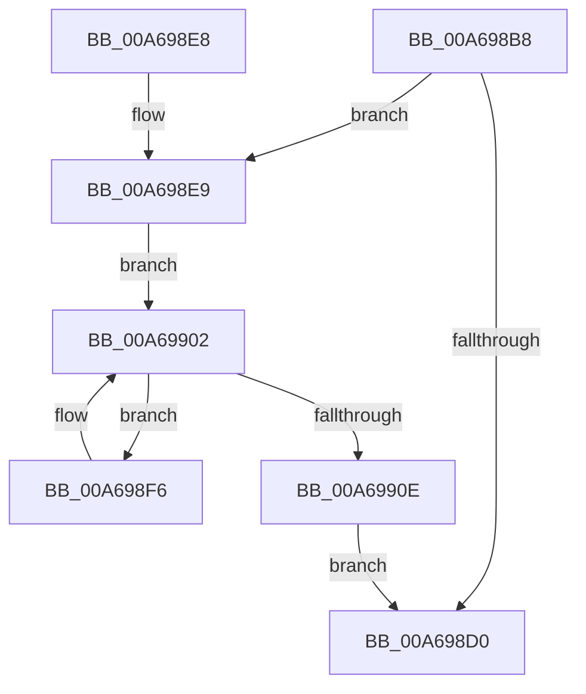

# RtlpDeleteRangeListEntry

- RVA: `0x00A698B8`–`0x00A69910` (길이 `88` bytes)
- VA: `0x0000000140A698B8`
- 실행 섹션: `PAGE`
- PDB 이름 있음: `예`; PDB Function 태그: `아니요`
- unwind 정보 RVA: `0x0009A534`
- 디코드: `27`개 명령, `88/88` bytes 표시
- 미해석 바이트: `0` (있으면 어셈블리에 `.byte`로 보존)

> 이 문서는 커널 이미지의 기계어와 PDB 기호를 분석해 생성했습니다. 4번과 5번은 함수 원형과 자료형을 바이너리 사용 방식에서 추정한 C 해석이며 원본 소스 복구 결과는 아닙니다.

## 1. Dependencies

- 직접 호출 지점: **2**; 고유 호출 대상: **1**
- 직접 호출자로 확인된 함수: **2**
- RIP 상대 이미지 참조: **0**

### Outgoing calls
- `0x00A698D3` → [RtlpFreeRangeListEntry](RtlpFreeRangeListEntry_function_00A69918.md) (function, `0x00A69918`)
- `0x00A698F6` → [RtlpFreeRangeListEntry](RtlpFreeRangeListEntry_function_00A69918.md) (function, `0x00A69918`)

### Direct callers
- [RtlpCopyRangeListEntry](RtlpCopyRangeListEntry_function_00A69720.md) at `0x00A69822`
- [RtlFreeRangeList](RtlFreeRangeList_function_00A69850.md) at `0x00A69898`

### Static image references
- 디코드된 RIP-relative 메모리 참조가 없습니다.

## 2. Other-region calls and transfers

- 다른 실행 섹션으로 향하는 call: **0**
- 별도 외부 분기/꼬리 이동을 확인하지 못했습니다.

## 3. Assembly (complete function range)

```asm
00A698B8  48 89 5C 24 08                  mov qword ptr [rsp + 8], rbx
00A698BD  48 89 74 24 10                  mov qword ptr [rsp + 0x10], rsi
00A698C2  57                              push rdi
00A698C3  48 83 EC 20                     sub rsp, 0x20
00A698C7  F6 41 22 01                     test byte ptr [rcx + 0x22], 1
00A698CB  48 8B F9                        mov rdi, rcx
00A698CE  75 19                           jne 0x140a698e9
00A698D0  48 8B CF                        mov rcx, rdi
00A698D3  E8 40 00 00 00                  call 0x140a69918
00A698D8  48 8B 5C 24 30                  mov rbx, qword ptr [rsp + 0x30]
00A698DD  48 8B 74 24 38                  mov rsi, qword ptr [rsp + 0x38]
00A698E2  48 83 C4 20                     add rsp, 0x20
00A698E6  5F                              pop rdi
00A698E7  C3                              ret
00A698E8  CC                              int3
00A698E9  48 8D 71 10                     lea rsi, [rcx + 0x10]
00A698ED  48 8B 06                        mov rax, qword ptr [rsi]
00A698F0  48 8D 48 D8                     lea rcx, [rax - 0x28]
00A698F4  EB 0C                           jmp 0x140a69902
00A698F6  E8 1D 00 00 00                  call 0x140a69918
00A698FB  48 8B CB                        mov rcx, rbx
00A698FE  48 8D 43 28                     lea rax, [rbx + 0x28]
00A69902  48 8B 18                        mov rbx, qword ptr [rax]
00A69905  48 83 EB 28                     sub rbx, 0x28
00A69909  48 3B F0                        cmp rsi, rax
00A6990C  75 E8                           jne 0x140a698f6
00A6990E  EB C0                           jmp 0x140a698d0
```

## 4. C-style interpretation (structured pseudocode)

```c
__int64 __fastcall RtlpDeleteRangeListEntry(__int64 a1)
{
    __int64 result;
    __int64 v_rbx;
    __int64 v_rsp;
    unsigned __int64 v_stack_p10;
    unsigned __int64 v_stack_p8;

    v_stack_p8 = v_rbx;
    v_stack_p10 = v_rsi;
    v_rsp = (v_rsp) - (32);
    if (((*(unsigned __int8 *)(a1 + 34)) & (1)) != 0) goto loc_00A698E9;
loc_00A698D0:
    result = RtlpFreeRangeListEntry(a1, a2, a3, a4);
    v_rsp = (v_rsp) + (32);
    return result;
loc_00A698E9:
    goto loc_00A69902;
loc_00A698F6:
    result = RtlpFreeRangeListEntry(*(unsigned __int64 *)(a1 + 16) - 40, a2, a3, a4);
loc_00A69902:
    v_rbx = (*(unsigned __int64 *)(v_stack_p8 + 40)) - (40);
    if ((a1 + 16) != (v_stack_p8 + 40)) goto loc_00A698F6;
    goto loc_00A698D0;
}
```

## 5. (Beta) C Style

```c
int64_t RtlpDeleteRangeListEntry(void *Arg1)
{
    uint8_t *arg1 = (uint8_t *)Arg1;

    int64_t result;
    int64_t local_rbx;
    int64_t local_rsp;
    uint64_t v_stack_p10;
    uint64_t v_stack_p8;

    v_stack_p8 = local_rbx;
    v_stack_p10 = local_rsi;
    local_rsp = (local_rsp) - (32);
    if (((*(uint8_t *)(arg1 + 0x22)) & (1)) != 0) goto loc_00A698E9;
loc_00A698D0:
    result = RtlpFreeRangeListEntry(Arg1, a2, a3, a4);
    local_rsp = (local_rsp) + (32);
    return result;
loc_00A698E9:
    goto loc_00A69902;
loc_00A698F6:
    result = RtlpFreeRangeListEntry(*(uint64_t *)(arg1 + 0x10) - 40, a2, a3, a4);
loc_00A69902:
    local_rbx = (*(uint64_t *)(v_stack_p8 + 0x28)) - (40);
    if ((Arg1 + 16) != (v_stack_p8 + 40)) goto loc_00A698F6;
    goto loc_00A698D0;
}
```

### 관측된 메모리 오프셋

구조체 형식이 확인되지 않은 접근은 인자 기준의 오프셋으로만 기록했습니다.

| 기준 인자 | 오프셋 표현 | 폭 (bit) | 접근 |
|---|---:|---:|---|
| `Arg1` | `+ 0x0` | `64` | `R` |
| `Arg1` | `+ 0x10` | `64` | `R` |
| `Arg1` | `+ 0x22` | `8` | `R` |

## 6. Execution-region graph

[열기: 2D/3D 그래프와 함수 탐색 컨트롤 패널](../../../control-panel.html?section=page&rva=0x00A698B8&view=graph)

- 2D 그래프는 위에서 아래로 흐르고, 3D 그래프는 빈 공간을 드래그해 회전합니다. Shift+드래그는 이동, 휠은 확대·축소, 함수 노드 선택은 대상 보고서 이동입니다.

### Static fallback


