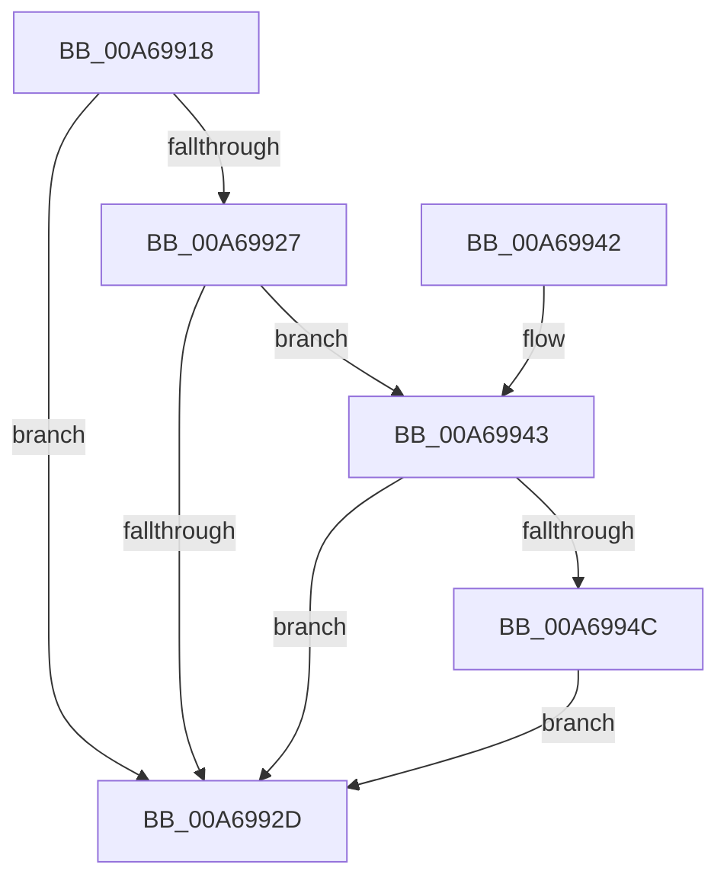

# RtlpFreeRangeListEntry

- RVA: `0x00A69918`–`0x00A69959` (길이 `65` bytes)
- VA: `0x0000000140A69918`
- 실행 섹션: `PAGE`
- PDB 이름 있음: `예`; PDB Function 태그: `아니요`
- unwind 정보 RVA: `0x00068804`
- 디코드: `21`개 명령, `65/65` bytes 표시
- 미해석 바이트: `0` (있으면 어셈블리에 `.byte`로 보존)

> 이 문서는 커널 이미지의 기계어와 PDB 기호를 분석해 생성했습니다. 4번과 5번은 함수 원형과 자료형을 바이너리 사용 방식에서 추정한 C 해석이며 원본 소스 복구 결과는 아닙니다.

## 1. Dependencies

- 직접 호출 지점: **2**; 고유 호출 대상: **2**
- 직접 호출자로 확인된 함수: **6**
- RIP 상대 이미지 참조: **1**

### Outgoing calls
- `0x00A69937` → [ExFreeToPagedLookasideList](../../text/38/ExFreeToPagedLookasideList_function_00387D30.md) (function, `0x00387D30`)
- `0x00A69952` → [ExFreePoolWithTag](../../poolcode/B8/ExFreePoolWithTag_function_00B82870.md) (function, `0x00B82870`)

### Direct callers
- [RtlDeleteRange](../78/RtlDeleteRange_function_0078A920.md) at `0x0078A9F8`
- [RtlpAddIntersectingRanges](../78/RtlpAddIntersectingRanges_function_0078AB4C.md) at `0x0078ACF2`
- [RtlpDeleteFromMergedRange](../78/RtlpDeleteFromMergedRange_function_0078AE98.md) at `0x0078AFFA`
- [RtlpDeleteFromMergedRange](../78/RtlpDeleteFromMergedRange_function_0078AE98.md) at `0x0078B002`
- [RtlpDeleteRangeListEntry](RtlpDeleteRangeListEntry_function_00A698B8.md) at `0x00A698D3`
- [RtlpDeleteRangeListEntry](RtlpDeleteRangeListEntry_function_00A698B8.md) at `0x00A698F6`
- [RtlDeleteOwnersRanges](../A8/RtlDeleteOwnersRanges_function_00A828B0.md) at `0x00A8293C`
- [RtlAddRange](../A8/RtlAddRange_function_00A8E860.md) at `0x00A8E92B`

### Static image references
- `0x00A69930` → RVA `0x00E28200` (`.data`; read)

## 2. Other-region calls and transfers

- 다른 실행 섹션으로 향하는 call: **2**
  - `0x00A69937` → [ExFreeToPagedLookasideList](../../text/38/ExFreeToPagedLookasideList_function_00387D30.md) (`PAGE` → `.text`)
  - `0x00A69952` → [ExFreePoolWithTag](../../poolcode/B8/ExFreePoolWithTag_function_00B82870.md) (`PAGE` → `POOLCODE`)
- 별도 외부 분기/꼬리 이동을 확인하지 못했습니다.

## 3. Assembly (complete function range)

```asm
00A69918  40 53                           push rbx
00A6991A  48 83 EC 20                     sub rsp, 0x20
00A6991E  F6 41 22 01                     test byte ptr [rcx + 0x22], 1
00A69922  48 8B D9                        mov rbx, rcx
00A69925  75 06                           jne 0x140a6992d
00A69927  F6 41 21 10                     test byte ptr [rcx + 0x21], 0x10
00A6992B  75 16                           jne 0x140a69943
00A6992D  48 8B D3                        mov rdx, rbx
00A69930  48 8D 0D C9 E8 3B 00            lea rcx, [rip + 0x3be8c9]
00A69937  E8 F4 E3 91 FF                  call 0x140387d30
00A6993C  48 83 C4 20                     add rsp, 0x20
00A69940  5B                              pop rbx
00A69941  C3                              ret
00A69942  CC                              int3
00A69943  48 8B 41 10                     mov rax, qword ptr [rcx + 0x10]
00A69947  83 00 FF                        add dword ptr [rax], -1
00A6994A  75 E1                           jne 0x140a6992d
00A6994C  48 8B 49 10                     mov rcx, qword ptr [rcx + 0x10]
00A69950  33 D2                           xor edx, edx
00A69952  E8 19 8F 11 00                  call 0x140b82870
00A69957  EB D4                           jmp 0x140a6992d
```

## 4. C-style interpretation (structured pseudocode)

```c
__int64 __fastcall RtlpFreeRangeListEntry(__int64 a1)
{
    __int64 result;
    __int64 v_rsp;

    v_rsp = (v_rsp) - (32);
    if (((*(unsigned __int8 *)(a1 + 34)) & (1)) != 0) goto loc_00A6992D;
    if (((*(unsigned __int8 *)(a1 + 33)) & (16)) != 0) goto loc_00A69943;
loc_00A6992D:
    result = ExFreeToPagedLookasideList(v_rip + 3926217, a1, a3, a4);
    v_rsp = (v_rsp) + (32);
    return result;
loc_00A69943:
    if (condition_is_not_equal) goto loc_00A6992D;
    a2 = 0;
    result = ExFreePoolWithTag(*(unsigned __int64 *)(v_rip + 3926217 + 16), a2, a3, a4);
    goto loc_00A6992D;
}
```

## 5. (Beta) C Style

```c
int64_t RtlpFreeRangeListEntry(void *Arg1)
{
    uint8_t *arg1 = (uint8_t *)Arg1;

    int64_t result;
    int64_t local_rsp;

    local_rsp = (local_rsp) - (32);
    if (((*(uint8_t *)(arg1 + 0x22)) & (1)) != 0) goto loc_00A6992D;
    if (((*(uint8_t *)(arg1 + 0x21)) & (16)) != 0) goto loc_00A69943;
loc_00A6992D:
    result = ExFreeToPagedLookasideList(v_rip + 3926217, Arg1, a3, a4);
    local_rsp = (local_rsp) + (32);
    return result;
loc_00A69943:
    if (condition_is_not_equal) goto loc_00A6992D;
    a2 = 0;
    result = ExFreePoolWithTag(*(uint64_t *)(v_rip + 0x3BE8C9 + 0x10), a2, a3, a4);
    goto loc_00A6992D;
}
```

### 관측된 메모리 오프셋

구조체 형식이 확인되지 않은 접근은 인자 기준의 오프셋으로만 기록했습니다.

| 기준 인자 | 오프셋 표현 | 폭 (bit) | 접근 |
|---|---:|---:|---|
| `Arg1` | `+ 0x10` | `64` | `R` |
| `Arg1` | `+ 0x21` | `8` | `R` |
| `Arg1` | `+ 0x22` | `8` | `R` |

## 6. Execution-region graph

[열기: 2D/3D 그래프와 함수 탐색 컨트롤 패널](../../../control-panel.html?section=page&rva=0x00A69918&view=graph)

- 2D 그래프는 위에서 아래로 흐르고, 3D 그래프는 빈 공간을 드래그해 회전합니다. Shift+드래그는 이동, 휠은 확대·축소, 함수 노드 선택은 대상 보고서 이동입니다.

### Static fallback


