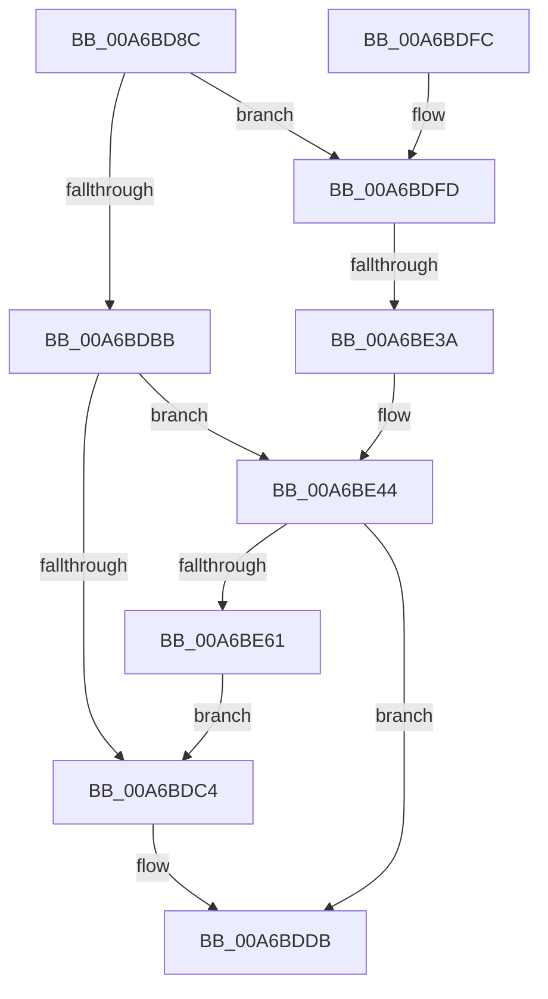

# RtlpGetTimeZoneInfoHandle

- RVA: `0x00A6BD8C`–`0x00A6BE66` (길이 `218` bytes)
- VA: `0x0000000140A6BD8C`
- 실행 섹션: `PAGE`
- PDB 이름 있음: `예`; PDB Function 태그: `예`
- unwind 정보 RVA: `0x000B43A0`
- 디코드: `47`개 명령, `218/218` bytes 표시
- 미해석 바이트: `0` (있으면 어셈블리에 `.byte`로 보존)

> 이 문서는 커널 이미지의 기계어와 PDB 기호를 분석해 생성했습니다. 4번과 5번은 함수 원형과 자료형을 바이너리 사용 방식에서 추정한 C 해석이며 원본 소스 복구 결과는 아닙니다.

## 1. Dependencies

- 직접 호출 지점: **4**; 고유 호출 대상: **3**
- 직접 호출자로 확인된 함수: **3**
- RIP 상대 이미지 참조: **6**

### Outgoing calls
- `0x00A6BDD6` → [RtlpGetRegistryHandle](../8C/RtlpGetRegistryHandle_function_008C955C.md) (function, `0x008C955C`)
- `0x00A6BDE6` → [_security_check_cookie](../../text/6A/_security_check_cookie_function_006AC640.md) (function, `0x006AC640`)
- `0x00A6BE2D` → [RtlGetPersistedStateLocation](../8C/RtlGetPersistedStateLocation_function_008C8DE0.md) (function, `0x008C8DE0`)
- `0x00A6BE51` → [RtlpGetRegistryHandle](../8C/RtlpGetRegistryHandle_function_008C955C.md) (function, `0x008C955C`)

### Direct callers
- [RtlSetActiveTimeBias](../78/RtlSetActiveTimeBias_function_0078FA2C.md) at `0x0078FA4E`
- [RtlpSetTimeZoneInformationWorker](../78/RtlpSetTimeZoneInformationWorker_function_0078FEC8.md) at `0x0078FF5F`
- [RtlpQueryTimeZoneInformationWorker](RtlpQueryTimeZoneInformationWorker_function_00A6BB6C.md) at `0x00A6BBC5`

### Static image references
- `0x00A6BD99` → RVA `0x00E0A740` (`.data`; read)
- `0x00A6BDAB` → RVA `0x00E67B0C` (`.data`; read)
- `0x00A6BDC7` → RVA `0x00B05940` (` ?? ::NNGAKEGL::`string'`; read)
- `0x00A6BE0A` → RVA `0x00B056B0` (` ?? ::NNGAKEGL::`string'`; read)
- `0x00A6BE26` → RVA `0x00B05970` (` ?? ::NNGAKEGL::`string'`; read)
- `0x00A6BE3A` → RVA `0x00E67B0C` (`.data`; write)

## 2. Other-region calls and transfers

- 다른 실행 섹션으로 향하는 call: **1**
  - `0x00A6BDE6` → [_security_check_cookie](../../text/6A/_security_check_cookie_function_006AC640.md) (`PAGE` → `.text`)
- call이 아닌 외부 분기/꼬리 이동: **1**
  - `0x00A6BE34` → [sub_00B3F31A](../B3/Unknown_function_00B3F31A.md) (`tail-transfer`)

## 3. Assembly (complete function range)

```asm
00A6BD8C  48 89 5C 24 08                  mov qword ptr [rsp + 8], rbx
00A6BD91  57                              push rdi
00A6BD92  48 81 EC 70 02 00 00            sub rsp, 0x270
00A6BD99  48 8B 05 A0 E9 39 00            mov rax, qword ptr [rip + 0x39e9a0]
00A6BDA0  48 33 C4                        xor rax, rsp
00A6BDA3  48 89 84 24 60 02 00 00         mov qword ptr [rsp + 0x260], rax
00A6BDAB  8B 05 5B BD 3F 00               mov eax, dword ptr [rip + 0x3fbd5b]
00A6BDB1  48 8B FA                        mov rdi, rdx
00A6BDB4  8A D9                           mov bl, cl
00A6BDB6  83 F8 02                        cmp eax, 2
00A6BDB9  75 42                           jne 0x140a6bdfd
00A6BDBB  83 F8 01                        cmp eax, 1
00A6BDBE  0F 84 80 00 00 00               je 0x140a6be44
00A6BDC4  4C 8B CF                        mov r9, rdi
00A6BDC7  48 8D 15 72 9B 09 00            lea rdx, [rip + 0x99b72]
00A6BDCE  44 8A C3                        mov r8b, bl
00A6BDD1  B9 02 00 00 00                  mov ecx, 2
00A6BDD6  E8 81 D7 E5 FF                  call 0x1408c955c
00A6BDDB  48 8B 8C 24 60 02 00 00         mov rcx, qword ptr [rsp + 0x260]
00A6BDE3  48 33 CC                        xor rcx, rsp
00A6BDE6  E8 55 08 C4 FF                  call 0x1406ac640
00A6BDEB  48 8B 9C 24 80 02 00 00         mov rbx, qword ptr [rsp + 0x280]
00A6BDF3  48 81 C4 70 02 00 00            add rsp, 0x270
00A6BDFA  5F                              pop rdi
00A6BDFB  C3                              ret
00A6BDFC  CC                              int3
00A6BDFD  48 8D 44 24 40                  lea rax, [rsp + 0x40]
00A6BE02  45 33 C9                        xor r9d, r9d
00A6BE05  48 89 44 24 30                  mov qword ptr [rsp + 0x30], rax
00A6BE0A  48 8D 15 9F 98 09 00            lea rdx, [rip + 0x9989f]
00A6BE11  48 8D 44 24 50                  lea rax, [rsp + 0x50]
00A6BE16  C7 44 24 28 08 02 00 00         mov dword ptr [rsp + 0x28], 0x208
00A6BE1E  45 33 C0                        xor r8d, r8d
00A6BE21  48 89 44 24 20                  mov qword ptr [rsp + 0x20], rax
00A6BE26  48 8D 0D 43 9B 09 00            lea rcx, [rip + 0x99b43]
00A6BE2D  E8 AE CF E5 FF                  call 0x1408c8de0
00A6BE32  85 C0                           test eax, eax
00A6BE34  0F 88 E0 34 0D 00               js 0x140b3f31a
00A6BE3A  C7 05 C8 BC 3F 00 01 00 00 00   mov dword ptr [rip + 0x3fbcc8], 1
00A6BE44  4C 8B CF                        mov r9, rdi
00A6BE47  48 8D 54 24 50                  lea rdx, [rsp + 0x50]
00A6BE4C  44 8A C3                        mov r8b, bl
00A6BE4F  33 C9                           xor ecx, ecx
00A6BE51  E8 06 D7 E5 FF                  call 0x1408c955c
00A6BE56  3D 34 00 00 C0                  cmp eax, 0xc0000034
00A6BE5B  0F 85 7A FF FF FF               jne 0x140a6bddb
00A6BE61  E9 5E FF FF FF                  jmp 0x140a6bdc4
```

## 4. C-style interpretation (structured pseudocode)

```c
__int64 __fastcall RtlpGetTimeZoneInfoHandle(unsigned __int8 a1, __int64 a2)
{
    __int64 result;
    __int64 v_rsp;
    unsigned __int64 v_stack_m18;
    unsigned __int64 v_stack_p20;
    unsigned int v_stack_p28;
    unsigned __int64 v_stack_p30;
    unsigned __int64 v_stack_p40;
    unsigned __int64 v_stack_p50;
    unsigned __int64 v_stack_p8;

    v_stack_p8 = v_rbx;
    v_rsp = (v_rsp) - (624);
    result = (*(unsigned __int64 *)(v_rip + 3795360)) ^ (v_rsp);
    v_stack_m18 = result;
    if (((unsigned int)((unsigned int)(*(unsigned int *)(v_rip + 4177243)))) != 2) goto loc_00A6BDFD;
    if (((unsigned int)((unsigned int)(*(unsigned int *)(v_rip + 4177243)))) == 1) goto loc_00A6BE44;
loc_00A6BDC4:
    result = RtlpGetRegistryHandle(2, v_rip + 629618, a1, a2);
loc_00A6BDDB:
    a1 = (v_stack_m18) ^ (v_rsp);
    result = _security_check_cookie(a1, v_rip + 629618, a1, a2);
    v_rsp = (v_rsp) + (624);
    return result;
loc_00A6BDFD:
    a4 = 0;
    v_stack_p30 = v_stack_p40;
    v_stack_p28 = 520;
    a3 = 0;
    v_stack_p20 = v_stack_p50;
    result = RtlGetPersistedStateLocation(v_rip + 629571, v_rip + 628895, a3, a4);
    *(unsigned int *)(v_rip + 4177096) = 1;
loc_00A6BE44:
    a1 = 0;
    result = RtlpGetRegistryHandle(a1, v_stack_p50, (unsigned __int8)(v_stack_p8), a2);
    if (((unsigned int)(result)) != 0xC0000034ULL) goto loc_00A6BDDB;
    goto loc_00A6BDC4;
}
```

## 5. (Beta) C Style

```c
int64_t RtlpGetTimeZoneInfoHandle(uint8_t Arg1, int64_t Arg2)
{
    int64_t result;
    int64_t local_rsp;
    uint64_t v_stack_m18;
    uint64_t v_stack_p20;
    uint32_t v_stack_p28;
    uint64_t v_stack_p30;
    uint64_t v_stack_p40;
    uint64_t v_stack_p50;
    uint64_t v_stack_p8;

    v_stack_p8 = local_rbx;
    local_rsp = (local_rsp) - (624);
    result = (*(uint64_t *)(v_rip + 0x39E9A0)) ^ (local_rsp);
    v_stack_m18 = result;
    if (((uint32_t)((uint32_t)(*(uint32_t *)(v_rip + 0x3FBD5B)))) != 2) goto loc_00A6BDFD;
    if (((uint32_t)((uint32_t)(*(uint32_t *)(v_rip + 0x3FBD5B)))) == 1) goto loc_00A6BE44;
loc_00A6BDC4:
    result = RtlpGetRegistryHandle(2, v_rip + 629618, Arg1, Arg2);
loc_00A6BDDB:
    Arg1 = (v_stack_m18) ^ (local_rsp);
    result = _security_check_cookie(Arg1, v_rip + 629618, Arg1, Arg2);
    local_rsp = (local_rsp) + (624);
    return result;
loc_00A6BDFD:
    a4 = 0;
    v_stack_p30 = v_stack_p40;
    v_stack_p28 = 520;
    a3 = 0;
    v_stack_p20 = v_stack_p50;
    result = RtlGetPersistedStateLocation(v_rip + 629571, v_rip + 628895, a3, a4);
    *(uint32_t *)(v_rip + 0x3FBCC8) = 1;
loc_00A6BE44:
    Arg1 = 0;
    result = RtlpGetRegistryHandle(Arg1, v_stack_p50, (uint8_t)(v_stack_p8), Arg2);
    if (((uint32_t)(result)) != 0xC0000034ULL) goto loc_00A6BDDB;
    goto loc_00A6BDC4;
}
```

## 6. Execution-region graph

[열기: 2D/3D 그래프와 함수 탐색 컨트롤 패널](../../../control-panel.html?section=page&rva=0x00A6BD8C&view=graph)

- 2D 그래프는 위에서 아래로 흐르고, 3D 그래프는 빈 공간을 드래그해 회전합니다. Shift+드래그는 이동, 휠은 확대·축소, 함수 노드 선택은 대상 보고서 이동입니다.

### Static fallback


