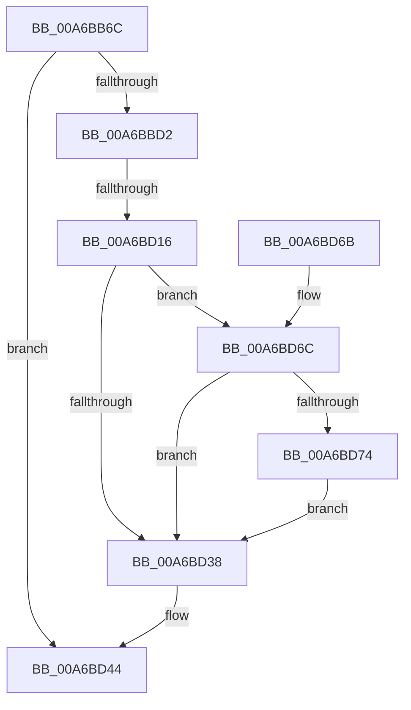

# RtlpQueryTimeZoneInformationWorker

- RVA: `0x00A6BB6C`–`0x00A6BD84` (길이 `536` bytes)
- VA: `0x0000000140A6BB6C`
- 실행 섹션: `PAGE`
- PDB 이름 있음: `예`; PDB Function 태그: `예`
- unwind 정보 RVA: `0x000B436C`
- 디코드: `118`개 명령, `536/536` bytes 표시
- 미해석 바이트: `0` (있으면 어셈블리에 `.byte`로 보존)

> 이 문서는 커널 이미지의 기계어와 PDB 기호를 분석해 생성했습니다. 4번과 5번은 함수 원형과 자료형을 바이너리 사용 방식에서 추정한 C 해석이며 원본 소스 복구 결과는 아닙니다.

## 1. Dependencies

- 직접 호출 지점: **6**; 고유 호출 대상: **5**
- 직접 호출자로 확인된 함수: **5**
- RIP 상대 이미지 참조: **8**

### Outgoing calls
- `0x00A6BBC5` → [RtlpGetTimeZoneInfoHandle](RtlpGetTimeZoneInfoHandle_function_00A6BD8C.md) (function, `0x00A6BD8C`)
- `0x00A6BBDA` → [memset](../../text/6C/memset_function_006C6C40.md) (function, `0x006C6C40`)
- `0x00A6BBEC` → [memset](../../text/6C/memset_function_006C6C40.md) (function, `0x006C6C40`)
- `0x00A6BD2D` → [RtlpQueryRegistryValues](../8C/RtlpQueryRegistryValues_function_008C9050.md) (function, `0x008C9050`)
- `0x00A6BD3D` → [ZwClose](../../text/6A/ZwClose_function_006AD2B0.md) (function, `0x006AD2B0`)
- `0x00A6BD4E` → [_security_check_cookie](../../text/6A/_security_check_cookie_function_006AC640.md) (function, `0x006AC640`)

### Direct callers
- [ExInitializeUtcTimeZoneBias](../7C/ExInitializeUtcTimeZoneBias_function_007C5818.md) at `0x007C589D`
- [EtwpAddLogHeader](../9C/EtwpAddLogHeader_function_009C0BD0.md) at `0x009C0E95`
- [RtlQueryDynamicTimeZoneInformation](RtlQueryDynamicTimeZoneInformation_function_00A6B450.md) at `0x00A6B459`
- [ExpRefreshTimeZoneInformation](ExpRefreshTimeZoneInformation_function_00A6B46C.md) at `0x00A6B529`
- [ExpRefreshTimeZoneInformation](ExpRefreshTimeZoneInformation_function_00A6B46C.md) at `0x00A6B5D3`
- [RtlQueryTimeZoneInformation](RtlQueryTimeZoneInformation_function_00A6BB50.md) at `0x00A6BB59`

### Static image references
- `0x00A6BB89` → RVA `0x00E0A740` (`.data`; read)
- `0x00A6BC04` → RVA `0x00B4B040` (`szBias`; read)
- `0x00A6BC18` → RVA `0x00B4BAF0` (`szStandardName`; read)
- `0x00A6BC36` → RVA `0x00B4BAB0` (`szStandardBias`; read)
- `0x00A6BC49` → RVA `0x00B4BB68` (`szStandardStart`; read)
- `0x00A6BC6B` → RVA `0x00B4BAD0` (`szDaylightName`; read)
- `0x00A6BC7F` → RVA `0x00B4BA90` (`szDaylightBias`; read)
- `0x00A6BC9B` → RVA `0x00B4BB48` (`szDaylightStart`; read)

## 2. Other-region calls and transfers

- 다른 실행 섹션으로 향하는 call: **4**
  - `0x00A6BBDA` → [memset](../../text/6C/memset_function_006C6C40.md) (`PAGE` → `.text`)
  - `0x00A6BBEC` → [memset](../../text/6C/memset_function_006C6C40.md) (`PAGE` → `.text`)
  - `0x00A6BD3D` → [ZwClose](../../text/6A/ZwClose_function_006AD2B0.md) (`PAGE` → `.text`)
  - `0x00A6BD4E` → [_security_check_cookie](../../text/6A/_security_check_cookie_function_006AC640.md) (`PAGE` → `.text`)
- call이 아닌 외부 분기/꼬리 이동: **1**
  - `0x00A6BD10` → [sub_00B3F2AC](../B3/Unknown_function_00B3F2AC.md) (`tail-transfer`)

## 3. Assembly (complete function range)

```asm
00A6BB6C  48 89 5C 24 18                  mov qword ptr [rsp + 0x18], rbx
00A6BB71  48 89 74 24 20                  mov qword ptr [rsp + 0x20], rsi
00A6BB76  55                              push rbp
00A6BB77  57                              push rdi
00A6BB78  41 56                           push r14
00A6BB7A  48 8D AC 24 50 FE FF FF         lea rbp, [rsp - 0x1b0]
00A6BB82  48 81 EC B0 02 00 00            sub rsp, 0x2b0
00A6BB89  48 8B 05 B0 EB 39 00            mov rax, qword ptr [rip + 0x39ebb0]
00A6BB90  48 33 C4                        xor rax, rsp
00A6BB93  48 89 85 A0 01 00 00            mov qword ptr [rbp + 0x1a0], rax
00A6BB9A  45 33 F6                        xor r14d, r14d
00A6BB9D  8B F2                           mov esi, edx
00A6BB9F  48 8B D9                        mov rbx, rcx
00A6BBA2  4C 89 74 24 38                  mov qword ptr [rsp + 0x38], r14
00A6BBA7  0F 57 C0                        xorps xmm0, xmm0
00A6BBAA  44 89 74 24 44                  mov dword ptr [rsp + 0x44], r14d
00A6BBAF  48 8D 54 24 38                  lea rdx, [rsp + 0x38]
00A6BBB4  44 89 74 24 54                  mov dword ptr [rsp + 0x54], r14d
00A6BBB9  33 C9                           xor ecx, ecx
00A6BBBB  44 89 74 24 30                  mov dword ptr [rsp + 0x30], r14d
00A6BBC0  0F 11 44 24 60                  movups xmmword ptr [rsp + 0x60], xmm0
00A6BBC5  E8 C2 01 00 00                  call 0x140a6bd8c
00A6BBCA  85 C0                           test eax, eax
00A6BBCC  0F 88 72 01 00 00               js 0x140a6bd44
00A6BBD2  44 8B C6                        mov r8d, esi
00A6BBD5  33 D2                           xor edx, edx
00A6BBD7  48 8B CB                        mov rcx, rbx
00A6BBDA  E8 61 B0 C5 FF                  call 0x1406c6c40
00A6BBDF  33 D2                           xor edx, edx
00A6BBE1  48 8D 4C 24 70                  lea rcx, [rsp + 0x70]
00A6BBE6  41 B8 30 02 00 00               mov r8d, 0x230
00A6BBEC  E8 4F B0 C5 FF                  call 0x1406c6c40
00A6BBF1  C7 44 24 40 00 00 40 00         mov dword ptr [rsp + 0x40], 0x400000
00A6BBF9  41 BA 20 01 00 00               mov r10d, 0x120
00A6BBFF  44 89 54 24 78                  mov dword ptr [rsp + 0x78], r10d
00A6BC04  48 8D 05 35 F4 0D 00            lea rax, [rip + 0xdf435]
00A6BC0B  48 89 45 80                     mov qword ptr [rbp - 0x80], rax
00A6BC0F  48 8D 43 04                     lea rax, [rbx + 4]
00A6BC13  48 89 44 24 48                  mov qword ptr [rsp + 0x48], rax
00A6BC18  48 8D 05 D1 FE 0D 00            lea rax, [rip + 0xdfed1]
00A6BC1F  48 89 45 B8                     mov qword ptr [rbp - 0x48], rax
00A6BC23  48 8D 44 24 40                  lea rax, [rsp + 0x40]
00A6BC28  48 89 45 C0                     mov qword ptr [rbp - 0x40], rax
00A6BC2C  41 BB 00 00 00 04               mov r11d, 0x4000000
00A6BC32  48 89 5D 88                     mov qword ptr [rbp - 0x78], rbx
00A6BC36  48 8D 05 73 FE 0D 00            lea rax, [rip + 0xdfe73]
00A6BC3D  48 89 45 F0                     mov qword ptr [rbp - 0x10], rax
00A6BC41  48 8D 43 54                     lea rax, [rbx + 0x54]
00A6BC45  48 89 45 F8                     mov qword ptr [rbp - 8], rax
00A6BC49  48 8D 05 18 FF 0D 00            lea rax, [rip + 0xdff18]
00A6BC50  48 89 45 28                     mov qword ptr [rbp + 0x28], rax
00A6BC54  48 8D 43 44                     lea rax, [rbx + 0x44]
00A6BC58  48 89 45 30                     mov qword ptr [rbp + 0x30], rax
00A6BC5C  41 8D 56 F0                     lea edx, [r14 - 0x10]
00A6BC60  89 10                           mov dword ptr [rax], edx
00A6BC62  48 8D 43 58                     lea rax, [rbx + 0x58]
00A6BC66  48 89 44 24 58                  mov qword ptr [rsp + 0x58], rax
00A6BC6B  48 8D 05 5E FE 0D 00            lea rax, [rip + 0xdfe5e]
00A6BC72  48 89 45 60                     mov qword ptr [rbp + 0x60], rax
00A6BC76  48 8D 44 24 50                  lea rax, [rsp + 0x50]
00A6BC7B  48 89 45 68                     mov qword ptr [rbp + 0x68], rax
00A6BC7F  48 8D 05 0A FE 0D 00            lea rax, [rip + 0xdfe0a]
00A6BC86  48 89 85 98 00 00 00            mov qword ptr [rbp + 0x98], rax
00A6BC8D  48 8D 83 A8 00 00 00            lea rax, [rbx + 0xa8]
00A6BC94  48 89 85 A0 00 00 00            mov qword ptr [rbp + 0xa0], rax
00A6BC9B  48 8D 05 A6 FE 0D 00            lea rax, [rip + 0xdfea6]
00A6BCA2  48 89 85 D0 00 00 00            mov qword ptr [rbp + 0xd0], rax
00A6BCA9  48 8D 83 98 00 00 00            lea rax, [rbx + 0x98]
00A6BCB0  C7 44 24 50 00 00 40 00         mov dword ptr [rsp + 0x50], 0x400000
00A6BCB8  41 B8 00 00 00 01               mov r8d, 0x1000000
00A6BCBE  48 89 85 D8 00 00 00            mov qword ptr [rbp + 0xd8], rax
00A6BCC5  B9 00 00 00 03                  mov ecx, 0x3000000
00A6BCCA  89 10                           mov dword ptr [rax], edx
00A6BCCC  44 89 5D 90                     mov dword ptr [rbp - 0x70], r11d
00A6BCD0  44 89 55 B0                     mov dword ptr [rbp - 0x50], r10d
00A6BCD4  44 89 45 C8                     mov dword ptr [rbp - 0x38], r8d
00A6BCD8  44 89 55 E8                     mov dword ptr [rbp - 0x18], r10d
00A6BCDC  44 89 5D 00                     mov dword ptr [rbp], r11d
00A6BCE0  44 89 55 20                     mov dword ptr [rbp + 0x20], r10d
00A6BCE4  89 4D 38                        mov dword ptr [rbp + 0x38], ecx
00A6BCE7  44 89 55 58                     mov dword ptr [rbp + 0x58], r10d
00A6BCEB  44 89 45 70                     mov dword ptr [rbp + 0x70], r8d
00A6BCEF  44 89 95 90 00 00 00            mov dword ptr [rbp + 0x90], r10d
00A6BCF6  44 89 9D A8 00 00 00            mov dword ptr [rbp + 0xa8], r11d
00A6BCFD  44 89 95 C8 00 00 00            mov dword ptr [rbp + 0xc8], r10d
00A6BD04  89 8D E0 00 00 00               mov dword ptr [rbp + 0xe0], ecx
00A6BD0A  81 FE B0 01 00 00               cmp esi, 0x1b0
00A6BD10  0F 83 96 35 0D 00               jae 0x140b3f2ac
00A6BD16  48 8B 54 24 38                  mov rdx, qword ptr [rsp + 0x38]
00A6BD1B  4C 8D 44 24 70                  lea r8, [rsp + 0x70]
00A6BD20  45 33 C9                        xor r9d, r9d
00A6BD23  C6 44 24 28 01                  mov byte ptr [rsp + 0x28], 1
00A6BD28  B9 00 00 00 40                  mov ecx, 0x40000000
00A6BD2D  E8 1E D3 E5 FF                  call 0x1408c9050
00A6BD32  8B F8                           mov edi, eax
00A6BD34  85 C0                           test eax, eax
00A6BD36  79 34                           jns 0x140a6bd6c
00A6BD38  48 8B 4C 24 38                  mov rcx, qword ptr [rsp + 0x38]
00A6BD3D  E8 6E 15 C4 FF                  call 0x1406ad2b0
00A6BD42  8B C7                           mov eax, edi
00A6BD44  48 8B 8D A0 01 00 00            mov rcx, qword ptr [rbp + 0x1a0]
00A6BD4B  48 33 CC                        xor rcx, rsp
00A6BD4E  E8 ED 08 C4 FF                  call 0x1406ac640
00A6BD53  4C 8D 9C 24 B0 02 00 00         lea r11, [rsp + 0x2b0]
00A6BD5B  49 8B 5B 30                     mov rbx, qword ptr [r11 + 0x30]
00A6BD5F  49 8B 73 38                     mov rsi, qword ptr [r11 + 0x38]
00A6BD63  49 8B E3                        mov rsp, r11
00A6BD66  41 5E                           pop r14
00A6BD68  5F                              pop rdi
00A6BD69  5D                              pop rbp
00A6BD6A  C3                              ret
00A6BD6B  CC                              int3
00A6BD6C  81 FE B0 01 00 00               cmp esi, 0x1b0
00A6BD72  72 C4                           jb 0x140a6bd38
00A6BD74  44 39 74 24 30                  cmp dword ptr [rsp + 0x30], r14d
00A6BD79  0F 95 C1                        setne cl
00A6BD7C  88 8B AC 01 00 00               mov byte ptr [rbx + 0x1ac], cl
00A6BD82  EB B4                           jmp 0x140a6bd38
```

## 4. C-style interpretation (structured pseudocode)

```c
__int64 __fastcall RtlpQueryTimeZoneInformationWorker(__int64 a1, int a2, __int64 a3, int a4)
{
    __int64 result;
    __int64 v_r14;
    __int64 v_rsp;
    unsigned int v_stack_m100;
    unsigned int v_stack_m120;
    unsigned __int64 v_stack_m128;
    unsigned __int64 v_stack_m130;
    unsigned int v_stack_m138;
    unsigned int v_stack_m158;
    unsigned __int64 v_stack_m160;
    unsigned __int64 v_stack_m168;
    unsigned int v_stack_m170;
    unsigned __int64 v_stack_m18;
    unsigned int v_stack_m190;
    unsigned __int64 v_stack_m198;
    unsigned __int64 v_stack_m1A0;
    unsigned int v_stack_m1A8;
    unsigned __int64 v_stack_m1C8;
    unsigned __int64 v_stack_m1D0;
    unsigned __int64 v_stack_m1D8;
    unsigned int v_stack_m1E0;
    unsigned int v_stack_m200;
    unsigned __int64 v_stack_m208;
    unsigned __int64 v_stack_m210;
    unsigned int v_stack_m218;
    unsigned int v_stack_m238;
    unsigned __int64 v_stack_m240;
    unsigned __int64 v_stack_m248;
    unsigned int v_stack_m250;
    unsigned __int64 v_stack_m258;
    unsigned __int64 v_stack_m268;
    unsigned __int64 v_stack_m270;
    unsigned int v_stack_m274;
    unsigned __int64 v_stack_m278;
    unsigned __int64 v_stack_m28;
    unsigned __int64 v_stack_m280;
    unsigned int v_stack_m284;
    unsigned int v_stack_m288;
    unsigned __int64 v_stack_m290;
    unsigned int v_stack_m298;
    unsigned __int8 v_stack_m2A0;
    unsigned int v_stack_mE8;
    unsigned __int64 v_stack_mF0;
    unsigned __int64 v_stack_mF8;
    unsigned __int64 v_stack_p18;
    unsigned __int64 v_stack_p20;

    v_stack_p18 = v_rbx;
    v_stack_p20 = v_rsi;
    v_rsp = (v_rsp) - (688);
    result = (*(unsigned __int64 *)(v_rip + 3795888)) ^ (v_rsp);
    v_stack_m28 = result;
    v_r14 = 0;
    v_stack_m290 = 0;
    v_stack_m284 = 0;
    v_stack_m274 = 0;
    a1 = 0;
    v_stack_m298 = 0;
    v_stack_m268 = v_xmm0;
    result = RtlpGetTimeZoneInfoHandle(a1, v_stack_m290, a3, a4);
    if (sign_flag) goto loc_00A6BD44;
    a2 = 0;
    result = memset(0, a2, (unsigned int)((unsigned int)((unsigned int)(a2))), a4);
    a2 = 0;
    result = memset(v_stack_m258, a2, 560, a4);
    v_stack_m288 = 0x400000ULL;
    v_stack_m250 = 288;
    v_stack_m248 = v_rip + 914485;
    v_stack_m280 = a1 + 4;
    v_stack_m210 = v_rip + 917201;
    v_stack_m208 = v_stack_m288;
    v_stack_m240 = 0;
    v_stack_m1D8 = v_rip + 917107;
    v_stack_m1D0 = a1 + 84;
    v_stack_m1A0 = v_rip + 917272;
    v_stack_m198 = a1 + 68;
    *(unsigned int *)(a1 + 68) = (unsigned int)(v_r14 - 16);
    v_stack_m270 = a1 + 88;
    v_stack_m168 = v_rip + 917086;
    v_stack_m160 = v_stack_m278;
    v_stack_m130 = v_rip + 917002;
    v_stack_m128 = a1 + 168;
    v_stack_mF8 = v_rip + 917158;
    v_stack_m278 = 0x400000ULL;
    v_stack_mF0 = a1 + 152;
    *(unsigned int *)(a1 + 152) = (unsigned int)(v_r14 - 16);
    v_stack_m238 = (unsigned int)((unsigned int)(0x4000000ULL));
    v_stack_m218 = 288;
    v_stack_m200 = (unsigned int)((unsigned int)(0x1000000ULL));
    v_stack_m1E0 = 288;
    v_stack_m1C8 = (unsigned int)((unsigned int)(0x4000000ULL));
    v_stack_m1A8 = 288;
    v_stack_m190 = (unsigned int)((unsigned int)(0x3000000ULL));
    v_stack_m170 = 288;
    v_stack_m158 = (unsigned int)((unsigned int)(0x1000000ULL));
    v_stack_m138 = 288;
    v_stack_m120 = (unsigned int)((unsigned int)(0x4000000ULL));
    v_stack_m100 = 288;
    v_stack_mE8 = (unsigned int)((unsigned int)(0x3000000ULL));
    a4 = 0;
    v_stack_m2A0 = 1;
    result = RtlpQueryRegistryValues((unsigned int)(0x40000000ULL), v_stack_m290, v_stack_m258, a4);
    if (!sign_flag) goto loc_00A6BD6C;
loc_00A6BD38:
    result = ZwClose(v_stack_m290, v_stack_m290, v_stack_m258, a4);
loc_00A6BD44:
    a1 = (v_stack_m28) ^ (v_rsp);
    result = _security_check_cookie(a1, v_stack_m290, v_stack_m258, a4);
    return result;
loc_00A6BD6C:
    if (((unsigned int)(*(unsigned __int64 *)(v_stack_m18 + 56))) < 432) goto loc_00A6BD38;
    a1 = (v_stack_m280 != 0) ? 1 : 0;
    *(unsigned __int8 *)(*(unsigned __int64 *)(v_stack_m18 + 48) + 428) = (unsigned __int8)(a1);
    goto loc_00A6BD38;
}
```

## 5. (Beta) C Style

```c
int64_t RtlpQueryTimeZoneInformationWorker(void *Arg1, int32_t Arg2, int64_t Arg3, int32_t Arg4)
{
    uint8_t *arg1 = (uint8_t *)Arg1;

    int64_t result;
    int64_t local_r14;
    int64_t local_rsp;
    uint32_t v_stack_m100;
    uint32_t v_stack_m120;
    uint64_t v_stack_m128;
    uint64_t v_stack_m130;
    uint32_t v_stack_m138;
    uint32_t v_stack_m158;
    uint64_t v_stack_m160;
    uint64_t v_stack_m168;
    uint32_t v_stack_m170;
    uint64_t v_stack_m18;
    uint32_t v_stack_m190;
    uint64_t v_stack_m198;
    uint64_t v_stack_m1A0;
    uint32_t v_stack_m1A8;
    uint64_t v_stack_m1C8;
    uint64_t v_stack_m1D0;
    uint64_t v_stack_m1D8;
    uint32_t v_stack_m1E0;
    uint32_t v_stack_m200;
    uint64_t v_stack_m208;
    uint64_t v_stack_m210;
    uint32_t v_stack_m218;
    uint32_t v_stack_m238;
    uint64_t v_stack_m240;
    uint64_t v_stack_m248;
    uint32_t v_stack_m250;
    uint64_t v_stack_m258;
    uint64_t v_stack_m268;
    uint64_t v_stack_m270;
    uint32_t v_stack_m274;
    uint64_t v_stack_m278;
    uint64_t v_stack_m28;
    uint64_t v_stack_m280;
    uint32_t v_stack_m284;
    uint32_t v_stack_m288;
    uint64_t v_stack_m290;
    uint32_t v_stack_m298;
    uint8_t v_stack_m2A0;
    uint32_t v_stack_mE8;
    uint64_t v_stack_mF0;
    uint64_t v_stack_mF8;
    uint64_t v_stack_p18;
    uint64_t v_stack_p20;

    v_stack_p18 = local_rbx;
    v_stack_p20 = local_rsi;
    local_rsp = (local_rsp) - (688);
    result = (*(uint64_t *)(v_rip + 0x39EBB0)) ^ (local_rsp);
    v_stack_m28 = result;
    local_r14 = 0;
    v_stack_m290 = 0;
    v_stack_m284 = 0;
    v_stack_m274 = 0;
    Arg1 = 0;
    v_stack_m298 = 0;
    v_stack_m268 = v_xmm0;
    result = RtlpGetTimeZoneInfoHandle(Arg1, v_stack_m290, Arg3, Arg4);
    if (sign_flag) goto loc_00A6BD44;
    Arg2 = 0;
    result = memset(0, Arg2, (uint32_t)((uint32_t)((uint32_t)(Arg2))), Arg4);
    Arg2 = 0;
    result = memset(v_stack_m258, Arg2, 560, Arg4);
    v_stack_m288 = 0x400000ULL;
    v_stack_m250 = 288;
    v_stack_m248 = v_rip + 914485;
    v_stack_m280 = Arg1 + 4;
    v_stack_m210 = v_rip + 917201;
    v_stack_m208 = v_stack_m288;
    v_stack_m240 = 0;
    v_stack_m1D8 = v_rip + 917107;
    v_stack_m1D0 = Arg1 + 84;
    v_stack_m1A0 = v_rip + 917272;
    v_stack_m198 = Arg1 + 68;
    *(uint32_t *)(arg1 + 0x44) = (uint32_t)(local_r14 - 16);
    v_stack_m270 = Arg1 + 88;
    v_stack_m168 = v_rip + 917086;
    v_stack_m160 = v_stack_m278;
    v_stack_m130 = v_rip + 917002;
    v_stack_m128 = Arg1 + 168;
    v_stack_mF8 = v_rip + 917158;
    v_stack_m278 = 0x400000ULL;
    v_stack_mF0 = Arg1 + 152;
    *(uint32_t *)(arg1 + 0x98) = (uint32_t)(local_r14 - 16);
    v_stack_m238 = (uint32_t)((uint32_t)(0x4000000ULL));
    v_stack_m218 = 288;
    v_stack_m200 = (uint32_t)((uint32_t)(0x1000000ULL));
    v_stack_m1E0 = 288;
    v_stack_m1C8 = (uint32_t)((uint32_t)(0x4000000ULL));
    v_stack_m1A8 = 288;
    v_stack_m190 = (uint32_t)((uint32_t)(0x3000000ULL));
    v_stack_m170 = 288;
    v_stack_m158 = (uint32_t)((uint32_t)(0x1000000ULL));
    v_stack_m138 = 288;
    v_stack_m120 = (uint32_t)((uint32_t)(0x4000000ULL));
    v_stack_m100 = 288;
    v_stack_mE8 = (uint32_t)((uint32_t)(0x3000000ULL));
    Arg4 = 0;
    v_stack_m2A0 = 1;
    result = RtlpQueryRegistryValues((uint32_t)(0x40000000ULL), v_stack_m290, v_stack_m258, Arg4);
    if (!sign_flag) goto loc_00A6BD6C;
loc_00A6BD38:
    result = ZwClose(v_stack_m290, v_stack_m290, v_stack_m258, Arg4);
loc_00A6BD44:
    Arg1 = (v_stack_m28) ^ (local_rsp);
    result = _security_check_cookie(Arg1, v_stack_m290, v_stack_m258, Arg4);
    return result;
loc_00A6BD6C:
    if (((uint32_t)(*(uint64_t *)(v_stack_m18 + 0x38))) < 432) goto loc_00A6BD38;
    Arg1 = (v_stack_m280 != 0) ? 1 : 0;
    *(uint8_t *)(*(uint64_t *)(v_stack_m18 + 0x30) + 0x1AC) = (uint8_t)(Arg1);
    goto loc_00A6BD38;
}
```

### 관측된 메모리 오프셋

구조체 형식이 확인되지 않은 접근은 인자 기준의 오프셋으로만 기록했습니다.

| 기준 인자 | 오프셋 표현 | 폭 (bit) | 접근 |
|---|---:|---:|---|
| `Arg1` | `+ 0x0` | `32` | `W` |
| `Arg1` | `+ 0x4` | `64` | `R` |
| `Arg1` | `+ 0x44` | `64` | `R` |
| `Arg1` | `+ 0x54` | `64` | `R` |
| `Arg1` | `+ 0x58` | `64` | `R` |
| `Arg1` | `+ 0x98` | `64` | `R` |
| `Arg1` | `+ 0xA8` | `64` | `R` |
| `Arg1` | `+ 0x1AC` | `8` | `W` |

## 6. Execution-region graph

[열기: 2D/3D 그래프와 함수 탐색 컨트롤 패널](../../../control-panel.html?section=page&rva=0x00A6BB6C&view=graph)

- 2D 그래프는 위에서 아래로 흐르고, 3D 그래프는 빈 공간을 드래그해 회전합니다. Shift+드래그는 이동, 휠은 확대·축소, 함수 노드 선택은 대상 보고서 이동입니다.

### Static fallback


