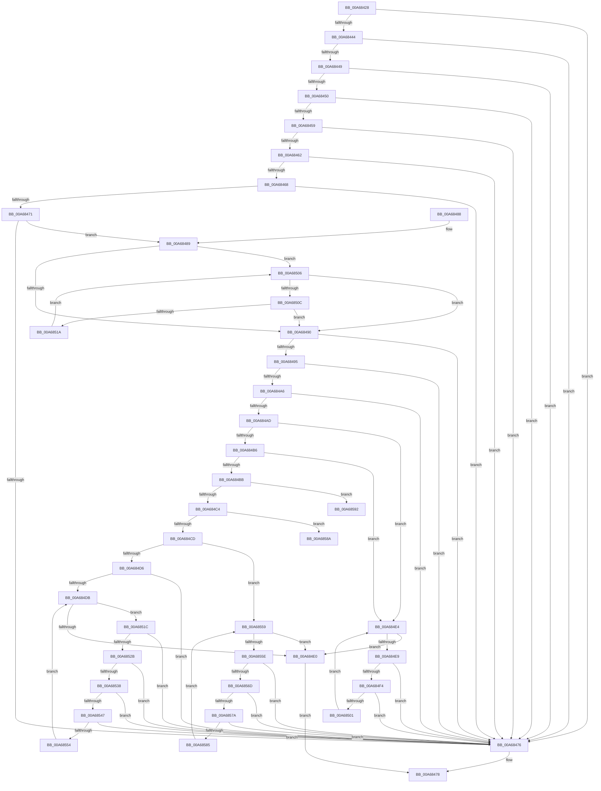

# RtlpValidRelativeAttribute

- RVA: `0x00A68428`–`0x00A6859A` (길이 `370` bytes)
- VA: `0x0000000140A68428`
- 실행 섹션: `PAGE`
- PDB 이름 있음: `예`; PDB Function 태그: `예`
- unwind 정보 RVA: `0x000B3E4C`
- 디코드: `118`개 명령, `370/370` bytes 표시
- 미해석 바이트: `0` (있으면 어셈블리에 `.byte`로 보존)

> 이 문서는 커널 이미지의 기계어와 PDB 기호를 분석해 생성했습니다. 4번과 5번은 함수 원형과 자료형을 바이너리 사용 방식에서 추정한 C 해석이며 원본 소스 복구 결과는 아닙니다.

## 1. Dependencies

- 직접 호출 지점: **0**; 고유 호출 대상: **0**
- 직접 호출자로 확인된 함수: **1**
- RIP 상대 이미지 참조: **0**

### Outgoing calls
- 직접 디코드된 call 명령이 없습니다.

### Direct callers
- [RtlValidAcl](../92/RtlValidAcl_function_0092A7A0.md) at `0x0092A993`

### Static image references
- 디코드된 RIP-relative 메모리 참조가 없습니다.

## 2. Other-region calls and transfers

- 다른 실행 섹션으로 향하는 call: **0**
- call이 아닌 외부 분기/꼬리 이동: **2**
  - `0x00A6858D` → [sub_00B3ECD6](../B3/Unknown_function_00B3ECD6.md) (`tail-transfer`)
  - `0x00A68595` → [sub_00B3ECD6 + 0x50](../B3/Unknown_function_00B3ECD6.md) (`tail-transfer`)

## 3. Assembly (complete function range)

```asm
00A68428  48 89 5C 24 10                  mov qword ptr [rsp + 0x10], rbx
00A6842D  48 89 74 24 18                  mov qword ptr [rsp + 0x18], rsi
00A68432  57                              push rdi
00A68433  48 83 EC 20                     sub rsp, 0x20
00A68437  45 33 DB                        xor r11d, r11d
00A6843A  8B FA                           mov edi, edx
00A6843C  48 8B D9                        mov rbx, rcx
00A6843F  48 85 C9                        test rcx, rcx
00A68442  74 32                           je 0x140a68476
00A68444  83 FA 14                        cmp edx, 0x14
00A68447  72 2D                           jb 0x140a68476
00A68449  66 44 39 59 06                  cmp word ptr [rcx + 6], r11w
00A6844E  75 26                           jne 0x140a68476
00A68450  F7 41 08 C0 FF 00 00            test dword ptr [rcx + 8], 0xffc0
00A68457  75 1D                           jne 0x140a68476
00A68459  44 8B 41 0C                     mov r8d, dword ptr [rcx + 0xc]
00A6845D  45 85 C0                        test r8d, r8d
00A68460  74 14                           je 0x140a68476
00A68462  8B 01                           mov eax, dword ptr [rcx]
00A68464  3B D0                           cmp edx, eax
00A68466  72 0E                           jb 0x140a68476
00A68468  8B CA                           mov ecx, edx
00A6846A  2B C8                           sub ecx, eax
00A6846C  83 F9 04                        cmp ecx, 4
00A6846F  72 05                           jb 0x140a68476
00A68471  48 03 C3                        add rax, rbx
00A68474  75 13                           jne 0x140a68489
00A68476  32 C0                           xor al, al
00A68478  48 8B 5C 24 38                  mov rbx, qword ptr [rsp + 0x38]
00A6847D  48 8B 74 24 40                  mov rsi, qword ptr [rsp + 0x40]
00A68482  48 83 C4 20                     add rsp, 0x20
00A68486  5F                              pop rdi
00A68487  C3                              ret
00A68488  CC                              int3
00A68489  8B D1                           mov edx, ecx
00A6848B  48 D1 EA                        shr rdx, 1
00A6848E  75 76                           jne 0x140a68506
00A68490  48 85 D2                        test rdx, rdx
00A68493  74 E1                           je 0x140a68476
00A68495  49 8B C8                        mov rcx, r8
00A68498  B8 FF FF FF FF                  mov eax, 0xffffffff
00A6849D  48 C1 E1 02                     shl rcx, 2
00A684A1  48 3B C8                        cmp rcx, rax
00A684A4  77 D0                           ja 0x140a68476
00A684A6  8D 47 F0                        lea eax, [rdi - 0x10]
00A684A9  3B C1                           cmp eax, ecx
00A684AB  72 C9                           jb 0x140a68476
00A684AD  0F B7 4B 04                     movzx ecx, word ptr [rbx + 4]
00A684B1  83 E9 01                        sub ecx, 1
00A684B4  74 2E                           je 0x140a684e4
00A684B6  83 E9 01                        sub ecx, 1
00A684B9  74 29                           je 0x140a684e4
00A684BB  83 E9 01                        sub ecx, 1
00A684BE  0F 84 CE 00 00 00               je 0x140a68592
00A684C4  83 E9 02                        sub ecx, 2
00A684C7  0F 84 BD 00 00 00               je 0x140a6858a
00A684CD  83 E9 01                        sub ecx, 1
00A684D0  0F 84 83 00 00 00               je 0x140a68559
00A684D6  83 F9 0A                        cmp ecx, 0xa
00A684D9  75 9B                           jne 0x140a68476
00A684DB  45 3B D8                        cmp r11d, r8d
00A684DE  72 3C                           jb 0x140a6851c
00A684E0  B0 01                           mov al, 1
00A684E2  EB 94                           jmp 0x140a68478
00A684E4  45 3B D8                        cmp r11d, r8d
00A684E7  73 F7                           jae 0x140a684e0
00A684E9  41 8B C3                        mov eax, r11d
00A684EC  8B 4C 83 10                     mov ecx, dword ptr [rbx + rax*4 + 0x10]
00A684F0  3B F9                           cmp edi, ecx
00A684F2  72 82                           jb 0x140a68476
00A684F4  8B C7                           mov eax, edi
00A684F6  2B C1                           sub eax, ecx
00A684F8  83 F8 08                        cmp eax, 8
00A684FB  0F 82 75 FF FF FF               jb 0x140a68476
00A68501  41 FF C3                        inc r11d
00A68504  EB DE                           jmp 0x140a684e4
00A68506  66 44 39 18                     cmp word ptr [rax], r11w
00A6850A  74 84                           je 0x140a68490
00A6850C  48 83 C0 02                     add rax, 2
00A68510  48 83 EA 01                     sub rdx, 1
00A68514  0F 84 76 FF FF FF               je 0x140a68490
00A6851A  EB EA                           jmp 0x140a68506
00A6851C  41 8B C3                        mov eax, r11d
00A6851F  8B 4C 83 10                     mov ecx, dword ptr [rbx + rax*4 + 0x10]
00A68523  3B F9                           cmp edi, ecx
00A68525  0F 82 4B FF FF FF               jb 0x140a68476
00A6852B  8B C7                           mov eax, edi
00A6852D  2B C1                           sub eax, ecx
00A6852F  83 F8 04                        cmp eax, 4
00A68532  0F 82 3E FF FF FF               jb 0x140a68476
00A68538  44 8B 0C 19                     mov r9d, dword ptr [rcx + rbx]
00A6853C  8D 51 04                        lea edx, [rcx + 4]
00A6853F  3B D1                           cmp edx, ecx
00A68541  0F 82 2F FF FF FF               jb 0x140a68476
00A68547  8B C7                           mov eax, edi
00A68549  2B C2                           sub eax, edx
00A6854B  41 3B C1                        cmp eax, r9d
00A6854E  0F 82 22 FF FF FF               jb 0x140a68476
00A68554  41 FF C3                        inc r11d
00A68557  EB 82                           jmp 0x140a684db
00A68559  45 3B D8                        cmp r11d, r8d
00A6855C  73 82                           jae 0x140a684e0
00A6855E  41 8B C3                        mov eax, r11d
00A68561  8B 4C 83 10                     mov ecx, dword ptr [rbx + rax*4 + 0x10]
00A68565  3B F9                           cmp edi, ecx
00A68567  0F 82 09 FF FF FF               jb 0x140a68476
00A6856D  8B C7                           mov eax, edi
00A6856F  2B C1                           sub eax, ecx
00A68571  83 F8 08                        cmp eax, 8
00A68574  0F 82 FC FE FF FF               jb 0x140a68476
00A6857A  48 83 3C 19 01                  cmp qword ptr [rcx + rbx], 1
00A6857F  0F 87 F1 FE FF FF               ja 0x140a68476
00A68585  41 FF C3                        inc r11d
00A68588  EB CF                           jmp 0x140a68559
00A6858A  41 8B D3                        mov edx, r11d
00A6858D  E9 44 67 0D 00                  jmp 0x140b3ecd6
00A68592  41 8B F3                        mov esi, r11d
00A68595  E9 8C 67 0D 00                  jmp 0x140b3ed26
```

## 4. C-style interpretation (structured pseudocode)

```c
__int64 __fastcall RtlpValidRelativeAttribute(__int64 a1, int a2)
{
    __int64 result;
    __int64 v_r11;
    __int64 v_rsp;
    unsigned __int64 v_stack_p10;
    unsigned __int64 v_stack_p18;

    v_stack_p10 = v_rbx;
    v_stack_p18 = v_rsi;
    v_rsp = (v_rsp) - (32);
    v_r11 = 0;
    if (a1 == 0) goto loc_00A68476;
    if (a2 < 20) goto loc_00A68476;
    if ((*(unsigned __int16 *)(a1 + 6)) != 0) goto loc_00A68476;
    if (((*(unsigned int *)(a1 + 8)) & (0xFFC0ULL)) != 0) goto loc_00A68476;
    if ((unsigned int)((unsigned int)(*(unsigned int *)(a1 + 12))) == 0) goto loc_00A68476;
    if (a2 < ((unsigned int)((unsigned int)(*(unsigned int *)(a1))))) goto loc_00A68476;
    a1 = (unsigned int)(((unsigned int)(a2)) - ((unsigned int)((unsigned int)(*(unsigned int *)(a1)))));
    if (((unsigned int)(a1)) < 4) goto loc_00A68476;
    result = ((unsigned int)(*(unsigned int *)(a1))) + (a1);
    if (condition_is_not_equal) goto loc_00A68489;
loc_00A68476:
    result = 0;
loc_00A68478:
    v_rsp = (v_rsp) + (32);
    return result;
loc_00A68489:
    a2 = ((unsigned int)((unsigned int)(a1))) >> (1);
    if (condition_is_not_equal) goto loc_00A68506;
loc_00A68490:
    if (a2 == 0) goto loc_00A68476;
    a1 = ((unsigned int)(*(unsigned int *)(a1 + 12))) << (2);
    if (a1 > ((unsigned int)(0xFFFFFFFFULL))) goto loc_00A68476;
    if (((unsigned int)((unsigned int)(a2) - 16)) < ((unsigned int)(a1))) goto loc_00A68476;
    a1 = (unsigned int)((*(unsigned __int16 *)(v_stack_p10 + 4)) - (1));
    if (condition_is_equal) goto loc_00A684E4;
    a1 = (unsigned int)((a1) - (1));
    if (condition_is_equal) goto loc_00A684E4;
    a1 = (unsigned int)((a1) - (1));
    if (condition_is_equal) goto loc_00A68592;
    a1 = (unsigned int)((a1) - (2));
    if (condition_is_equal) goto loc_00A6858A;
    a1 = (unsigned int)((a1) - (1));
    if (condition_is_equal) goto loc_00A68559;
    if (((unsigned int)(a1)) != 10) goto loc_00A68476;
loc_00A684DB:
    if (0 < ((unsigned int)((unsigned int)(*(unsigned int *)(a1 + 12))))) goto loc_00A6851C;
loc_00A684E0:
    goto loc_00A68478;
loc_00A684E4:
    if (0 >= ((unsigned int)((unsigned int)(*(unsigned int *)(a1 + 12))))) goto loc_00A684E0;
    if (((unsigned int)((unsigned int)(a2))) < ((unsigned int)((unsigned int)(*(unsigned int *)(v_stack_p10 + 0 * 4 + 16))))) goto loc_00A68476;
    result = (unsigned int)(((unsigned int)((unsigned int)((unsigned int)(a2)))) - ((unsigned int)((unsigned int)(*(unsigned int *)(v_stack_p10 + 0 * 4 + 16)))));
    if (((unsigned int)(result)) < 8) goto loc_00A68476;
    v_r11 = (unsigned int)((v_r11) + 1);
    goto loc_00A684E4;
loc_00A68506:
    if ((*(unsigned __int16 *)(result)) == ((unsigned __int16)(v_r11))) goto loc_00A68490;
    result = (result) + (2);
    a2 = (a2) - (1);
    if (condition_is_equal) goto loc_00A68490;
    goto loc_00A68506;
loc_00A6851C:
    if (((unsigned int)((unsigned int)(a2))) < ((unsigned int)((unsigned int)(*(unsigned int *)(v_stack_p10 + (unsigned int)((unsigned int)(v_r11)) * 4 + 16))))) goto loc_00A68476;
    result = (unsigned int)(((unsigned int)((unsigned int)((unsigned int)(a2)))) - ((unsigned int)((unsigned int)(*(unsigned int *)(v_stack_p10 + (unsigned int)((unsigned int)(v_r11)) * 4 + 16)))));
    if (((unsigned int)(result)) < 4) goto loc_00A68476;
    if (((unsigned int)((unsigned int)(*(unsigned int *)(v_stack_p10 + (unsigned int)((unsigned int)(v_r11)) * 4 + 16)) + 4)) < ((unsigned int)((unsigned int)(*(unsigned int *)(v_stack_p10 + (unsigned int)((unsigned int)(v_r11)) * 4 + 16))))) goto loc_00A68476;
    result = (unsigned int)(((unsigned int)((unsigned int)((unsigned int)(a2)))) - ((unsigned int)((unsigned int)(*(unsigned int *)(v_stack_p10 + (unsigned int)((unsigned int)(v_r11)) * 4 + 16)) + 4)));
    if (((unsigned int)(result)) < ((unsigned int)((unsigned int)(*(unsigned int *)((unsigned int)(*(unsigned int *)(v_stack_p10 + (unsigned int)((unsigned int)(v_r11)) * 4 + 16)) + v_stack_p10 * 1))))) goto loc_00A68476;
    v_r11 = (unsigned int)((v_r11) + 1);
    goto loc_00A684DB;
loc_00A68559:
    if (((unsigned int)(v_r11)) >= ((unsigned int)((unsigned int)(*(unsigned int *)(a1 + 12))))) goto loc_00A684E0;
    if (((unsigned int)((unsigned int)(a2))) < ((unsigned int)((unsigned int)(*(unsigned int *)(v_stack_p10 + (unsigned int)((unsigned int)(v_r11)) * 4 + 16))))) goto loc_00A68476;
    result = (unsigned int)(((unsigned int)((unsigned int)((unsigned int)(a2)))) - ((unsigned int)((unsigned int)(*(unsigned int *)(v_stack_p10 + (unsigned int)((unsigned int)(v_r11)) * 4 + 16)))));
    if (((unsigned int)(result)) < 8) goto loc_00A68476;
    if ((*(unsigned __int64 *)((unsigned int)(*(unsigned int *)(v_stack_p10 + (unsigned int)((unsigned int)(v_r11)) * 4 + 16)) + v_stack_p10 * 1)) > 1) goto loc_00A68476;
    v_r11 = (unsigned int)((v_r11) + 1);
    goto loc_00A68559;
loc_00A6858A:
loc_00A68592:
}
```

## 5. (Beta) C Style

```c
int64_t RtlpValidRelativeAttribute(void *Arg1, void *Arg2)
{
    uint8_t *arg1 = (uint8_t *)Arg1;
    uint8_t *arg2 = (uint8_t *)Arg2;

    int64_t result;
    int64_t local_r11;
    int64_t local_rsp;
    uint64_t v_stack_p10;
    uint64_t v_stack_p18;

    v_stack_p10 = local_rbx;
    v_stack_p18 = local_rsi;
    local_rsp = (local_rsp) - (32);
    local_r11 = 0;
    if (Arg1 == NULL) goto loc_00A68476;
    if (Arg2 < 20) goto loc_00A68476;
    if ((*(uint16_t *)(arg1 + 0x6)) != 0) goto loc_00A68476;
    if (((*(uint32_t *)(arg1 + 0x8)) & (0xFFC0ULL)) != 0) goto loc_00A68476;
    if ((uint32_t)((uint32_t)(*(uint32_t *)(arg1 + 0xC))) == 0) goto loc_00A68476;
    if (Arg2 < ((uint32_t)((uint32_t)(*(uint32_t *)(arg1))))) goto loc_00A68476;
    Arg1 = (uint32_t)(((uint32_t)(Arg2)) - ((uint32_t)((uint32_t)(*(uint32_t *)(arg1)))));
    if (((uint32_t)(Arg1)) < 4) goto loc_00A68476;
    result = ((uint32_t)(*(uint32_t *)(arg1))) + (Arg1);
    if (condition_is_not_equal) goto loc_00A68489;
loc_00A68476:
    result = 0;
loc_00A68478:
    local_rsp = (local_rsp) + (32);
    return result;
loc_00A68489:
    Arg2 = ((uint32_t)((uint32_t)(Arg1))) >> (1);
    if (condition_is_not_equal) goto loc_00A68506;
loc_00A68490:
    if (Arg2 == NULL) goto loc_00A68476;
    Arg1 = ((uint32_t)(*(uint32_t *)(arg1 + 0xC))) << (2);
    if (Arg1 > ((uint32_t)(0xFFFFFFFFULL))) goto loc_00A68476;
    if (((uint32_t)((uint32_t)(Arg2) - 16)) < ((uint32_t)(Arg1))) goto loc_00A68476;
    Arg1 = (uint32_t)((*(uint16_t *)(v_stack_p10 + 0x4)) - (1));
    if (condition_is_equal) goto loc_00A684E4;
    Arg1 = (uint32_t)((Arg1) - (1));
    if (condition_is_equal) goto loc_00A684E4;
    Arg1 = (uint32_t)((Arg1) - (1));
    if (condition_is_equal) goto loc_00A68592;
    Arg1 = (uint32_t)((Arg1) - (2));
    if (condition_is_equal) goto loc_00A6858A;
    Arg1 = (uint32_t)((Arg1) - (1));
    if (condition_is_equal) goto loc_00A68559;
    if (((uint32_t)(Arg1)) != 10) goto loc_00A68476;
loc_00A684DB:
    if (0 < ((uint32_t)((uint32_t)(*(uint32_t *)(arg1 + 0xC))))) goto loc_00A6851C;
loc_00A684E0:
    goto loc_00A68478;
loc_00A684E4:
    if (0 >= ((uint32_t)((uint32_t)(*(uint32_t *)(arg1 + 0xC))))) goto loc_00A684E0;
    if (((uint32_t)((uint32_t)(Arg2))) < ((uint32_t)((uint32_t)(*(uint32_t *)(v_stack_p10 + 0x0 * 4 + 0x10))))) goto loc_00A68476;
    result = (uint32_t)(((uint32_t)((uint32_t)((uint32_t)(Arg2)))) - ((uint32_t)((uint32_t)(*(uint32_t *)(v_stack_p10 + 0x0 * 4 + 0x10)))));
    if (((uint32_t)(result)) < 8) goto loc_00A68476;
    local_r11 = (uint32_t)((local_r11) + 1);
    goto loc_00A684E4;
loc_00A68506:
    if ((*(uint16_t *)(result)) == ((uint16_t)(local_r11))) goto loc_00A68490;
    result = (result) + (2);
    Arg2 = (Arg2) - (1);
    if (condition_is_equal) goto loc_00A68490;
    goto loc_00A68506;
loc_00A6851C:
    if (((uint32_t)((uint32_t)(Arg2))) < ((uint32_t)((uint32_t)(*(uint32_t *)(v_stack_p10 + (uint32_t)((uint32_t)(local_r11)) * 4 + 0x10))))) goto loc_00A68476;
    result = (uint32_t)(((uint32_t)((uint32_t)((uint32_t)(Arg2)))) - ((uint32_t)((uint32_t)(*(uint32_t *)(v_stack_p10 + (uint32_t)((uint32_t)(local_r11)) * 4 + 0x10)))));
    if (((uint32_t)(result)) < 4) goto loc_00A68476;
    if (((uint32_t)((uint32_t)(*(uint32_t *)(v_stack_p10 + (uint32_t)((uint32_t)(local_r11)) * 4 + 0x10)) + 4)) < ((uint32_t)((uint32_t)(*(uint32_t *)(v_stack_p10 + (uint32_t)((uint32_t)(local_r11)) * 4 + 0x10))))) goto loc_00A68476;
    result = (uint32_t)(((uint32_t)((uint32_t)((uint32_t)(Arg2)))) - ((uint32_t)((uint32_t)(*(uint32_t *)(v_stack_p10 + (uint32_t)((uint32_t)(local_r11)) * 4 + 0x10)) + 4)));
    if (((uint32_t)(result)) < ((uint32_t)((uint32_t)(*(uint32_t *)((uint32_t)(*(uint32_t *)(v_stack_p10 + (uint32_t)((uint32_t)(local_r11)) * 4 + 0x10)) + v_stack_p10 * 1))))) goto loc_00A68476;
    local_r11 = (uint32_t)((local_r11) + 1);
    goto loc_00A684DB;
loc_00A68559:
    if (((uint32_t)(local_r11)) >= ((uint32_t)((uint32_t)(*(uint32_t *)(arg1 + 0xC))))) goto loc_00A684E0;
    if (((uint32_t)((uint32_t)(Arg2))) < ((uint32_t)((uint32_t)(*(uint32_t *)(v_stack_p10 + (uint32_t)((uint32_t)(local_r11)) * 4 + 0x10))))) goto loc_00A68476;
    result = (uint32_t)(((uint32_t)((uint32_t)((uint32_t)(Arg2)))) - ((uint32_t)((uint32_t)(*(uint32_t *)(v_stack_p10 + (uint32_t)((uint32_t)(local_r11)) * 4 + 0x10)))));
    if (((uint32_t)(result)) < 8) goto loc_00A68476;
    if ((*(uint64_t *)((uint32_t)(*(uint32_t *)(v_stack_p10 + (uint32_t)((uint32_t)(local_r11)) * 4 + 0x10)) + v_stack_p10 * 1)) > 1) goto loc_00A68476;
    local_r11 = (uint32_t)((local_r11) + 1);
    goto loc_00A68559;
loc_00A6858A:
loc_00A68592:
}
```

### 관측된 메모리 오프셋

구조체 형식이 확인되지 않은 접근은 인자 기준의 오프셋으로만 기록했습니다.

| 기준 인자 | 오프셋 표현 | 폭 (bit) | 접근 |
|---|---:|---:|---|
| `Arg1` | `+ 0x4` | `16` | `R` |
| `Arg1` | `+ 0x10 + rax*4` | `32` | `R` |
| `Arg2` | `- 0x10` | `32` | `R` |

## 6. Execution-region graph

[열기: 2D/3D 그래프와 함수 탐색 컨트롤 패널](../../../control-panel.html?section=page&rva=0x00A68428&view=graph)

- 2D 그래프는 위에서 아래로 흐르고, 3D 그래프는 빈 공간을 드래그해 회전합니다. Shift+드래그는 이동, 휠은 확대·축소, 함수 노드 선택은 대상 보고서 이동입니다.

### Static fallback


