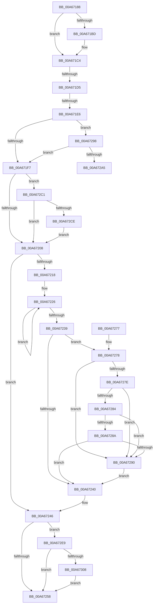

# RtlpWow64CtxToAmd64

- RVA: `0x00A67188`–`0x00A6732D` (길이 `421` bytes)
- VA: `0x0000000140A67188`
- 실행 섹션: `PAGE`
- PDB 이름 있음: `예`; PDB Function 태그: `예`
- unwind 정보 RVA: `0x000B3C10`
- 디코드: `118`개 명령, `421/421` bytes 표시
- 미해석 바이트: `0` (있으면 어셈블리에 `.byte`로 보존)

> 이 문서는 커널 이미지의 기계어와 PDB 기호를 분석해 생성했습니다. 4번과 5번은 함수 원형과 자료형을 바이너리 사용 방식에서 추정한 C 해석이며 원본 소스 복구 결과는 아닙니다.

## 1. Dependencies

- 직접 호출 지점: **2**; 고유 호출 대상: **2**
- 직접 호출자로 확인된 함수: **1**
- RIP 상대 이미지 참조: **0**

### Outgoing calls
- `0x00A672D9` → [RtlFnToFxFrame](../../text/47/RtlFnToFxFrame_function_004718F8.md) (function, `0x004718F8`)
- `0x00A67320` → [RtlpCopyXStateChunk](../../text/3F/RtlpCopyXStateChunk_function_003F51D4.md) (function, `0x003F51D4`)

### Direct callers
- [PspWow64SetContextThread](../8C/PspWow64SetContextThread_function_008CCC88.md) at `0x008CD174`
- [PspWow64SetContextThread](../8C/PspWow64SetContextThread_function_008CCC88.md) at `0x008CD191`

### Static image references
- 디코드된 RIP-relative 메모리 참조가 없습니다.

## 2. Other-region calls and transfers

- 다른 실행 섹션으로 향하는 call: **2**
  - `0x00A672D9` → [RtlFnToFxFrame](../../text/47/RtlFnToFxFrame_function_004718F8.md) (`PAGE` → `.text`)
  - `0x00A67320` → [RtlpCopyXStateChunk](../../text/3F/RtlpCopyXStateChunk_function_003F51D4.md) (`PAGE` → `.text`)
- call이 아닌 외부 분기/꼬리 이동: **3**
  - `0x00A671CF` → [sub_00B3E9EC](../B3/Unknown_function_00B3E9EC.md) (`tail-transfer`)
  - `0x00A671E0` → [sub_00B3E9EC + 0x55](../B3/Unknown_function_00B3E9EC.md) (`tail-transfer`)
  - `0x00A672BC` → [sub_00B3E9EC + 0xB8](../B3/Unknown_function_00B3E9EC.md) (`tail-transfer`)

## 3. Assembly (complete function range)

```asm
00A67188  48 89 5C 24 08                  mov qword ptr [rsp + 8], rbx
00A6718D  48 89 6C 24 10                  mov qword ptr [rsp + 0x10], rbp
00A67192  48 89 74 24 18                  mov qword ptr [rsp + 0x18], rsi
00A67197  57                              push rdi
00A67198  41 56                           push r14
00A6719A  41 57                           push r15
00A6719C  48 83 EC 30                     sub rsp, 0x30
00A671A0  44 8B 32                        mov r14d, dword ptr [rdx]
00A671A3  45 33 FF                        xor r15d, r15d
00A671A6  41 8B 68 30                     mov ebp, dword ptr [r8 + 0x30]
00A671AA  48 8B FA                        mov rdi, rdx
00A671AD  49 8B D8                        mov rbx, r8
00A671B0  8B F1                           mov esi, ecx
00A671B2  41 8D 57 23                     lea edx, [r15 + 0x23]
00A671B6  66 41 39 50 38                  cmp word ptr [r8 + 0x38], dx
00A671BB  74 07                           je 0x140a671c4
00A671BD  83 E6 F8                        and esi, 0xfffffff8
00A671C0  0F BA EE 10                     bts esi, 0x10
00A671C4  B9 01 00 01 00                  mov ecx, 0x10001
00A671C9  8B C6                           mov eax, esi
00A671CB  23 C1                           and eax, ecx
00A671CD  3B C1                           cmp eax, ecx
00A671CF  0F 84 17 78 0D 00               je 0x140b3e9ec
00A671D5  B9 02 00 01 00                  mov ecx, 0x10002
00A671DA  8B C6                           mov eax, esi
00A671DC  23 C1                           and eax, ecx
00A671DE  3B C1                           cmp eax, ecx
00A671E0  0F 84 5B 78 0D 00               je 0x140b3ea41
00A671E6  B9 20 00 01 00                  mov ecx, 0x10020
00A671EB  8B C6                           mov eax, esi
00A671ED  23 C1                           and eax, ecx
00A671EF  3B C1                           cmp eax, ecx
00A671F1  0F 84 A1 00 00 00               je 0x140a67298
00A671F7  B9 08 00 01 00                  mov ecx, 0x10008
00A671FC  8B C6                           mov eax, esi
00A671FE  23 C1                           and eax, ecx
00A67200  3B C1                           cmp eax, ecx
00A67202  0F 84 B9 00 00 00               je 0x140a672c1
00A67208  B9 10 00 01 00                  mov ecx, 0x10010
00A6720D  41 8B C6                        mov eax, r14d
00A67210  23 C6                           and eax, esi
00A67212  23 C1                           and eax, ecx
00A67214  3B C1                           cmp eax, ecx
00A67216  75 2E                           jne 0x140a67246
00A67218  48 8D 4B 48                     lea rcx, [rbx + 0x48]
00A6721C  41 B8 06 00 00 00               mov r8d, 6
00A67222  48 8D 57 04                     lea rdx, [rdi + 4]
00A67226  8B 02                           mov eax, dword ptr [rdx]
00A67228  48 8D 52 04                     lea rdx, [rdx + 4]
00A6722C  48 89 01                        mov qword ptr [rcx], rax
00A6722F  48 8D 49 08                     lea rcx, [rcx + 8]
00A67233  49 83 E8 01                     sub r8, 1
00A67237  75 ED                           jne 0x140a67226
00A67239  8B 47 18                        mov eax, dword ptr [rdi + 0x18]
00A6723C  A8 55                           test al, 0x55
00A6723E  74 38                           je 0x140a67278
00A67240  81 CD 10 00 10 00               or ebp, 0x100010
00A67246  41 B8 40 00 01 00               mov r8d, 0x10040
00A6724C  41 23 F0                        and esi, r8d
00A6724F  41 3B F0                        cmp esi, r8d
00A67252  0F 84 91 00 00 00               je 0x140a672e9
00A67258  48 8B 74 24 60                  mov rsi, qword ptr [rsp + 0x60]
00A6725D  41 8B C7                        mov eax, r15d
00A67260  89 6B 30                        mov dword ptr [rbx + 0x30], ebp
00A67263  48 8B 5C 24 50                  mov rbx, qword ptr [rsp + 0x50]
00A67268  48 8B 6C 24 58                  mov rbp, qword ptr [rsp + 0x58]
00A6726D  48 83 C4 30                     add rsp, 0x30
00A67271  41 5F                           pop r15
00A67273  41 5E                           pop r14
00A67275  5F                              pop rdi
00A67276  C3                              ret
00A67277  CC                              int3
00A67278  44 39 7F 04                     cmp dword ptr [rdi + 4], r15d
00A6727C  75 12                           jne 0x140a67290
00A6727E  44 39 7F 08                     cmp dword ptr [rdi + 8], r15d
00A67282  75 0C                           jne 0x140a67290
00A67284  44 39 7F 0C                     cmp dword ptr [rdi + 0xc], r15d
00A67288  75 06                           jne 0x140a67290
00A6728A  44 39 7F 10                     cmp dword ptr [rdi + 0x10], r15d
00A6728E  74 B0                           je 0x140a67240
00A67290  48 0F BA 6B 70 08               bts qword ptr [rbx + 0x70], 8
00A67296  EB A8                           jmp 0x140a67240
00A67298  41 8B C6                        mov eax, r14d
00A6729B  23 C1                           and eax, ecx
00A6729D  3B C1                           cmp eax, ecx
00A6729F  0F 85 52 FF FF FF               jne 0x140a671f7
00A672A5  BA 02 00 00 00                  mov edx, 2
00A672AA  49 8D 80 00 01 00 00            lea rax, [r8 + 0x100]
00A672B1  48 8D 8F CC 00 00 00            lea rcx, [rdi + 0xcc]
00A672B8  44 8D 42 7E                     lea r8d, [rdx + 0x7e]
00A672BC  E9 E3 77 0D 00                  jmp 0x140b3eaa4
00A672C1  41 8B C6                        mov eax, r14d
00A672C4  23 C1                           and eax, ecx
00A672C6  3B C1                           cmp eax, ecx
00A672C8  0F 85 3A FF FF FF               jne 0x140a67208
00A672CE  48 8D 57 1C                     lea rdx, [rdi + 0x1c]
00A672D2  48 8D 8B 00 01 00 00            lea rcx, [rbx + 0x100]
00A672D9  E8 1A A6 A0 FF                  call 0x1404718f8
00A672DE  81 CD 08 00 10 00               or ebp, 0x100008
00A672E4  E9 1F FF FF FF                  jmp 0x140a67208
00A672E9  B9 40 00 10 00                  mov ecx, 0x100040
00A672EE  8B C5                           mov eax, ebp
00A672F0  23 C1                           and eax, ecx
00A672F2  3B C1                           cmp eax, ecx
00A672F4  0F 94 C2                        sete dl
00A672F7  45 23 F0                        and r14d, r8d
00A672FA  45 3B F0                        cmp r14d, r8d
00A672FD  0F 94 C0                        sete al
00A67300  84 D0                           test al, dl
00A67302  0F 84 50 FF FF FF               je 0x140a67258
00A67308  48 8D 93 D0 04 00 00            lea rdx, [rbx + 0x4d0]
00A6730F  B1 01                           mov cl, 1
00A67311  4C 8D 8F CC 02 00 00            lea r9, [rdi + 0x2cc]
00A67318  4C 8B C2                        mov r8, rdx
00A6731B  4C 89 4C 24 20                  mov qword ptr [rsp + 0x20], r9
00A67320  E8 AF DE 98 FF                  call 0x1403f51d4
00A67325  44 8B F8                        mov r15d, eax
00A67328  E9 2B FF FF FF                  jmp 0x140a67258
```

## 4. C-style interpretation (structured pseudocode)

```c
__int64 __fastcall RtlpWow64CtxToAmd64(int a1, __int64 a2, __int64 a3)
{
    __int64 result;
    __int64 v_r14;
    __int64 v_r15;
    __int64 v_rbp;
    __int64 v_rsi;
    __int64 v_rsp;
    unsigned __int64 v_stack_p10;
    unsigned __int64 v_stack_p18;
    unsigned __int64 v_stack_p20;
    unsigned __int64 v_stack_p8;

    v_stack_p8 = v_rbx;
    v_stack_p10 = v_rbp;
    v_stack_p18 = v_rsi;
    v_rsp = (v_rsp) - (48);
    v_r15 = 0;
    v_rsi = (unsigned int)(a1);
    if ((*(unsigned __int16 *)(a3 + 56)) != ((unsigned __int16)(v_r15 + 35))) {
        v_rsi = (unsigned int)(((unsigned int)(a1)) & (0xFFFFFFF8ULL));
    }
    result = (unsigned int)(((unsigned int)((unsigned int)(v_rsi))) & ((unsigned int)((unsigned int)(0x10001ULL))));
    result = (unsigned int)(((unsigned int)((unsigned int)(v_rsi))) & ((unsigned int)((unsigned int)(0x10002ULL))));
    result = (unsigned int)(((unsigned int)((unsigned int)(v_rsi))) & ((unsigned int)((unsigned int)(0x10020ULL))));
    if (((unsigned int)(result)) == ((unsigned int)((unsigned int)(0x10020ULL)))) goto loc_00A67298;
loc_00A671F7:
    result = (unsigned int)(((unsigned int)((unsigned int)(v_rsi))) & ((unsigned int)((unsigned int)(0x10008ULL))));
    if (((unsigned int)(result)) == ((unsigned int)((unsigned int)(0x10008ULL)))) goto loc_00A672C1;
loc_00A67208:
    result = (unsigned int)(((unsigned int)((unsigned int)((unsigned int)(*(unsigned int *)(a2))))) & ((unsigned int)(v_rsi)));
    result = (unsigned int)((result) & ((unsigned int)((unsigned int)(0x10010ULL))));
    if (((unsigned int)(result)) != ((unsigned int)((unsigned int)(0x10010ULL)))) goto loc_00A67246;
loc_00A67226:
    *(unsigned __int64 *)(a3 + 72) = (unsigned int)(*(unsigned int *)(a2 + 4));
    a3 = (6) - (1);
    if (condition_is_not_equal) goto loc_00A67226;
    if ((((unsigned __int8)((unsigned int)(*(unsigned int *)(a2 + 24)))) & (85)) == 0) goto loc_00A67278;
loc_00A67240:
    v_rbp = (unsigned int)(((unsigned int)(*(unsigned int *)(a3 + 48))) | (0x100010ULL));
loc_00A67246:
    v_rsi = (unsigned int)((v_rsi) & ((unsigned int)((unsigned int)(0x10040ULL))));
    if (((unsigned int)(v_rsi)) == ((unsigned int)((unsigned int)(0x10040ULL)))) goto loc_00A672E9;
loc_00A67258:
    *(unsigned int *)(a3 + 48) = (unsigned int)(v_rbp);
    v_rsp = (v_rsp) + (48);
    return 0;
loc_00A67278:
    if ((*(unsigned int *)(a2 + 4)) != 0) goto loc_00A67290;
    if ((*(unsigned int *)(a2 + 8)) != 0) goto loc_00A67290;
    if ((*(unsigned int *)(a2 + 12)) != 0) goto loc_00A67290;
    if ((*(unsigned int *)(a2 + 16)) == 0) goto loc_00A67240;
loc_00A67290:
    goto loc_00A67240;
loc_00A67298:
    result = (unsigned int)(((unsigned int)((unsigned int)((unsigned int)(*(unsigned int *)(a2))))) & ((unsigned int)(a3 + 72 + 8)));
    if (((unsigned int)(result)) != ((unsigned int)(a3 + 72 + 8))) goto loc_00A671F7;
loc_00A672C1:
    result = (unsigned int)(((unsigned int)((unsigned int)((unsigned int)(*(unsigned int *)(a2))))) & ((unsigned int)(a2 + 204)));
    if (((unsigned int)(result)) != ((unsigned int)(a2 + 204))) goto loc_00A67208;
    result = RtlFnToFxFrame(v_stack_p8 + 256, a2 + 28, 2 + 126, a4);
    v_rbp = (unsigned int)((v_stack_p10) | (0x100008ULL));
    goto loc_00A67208;
loc_00A672E9:
    result = (unsigned int)(((unsigned int)((unsigned int)(v_rbp))) & ((unsigned int)((unsigned int)(0x100040ULL))));
    a2 = (((unsigned int)(result)) == ((unsigned int)((unsigned int)(0x100040ULL)))) ? 1 : 0;
    v_r14 = (unsigned int)(((unsigned int)(*(unsigned int *)(a2))) & ((unsigned int)(2 + 126)));
    result = (((unsigned int)(v_r14)) == ((unsigned int)(2 + 126))) ? 1 : 0;
    if ((((unsigned __int8)(result)) & ((unsigned __int8)(a2))) == 0) goto loc_00A67258;
    v_stack_p20 = a2 + 716;
    result = RtlpCopyXStateChunk(1, v_stack_p8 + 1232, v_stack_p8 + 1232, a2 + 716);
    goto loc_00A67258;
}
```

## 5. (Beta) C Style

```c
int64_t RtlpWow64CtxToAmd64(int32_t Arg1, void *Arg2, void *Arg3)
{
    uint8_t *arg2 = (uint8_t *)Arg2;
    uint8_t *arg3 = (uint8_t *)Arg3;

    int64_t result;
    int64_t local_r14;
    int64_t local_r15;
    int64_t local_rbp;
    int64_t local_rsi;
    int64_t local_rsp;
    uint64_t v_stack_p10;
    uint64_t v_stack_p18;
    uint64_t v_stack_p20;
    uint64_t v_stack_p8;

    v_stack_p8 = local_rbx;
    v_stack_p10 = local_rbp;
    v_stack_p18 = local_rsi;
    local_rsp = (local_rsp) - (48);
    local_r15 = 0;
    local_rsi = (uint32_t)(Arg1);
    if ((*(uint16_t *)(arg3 + 0x38)) != ((uint16_t)(local_r15 + 35))) {
        local_rsi = (uint32_t)(((uint32_t)(Arg1)) & (0xFFFFFFF8ULL));
    }
    result = (uint32_t)(((uint32_t)((uint32_t)(local_rsi))) & ((uint32_t)((uint32_t)(0x10001ULL))));
    result = (uint32_t)(((uint32_t)((uint32_t)(local_rsi))) & ((uint32_t)((uint32_t)(0x10002ULL))));
    result = (uint32_t)(((uint32_t)((uint32_t)(local_rsi))) & ((uint32_t)((uint32_t)(0x10020ULL))));
    if (((uint32_t)(result)) == ((uint32_t)((uint32_t)(0x10020ULL)))) goto loc_00A67298;
loc_00A671F7:
    result = (uint32_t)(((uint32_t)((uint32_t)(local_rsi))) & ((uint32_t)((uint32_t)(0x10008ULL))));
    if (((uint32_t)(result)) == ((uint32_t)((uint32_t)(0x10008ULL)))) goto loc_00A672C1;
loc_00A67208:
    result = (uint32_t)(((uint32_t)((uint32_t)((uint32_t)(*(uint32_t *)(arg2))))) & ((uint32_t)(local_rsi)));
    result = (uint32_t)((result) & ((uint32_t)((uint32_t)(0x10010ULL))));
    if (((uint32_t)(result)) != ((uint32_t)((uint32_t)(0x10010ULL)))) goto loc_00A67246;
loc_00A67226:
    *(uint64_t *)(arg3 + 0x48) = (uint32_t)(*(uint32_t *)(arg2 + 0x4));
    Arg3 = (6) - (1);
    if (condition_is_not_equal) goto loc_00A67226;
    if ((((uint8_t)((uint32_t)(*(uint32_t *)(arg2 + 0x18)))) & (85)) == 0) goto loc_00A67278;
loc_00A67240:
    local_rbp = (uint32_t)(((uint32_t)(*(uint32_t *)(arg3 + 0x30))) | (0x100010ULL));
loc_00A67246:
    local_rsi = (uint32_t)((local_rsi) & ((uint32_t)((uint32_t)(0x10040ULL))));
    if (((uint32_t)(local_rsi)) == ((uint32_t)((uint32_t)(0x10040ULL)))) goto loc_00A672E9;
loc_00A67258:
    *(uint32_t *)(arg3 + 0x30) = (uint32_t)(local_rbp);
    local_rsp = (local_rsp) + (48);
    return 0;
loc_00A67278:
    if ((*(uint32_t *)(arg2 + 0x4)) != 0) goto loc_00A67290;
    if ((*(uint32_t *)(arg2 + 0x8)) != 0) goto loc_00A67290;
    if ((*(uint32_t *)(arg2 + 0xC)) != 0) goto loc_00A67290;
    if ((*(uint32_t *)(arg2 + 0x10)) == 0) goto loc_00A67240;
loc_00A67290:
    goto loc_00A67240;
loc_00A67298:
    result = (uint32_t)(((uint32_t)((uint32_t)((uint32_t)(*(uint32_t *)(arg2))))) & ((uint32_t)(Arg3 + 72 + 8)));
    if (((uint32_t)(result)) != ((uint32_t)(Arg3 + 72 + 8))) goto loc_00A671F7;
loc_00A672C1:
    result = (uint32_t)(((uint32_t)((uint32_t)((uint32_t)(*(uint32_t *)(arg2))))) & ((uint32_t)(Arg2 + 204)));
    if (((uint32_t)(result)) != ((uint32_t)(Arg2 + 204))) goto loc_00A67208;
    result = RtlFnToFxFrame(v_stack_p8 + 256, Arg2 + 28, 2 + 126, a4);
    local_rbp = (uint32_t)((v_stack_p10) | (0x100008ULL));
    goto loc_00A67208;
loc_00A672E9:
    result = (uint32_t)(((uint32_t)((uint32_t)(local_rbp))) & ((uint32_t)((uint32_t)(0x100040ULL))));
    Arg2 = (((uint32_t)(result)) == ((uint32_t)((uint32_t)(0x100040ULL)))) ? 1 : 0;
    local_r14 = (uint32_t)(((uint32_t)(*(uint32_t *)(arg2))) & ((uint32_t)(2 + 126)));
    result = (((uint32_t)(local_r14)) == ((uint32_t)(2 + 126))) ? 1 : 0;
    if ((((uint8_t)(result)) & ((uint8_t)(Arg2))) == 0) goto loc_00A67258;
    v_stack_p20 = Arg2 + 716;
    result = RtlpCopyXStateChunk(1, v_stack_p8 + 1232, v_stack_p8 + 1232, Arg2 + 716);
    goto loc_00A67258;
}
```

### 관측된 메모리 오프셋

구조체 형식이 확인되지 않은 접근은 인자 기준의 오프셋으로만 기록했습니다.

| 기준 인자 | 오프셋 표현 | 폭 (bit) | 접근 |
|---|---:|---:|---|
| `Arg2` | `+ 0x0` | `32` | `R` |
| `Arg2` | `+ 0x4` | `32` | `R` |
| `Arg2` | `+ 0x4` | `64` | `R` |
| `Arg2` | `+ 0x8` | `32` | `R` |
| `Arg2` | `+ 0xC` | `32` | `R` |
| `Arg2` | `+ 0x10` | `32` | `R` |
| `Arg2` | `+ 0x18` | `32` | `R` |
| `Arg2` | `+ 0x1C` | `64` | `R` |
| `Arg2` | `+ 0xCC` | `64` | `R` |
| `Arg2` | `+ 0x2CC` | `64` | `R` |
| `Arg3` | `+ 0x0` | `64` | `W` |
| `Arg3` | `+ 0x8` | `64` | `R` |
| `Arg3` | `+ 0x30` | `32` | `R` |
| `Arg3` | `+ 0x30` | `32` | `W` |
| `Arg3` | `+ 0x38` | `16` | `R` |
| `Arg3` | `+ 0x48` | `64` | `R` |
| `Arg3` | `+ 0x70` | `64` | `R/W` |
| `Arg3` | `+ 0x100` | `64` | `R` |
| `Arg3` | `+ 0x4D0` | `64` | `R` |

## 6. Execution-region graph

[열기: 2D/3D 그래프와 함수 탐색 컨트롤 패널](../../../control-panel.html?section=page&rva=0x00A67188&view=graph)

- 2D 그래프는 위에서 아래로 흐르고, 3D 그래프는 빈 공간을 드래그해 회전합니다. Shift+드래그는 이동, 휠은 확대·축소, 함수 노드 선택은 대상 보고서 이동입니다.

### Static fallback


