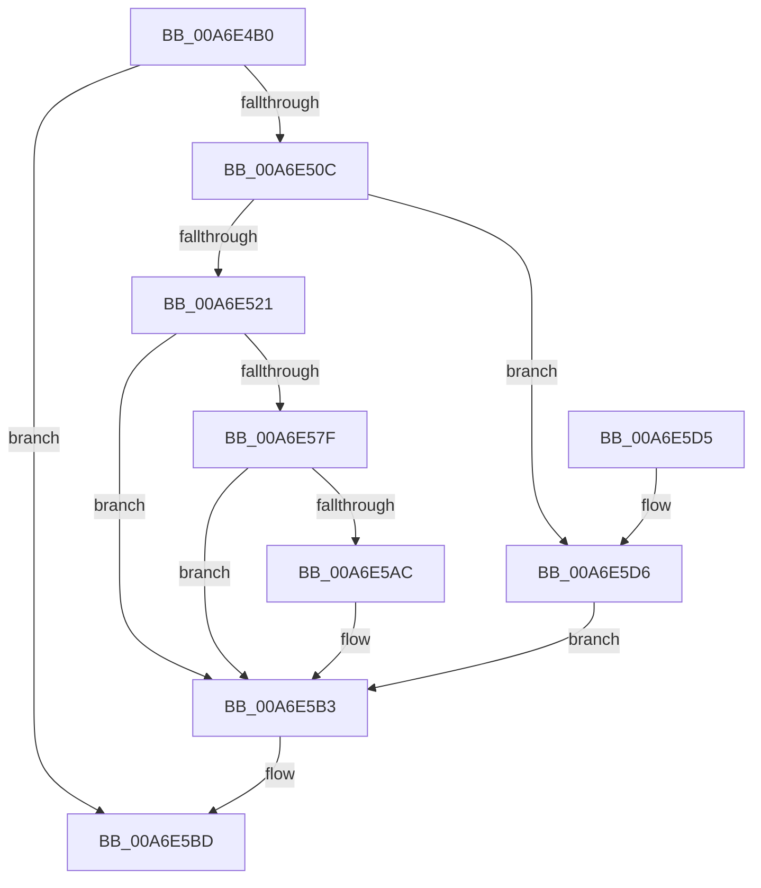

# SeGetLogonSessionToken

- RVA: `0x00A6E4B0`–`0x00A6E5DD` (길이 `301` bytes)
- VA: `0x0000000140A6E4B0`
- 실행 섹션: `PAGE`
- PDB 이름 있음: `예`; PDB Function 태그: `아니요`
- unwind 정보 RVA: `0x000B4A20`
- 디코드: `81`개 명령, `301/301` bytes 표시
- 미해석 바이트: `0` (있으면 어셈블리에 `.byte`로 보존)

> 이 문서는 커널 이미지의 기계어와 PDB 기호를 분석해 생성했습니다. 4번과 5번은 함수 원형과 자료형을 바이너리 사용 방식에서 추정한 C 해석이며 원본 소스 복구 결과는 아닙니다.

## 1. Dependencies

- 직접 호출 지점: **4**; 고유 호출 대상: **4**
- 직접 호출자로 확인된 함수: **0**
- RIP 상대 이미지 참조: **1**

### Outgoing calls
- `0x00A6E4FF` → [ObReferenceObjectByHandle](../86/ObReferenceObjectByHandle_function_00868DB0.md) (function, `0x00868DB0`)
- `0x00A6E574` → [SepDuplicateToken](../8B/SepDuplicateToken_function_008B87EC.md) (function, `0x008B87EC`)
- `0x00A6E5A1` → [ObInsertObjectEx](../8B/ObInsertObjectEx_function_008B97A0.md) (function, `0x008B97A0`)
- `0x00A6E5B6` → [ObfDereferenceObject](../../text/2F/ObfDereferenceObject_function_002F9350.md) (function, `0x002F9350`)

### Direct callers
- 이 함수 시작 RVA로 연결되는 직접 call은 확인되지 않았습니다. 간접 호출은 완전히 역산할 수 없습니다.

### Static image references
- `0x00A6E4D7` → RVA `0x00FD8020` (`PAGEDATA`; read)

## 2. Other-region calls and transfers

- 다른 실행 섹션으로 향하는 call: **1**
  - `0x00A6E5B6` → [ObfDereferenceObject](../../text/2F/ObfDereferenceObject_function_002F9350.md) (`PAGE` → `.text`)
- 별도 외부 분기/꼬리 이동을 확인하지 못했습니다.

## 3. Assembly (complete function range)

```asm
00A6E4B0  4C 8B DC                        mov r11, rsp
00A6E4B3  49 89 5B 08                     mov qword ptr [r11 + 8], rbx
00A6E4B7  49 89 73 10                     mov qword ptr [r11 + 0x10], rsi
00A6E4BB  55                              push rbp
00A6E4BC  57                              push rdi
00A6E4BD  41 56                           push r14
00A6E4BF  48 8B EC                        mov rbp, rsp
00A6E4C2  48 81 EC 80 00 00 00            sub rsp, 0x80
00A6E4C9  45 33 F6                        xor r14d, r14d
00A6E4CC  48 8D 45 38                     lea rax, [rbp + 0x38]
00A6E4D0  49 8B F0                        mov rsi, r8
00A6E4D3  4D 89 73 90                     mov qword ptr [r11 - 0x70], r14
00A6E4D7  4C 8B 05 42 9B 56 00            mov r8, qword ptr [rip + 0x569b42]
00A6E4DE  8A DA                           mov bl, dl
00A6E4E0  44 8A CA                        mov r9b, dl
00A6E4E3  4C 89 75 C8                     mov qword ptr [rbp - 0x38], r14
00A6E4E7  41 8D 56 08                     lea edx, [r14 + 8]
00A6E4EB  4C 89 75 C0                     mov qword ptr [rbp - 0x40], r14
00A6E4EF  44 89 75 D4                     mov dword ptr [rbp - 0x2c], r14d
00A6E4F3  44 89 75 EC                     mov dword ptr [rbp - 0x14], r14d
00A6E4F7  4C 89 75 38                     mov qword ptr [rbp + 0x38], r14
00A6E4FB  49 89 43 88                     mov qword ptr [r11 - 0x78], rax
00A6E4FF  E8 AC A8 DF FF                  call 0x140868db0
00A6E504  85 C0                           test eax, eax
00A6E506  0F 88 B1 00 00 00               js 0x140a6e5bd
00A6E50C  48 8B 7D 38                     mov rdi, qword ptr [rbp + 0x38]
00A6E510  48 8B 87 D8 00 00 00            mov rax, qword ptr [rdi + 0xd8]
00A6E517  4C 39 70 38                     cmp qword ptr [rax + 0x38], r14
00A6E51B  0F 84 B5 00 00 00               je 0x140a6e5d6
00A6E521  C7 45 D0 30 00 00 00            mov dword ptr [rbp - 0x30], 0x30
00A6E528  45 8D 4E 01                     lea r9d, [r14 + 1]
00A6E52C  4C 89 75 D8                     mov qword ptr [rbp - 0x28], r14
00A6E530  48 8D 55 D0                     lea rdx, [rbp - 0x30]
00A6E534  4C 89 75 E0                     mov qword ptr [rbp - 0x20], r14
00A6E538  0F 57 C0                        xorps xmm0, xmm0
00A6E53B  F3 0F 7F 45 F0                  movdqu xmmword ptr [rbp - 0x10], xmm0
00A6E540  F6 DB                           neg bl
00A6E542  1B C0                           sbb eax, eax
00A6E544  45 33 C0                        xor r8d, r8d
00A6E547  F7 D0                           not eax
00A6E549  25 00 02 00 00                  and eax, 0x200
00A6E54E  89 45 E8                        mov dword ptr [rbp - 0x18], eax
00A6E551  48 8D 45 C0                     lea rax, [rbp - 0x40]
00A6E555  48 8B 8F D8 00 00 00            mov rcx, qword ptr [rdi + 0xd8]
00A6E55C  48 89 44 24 38                  mov qword ptr [rsp + 0x38], rax
00A6E561  44 88 74 24 30                  mov byte ptr [rsp + 0x30], r14b
00A6E566  44 88 74 24 28                  mov byte ptr [rsp + 0x28], r14b
00A6E56B  48 8B 49 38                     mov rcx, qword ptr [rcx + 0x38]
00A6E56F  44 89 74 24 20                  mov dword ptr [rsp + 0x20], r14d
00A6E574  E8 73 A2 E4 FF                  call 0x1408b87ec
00A6E579  8B D8                           mov ebx, eax
00A6E57B  85 C0                           test eax, eax
00A6E57D  78 34                           js 0x140a6e5b3
00A6E57F  48 8B 4D C0                     mov rcx, qword ptr [rbp - 0x40]
00A6E583  48 8D 45 C8                     lea rax, [rbp - 0x38]
00A6E587  48 89 44 24 30                  mov qword ptr [rsp + 0x30], rax
00A6E58C  45 33 C9                        xor r9d, r9d
00A6E58F  4C 89 74 24 28                  mov qword ptr [rsp + 0x28], r14
00A6E594  33 D2                           xor edx, edx
00A6E596  41 B8 FF 01 0F 00               mov r8d, 0xf01ff
00A6E59C  44 89 74 24 20                  mov dword ptr [rsp + 0x20], r14d
00A6E5A1  E8 FA B1 E4 FF                  call 0x1408b97a0
00A6E5A6  8B D8                           mov ebx, eax
00A6E5A8  85 C0                           test eax, eax
00A6E5AA  78 07                           js 0x140a6e5b3
00A6E5AC  48 8B 45 C8                     mov rax, qword ptr [rbp - 0x38]
00A6E5B0  48 89 06                        mov qword ptr [rsi], rax
00A6E5B3  48 8B CF                        mov rcx, rdi
00A6E5B6  E8 95 AD 88 FF                  call 0x1402f9350
00A6E5BB  8B C3                           mov eax, ebx
00A6E5BD  4C 8D 9C 24 80 00 00 00         lea r11, [rsp + 0x80]
00A6E5C5  49 8B 5B 20                     mov rbx, qword ptr [r11 + 0x20]
00A6E5C9  49 8B 73 28                     mov rsi, qword ptr [r11 + 0x28]
00A6E5CD  49 8B E3                        mov rsp, r11
00A6E5D0  41 5E                           pop r14
00A6E5D2  5F                              pop rdi
00A6E5D3  5D                              pop rbp
00A6E5D4  C3                              ret
00A6E5D5  CC                              int3
00A6E5D6  BB 7C 00 00 C0                  mov ebx, 0xc000007c
00A6E5DB  EB D6                           jmp 0x140a6e5b3
```

## 4. C-style interpretation (structured pseudocode)

```c
__int64 __fastcall SeGetLogonSessionToken(__int64 a1, unsigned __int8 a2, __int64 a3)
{
    __int64 result;
    __int64 v_r14;
    __int64 v_rbx;
    __int64 v_rsp;
    unsigned __int64 v_stack_m18;
    unsigned __int64 v_stack_m28;
    unsigned int v_stack_m2C;
    unsigned int v_stack_m30;
    unsigned __int64 v_stack_m38;
    unsigned __int64 v_stack_m40;
    unsigned int v_stack_m44;
    unsigned int v_stack_m48;
    unsigned __int64 v_stack_m50;
    unsigned __int64 v_stack_m58;
    unsigned __int64 v_stack_m60;
    unsigned __int8 v_stack_m68;
    unsigned __int8 v_stack_m70;
    unsigned int v_stack_m78;
    unsigned __int64 v_stack_p20;

    *(unsigned __int64 *)(v_rsp + 8) = v_rbx;
    *(unsigned __int64 *)(v_rsp + 16) = v_rsi;
    v_rsp = (v_rsp) - (128);
    v_r14 = 0;
    *(unsigned __int64 *)(v_rsp - 112) = 0;
    v_stack_m50 = 0;
    v_stack_m58 = 0;
    v_stack_m44 = 0;
    v_stack_m2C = 0;
    v_stack_p20 = 0;
    *(unsigned __int64 *)(v_rsp - 120) = v_stack_p20;
    result = ObReferenceObjectByHandle(a1, v_r14 + 8, *(unsigned __int64 *)(v_rip + 5675842), a2);
    if (sign_flag) goto loc_00A6E5BD;
    if ((*(unsigned __int64 *)(*(unsigned __int64 *)(v_stack_p20 + 216) + 56)) == 0) goto loc_00A6E5D6;
    v_stack_m48 = 48;
    v_stack_m40 = 0;
    v_stack_m38 = 0;
    v_stack_m28 = v_xmm0;
    v_rbx = (unsigned __int8)(-(a2));
    a3 = 0;
    result = (unsigned int)(~(*(unsigned __int64 *)(v_stack_p20 + 216)));
    result = (unsigned int)((result) & (512));
    v_stack_m30 = (unsigned int)(result);
    v_stack_m60 = v_stack_m58;
    v_stack_m68 = 0;
    v_stack_m70 = 0;
    v_stack_m78 = 0;
    result = SepDuplicateToken(*(unsigned __int64 *)(*(unsigned __int64 *)(v_stack_p20 + 216) + 56), v_stack_m48, a3, v_r14 + 1);
    if (sign_flag) goto loc_00A6E5B3;
    v_stack_m68 = v_stack_m50;
    a4 = 0;
    v_stack_m70 = 0;
    a2 = 0;
    v_stack_m78 = 0;
    result = ObInsertObjectEx(v_stack_m58, a2, (unsigned int)(0xF01FFULL), a4);
    if (!(sign_flag)) {
        result = v_stack_m50;
        *(unsigned __int64 *)(a3) = result;
    }
    result = ObfDereferenceObject(v_stack_p20, a2, (unsigned int)(0xF01FFULL), a4);
loc_00A6E5BD:
    return (unsigned int)((unsigned int)((unsigned int)((unsigned int)(result))));
loc_00A6E5D6:
    goto loc_00A6E5B3;
}
```

## 5. (Beta) C Style

```c
int64_t SeGetLogonSessionToken(int64_t Arg1, uint8_t Arg2, void *Arg3)
{
    uint8_t *arg3 = (uint8_t *)Arg3;

    int64_t result;
    int64_t local_r14;
    int64_t local_rbx;
    int64_t local_rsp;
    uint64_t v_stack_m18;
    uint64_t v_stack_m28;
    uint32_t v_stack_m2C;
    uint32_t v_stack_m30;
    uint64_t v_stack_m38;
    uint64_t v_stack_m40;
    uint32_t v_stack_m44;
    uint32_t v_stack_m48;
    uint64_t v_stack_m50;
    uint64_t v_stack_m58;
    uint64_t v_stack_m60;
    uint8_t v_stack_m68;
    uint8_t v_stack_m70;
    uint32_t v_stack_m78;
    uint64_t v_stack_p20;

    *(uint64_t *)(local_rsp + 0x8) = local_rbx;
    *(uint64_t *)(local_rsp + 0x10) = local_rsi;
    local_rsp = (local_rsp) - (128);
    local_r14 = 0;
    *(uint64_t *)(local_rsp - 0x70) = 0;
    v_stack_m50 = 0;
    v_stack_m58 = 0;
    v_stack_m44 = 0;
    v_stack_m2C = 0;
    v_stack_p20 = 0;
    *(uint64_t *)(local_rsp - 0x78) = v_stack_p20;
    result = ObReferenceObjectByHandle(Arg1, local_r14 + 8, *(uint64_t *)(v_rip + 0x569B42), Arg2);
    if (sign_flag) goto loc_00A6E5BD;
    if ((*(uint64_t *)(*(uint64_t *)(v_stack_p20 + 0xD8) + 0x38)) == 0) goto loc_00A6E5D6;
    v_stack_m48 = 48;
    v_stack_m40 = 0;
    v_stack_m38 = 0;
    v_stack_m28 = v_xmm0;
    local_rbx = (uint8_t)(-(Arg2));
    Arg3 = 0;
    result = (uint32_t)(~(*(uint64_t *)(v_stack_p20 + 0xD8)));
    result = (uint32_t)((result) & (512));
    v_stack_m30 = (uint32_t)(result);
    v_stack_m60 = v_stack_m58;
    v_stack_m68 = 0;
    v_stack_m70 = 0;
    v_stack_m78 = 0;
    result = SepDuplicateToken(*(uint64_t *)(*(uint64_t *)(v_stack_p20 + 0xD8) + 0x38), v_stack_m48, Arg3, local_r14 + 1);
    if (sign_flag) goto loc_00A6E5B3;
    v_stack_m68 = v_stack_m50;
    a4 = 0;
    v_stack_m70 = 0;
    Arg2 = 0;
    v_stack_m78 = 0;
    result = ObInsertObjectEx(v_stack_m58, Arg2, (uint32_t)(0xF01FFULL), a4);
    if (!(sign_flag)) {
        result = v_stack_m50;
        *(uint64_t *)(arg3) = result;
    }
    result = ObfDereferenceObject(v_stack_p20, Arg2, (uint32_t)(0xF01FFULL), a4);
loc_00A6E5BD:
    return (uint32_t)((uint32_t)((uint32_t)((uint32_t)(result))));
loc_00A6E5D6:
    goto loc_00A6E5B3;
}
```

### 관측된 메모리 오프셋

구조체 형식이 확인되지 않은 접근은 인자 기준의 오프셋으로만 기록했습니다.

| 기준 인자 | 오프셋 표현 | 폭 (bit) | 접근 |
|---|---:|---:|---|
| `Arg3` | `+ 0x0` | `64` | `W` |

## 6. Execution-region graph

[열기: 2D/3D 그래프와 함수 탐색 컨트롤 패널](../../../control-panel.html?section=page&rva=0x00A6E4B0&view=graph)

- 2D 그래프는 위에서 아래로 흐르고, 3D 그래프는 빈 공간을 드래그해 회전합니다. Shift+드래그는 이동, 휠은 확대·축소, 함수 노드 선택은 대상 보고서 이동입니다.

### Static fallback


