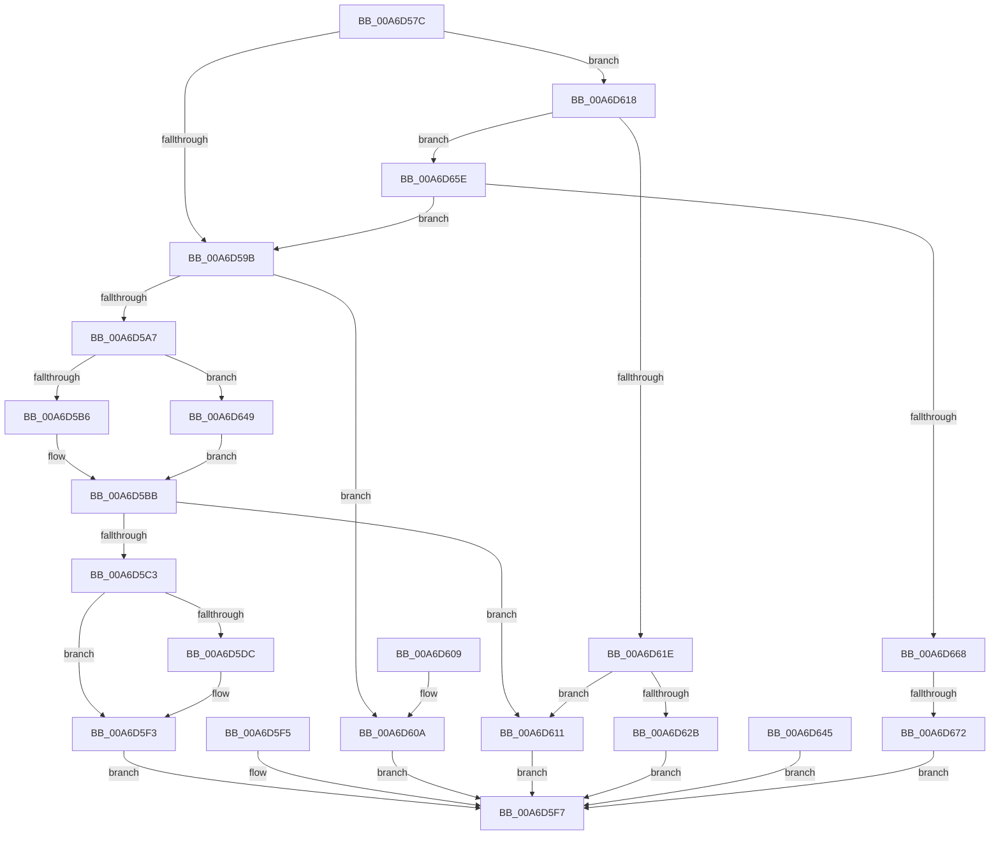

# SeSecureBootQueryInformation

- RVA: `0x00A6D57C`–`0x00A6D67C` (길이 `256` bytes)
- VA: `0x0000000140A6D57C`
- 실행 섹션: `PAGE`
- PDB 이름 있음: `예`; PDB Function 태그: `예`
- unwind 정보 RVA: `0x000B4628`
- 디코드: `72`개 명령, `256/256` bytes 표시
- 미해석 바이트: `0` (있으면 어셈블리에 `.byte`로 보존)

> 이 문서는 커널 이미지의 기계어와 PDB 기호를 분석해 생성했습니다. 4번과 5번은 함수 원형과 자료형을 바이너리 사용 방식에서 추정한 C 해석이며 원본 소스 복구 결과는 아닙니다.

## 1. Dependencies

- 직접 호출 지점: **1**; 고유 호출 대상: **1**
- 직접 호출자로 확인된 함수: **1**
- RIP 상대 이미지 참조: **2**

### Outgoing calls
- `0x00A6D5E8` → [memcpy](../../text/6C/memcpy_function_006C6840.md) (function, `0x006C6840`)

### Direct callers
- [ExpQuerySystemInformation](../A5/ExpQuerySystemInformation_function_00A57858.md) at `0x00A59D62`

### Static image references
- `0x00A6D59B` → RVA `0x00E67DF0` (`.data`; read)
- `0x00A6D62B` → RVA `0x00E67E04` (`.data`; read)

## 2. Other-region calls and transfers

- 다른 실행 섹션으로 향하는 call: **1**
  - `0x00A6D5E8` → [memcpy](../../text/6C/memcpy_function_006C6840.md) (`PAGE` → `.text`)
- call이 아닌 외부 분기/꼬리 이동: **1**
  - `0x00A6D66C` → [sub_00B3F498](../B3/Unknown_function_00B3F498.md) (`tail-transfer`)

## 3. Assembly (complete function range)

```asm
00A6D57C  48 89 5C 24 08                  mov qword ptr [rsp + 8], rbx
00A6D581  48 89 74 24 10                  mov qword ptr [rsp + 0x10], rsi
00A6D586  57                              push rdi
00A6D587  48 83 EC 40                     sub rsp, 0x40
00A6D58B  33 F6                           xor esi, esi
00A6D58D  8B DE                           mov ebx, esi
00A6D58F  44 8B D1                        mov r10d, ecx
00A6D592  41 81 EA 8F 00 00 00            sub r10d, 0x8f
00A6D599  75 7D                           jne 0x140a6d618
00A6D59B  48 8B 3D 4E A8 3F 00            mov rdi, qword ptr [rip + 0x3fa84e]
00A6D5A2  48 85 FF                        test rdi, rdi
00A6D5A5  74 63                           je 0x140a6d60a
00A6D5A7  41 BA AB 00 00 00               mov r10d, 0xab
00A6D5AD  41 3B CA                        cmp ecx, r10d
00A6D5B0  0F 84 93 00 00 00               je 0x140a6d649
00A6D5B6  B8 18 00 00 00                  mov eax, 0x18
00A6D5BB  41 89 01                        mov dword ptr [r9], eax
00A6D5BE  44 3B C0                        cmp r8d, eax
00A6D5C1  72 4E                           jb 0x140a6d611
00A6D5C3  0F 10 47 04                     movups xmm0, xmmword ptr [rdi + 4]
00A6D5C7  F3 0F 7F 02                     movdqu xmmword ptr [rdx], xmm0
00A6D5CB  8B 47 14                        mov eax, dword ptr [rdi + 0x14]
00A6D5CE  89 42 10                        mov dword ptr [rdx + 0x10], eax
00A6D5D1  8B 47 20                        mov eax, dword ptr [rdi + 0x20]
00A6D5D4  89 42 14                        mov dword ptr [rdx + 0x14], eax
00A6D5D7  41 3B CA                        cmp ecx, r10d
00A6D5DA  75 17                           jne 0x140a6d5f3
00A6D5DC  44 8B 47 38                     mov r8d, dword ptr [rdi + 0x38]
00A6D5E0  48 8D 57 3C                     lea rdx, [rdi + 0x3c]
00A6D5E4  48 8D 4E 1C                     lea rcx, [rsi + 0x1c]
00A6D5E8  E8 53 92 C5 FF                  call 0x1406c6840
00A6D5ED  8B 47 38                        mov eax, dword ptr [rdi + 0x38]
00A6D5F0  89 46 18                        mov dword ptr [rsi + 0x18], eax
00A6D5F3  EB 02                           jmp 0x140a6d5f7
00A6D5F5  8B D8                           mov ebx, eax
00A6D5F7  8B C3                           mov eax, ebx
00A6D5F9  48 8B 5C 24 50                  mov rbx, qword ptr [rsp + 0x50]
00A6D5FE  48 8B 74 24 58                  mov rsi, qword ptr [rsp + 0x58]
00A6D603  48 83 C4 40                     add rsp, 0x40
00A6D607  5F                              pop rdi
00A6D608  C3                              ret
00A6D609  CC                              int3
00A6D60A  BB 06 00 43 80                  mov ebx, 0x80430006
00A6D60F  EB E6                           jmp 0x140a6d5f7
00A6D611  BB 04 00 00 C0                  mov ebx, 0xc0000004
00A6D616  EB DF                           jmp 0x140a6d5f7
00A6D618  41 83 EA 02                     sub r10d, 2
00A6D61C  75 40                           jne 0x140a6d65e
00A6D61E  41 C7 01 02 00 00 00            mov dword ptr [r9], 2
00A6D625  41 83 F8 02                     cmp r8d, 2
00A6D629  72 E6                           jb 0x140a6d611
00A6D62B  8A 05 D3 A7 3F 00               mov al, byte ptr [rip + 0x3fa7d3]
00A6D631  24 01                           and al, 1
00A6D633  88 02                           mov byte ptr [rdx], al
00A6D635  8B 05 C9 A7 3F 00               mov eax, dword ptr [rip + 0x3fa7c9]
00A6D63B  C1 E8 03                        shr eax, 3
00A6D63E  24 01                           and al, 1
00A6D640  88 42 01                        mov byte ptr [rdx + 1], al
00A6D643  EB B2                           jmp 0x140a6d5f7
00A6D645  8B D8                           mov ebx, eax
00A6D647  EB AE                           jmp 0x140a6d5f7
00A6D649  41 C7 01 1C 00 00 00            mov dword ptr [r9], 0x1c
00A6D650  48 8B F2                        mov rsi, rdx
00A6D653  8B 47 38                        mov eax, dword ptr [rdi + 0x38]
00A6D656  83 C0 1C                        add eax, 0x1c
00A6D659  E9 5D FF FF FF                  jmp 0x140a6d5bb
00A6D65E  41 83 EA 1A                     sub r10d, 0x1a
00A6D662  0F 84 33 FF FF FF               je 0x140a6d59b
00A6D668  41 83 FA 08                     cmp r10d, 8
00A6D66C  0F 84 26 1E 0D 00               je 0x140b3f498
00A6D672  BB 03 00 00 C0                  mov ebx, 0xc0000003
00A6D677  E9 7B FF FF FF                  jmp 0x140a6d5f7
```

## 4. C-style interpretation (structured pseudocode)

```c
__int64 __fastcall SeSecureBootQueryInformation(int a1, __int64 a2, int a3, __int64 a4)
{
    __int64 result;
    __int64 v_r10;
    __int64 v_rsi;
    __int64 v_rsp;
    unsigned __int64 v_stack_p10;
    unsigned __int64 v_stack_p8;

    v_stack_p8 = v_rbx;
    v_stack_p10 = v_rsi;
    v_rsp = (v_rsp) - (64);
    v_rsi = 0;
    v_r10 = (unsigned int)(((unsigned int)(a1)) - (143));
    if (condition_is_not_equal) goto loc_00A6D618;
loc_00A6D59B:
    if (*(unsigned __int64 *)(v_rip + 4171854) == 0) goto loc_00A6D60A;
    if (a1 == 171) goto loc_00A6D649;
loc_00A6D5BB:
    *(unsigned int *)(a4) = 24;
    if (a3 < 24) goto loc_00A6D611;
    *(unsigned __int64 *)(a2) = v_xmm0;
    *(unsigned int *)(a2 + 16) = (unsigned int)((unsigned int)(*(unsigned int *)(*(unsigned __int64 *)(v_rip + 4171854) + 20)));
    *(unsigned int *)(a2 + 20) = (unsigned int)((unsigned int)(*(unsigned int *)(*(unsigned __int64 *)(v_rip + 4171854) + 32)));
    result = (unsigned int)(*(unsigned int *)(*(unsigned __int64 *)(v_rip + 4171854) + 32));
    if (a1 == 171) {
        a3 = *(unsigned int *)(*(unsigned __int64 *)(v_rip + 4171854) + 56);
        a2 = *(unsigned __int64 *)(v_rip + 4171854) + 60;
        a1 = v_rsi + 28;
        result = memcpy(a1, a2, a3, a4);
        result = *(unsigned int *)(*(unsigned __int64 *)(v_rip + 4171854) + 56);
        *(unsigned int *)(v_rsi + 24) = (unsigned int)(result);
    }
    goto loc_00A6D5F7;
loc_00A6D5F7:
    v_rsp = (v_rsp) + (64);
    return 0;
loc_00A6D60A:
    goto loc_00A6D5F7;
loc_00A6D611:
    goto loc_00A6D5F7;
loc_00A6D618:
    v_r10 = (unsigned int)((171) - (2));
    if (condition_is_not_equal) goto loc_00A6D65E;
    *(unsigned int *)(a4) = 2;
    if (a3 < 2) goto loc_00A6D611;
    result = (unsigned __int8)((*(unsigned __int8 *)(v_rip + 4171731)) & (1));
    *(unsigned __int8 *)(a2) = (unsigned __int8)(result);
    result = (unsigned int)(((unsigned int)(*(unsigned int *)(v_rip + 4171721))) >> (3));
    result = (unsigned __int8)((result) & (1));
    *(unsigned __int8 *)(a2 + 1) = (unsigned __int8)(result);
    goto loc_00A6D5F7;
loc_00A6D649:
    *(unsigned int *)(a4) = 28;
    result = (unsigned int)(((unsigned int)(*(unsigned int *)(*(unsigned __int64 *)(v_rip + 4171854) + 56))) + (28));
    goto loc_00A6D5BB;
loc_00A6D65E:
    v_r10 = (unsigned int)((v_r10) - (26));
    if (condition_is_equal) goto loc_00A6D59B;
    goto loc_00A6D5F7;
}
```

## 5. (Beta) C Style

```c
int64_t SeSecureBootQueryInformation(int32_t Arg1, void *Arg2, int32_t Arg3, void *Arg4)
{
    uint8_t *arg2 = (uint8_t *)Arg2;
    uint8_t *arg4 = (uint8_t *)Arg4;

    int64_t result;
    int64_t local_r10;
    int64_t local_rsi;
    int64_t local_rsp;
    uint64_t v_stack_p10;
    uint64_t v_stack_p8;

    v_stack_p8 = local_rbx;
    v_stack_p10 = local_rsi;
    local_rsp = (local_rsp) - (64);
    local_rsi = 0;
    local_r10 = (uint32_t)(((uint32_t)(Arg1)) - (143));
    if (condition_is_not_equal) goto loc_00A6D618;
loc_00A6D59B:
    if (*(uint64_t *)(v_rip + 0x3FA84E) == 0) goto loc_00A6D60A;
    if (Arg1 == 171) goto loc_00A6D649;
loc_00A6D5BB:
    *(uint32_t *)(arg4) = 24;
    if (Arg3 < 24) goto loc_00A6D611;
    *(uint64_t *)(arg2) = v_xmm0;
    *(uint32_t *)(arg2 + 0x10) = (uint32_t)((uint32_t)(*(uint32_t *)(*(uint64_t *)(v_rip + 0x3FA84E) + 0x14)));
    *(uint32_t *)(arg2 + 0x14) = (uint32_t)((uint32_t)(*(uint32_t *)(*(uint64_t *)(v_rip + 0x3FA84E) + 0x20)));
    result = (uint32_t)(*(uint32_t *)(*(uint64_t *)(v_rip + 0x3FA84E) + 0x20));
    if (Arg1 == 171) {
        Arg3 = *(uint32_t *)(*(uint64_t *)(v_rip + 0x3FA84E) + 0x38);
        Arg2 = *(uint64_t *)(v_rip + 0x3FA84E) + 60;
        Arg1 = local_rsi + 28;
        result = memcpy(Arg1, Arg2, Arg3, Arg4);
        result = *(uint32_t *)(*(uint64_t *)(v_rip + 0x3FA84E) + 0x38);
        *(uint32_t *)(local_rsi + 0x18) = (uint32_t)(result);
    }
    goto loc_00A6D5F7;
loc_00A6D5F7:
    local_rsp = (local_rsp) + (64);
    return 0;
loc_00A6D60A:
    goto loc_00A6D5F7;
loc_00A6D611:
    goto loc_00A6D5F7;
loc_00A6D618:
    local_r10 = (uint32_t)((171) - (2));
    if (condition_is_not_equal) goto loc_00A6D65E;
    *(uint32_t *)(arg4) = 2;
    if (Arg3 < 2) goto loc_00A6D611;
    result = (uint8_t)((*(uint8_t *)(v_rip + 0x3FA7D3)) & (1));
    *(uint8_t *)(arg2) = (uint8_t)(result);
    result = (uint32_t)(((uint32_t)(*(uint32_t *)(v_rip + 0x3FA7C9))) >> (3));
    result = (uint8_t)((result) & (1));
    *(uint8_t *)(arg2 + 0x1) = (uint8_t)(result);
    goto loc_00A6D5F7;
loc_00A6D649:
    *(uint32_t *)(arg4) = 28;
    result = (uint32_t)(((uint32_t)(*(uint32_t *)(*(uint64_t *)(v_rip + 0x3FA84E) + 0x38))) + (28));
    goto loc_00A6D5BB;
loc_00A6D65E:
    local_r10 = (uint32_t)((local_r10) - (26));
    if (condition_is_equal) goto loc_00A6D59B;
    goto loc_00A6D5F7;
}
```

### 관측된 메모리 오프셋

구조체 형식이 확인되지 않은 접근은 인자 기준의 오프셋으로만 기록했습니다.

| 기준 인자 | 오프셋 표현 | 폭 (bit) | 접근 |
|---|---:|---:|---|
| `Arg2` | `+ 0x0` | `8` | `W` |
| `Arg2` | `+ 0x0` | `128` | `W` |
| `Arg2` | `+ 0x1` | `8` | `W` |
| `Arg2` | `+ 0x10` | `32` | `W` |
| `Arg2` | `+ 0x14` | `32` | `W` |
| `Arg4` | `+ 0x0` | `32` | `W` |

## 6. Execution-region graph

[열기: 2D/3D 그래프와 함수 탐색 컨트롤 패널](../../../control-panel.html?section=page&rva=0x00A6D57C&view=graph)

- 2D 그래프는 위에서 아래로 흐르고, 3D 그래프는 빈 공간을 드래그해 회전합니다. Shift+드래그는 이동, 휠은 확대·축소, 함수 노드 선택은 대상 보고서 이동입니다.

### Static fallback


