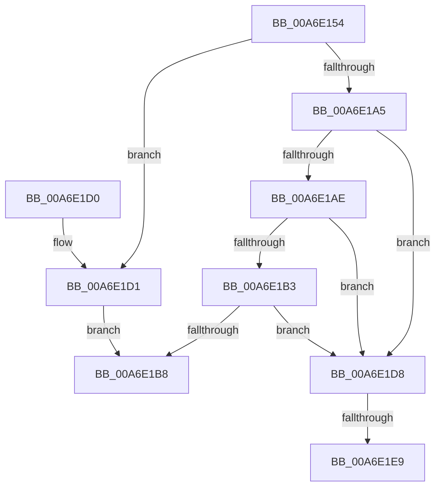

# SepCreateClaimAttributes

- RVA: `0x00A6E154`–`0x00A6E1F3` (길이 `159` bytes)
- VA: `0x0000000140A6E154`
- 실행 섹션: `PAGE`
- PDB 이름 있음: `예`; PDB Function 태그: `예`
- unwind 정보 RVA: `0x000B498C`
- 디코드: `53`개 명령, `159/159` bytes 표시
- 미해석 바이트: `0` (있으면 어셈블리에 `.byte`로 보존)

> 이 문서는 커널 이미지의 기계어와 PDB 기호를 분석해 생성했습니다. 4번과 5번은 함수 원형과 자료형을 바이너리 사용 방식에서 추정한 C 해석이며 원본 소스 복구 결과는 아닙니다.

## 1. Dependencies

- 직접 호출 지점: **1**; 고유 호출 대상: **1**
- 직접 호출자로 확인된 함수: **1**
- RIP 상대 이미지 참조: **0**

### Outgoing calls
- `0x00A6E1D8` → [AuthzBasepAllocateClaimCollectionNoLists](../A7/AuthzBasepAllocateClaimCollectionNoLists_function_00A7648C.md) (function, `0x00A7648C`)

### Direct callers
- [SepSetTokenClaims](SepSetTokenClaims_function_00A6E0D8.md) at `0x00A6E10B`

### Static image references
- 디코드된 RIP-relative 메모리 참조가 없습니다.

## 2. Other-region calls and transfers

- 다른 실행 섹션으로 향하는 call: **0**
- call이 아닌 외부 분기/꼬리 이동: **2**
  - `0x00A6E1E3` → [sub_00B3F630](../B3/Unknown_function_00B3F630.md) (`tail-transfer`)
  - `0x00A6E1EE` → [sub_00B3F630 + 0x12B](../B3/Unknown_function_00B3F630.md) (`tail-transfer`)

## 3. Assembly (complete function range)

```asm
00A6E154  4C 8B DC                        mov r11, rsp
00A6E157  49 89 5B 20                     mov qword ptr [r11 + 0x20], rbx
00A6E15B  4D 89 43 18                     mov qword ptr [r11 + 0x18], r8
00A6E15F  49 89 53 10                     mov qword ptr [r11 + 0x10], rdx
00A6E163  55                              push rbp
00A6E164  56                              push rsi
00A6E165  57                              push rdi
00A6E166  41 54                           push r12
00A6E168  41 55                           push r13
00A6E16A  41 56                           push r14
00A6E16C  41 57                           push r15
00A6E16E  48 83 EC 70                     sub rsp, 0x70
00A6E172  4C 8B E9                        mov r13, rcx
00A6E175  C7 44 24 54 01 00 00 00         mov dword ptr [rsp + 0x54], 1
00A6E17D  33 C9                           xor ecx, ecx
00A6E17F  45 8B F9                        mov r15d, r9d
00A6E182  88 8C 24 B0 00 00 00            mov byte ptr [rsp + 0xb0], cl
00A6E189  48 8B C2                        mov rax, rdx
00A6E18C  89 4C 24 58                     mov dword ptr [rsp + 0x58], ecx
00A6E190  8B D9                           mov ebx, ecx
00A6E192  49 89 4B B8                     mov qword ptr [r11 - 0x48], rcx
00A6E196  44 8B F1                        mov r14d, ecx
00A6E199  8B F1                           mov esi, ecx
00A6E19B  44 8A E1                        mov r12b, cl
00A6E19E  8B E9                           mov ebp, ecx
00A6E1A0  4D 85 ED                        test r13, r13
00A6E1A3  74 2C                           je 0x140a6e1d1
00A6E1A5  49 89 4D 00                     mov qword ptr [r13], rcx
00A6E1A9  48 85 C0                        test rax, rax
00A6E1AC  75 2A                           jne 0x140a6e1d8
00A6E1AE  4D 85 C0                        test r8, r8
00A6E1B1  75 25                           jne 0x140a6e1d8
00A6E1B3  45 85 C9                        test r9d, r9d
00A6E1B6  75 20                           jne 0x140a6e1d8
00A6E1B8  48 8B 9C 24 C8 00 00 00         mov rbx, qword ptr [rsp + 0xc8]
00A6E1C0  48 83 C4 70                     add rsp, 0x70
00A6E1C4  41 5F                           pop r15
00A6E1C6  41 5E                           pop r14
00A6E1C8  41 5D                           pop r13
00A6E1CA  41 5C                           pop r12
00A6E1CC  5F                              pop rdi
00A6E1CD  5E                              pop rsi
00A6E1CE  5D                              pop rbp
00A6E1CF  C3                              ret
00A6E1D0  CC                              int3
00A6E1D1  B8 0D 00 00 C0                  mov eax, 0xc000000d
00A6E1D6  EB E0                           jmp 0x140a6e1b8
00A6E1D8  E8 AF 82 00 00                  call 0x140a7648c
00A6E1DD  48 8B F8                        mov rdi, rax
00A6E1E0  48 85 C0                        test rax, rax
00A6E1E3  0F 85 47 14 0D 00               jne 0x140b3f630
00A6E1E9  BB 9A 00 00 C0                  mov ebx, 0xc000009a
00A6E1EE  E9 68 15 0D 00                  jmp 0x140b3f75b
```

## 4. C-style interpretation (structured pseudocode)

```c
__int64 __fastcall SepCreateClaimAttributes(__int64 a1, __int64 a2, __int64 a3, int a4)
{
    __int64 result;
    __int64 v_rsp;
    unsigned int v_stack_m50;
    unsigned int v_stack_m54;
    unsigned __int64 v_stack_p20;
    unsigned __int8 v_stack_p8;

    *(unsigned __int64 *)(v_rsp + 32) = v_rbx;
    *(unsigned __int64 *)(v_rsp + 24) = a3;
    *(unsigned __int64 *)(v_rsp + 16) = a2;
    v_rsp = (v_rsp) - (112);
    v_stack_m54 = 1;
    a1 = 0;
    v_stack_p8 = 0;
    v_stack_m50 = 0;
    *(unsigned __int64 *)(v_rsp - 72) = 0;
    if (0 == 0) goto loc_00A6E1D1;
    *(unsigned __int64 *)(a1) = 0;
    if (a2 != 0) goto loc_00A6E1D8;
    if (a3 != 0) goto loc_00A6E1D8;
    if (a4 != 0) goto loc_00A6E1D8;
loc_00A6E1B8:
    v_rsp = (v_rsp) + (112);
    return a2;
loc_00A6E1D1:
    goto loc_00A6E1B8;
loc_00A6E1D8:
    result = AuthzBasepAllocateClaimCollectionNoLists(a1, a2, a3, a4);
}
```

## 5. (Beta) C Style

```c
int64_t SepCreateClaimAttributes(int64_t Arg1, int64_t Arg2, int64_t Arg3, int32_t Arg4)
{
    int64_t result;
    int64_t local_rsp;
    uint32_t v_stack_m50;
    uint32_t v_stack_m54;
    uint64_t v_stack_p20;
    uint8_t v_stack_p8;

    *(uint64_t *)(local_rsp + 0x20) = local_rbx;
    *(uint64_t *)(local_rsp + 0x18) = Arg3;
    *(uint64_t *)(local_rsp + 0x10) = Arg2;
    local_rsp = (local_rsp) - (112);
    v_stack_m54 = 1;
    Arg1 = 0;
    v_stack_p8 = 0;
    v_stack_m50 = 0;
    *(uint64_t *)(local_rsp - 0x48) = 0;
    if (0 == 0) goto loc_00A6E1D1;
    *(uint64_t *)(Arg1) = 0;
    if (Arg2 != 0) goto loc_00A6E1D8;
    if (Arg3 != 0) goto loc_00A6E1D8;
    if (Arg4 != 0) goto loc_00A6E1D8;
loc_00A6E1B8:
    local_rsp = (local_rsp) + (112);
    return Arg2;
loc_00A6E1D1:
    goto loc_00A6E1B8;
loc_00A6E1D8:
    result = AuthzBasepAllocateClaimCollectionNoLists(Arg1, Arg2, Arg3, Arg4);
}
```

## 6. Execution-region graph

[열기: 2D/3D 그래프와 함수 탐색 컨트롤 패널](../../../control-panel.html?section=page&rva=0x00A6E154&view=graph)

- 2D 그래프는 위에서 아래로 흐르고, 3D 그래프는 빈 공간을 드래그해 회전합니다. Shift+드래그는 이동, 휠은 확대·축소, 함수 노드 선택은 대상 보고서 이동입니다.

### Static fallback


