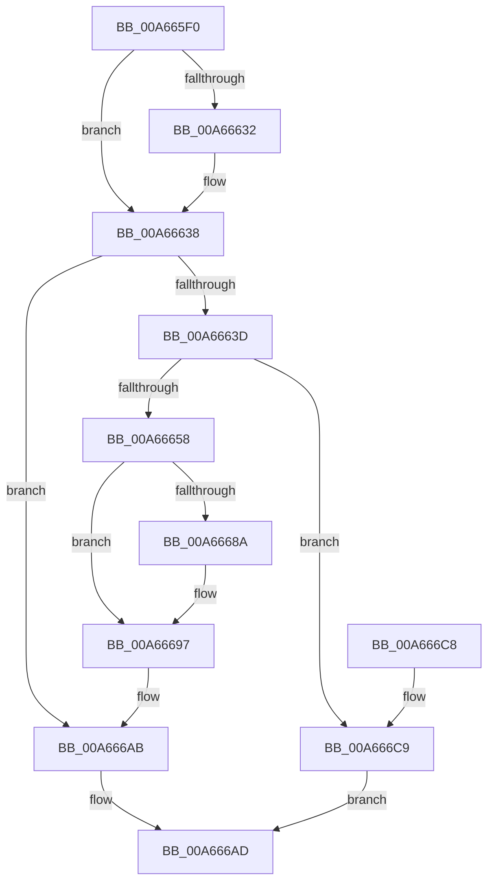

# SepExpandDynamic

- RVA: `0x00A665F0`–`0x00A666D0` (길이 `224` bytes)
- VA: `0x0000000140A665F0`
- 실행 섹션: `PAGE`
- PDB 이름 있음: `예`; PDB Function 태그: `아니요`
- unwind 정보 RVA: `0x0006B020`
- 디코드: `58`개 명령, `224/224` bytes 표시
- 미해석 바이트: `0` (있으면 어셈블리에 `.byte`로 보존)

> 이 문서는 커널 이미지의 기계어와 PDB 기호를 분석해 생성했습니다. 4번과 5번은 함수 원형과 자료형을 바이너리 사용 방식에서 추정한 C 해석이며 원본 소스 복구 결과는 아닙니다.

## 1. Dependencies

- 직접 호출 지점: **3**; 고유 호출 대상: **3**
- 직접 호출자로 확인된 함수: **2**
- RIP 상대 이미지 참조: **0**

### Outgoing calls
- `0x00A6664B` → [ExAllocatePool2](../../poolcode/B8/ExAllocatePool2_function_00B820F0.md) (function, `0x00B820F0`)
- `0x00A66668` → [memcpy](../../text/6C/memcpy_function_006C6840.md) (function, `0x006C6840`)
- `0x00A666A6` → [ExFreePoolWithTag](../../poolcode/B8/ExFreePoolWithTag_function_00B82870.md) (function, `0x00B82870`)

### Direct callers
- [SepAppendAceToTokenDefaultDacl](../../text/40/SepAppendAceToTokenDefaultDacl_function_004002F8.md) at `0x00400466`
- [NtSetInformationToken](../AF/NtSetInformationToken_function_00AF0530.md) at `0x00AF0809`
- [NtSetInformationToken](../AF/NtSetInformationToken_function_00AF0530.md) at `0x00AF0A1A`

### Static image references
- 디코드된 RIP-relative 메모리 참조가 없습니다.

## 2. Other-region calls and transfers

- 다른 실행 섹션으로 향하는 call: **3**
  - `0x00A6664B` → [ExAllocatePool2](../../poolcode/B8/ExAllocatePool2_function_00B820F0.md) (`PAGE` → `POOLCODE`)
  - `0x00A66668` → [memcpy](../../text/6C/memcpy_function_006C6840.md) (`PAGE` → `.text`)
  - `0x00A666A6` → [ExFreePoolWithTag](../../poolcode/B8/ExFreePoolWithTag_function_00B82870.md) (`PAGE` → `POOLCODE`)
- 별도 외부 분기/꼬리 이동을 확인하지 못했습니다.

## 3. Assembly (complete function range)

```asm
00A665F0  48 8B C4                        mov rax, rsp
00A665F3  48 89 58 08                     mov qword ptr [rax + 8], rbx
00A665F7  48 89 68 10                     mov qword ptr [rax + 0x10], rbp
00A665FB  48 89 70 18                     mov qword ptr [rax + 0x18], rsi
00A665FF  48 89 78 20                     mov qword ptr [rax + 0x20], rdi
00A66603  41 56                           push r14
00A66605  48 83 EC 20                     sub rsp, 0x20
00A66609  48 8B 81 A8 00 00 00            mov rax, qword ptr [rcx + 0xa8]
00A66610  48 8B F9                        mov rdi, rcx
00A66613  44 8B F2                        mov r14d, edx
00A66616  0F B6 68 01                     movzx ebp, byte ptr [rax + 1]
00A6661A  8B 81 8C 00 00 00               mov eax, dword ptr [rcx + 0x8c]
00A66620  83 C0 08                        add eax, 8
00A66623  8D 2C A8                        lea ebp, [rax + rbp*4]
00A66626  48 8B 81 B8 00 00 00            mov rax, qword ptr [rcx + 0xb8]
00A6662D  48 85 C0                        test rax, rax
00A66630  74 06                           je 0x140a66638
00A66632  0F B7 40 02                     movzx eax, word ptr [rax + 2]
00A66636  03 E8                           add ebp, eax
00A66638  44 3B F5                        cmp r14d, ebp
00A6663B  76 6E                           jbe 0x140a666ab
00A6663D  49 8B D6                        mov rdx, r14
00A66640  B9 00 01 00 00                  mov ecx, 0x100
00A66645  41 B8 53 65 54 64               mov r8d, 0x64546553
00A6664B  E8 A0 BA 11 00                  call 0x140b820f0
00A66650  48 8B D8                        mov rbx, rax
00A66653  48 85 C0                        test rax, rax
00A66656  74 71                           je 0x140a666c9
00A66658  48 8B B7 B0 00 00 00            mov rsi, qword ptr [rdi + 0xb0]
00A6665F  48 8B C8                        mov rcx, rax
00A66662  48 8B D6                        mov rdx, rsi
00A66665  44 8B C5                        mov r8d, ebp
00A66668  E8 D3 01 C6 FF                  call 0x1406c6840
00A6666D  48 8B 87 B8 00 00 00            mov rax, qword ptr [rdi + 0xb8]
00A66674  44 2B F5                        sub r14d, ebp
00A66677  44 01 B7 8C 00 00 00            add dword ptr [rdi + 0x8c], r14d
00A6667E  48 89 9F B0 00 00 00            mov qword ptr [rdi + 0xb0], rbx
00A66685  48 85 C0                        test rax, rax
00A66688  74 0D                           je 0x140a66697
00A6668A  48 2B C6                        sub rax, rsi
00A6668D  48 03 C3                        add rax, rbx
00A66690  48 89 87 B8 00 00 00            mov qword ptr [rdi + 0xb8], rax
00A66697  48 2B DE                        sub rbx, rsi
00A6669A  33 D2                           xor edx, edx
00A6669C  48 01 9F A8 00 00 00            add qword ptr [rdi + 0xa8], rbx
00A666A3  48 8B CE                        mov rcx, rsi
00A666A6  E8 C5 C1 11 00                  call 0x140b82870
00A666AB  33 C0                           xor eax, eax
00A666AD  48 8B 5C 24 30                  mov rbx, qword ptr [rsp + 0x30]
00A666B2  48 8B 6C 24 38                  mov rbp, qword ptr [rsp + 0x38]
00A666B7  48 8B 74 24 40                  mov rsi, qword ptr [rsp + 0x40]
00A666BC  48 8B 7C 24 48                  mov rdi, qword ptr [rsp + 0x48]
00A666C1  48 83 C4 20                     add rsp, 0x20
00A666C5  41 5E                           pop r14
00A666C7  C3                              ret
00A666C8  CC                              int3
00A666C9  B8 9A 00 00 C0                  mov eax, 0xc000009a
00A666CE  EB DD                           jmp 0x140a666ad
```

## 4. C-style interpretation (structured pseudocode)

```c
__int64 __fastcall SepExpandDynamic(__int64 a1, int a2)
{
    __int64 result;
    __int64 v_r14;
    __int64 v_rbp;
    __int64 v_rbx;
    __int64 v_rsp;
    unsigned __int64 v_stack_p10;
    unsigned __int64 v_stack_p18;
    unsigned __int64 v_stack_p20;
    unsigned __int64 v_stack_p8;

    *(unsigned __int64 *)(v_rsp + 8) = v_rbx;
    *(unsigned __int64 *)(v_rsp + 16) = v_rbp;
    *(unsigned __int64 *)(v_rsp + 24) = v_rsi;
    *(unsigned __int64 *)(v_rsp + 32) = v_rdi;
    v_rsp = (v_rsp) - (32);
    result = (unsigned int)(((unsigned int)(*(unsigned int *)(a1 + 140))) + (8));
    result = *(unsigned __int64 *)(a1 + 184);
    v_rbp = result + *(unsigned __int8 *)(*(unsigned __int64 *)(a1 + 168) + 1) * 4;
    if (*(unsigned __int64 *)(a1 + 184) != 0) {
        result = *(unsigned __int16 *)(*(unsigned __int64 *)(a1 + 184) + 2);
        v_rbp = (unsigned int)((result + *(unsigned __int8 *)(*(unsigned __int64 *)(a1 + 168) + 1) * 4) + ((unsigned int)(result)));
    }
    if (((unsigned int)((unsigned int)(a2))) <= ((unsigned int)(v_rbp))) goto loc_00A666AB;
    result = ExAllocatePool2(256, (unsigned int)(a2), (unsigned int)(0x64546553ULL), a4);
    if (result == 0) goto loc_00A666C9;
    result = memcpy(result, *(unsigned __int64 *)(a1 + 176), (unsigned int)((unsigned int)(v_rbp)), a4);
    v_r14 = (unsigned int)(((unsigned int)(a2)) - ((unsigned int)(v_rbp)));
    *(unsigned __int64 *)(a1 + 176) = result;
    result = *(unsigned __int64 *)(a1 + 184);
    if (*(unsigned __int64 *)(a1 + 184) != 0) {
        result = (*(unsigned __int64 *)(a1 + 184)) - (*(unsigned __int64 *)(a1 + 176));
        result = (result) + (result);
        *(unsigned __int64 *)(a1 + 184) = result;
    }
    v_rbx = (result) - (*(unsigned __int64 *)(a1 + 176));
    a2 = 0;
    result = ExFreePoolWithTag(*(unsigned __int64 *)(a1 + 176), a2, (unsigned int)((unsigned int)(v_rbp)), a4);
loc_00A666AB:
    result = 0;
loc_00A666AD:
    v_rsp = (v_rsp) + (32);
    return result;
loc_00A666C9:
    goto loc_00A666AD;
}
```

## 5. (Beta) C Style

```c
int64_t SepExpandDynamic(void *Arg1, int32_t Arg2)
{
    uint8_t *arg1 = (uint8_t *)Arg1;

    int64_t result;
    int64_t local_r14;
    int64_t local_rbp;
    int64_t local_rbx;
    int64_t local_rsp;
    uint64_t v_stack_p10;
    uint64_t v_stack_p18;
    uint64_t v_stack_p20;
    uint64_t v_stack_p8;

    *(uint64_t *)(local_rsp + 0x8) = local_rbx;
    *(uint64_t *)(local_rsp + 0x10) = local_rbp;
    *(uint64_t *)(local_rsp + 0x18) = local_rsi;
    *(uint64_t *)(local_rsp + 0x20) = local_rdi;
    local_rsp = (local_rsp) - (32);
    result = (uint32_t)(((uint32_t)(*(uint32_t *)(arg1 + 0x8C))) + (8));
    result = *(uint64_t *)(arg1 + 0xB8);
    local_rbp = result + *(uint8_t *)(*(uint64_t *)(arg1 + 0xA8) + 0x1) * 4;
    if (*(uint64_t *)(arg1 + 0xB8) != 0) {
        result = *(uint16_t *)(*(uint64_t *)(arg1 + 0xB8) + 0x2);
        local_rbp = (uint32_t)((result + *(uint8_t *)(*(uint64_t *)(arg1 + 0xA8) + 0x1) * 4) + ((uint32_t)(result)));
    }
    if (((uint32_t)((uint32_t)(Arg2))) <= ((uint32_t)(local_rbp))) goto loc_00A666AB;
    result = ExAllocatePool2(256, (uint32_t)(Arg2), (uint32_t)(0x64546553ULL), a4);
    if (result == 0) goto loc_00A666C9;
    result = memcpy(result, *(uint64_t *)(arg1 + 0xB0), (uint32_t)((uint32_t)(local_rbp)), a4);
    local_r14 = (uint32_t)(((uint32_t)(Arg2)) - ((uint32_t)(local_rbp)));
    *(uint64_t *)(arg1 + 0xB0) = result;
    result = *(uint64_t *)(arg1 + 0xB8);
    if (*(uint64_t *)(arg1 + 0xB8) != 0) {
        result = (*(uint64_t *)(arg1 + 0xB8)) - (*(uint64_t *)(arg1 + 0xB0));
        result = (result) + (result);
        *(uint64_t *)(arg1 + 0xB8) = result;
    }
    local_rbx = (result) - (*(uint64_t *)(arg1 + 0xB0));
    Arg2 = 0;
    result = ExFreePoolWithTag(*(uint64_t *)(arg1 + 0xB0), Arg2, (uint32_t)((uint32_t)(local_rbp)), a4);
loc_00A666AB:
    result = 0;
loc_00A666AD:
    local_rsp = (local_rsp) + (32);
    return result;
loc_00A666C9:
    goto loc_00A666AD;
}
```

### 관측된 메모리 오프셋

구조체 형식이 확인되지 않은 접근은 인자 기준의 오프셋으로만 기록했습니다.

| 기준 인자 | 오프셋 표현 | 폭 (bit) | 접근 |
|---|---:|---:|---|
| `Arg1` | `+ 0x8C` | `32` | `R` |
| `Arg1` | `+ 0x8C` | `32` | `R/W` |
| `Arg1` | `+ 0xA8` | `64` | `R` |
| `Arg1` | `+ 0xA8` | `64` | `R/W` |
| `Arg1` | `+ 0xB0` | `64` | `R` |
| `Arg1` | `+ 0xB0` | `64` | `W` |
| `Arg1` | `+ 0xB8` | `64` | `R` |
| `Arg1` | `+ 0xB8` | `64` | `W` |

## 6. Execution-region graph

[열기: 2D/3D 그래프와 함수 탐색 컨트롤 패널](../../../control-panel.html?section=page&rva=0x00A665F0&view=graph)

- 2D 그래프는 위에서 아래로 흐르고, 3D 그래프는 빈 공간을 드래그해 회전합니다. Shift+드래그는 이동, 휠은 확대·축소, 함수 노드 선택은 대상 보고서 이동입니다.

### Static fallback


