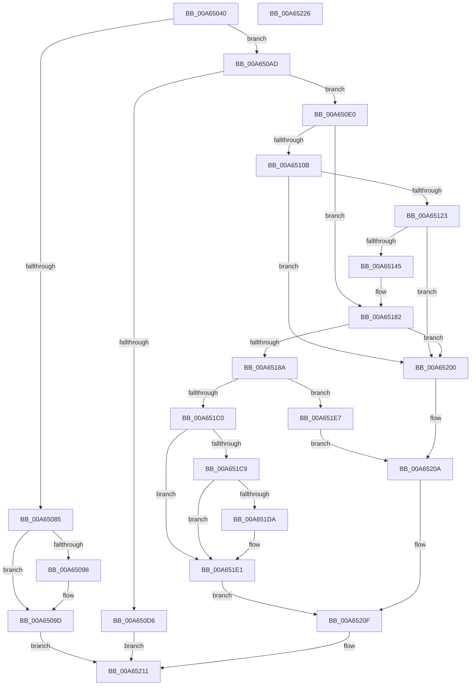

# SepGetLowBoxNumberEntry

- RVA: `0x00A65040`–`0x00A65227` (길이 `487` bytes)
- VA: `0x0000000140A65040`
- 실행 섹션: `PAGE`
- PDB 이름 있음: `예`; PDB Function 태그: `아니요`
- unwind 정보 RVA: `0x000B384C`
- 디코드: `145`개 명령, `487/487` bytes 표시
- 미해석 바이트: `0` (있으면 어셈블리에 `.byte`로 보존)

> 이 문서는 커널 이미지의 기계어와 PDB 기호를 분석해 생성했습니다. 4번과 5번은 함수 원형과 자료형을 바이너리 사용 방식에서 추정한 C 해석이며 원본 소스 복구 결과는 아닙니다.

## 1. Dependencies

- 직접 호출 지점: **15**; 고유 호출 대상: **11**
- 직접 호출자로 확인된 함수: **2**
- RIP 상대 이미지 참조: **0**

### Outgoing calls
- `0x00A65076` → [SepFindMatchingLowBoxNumberEntry](../A7/SepFindMatchingLowBoxNumberEntry_function_00A74544.md) (function, `0x00A74544`)
- `0x00A650C9` → [ExAllocatePool2](../../poolcode/B8/ExAllocatePool2_function_00B820F0.md) (function, `0x00B820F0`)
- `0x00A650EE` → [RtlCopySid](../9A/RtlCopySid_function_009A9A50.md) (function, `0x009A9A50`)
- `0x00A650FF` → [RtlFindClearBitsAndSet](../../text/3E/RtlFindClearBitsAndSet_function_003E0CD0.md) (function, `0x003E0CD0`)
- `0x00A6510E` → [RtlNumberOfSetBits](../../text/43/RtlNumberOfSetBits_function_00433F70.md) (function, `0x00433F70`)
- `0x00A65134` → [ExAllocatePool2](../../poolcode/B8/ExAllocatePool2_function_00B820F0.md) (function, `0x00B820F0`)
- `0x00A6514B` → [ExFreePoolWithTag](../../poolcode/B8/ExFreePoolWithTag_function_00B82870.md) (function, `0x00B82870`)
- `0x00A6515A` → [RtlClearAllBits](../../text/45/RtlClearAllBits_function_00450230.md) (function, `0x00450230`)
- `0x00A65169` → [RtlSetBits](../../text/3E/RtlSetBits_function_003E1610.md) (function, `0x003E1610`)
- `0x00A65176` → [RtlFindClearBitsAndSet](../../text/3E/RtlFindClearBitsAndSet_function_003E0CD0.md) (function, `0x003E0CD0`)
- `0x00A651B7` → [RtlInsertEntryHashTable](../../text/43/RtlInsertEntryHashTable_function_00437660.md) (function, `0x00437660`)
- `0x00A651C0` → [Feature_LowBoxNumberEntryReferenceIssue__private_IsEnabledDeviceUsageNoInline](../../text/60/Feature_LowBoxNumberEntryReferenceIssue__private_IsEnabledDeviceUsageNoInline_function_00609F98.md) (function, `0x00609F98`)
- `0x00A651EC` → [ExFreePoolWithTag](../../poolcode/B8/ExFreePoolWithTag_function_00B82870.md) (function, `0x00B82870`)
- `0x00A651F9` → [RtlClearBits](../../text/3E/RtlClearBits_function_003E1A90.md) (function, `0x003E1A90`)
- `0x00A65205` → [ExFreePoolWithTag](../../poolcode/B8/ExFreePoolWithTag_function_00B82870.md) (function, `0x00B82870`)

### Direct callers
- [SepSetTokenLowboxNumberEntry](../../text/60/SepSetTokenLowboxNumberEntry_function_0060B594.md) at `0x0060B7E0`
- [SepSetTokenLowboxNumber](SepSetTokenLowboxNumber_function_00A64D6C.md) at `0x00A64E28`

### Static image references
- 디코드된 RIP-relative 메모리 참조가 없습니다.

## 2. Other-region calls and transfers

- 다른 실행 섹션으로 향하는 call: **13**
  - `0x00A650C9` → [ExAllocatePool2](../../poolcode/B8/ExAllocatePool2_function_00B820F0.md) (`PAGE` → `POOLCODE`)
  - `0x00A650FF` → [RtlFindClearBitsAndSet](../../text/3E/RtlFindClearBitsAndSet_function_003E0CD0.md) (`PAGE` → `.text`)
  - `0x00A6510E` → [RtlNumberOfSetBits](../../text/43/RtlNumberOfSetBits_function_00433F70.md) (`PAGE` → `.text`)
  - `0x00A65134` → [ExAllocatePool2](../../poolcode/B8/ExAllocatePool2_function_00B820F0.md) (`PAGE` → `POOLCODE`)
  - `0x00A6514B` → [ExFreePoolWithTag](../../poolcode/B8/ExFreePoolWithTag_function_00B82870.md) (`PAGE` → `POOLCODE`)
  - `0x00A6515A` → [RtlClearAllBits](../../text/45/RtlClearAllBits_function_00450230.md) (`PAGE` → `.text`)
  - `0x00A65169` → [RtlSetBits](../../text/3E/RtlSetBits_function_003E1610.md) (`PAGE` → `.text`)
  - `0x00A65176` → [RtlFindClearBitsAndSet](../../text/3E/RtlFindClearBitsAndSet_function_003E0CD0.md) (`PAGE` → `.text`)
  - `0x00A651B7` → [RtlInsertEntryHashTable](../../text/43/RtlInsertEntryHashTable_function_00437660.md) (`PAGE` → `.text`)
  - `0x00A651C0` → [Feature_LowBoxNumberEntryReferenceIssue__private_IsEnabledDeviceUsageNoInline](../../text/60/Feature_LowBoxNumberEntryReferenceIssue__private_IsEnabledDeviceUsageNoInline_function_00609F98.md) (`PAGE` → `.text`)
  - `0x00A651EC` → [ExFreePoolWithTag](../../poolcode/B8/ExFreePoolWithTag_function_00B82870.md) (`PAGE` → `POOLCODE`)
  - `0x00A651F9` → [RtlClearBits](../../text/3E/RtlClearBits_function_003E1A90.md) (`PAGE` → `.text`)
  - `0x00A65205` → [ExFreePoolWithTag](../../poolcode/B8/ExFreePoolWithTag_function_00B82870.md) (`PAGE` → `POOLCODE`)
- 별도 외부 분기/꼬리 이동을 확인하지 못했습니다.

## 3. Assembly (complete function range)

```asm
00A65040  48 89 5C 24 10                  mov qword ptr [rsp + 0x10], rbx
00A65045  55                              push rbp
00A65046  56                              push rsi
00A65047  57                              push rdi
00A65048  41 54                           push r12
00A6504A  41 55                           push r13
00A6504C  41 56                           push r14
00A6504E  41 57                           push r15
00A65050  48 83 EC 20                     sub rsp, 0x20
00A65054  4C 8B 69 18                     mov r13, qword ptr [rcx + 0x18]
00A65058  4C 8D 71 08                     lea r14, [rcx + 8]
00A6505C  4D 8B E0                        mov r12, r8
00A6505F  4C 89 6C 24 78                  mov qword ptr [rsp + 0x78], r13
00A65064  33 FF                           xor edi, edi
00A65066  4C 8D 44 24 60                  lea r8, [rsp + 0x60]
00A6506B  49 8B CD                        mov rcx, r13
00A6506E  48 89 7C 24 60                  mov qword ptr [rsp + 0x60], rdi
00A65073  4C 8B FA                        mov r15, rdx
00A65076  E8 C9 F4 00 00                  call 0x140a74544
00A6507B  48 8B 4C 24 60                  mov rcx, qword ptr [rsp + 0x60]
00A65080  48 85 C9                        test rcx, rcx
00A65083  74 28                           je 0x140a650ad
00A65085  8D 5F 01                        lea ebx, [rdi + 1]
00A65088  8B C3                           mov eax, ebx
00A6508A  F0 48 0F C1 41 18               lock xadd qword ptr [rcx + 0x18], rax
00A65090  48 03 C3                        add rax, rbx
00A65093  48 3B C3                        cmp rax, rbx
00A65096  7F 05                           jg 0x140a6509d
00A65098  8D 4F 0E                        lea ecx, [rdi + 0xe]
00A6509B  CD 29                           int 0x29
00A6509D  48 8B 44 24 60                  mov rax, qword ptr [rsp + 0x60]
00A650A2  49 89 04 24                     mov qword ptr [r12], rax
00A650A6  33 C0                           xor eax, eax
00A650A8  E9 64 01 00 00                  jmp 0x140a65211
00A650AD  41 0F B6 47 01                  movzx eax, byte ptr [r15 + 1]
00A650B2  B9 00 01 00 00                  mov ecx, 0x100
00A650B7  41 B8 53 65 4C 73               mov r8d, 0x734c6553
00A650BD  8D 1C 85 43 00 00 00            lea ebx, [rax*4 + 0x43]
00A650C4  83 E3 FC                        and ebx, 0xfffffffc
00A650C7  8B D3                           mov edx, ebx
00A650C9  E8 22 D0 11 00                  call 0x140b820f0
00A650CE  48 8B F0                        mov rsi, rax
00A650D1  48 85 C0                        test rax, rax
00A650D4  75 0A                           jne 0x140a650e0
00A650D6  B8 9A 00 00 C0                  mov eax, 0xc000009a
00A650DB  E9 31 01 00 00                  jmp 0x140a65211
00A650E0  48 8D 50 38                     lea rdx, [rax + 0x38]
00A650E4  4D 8B C7                        mov r8, r15
00A650E7  8D 4B C8                        lea ecx, [rbx - 0x38]
00A650EA  48 89 50 20                     mov qword ptr [rax + 0x20], rdx
00A650EE  E8 5D 49 F4 FF                  call 0x1409a9a50
00A650F3  45 33 C0                        xor r8d, r8d
00A650F6  49 8B CE                        mov rcx, r14
00A650F9  41 8D 58 01                     lea ebx, [r8 + 1]
00A650FD  8B D3                           mov edx, ebx
00A650FF  E8 CC BB 97 FF                  call 0x1403e0cd0
00A65104  8B E8                           mov ebp, eax
00A65106  83 F8 FF                        cmp eax, -1
00A65109  75 77                           jne 0x140a65182
00A6510B  49 8B CE                        mov rcx, r14
00A6510E  E8 5D EE 9C FF                  call 0x140433f70
00A65113  8B E8                           mov ebp, eax
00A65115  03 ED                           add ebp, ebp
00A65117  81 FD 00 00 01 00               cmp ebp, 0x10000
00A6511D  0F 87 DD 00 00 00               ja 0x140a65200
00A65123  8B D5                           mov edx, ebp
00A65125  B9 00 01 00 00                  mov ecx, 0x100
00A6512A  48 C1 EA 03                     shr rdx, 3
00A6512E  41 B8 53 65 4C 73               mov r8d, 0x734c6553
00A65134  E8 B7 CF 11 00                  call 0x140b820f0
00A65139  4C 8B E8                        mov r13, rax
00A6513C  48 85 C0                        test rax, rax
00A6513F  0F 84 BB 00 00 00               je 0x140a65200
00A65145  49 8B 4E 08                     mov rcx, qword ptr [r14 + 8]
00A65149  33 D2                           xor edx, edx
00A6514B  E8 20 D7 11 00                  call 0x140b82870
00A65150  49 8B CE                        mov rcx, r14
00A65153  41 89 2E                        mov dword ptr [r14], ebp
00A65156  4D 89 6E 08                     mov qword ptr [r14 + 8], r13
00A6515A  E8 D1 B0 9E FF                  call 0x140450230
00A6515F  D1 ED                           shr ebp, 1
00A65161  33 D2                           xor edx, edx
00A65163  44 8B C5                        mov r8d, ebp
00A65166  49 8B CE                        mov rcx, r14
00A65169  E8 A2 C4 97 FF                  call 0x1403e1610
00A6516E  45 33 C0                        xor r8d, r8d
00A65171  8B D3                           mov edx, ebx
00A65173  49 8B CE                        mov rcx, r14
00A65176  E8 55 BB 97 FF                  call 0x1403e0cd0
00A6517B  4C 8B 6C 24 78                  mov r13, qword ptr [rsp + 0x78]
00A65180  8B E8                           mov ebp, eax
00A65182  81 FD FE FF 00 00               cmp ebp, 0xfffe
00A65188  77 76                           ja 0x140a65200
00A6518A  8D 45 01                        lea eax, [rbp + 1]
00A6518D  48 89 7E 30                     mov qword ptr [rsi + 0x30], rdi
00A65191  89 46 28                        mov dword ptr [rsi + 0x28], eax
00A65194  49 8B CD                        mov rcx, r13
00A65197  48 89 5E 18                     mov qword ptr [rsi + 0x18], rbx
00A6519B  41 0F B6 47 01                  movzx eax, byte ptr [r15 + 1]
00A651A0  2B C3                           sub eax, ebx
00A651A2  41 8B 54 87 08                  mov edx, dword ptr [r15 + rax*4 + 8]
00A651A7  85 D2                           test edx, edx
00A651A9  4C 8D 42 01                     lea r8, [rdx + 1]
00A651AD  4C 0F 45 C2                     cmovne r8, rdx
00A651B1  45 33 C9                        xor r9d, r9d
00A651B4  48 8B D6                        mov rdx, rsi
00A651B7  E8 A4 24 9D FF                  call 0x140437660
00A651BC  84 C0                           test al, al
00A651BE  74 27                           je 0x140a651e7
00A651C0  E8 D3 4D BA FF                  call 0x140609f98
00A651C5  85 C0                           test eax, eax
00A651C7  75 18                           jne 0x140a651e1
00A651C9  48 8B C3                        mov rax, rbx
00A651CC  F0 48 0F C1 46 18               lock xadd qword ptr [rsi + 0x18], rax
00A651D2  48 03 C3                        add rax, rbx
00A651D5  48 3B C3                        cmp rax, rbx
00A651D8  7F 07                           jg 0x140a651e1
00A651DA  B9 0E 00 00 00                  mov ecx, 0xe
00A651DF  CD 29                           int 0x29
00A651E1  49 89 34 24                     mov qword ptr [r12], rsi
00A651E5  EB 28                           jmp 0x140a6520f
00A651E7  33 D2                           xor edx, edx
00A651E9  48 8B CE                        mov rcx, rsi
00A651EC  E8 7F D6 11 00                  call 0x140b82870
00A651F1  44 8B C5                        mov r8d, ebp
00A651F4  8B D3                           mov edx, ebx
00A651F6  49 8B CE                        mov rcx, r14
00A651F9  E8 92 C8 97 FF                  call 0x1403e1a90
00A651FE  EB 0A                           jmp 0x140a6520a
00A65200  33 D2                           xor edx, edx
00A65202  48 8B CE                        mov rcx, rsi
00A65205  E8 66 D6 11 00                  call 0x140b82870
00A6520A  BF 9A 00 00 C0                  mov edi, 0xc000009a
00A6520F  8B C7                           mov eax, edi
00A65211  48 8B 5C 24 68                  mov rbx, qword ptr [rsp + 0x68]
00A65216  48 83 C4 20                     add rsp, 0x20
00A6521A  41 5F                           pop r15
00A6521C  41 5E                           pop r14
00A6521E  41 5D                           pop r13
00A65220  41 5C                           pop r12
00A65222  5F                              pop rdi
00A65223  5E                              pop rsi
00A65224  5D                              pop rbp
00A65225  C3                              ret
00A65226  CC                              int3
```

## 4. C-style interpretation (structured pseudocode)

```c
__int64 __fastcall SepGetLowBoxNumberEntry(__int64 a1, __int64 a2, __int64 a3, int a4)
{
    __int64 result;
    __int64 v_rbp;
    __int64 v_rbx;
    __int64 v_rdi;
    __int64 v_rsp;
    unsigned __int64 v_stack_p10;
    unsigned __int64 v_stack_p20;
    unsigned __int64 v_stack_p8;

    v_stack_p10 = v_rbx;
    v_rsp = (v_rsp) - (32);
    v_stack_p20 = *(unsigned __int64 *)(a1 + 24);
    v_rdi = 0;
    v_stack_p8 = 0;
    result = SepFindMatchingLowBoxNumberEntry(*(unsigned __int64 *)(a1 + 24), a2, v_stack_p8, a4);
    if (v_stack_p8 == 0) goto loc_00A650AD;
    result = ((unsigned int)((unsigned int)(v_rdi + 1))) + (v_rdi + 1);
    if (result <= (v_rdi + 1)) {
        a1 = v_rdi + 14;
    }
    *(unsigned __int64 *)(a3) = v_stack_p8;
    result = 0;
    goto loc_00A65211;
loc_00A650AD:
    v_rbx = (unsigned int)((*(unsigned __int8 *)(a2 + 1) * 4 + 67) & (0xFFFFFFFCULL));
    result = ExAllocatePool2(256, (unsigned int)((unsigned int)(v_rbx)), (unsigned int)(0x734C6553ULL), a4);
    if (result != 0) goto loc_00A650E0;
    goto loc_00A65211;
loc_00A650E0:
    *(unsigned __int64 *)((unsigned int)(0xC000009AULL) + 32) = (unsigned int)(0xC000009AULL) + 56;
    result = RtlCopySid(v_rbx - 56, (unsigned int)(0xC000009AULL) + 56, a2, a4);
    a3 = 0;
    result = RtlFindClearBitsAndSet(a1 + 8, (unsigned int)((unsigned int)(a3 + 1)), a3, a4);
    if (((unsigned int)(result)) != -1) goto loc_00A65182;
    result = RtlNumberOfSetBits(a1 + 8, (unsigned int)((unsigned int)(a3 + 1)), a3, a4);
    v_rbp = (unsigned int)(((unsigned int)((unsigned int)(result))) + ((unsigned int)((unsigned int)((unsigned int)(result)))));
    if (((unsigned int)(v_rbp)) > 0x10000ULL) goto loc_00A65200;
    a2 = ((unsigned int)((unsigned int)(v_rbp))) >> (3);
    result = ExAllocatePool2(256, a2, (unsigned int)(0x734C6553ULL), a4);
    if (result == 0) goto loc_00A65200;
    a2 = 0;
    result = ExFreePoolWithTag(*(unsigned __int64 *)(a1 + 8 + 8), a2, (unsigned int)(0x734C6553ULL), a4);
    *(unsigned int *)(a1 + 8) = (unsigned int)(v_rbp);
    *(unsigned __int64 *)(a1 + 8 + 8) = result;
    result = RtlClearAllBits(a1 + 8, a2, (unsigned int)(0x734C6553ULL), a4);
    v_rbp = (unsigned int)((v_rbp) >> (1));
    a2 = 0;
    result = RtlSetBits(a1 + 8, a2, (unsigned int)((unsigned int)(v_rbp)), a4);
    a3 = 0;
    result = RtlFindClearBitsAndSet(a1 + 8, (unsigned int)((unsigned int)(a3 + 1)), a3, a4);
loc_00A65182:
    if (((unsigned int)((unsigned int)((unsigned int)(result)))) > 0xFFFEULL) goto loc_00A65200;
    *(unsigned __int64 *)(result + 48) = 0;
    *(unsigned int *)(result + 40) = (unsigned int)((unsigned int)((unsigned int)(result)) + 1);
    *(unsigned __int64 *)(result + 24) = a3 + 1;
    result = (unsigned int)((*(unsigned __int8 *)(a2 + 1)) - ((unsigned int)(a3 + 1)));
    a3 = (unsigned int)(*(unsigned int *)(a2 + result * 4 + 8)) + 1;
    if ((unsigned int)((unsigned int)(*(unsigned int *)(a2 + result * 4 + 8))) != 0) { a3 = (unsigned int)(*(unsigned int *)(a2 + result * 4 + 8)); }
    a4 = 0;
    result = RtlInsertEntryHashTable(v_stack_p20, result, a3, a4);
    if ((unsigned __int8)(result) == 0) goto loc_00A651E7;
    result = Feature_LowBoxNumberEntryReferenceIssue__private_IsEnabledDeviceUsageNoInline(v_stack_p20, result, a3, a4);
    if ((unsigned int)(result) != 0) goto loc_00A651E1;
    result = (a3 + 1) + (a3 + 1);
    if (result <= (a3 + 1)) {
        a1 = 14;
    }
    *(unsigned __int64 *)(a3) = result;
    goto loc_00A6520F;
loc_00A651E7:
    a2 = 0;
    result = ExFreePoolWithTag(result, a2, a3, a4);
    result = RtlClearBits(a1 + 8, (unsigned int)((unsigned int)(a3 + 1)), (unsigned int)((unsigned int)((unsigned int)((unsigned int)(result)))), a4);
    goto loc_00A6520A;
loc_00A65200:
    a2 = 0;
    result = ExFreePoolWithTag(result, a2, (unsigned int)((unsigned int)((unsigned int)((unsigned int)(result)))), a4);
loc_00A6520A:
loc_00A6520F:
loc_00A65211:
    v_rsp = (v_rsp) + (32);
    return (unsigned int)((unsigned int)((unsigned int)(0xC000009AULL)));
}
```

## 5. (Beta) C Style

```c
int64_t SepGetLowBoxNumberEntry(void *Arg1, void *Arg2, void *Arg3, int32_t Arg4)
{
    uint8_t *arg1 = (uint8_t *)Arg1;
    uint8_t *arg2 = (uint8_t *)Arg2;
    uint8_t *arg3 = (uint8_t *)Arg3;

    int64_t result;
    int64_t local_rbp;
    int64_t local_rbx;
    int64_t local_rdi;
    int64_t local_rsp;
    uint64_t v_stack_p10;
    uint64_t v_stack_p20;
    uint64_t v_stack_p8;

    v_stack_p10 = local_rbx;
    local_rsp = (local_rsp) - (32);
    v_stack_p20 = *(uint64_t *)(arg1 + 0x18);
    local_rdi = 0;
    v_stack_p8 = 0;
    result = SepFindMatchingLowBoxNumberEntry(*(uint64_t *)(arg1 + 0x18), Arg2, v_stack_p8, Arg4);
    if (v_stack_p8 == 0) goto loc_00A650AD;
    result = ((uint32_t)((uint32_t)(local_rdi + 1))) + (local_rdi + 1);
    if (result <= (local_rdi + 1)) {
        Arg1 = local_rdi + 14;
    }
    *(uint64_t *)(arg3) = v_stack_p8;
    result = 0;
    goto loc_00A65211;
loc_00A650AD:
    local_rbx = (uint32_t)((*(uint8_t *)(arg2 + 0x1) * 4 + 67) & (0xFFFFFFFCULL));
    result = ExAllocatePool2(256, (uint32_t)((uint32_t)(local_rbx)), (uint32_t)(0x734C6553ULL), Arg4);
    if (result != 0) goto loc_00A650E0;
    goto loc_00A65211;
loc_00A650E0:
    *(uint64_t *)((uint32_t)(0xC000009AULL) + 0x20) = (uint32_t)(0xC000009AULL) + 56;
    result = RtlCopySid(local_rbx - 56, (uint32_t)(0xC000009AULL) + 56, Arg2, Arg4);
    Arg3 = 0;
    result = RtlFindClearBitsAndSet(Arg1 + 8, (uint32_t)((uint32_t)(Arg3 + 1)), Arg3, Arg4);
    if (((uint32_t)(result)) != -1) goto loc_00A65182;
    result = RtlNumberOfSetBits(Arg1 + 8, (uint32_t)((uint32_t)(Arg3 + 1)), Arg3, Arg4);
    local_rbp = (uint32_t)(((uint32_t)((uint32_t)(result))) + ((uint32_t)((uint32_t)((uint32_t)(result)))));
    if (((uint32_t)(local_rbp)) > 0x10000ULL) goto loc_00A65200;
    Arg2 = ((uint32_t)((uint32_t)(local_rbp))) >> (3);
    result = ExAllocatePool2(256, Arg2, (uint32_t)(0x734C6553ULL), Arg4);
    if (result == 0) goto loc_00A65200;
    Arg2 = 0;
    result = ExFreePoolWithTag(*(uint64_t *)(arg1 + 0x8 + 0x8), Arg2, (uint32_t)(0x734C6553ULL), Arg4);
    *(uint32_t *)(arg1 + 0x8) = (uint32_t)(local_rbp);
    *(uint64_t *)(arg1 + 0x8 + 0x8) = result;
    result = RtlClearAllBits(Arg1 + 8, Arg2, (uint32_t)(0x734C6553ULL), Arg4);
    local_rbp = (uint32_t)((local_rbp) >> (1));
    Arg2 = 0;
    result = RtlSetBits(Arg1 + 8, Arg2, (uint32_t)((uint32_t)(local_rbp)), Arg4);
    Arg3 = 0;
    result = RtlFindClearBitsAndSet(Arg1 + 8, (uint32_t)((uint32_t)(Arg3 + 1)), Arg3, Arg4);
loc_00A65182:
    if (((uint32_t)((uint32_t)((uint32_t)(result)))) > 0xFFFEULL) goto loc_00A65200;
    *(uint64_t *)(result + 0x30) = 0;
    *(uint32_t *)(result + 0x28) = (uint32_t)((uint32_t)((uint32_t)(result)) + 1);
    *(void **)(result + 0x18) = Arg3 + 1;
    result = (uint32_t)((*(uint8_t *)(arg2 + 0x1)) - ((uint32_t)(Arg3 + 1)));
    Arg3 = (uint32_t)(*(uint32_t *)(arg2 + result * 4 + 0x8)) + 1;
    if ((uint32_t)((uint32_t)(*(uint32_t *)(arg2 + result * 4 + 0x8))) != 0) { Arg3 = (uint32_t)(*(uint32_t *)(arg2 + result * 4 + 0x8)); }
    Arg4 = 0;
    result = RtlInsertEntryHashTable(v_stack_p20, result, Arg3, Arg4);
    if ((uint8_t)(result) == 0) goto loc_00A651E7;
    result = Feature_LowBoxNumberEntryReferenceIssue__private_IsEnabledDeviceUsageNoInline(v_stack_p20, result, Arg3, Arg4);
    if ((uint32_t)(result) != 0) goto loc_00A651E1;
    result = (Arg3 + 1) + (Arg3 + 1);
    if (result <= (Arg3 + 1)) {
        Arg1 = 14;
    }
    *(uint64_t *)(arg3) = result;
    goto loc_00A6520F;
loc_00A651E7:
    Arg2 = 0;
    result = ExFreePoolWithTag(result, Arg2, Arg3, Arg4);
    result = RtlClearBits(Arg1 + 8, (uint32_t)((uint32_t)(Arg3 + 1)), (uint32_t)((uint32_t)((uint32_t)((uint32_t)(result)))), Arg4);
    goto loc_00A6520A;
loc_00A65200:
    Arg2 = 0;
    result = ExFreePoolWithTag(result, Arg2, (uint32_t)((uint32_t)((uint32_t)((uint32_t)(result)))), Arg4);
loc_00A6520A:
loc_00A6520F:
loc_00A65211:
    local_rsp = (local_rsp) + (32);
    return (uint32_t)((uint32_t)((uint32_t)(0xC000009AULL)));
}
```

### 관측된 메모리 오프셋

구조체 형식이 확인되지 않은 접근은 인자 기준의 오프셋으로만 기록했습니다.

| 기준 인자 | 오프셋 표현 | 폭 (bit) | 접근 |
|---|---:|---:|---|
| `Arg1` | `+ 0x0` | `32` | `W` |
| `Arg1` | `+ 0x8` | `64` | `R` |
| `Arg1` | `+ 0x8` | `64` | `W` |
| `Arg1` | `+ 0x18` | `64` | `R` |
| `Arg2` | `+ 0x1` | `8` | `R` |
| `Arg2` | `+ 0x8 + rax*4` | `32` | `R` |
| `Arg3` | `+ 0x0` | `64` | `W` |

## 6. Execution-region graph

[열기: 2D/3D 그래프와 함수 탐색 컨트롤 패널](../../../control-panel.html?section=page&rva=0x00A65040&view=graph)

- 2D 그래프는 위에서 아래로 흐르고, 3D 그래프는 빈 공간을 드래그해 회전합니다. Shift+드래그는 이동, 휠은 확대·축소, 함수 노드 선택은 대상 보고서 이동입니다.

### Static fallback


