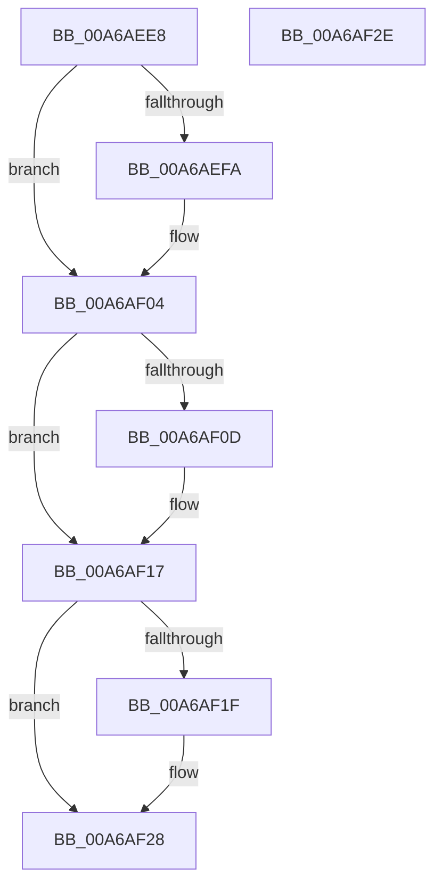

# SepRmCleanupRmLsaState

- RVA: `0x00A6AEE8`–`0x00A6AF2F` (길이 `71` bytes)
- VA: `0x0000000140A6AEE8`
- 실행 섹션: `PAGE`
- PDB 이름 있음: `예`; PDB Function 태그: `아니요`
- unwind 정보 RVA: `0x0005CF00`
- 디코드: `22`개 명령, `71/71` bytes 표시
- 미해석 바이트: `0` (있으면 어셈블리에 `.byte`로 보존)

> 이 문서는 커널 이미지의 기계어와 PDB 기호를 분석해 생성했습니다. 4번과 5번은 함수 원형과 자료형을 바이너리 사용 방식에서 추정한 C 해석이며 원본 소스 복구 결과는 아닙니다.

## 1. Dependencies

- 직접 호출 지점: **3**; 고유 호출 대상: **1**
- 직접 호출자로 확인된 함수: **2**
- RIP 상대 이미지 참조: **0**

### Outgoing calls
- `0x00A6AEFA` → [ZwClose](../../text/6A/ZwClose_function_006AD2B0.md) (function, `0x006AD2B0`)
- `0x00A6AF0D` → [ZwClose](../../text/6A/ZwClose_function_006AD2B0.md) (function, `0x006AD2B0`)
- `0x00A6AF1F` → [ZwClose](../../text/6A/ZwClose_function_006AD2B0.md) (function, `0x006AD2B0`)

### Direct callers
- [SepRmCommandServerThread](SepRmCommandServerThread_function_00A6A8D0.md) at `0x00A6AAE6`
- [SepRmLsaConnectRequest](SepRmLsaConnectRequest_function_00A6AB54.md) at `0x00A6ADC2`

### Static image references
- 디코드된 RIP-relative 메모리 참조가 없습니다.

## 2. Other-region calls and transfers

- 다른 실행 섹션으로 향하는 call: **3**
  - `0x00A6AEFA` → [ZwClose](../../text/6A/ZwClose_function_006AD2B0.md) (`PAGE` → `.text`)
  - `0x00A6AF0D` → [ZwClose](../../text/6A/ZwClose_function_006AD2B0.md) (`PAGE` → `.text`)
  - `0x00A6AF1F` → [ZwClose](../../text/6A/ZwClose_function_006AD2B0.md) (`PAGE` → `.text`)
- 별도 외부 분기/꼬리 이동을 확인하지 못했습니다.

## 3. Assembly (complete function range)

```asm
00A6AEE8  40 53                           push rbx
00A6AEEA  48 83 EC 20                     sub rsp, 0x20
00A6AEEE  48 8B D9                        mov rbx, rcx
00A6AEF1  48 8B 49 08                     mov rcx, qword ptr [rcx + 8]
00A6AEF5  48 85 C9                        test rcx, rcx
00A6AEF8  74 0A                           je 0x140a6af04
00A6AEFA  E8 B1 23 C4 FF                  call 0x1406ad2b0
00A6AEFF  48 83 63 08 00                  and qword ptr [rbx + 8], 0
00A6AF04  48 8B 4B 18                     mov rcx, qword ptr [rbx + 0x18]
00A6AF08  48 85 C9                        test rcx, rcx
00A6AF0B  74 0A                           je 0x140a6af17
00A6AF0D  E8 9E 23 C4 FF                  call 0x1406ad2b0
00A6AF12  48 83 63 18 00                  and qword ptr [rbx + 0x18], 0
00A6AF17  48 8B 0B                        mov rcx, qword ptr [rbx]
00A6AF1A  48 85 C9                        test rcx, rcx
00A6AF1D  74 09                           je 0x140a6af28
00A6AF1F  E8 8C 23 C4 FF                  call 0x1406ad2b0
00A6AF24  48 83 23 00                     and qword ptr [rbx], 0
00A6AF28  48 83 C4 20                     add rsp, 0x20
00A6AF2C  5B                              pop rbx
00A6AF2D  C3                              ret
00A6AF2E  CC                              int3
```

## 4. C-style interpretation (structured pseudocode)

```c
__int64 __fastcall SepRmCleanupRmLsaState(__int64 a1)
{
    __int64 result;
    __int64 v_rsp;

    v_rsp = (v_rsp) - (32);
    if (*(unsigned __int64 *)(a1 + 8) != 0) {
        result = ZwClose(*(unsigned __int64 *)(a1 + 8), a2, a3, a4);
    }
    if (*(unsigned __int64 *)(a1 + 24) != 0) {
        result = ZwClose(*(unsigned __int64 *)(a1 + 24), a2, a3, a4);
    }
    if (*(unsigned __int64 *)(a1) != 0) {
        result = ZwClose(*(unsigned __int64 *)(a1), a2, a3, a4);
    }
    v_rsp = (v_rsp) + (32);
    return result;
}
```

## 5. (Beta) C Style

```c
int64_t SepRmCleanupRmLsaState(void *Arg1)
{
    uint8_t *arg1 = (uint8_t *)Arg1;

    int64_t result;
    int64_t local_rsp;

    local_rsp = (local_rsp) - (32);
    if (*(uint64_t *)(arg1 + 0x8) != 0) {
        result = ZwClose(*(uint64_t *)(arg1 + 0x8), a2, a3, a4);
    }
    if (*(uint64_t *)(arg1 + 0x18) != 0) {
        result = ZwClose(*(uint64_t *)(arg1 + 0x18), a2, a3, a4);
    }
    if (*(uint64_t *)(arg1) != 0) {
        result = ZwClose(*(uint64_t *)(arg1), a2, a3, a4);
    }
    local_rsp = (local_rsp) + (32);
    return result;
}
```

### 관측된 메모리 오프셋

구조체 형식이 확인되지 않은 접근은 인자 기준의 오프셋으로만 기록했습니다.

| 기준 인자 | 오프셋 표현 | 폭 (bit) | 접근 |
|---|---:|---:|---|
| `Arg1` | `+ 0x0` | `64` | `R` |
| `Arg1` | `+ 0x0` | `64` | `R/W` |
| `Arg1` | `+ 0x8` | `64` | `R` |
| `Arg1` | `+ 0x8` | `64` | `R/W` |
| `Arg1` | `+ 0x18` | `64` | `R` |
| `Arg1` | `+ 0x18` | `64` | `R/W` |

## 6. Execution-region graph

[열기: 2D/3D 그래프와 함수 탐색 컨트롤 패널](../../../control-panel.html?section=page&rva=0x00A6AEE8&view=graph)

- 2D 그래프는 위에서 아래로 흐르고, 3D 그래프는 빈 공간을 드래그해 회전합니다. Shift+드래그는 이동, 휠은 확대·축소, 함수 노드 선택은 대상 보고서 이동입니다.

### Static fallback


