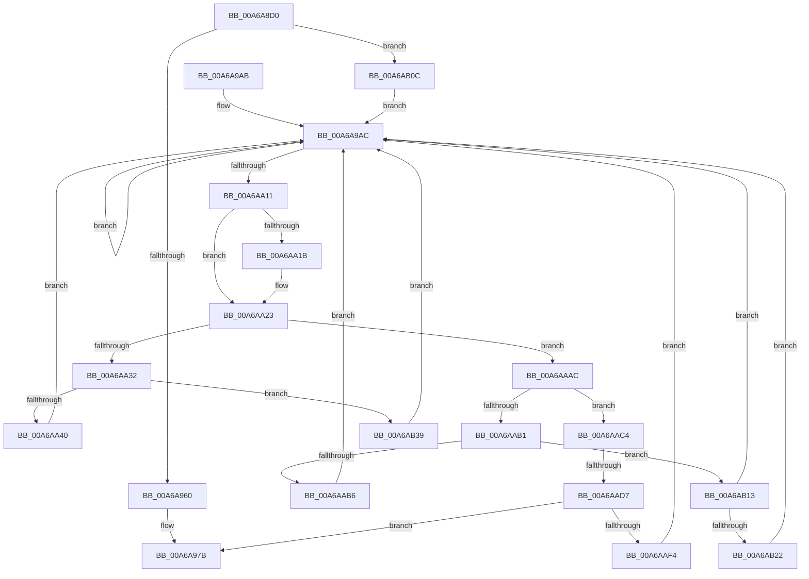

# SepRmCommandServerThread

- RVA: `0x00A6A8D0`–`0x00A6AB4E` (길이 `638` bytes)
- VA: `0x0000000140A6A8D0`
- 실행 섹션: `PAGE`
- PDB 이름 있음: `예`; PDB Function 태그: `예`
- unwind 정보 RVA: `0x000B4228`
- 디코드: `146`개 명령, `638/638` bytes 표시
- 미해석 바이트: `0` (있으면 어셈블리에 `.byte`로 보존)

> 이 문서는 커널 이미지의 기계어와 PDB 기호를 분석해 생성했습니다. 4번과 5번은 함수 원형과 자료형을 바이너리 사용 방식에서 추정한 C 해석이며 원본 소스 복구 결과는 아닙니다.

## 1. Dependencies

- 직접 호출 지점: **20**; 고유 호출 대상: **17**
- 직접 호출자로 확인된 함수: **0**
- RIP 상대 이미지 참조: **5**

### Outgoing calls
- `0x00A6A916` → [memset](../../text/6C/memset_function_006C6C40.md) (function, `0x006C6C40`)
- `0x00A6A927` → [memset](../../text/6C/memset_function_006C6C40.md) (function, `0x006C6C40`)
- `0x00A6A943` → [ObfReferenceObject](../../text/20/ObfReferenceObject_function_0020FA20.md) (function, `0x0020FA20`)
- `0x00A6A951` → [PopRequestShutdownWait](PopRequestShutdownWait_function_00A6AE34.md) (function, `0x00A6AE34`)
- `0x00A6A967` → [ZwClose](../../text/6A/ZwClose_function_006AD2B0.md) (function, `0x006AD2B0`)
- `0x00A6A976` → [SepAuditFailed](../86/SepAuditFailed_function_0086EE20.md) (function, `0x0086EE20`)
- `0x00A6A985` → [_security_check_cookie](../../text/6A/_security_check_cookie_function_006AC640.md) (function, `0x006AC640`)
- `0x00A6AA06` → [ZwAlpcSendWaitReceivePort](../../text/6A/ZwAlpcSendWaitReceivePort_function_006AE290.md) (function, `0x006AE290`)
- `0x00A6AA1B` → [HalAdjustResourceList](../../text/48/HalAdjustResourceList_function_0048FDC0.md) (function, `0x0048FDC0`)
- `0x00A6AA4A` → [memset](../../text/6C/memset_function_006C6C40.md) (function, `0x006C6C40`)
- `0x00A6AA71` → [PsAttachSiloToCurrentThread](../../text/44/PsAttachSiloToCurrentThread_function_004428C0.md) (function, `0x004428C0`)
- `0x00A6AA93` → [guard_dispatch_icall](../../text/6B/guard_dispatch_icall_function_006BAAD0.md) (function, `0x006BAAD0`)
- `0x00A6AA9B` → [PsDetachSiloFromCurrentThread](../../text/44/PsDetachSiloFromCurrentThread_function_00449AC0.md) (function, `0x00449AC0`)
- `0x00A6AABA` → [SepRmLsaConnectRequest](SepRmLsaConnectRequest_function_00A6AB54.md) (function, `0x00A6AB54`)
- `0x00A6AAC7` → [PsIsHostSilo](../../text/44/PsIsHostSilo_function_00443B30.md) (function, `0x00443B30`)
- `0x00A6AADA` → [PsGetServerSiloGlobals](../../text/22/PsGetServerSiloGlobals_function_002250A0.md) (function, `0x002250A0`)
- `0x00A6AAE6` → [SepRmCleanupRmLsaState](SepRmCleanupRmLsaState_function_00A6AEE8.md) (function, `0x00A6AEE8`)
- `0x00A6AAFC` → [ObfDereferenceObjectWithTag](../../text/2F/ObfDereferenceObjectWithTag_function_002F78E0.md) (function, `0x002F78E0`)
- `0x00A6AB2F` → [NtAlpcCancelMessage](../A3/NtAlpcCancelMessage_function_00A3A860.md) (function, `0x00A3A860`)
- `0x00A6AB44` → [NtAlpcCancelMessage](../A3/NtAlpcCancelMessage_function_00A3A860.md) (function, `0x00A3A860`)

### Direct callers
- 이 함수 시작 RVA로 연결되는 직접 call은 확인되지 않았습니다. 간접 호출은 완전히 역산할 수 없습니다.

### Static image references
- `0x00A6A8F6` → RVA `0x00E0A740` (`.data`; read)
- `0x00A6A93C` → RVA `0x00FD9E48` (`PAGEDATA`; write)
- `0x00A6A960` → RVA `0x00FD9F18` (`PAGEDATA`; read)
- `0x00A6A96C` → RVA `0x00FD9F18` (`PAGEDATA`; read/write)
- `0x00A6AA84` → RVA `0x00B4E1C0` (`SepRmCommandDispatch`; read)

## 2. Other-region calls and transfers

- 다른 실행 섹션으로 향하는 call: **14**
  - `0x00A6A916` → [memset](../../text/6C/memset_function_006C6C40.md) (`PAGE` → `.text`)
  - `0x00A6A927` → [memset](../../text/6C/memset_function_006C6C40.md) (`PAGE` → `.text`)
  - `0x00A6A943` → [ObfReferenceObject](../../text/20/ObfReferenceObject_function_0020FA20.md) (`PAGE` → `.text`)
  - `0x00A6A967` → [ZwClose](../../text/6A/ZwClose_function_006AD2B0.md) (`PAGE` → `.text`)
  - `0x00A6A985` → [_security_check_cookie](../../text/6A/_security_check_cookie_function_006AC640.md) (`PAGE` → `.text`)
  - `0x00A6AA06` → [ZwAlpcSendWaitReceivePort](../../text/6A/ZwAlpcSendWaitReceivePort_function_006AE290.md) (`PAGE` → `.text`)
  - `0x00A6AA1B` → [HalAdjustResourceList](../../text/48/HalAdjustResourceList_function_0048FDC0.md) (`PAGE` → `.text`)
  - `0x00A6AA4A` → [memset](../../text/6C/memset_function_006C6C40.md) (`PAGE` → `.text`)
  - `0x00A6AA71` → [PsAttachSiloToCurrentThread](../../text/44/PsAttachSiloToCurrentThread_function_004428C0.md) (`PAGE` → `.text`)
  - `0x00A6AA93` → [guard_dispatch_icall](../../text/6B/guard_dispatch_icall_function_006BAAD0.md) (`PAGE` → `.text`)
  - `0x00A6AA9B` → [PsDetachSiloFromCurrentThread](../../text/44/PsDetachSiloFromCurrentThread_function_00449AC0.md) (`PAGE` → `.text`)
  - `0x00A6AAC7` → [PsIsHostSilo](../../text/44/PsIsHostSilo_function_00443B30.md) (`PAGE` → `.text`)
  - `0x00A6AADA` → [PsGetServerSiloGlobals](../../text/22/PsGetServerSiloGlobals_function_002250A0.md) (`PAGE` → `.text`)
  - `0x00A6AAFC` → [ObfDereferenceObjectWithTag](../../text/2F/ObfDereferenceObjectWithTag_function_002F78E0.md) (`PAGE` → `.text`)
- call이 아닌 외부 분기/꼬리 이동: **1**
  - `0x00A6AAD1` → [sub_00B3F12C](../B3/Unknown_function_00B3F12C.md) (`tail-transfer`)

## 3. Assembly (complete function range)

```asm
00A6A8D0  48 8B C4                        mov rax, rsp
00A6A8D3  48 89 58 08                     mov qword ptr [rax + 8], rbx
00A6A8D7  48 89 70 10                     mov qword ptr [rax + 0x10], rsi
00A6A8DB  48 89 78 18                     mov qword ptr [rax + 0x18], rdi
00A6A8DF  4C 89 60 20                     mov qword ptr [rax + 0x20], r12
00A6A8E3  55                              push rbp
00A6A8E4  41 56                           push r14
00A6A8E6  41 57                           push r15
00A6A8E8  48 8D A8 18 FC FF FF            lea rbp, [rax - 0x3e8]
00A6A8EF  48 81 EC D0 04 00 00            sub rsp, 0x4d0
00A6A8F6  48 8B 05 43 FE 39 00            mov rax, qword ptr [rip + 0x39fe43]
00A6A8FD  48 33 C4                        xor rax, rsp
00A6A900  48 89 85 C0 03 00 00            mov qword ptr [rbp + 0x3c0], rax
00A6A907  41 BE 00 02 00 00               mov r14d, 0x200
00A6A90D  48 8D 4D C0                     lea rcx, [rbp - 0x40]
00A6A911  45 8B C6                        mov r8d, r14d
00A6A914  33 D2                           xor edx, edx
00A6A916  E8 25 C3 C5 FF                  call 0x1406c6c40
00A6A91B  45 8B C6                        mov r8d, r14d
00A6A91E  48 8D 8D C0 01 00 00            lea rcx, [rbp + 0x1c0]
00A6A925  33 D2                           xor edx, edx
00A6A927  E8 14 C3 C5 FF                  call 0x1406c6c40
00A6A92C  65 48 8B 04 25 88 01 00 00      mov rax, qword ptr gs:[0x188]
00A6A935  48 8B 88 B8 00 00 00            mov rcx, qword ptr [rax + 0xb8]
00A6A93C  48 89 0D 05 F5 56 00            mov qword ptr [rip + 0x56f505], rcx
00A6A943  E8 D8 50 7A FF                  call 0x14020fa20
00A6A948  65 48 8B 0C 25 88 01 00 00      mov rcx, qword ptr gs:[0x188]
00A6A951  E8 DE 04 00 00                  call 0x140a6ae34
00A6A956  8B D8                           mov ebx, eax
00A6A958  85 C0                           test eax, eax
00A6A95A  0F 89 AC 01 00 00               jns 0x140a6ab0c
00A6A960  48 8B 0D B1 F5 56 00            mov rcx, qword ptr [rip + 0x56f5b1]
00A6A967  E8 44 29 C4 FF                  call 0x1406ad2b0
00A6A96C  48 83 25 A4 F5 56 00 00         and qword ptr [rip + 0x56f5a4], 0
00A6A974  8B CB                           mov ecx, ebx
00A6A976  E8 A5 44 E0 FF                  call 0x14086ee20
00A6A97B  48 8B 8D C0 03 00 00            mov rcx, qword ptr [rbp + 0x3c0]
00A6A982  48 33 CC                        xor rcx, rsp
00A6A985  E8 B6 1C C4 FF                  call 0x1406ac640
00A6A98A  4C 8D 9C 24 D0 04 00 00         lea r11, [rsp + 0x4d0]
00A6A992  49 8B 5B 20                     mov rbx, qword ptr [r11 + 0x20]
00A6A996  49 8B 73 28                     mov rsi, qword ptr [r11 + 0x28]
00A6A99A  49 8B 7B 30                     mov rdi, qword ptr [r11 + 0x30]
00A6A99E  4D 8B 63 38                     mov r12, qword ptr [r11 + 0x38]
00A6A9A2  49 8B E3                        mov rsp, r11
00A6A9A5  41 5F                           pop r15
00A6A9A7  41 5E                           pop r14
00A6A9A9  5D                              pop rbp
00A6A9AA  C3                              ret
00A6A9AB  CC                              int3
00A6A9AC  48 8B 0D 65 F5 56 00            mov rcx, qword ptr [rip + 0x56f565]
00A6A9B3  33 C0                           xor eax, eax
00A6A9B5  48 89 45 B0                     mov qword ptr [rbp - 0x50], rax
00A6A9B9  0F 57 C0                        xorps xmm0, xmm0
00A6A9BC  48 2B C6                        sub rax, rsi
00A6A9BF  4C 89 74 24 40                  mov qword ptr [rsp + 0x40], r14
00A6A9C4  48 F7 D8                        neg rax
00A6A9C7  4C 8B C6                        mov r8, rsi
00A6A9CA  48 8D 45 90                     lea rax, [rbp - 0x70]
00A6A9CE  1B D2                           sbb edx, edx
00A6A9D0  48 83 64 24 38 00               and qword ptr [rsp + 0x38], 0
00A6A9D6  48 89 44 24 30                  mov qword ptr [rsp + 0x30], rax
00A6A9DB  81 E2 00 00 01 00               and edx, 0x10000
00A6A9E1  48 8D 44 24 40                  lea rax, [rsp + 0x40]
00A6A9E6  45 33 C9                        xor r9d, r9d
00A6A9E9  48 89 44 24 28                  mov qword ptr [rsp + 0x28], rax
00A6A9EE  48 8D 45 C0                     lea rax, [rbp - 0x40]
00A6A9F2  0F 11 45 90                     movups xmmword ptr [rbp - 0x70], xmm0
00A6A9F6  48 89 44 24 20                  mov qword ptr [rsp + 0x20], rax
00A6A9FB  0F 11 45 A0                     movups xmmword ptr [rbp - 0x60], xmm0
00A6A9FF  C7 45 90 00 00 00 20            mov dword ptr [rbp - 0x70], 0x20000000
00A6AA06  E8 85 38 C4 FF                  call 0x1406ae290
00A6AA0B  33 F6                           xor esi, esi
00A6AA0D  85 C0                           test eax, eax
00A6AA0F  78 9B                           js 0x140a6a9ac
00A6AA11  48 8B 7D 98                     mov rdi, qword ptr [rbp - 0x68]
00A6AA15  48 83 FF F8                     cmp rdi, -8
00A6AA19  75 08                           jne 0x140a6aa23
00A6AA1B  E8 A0 53 A2 FF                  call 0x14048fdc0
00A6AA20  48 8B F8                        mov rdi, rax
00A6AA23  0F B7 55 C4                     movzx edx, word ptr [rbp - 0x3c]
00A6AA27  81 E2 FF 00 FF FF               and edx, 0xffff00ff
00A6AA2D  83 EA 01                        sub edx, 1
00A6AA30  75 7A                           jne 0x140a6aaac
00A6AA32  8B 45 E8                        mov eax, dword ptr [rbp - 0x18]
00A6AA35  FF C8                           dec eax
00A6AA37  83 F8 0B                        cmp eax, 0xb
00A6AA3A  0F 87 F9 00 00 00               ja 0x140a6ab39
00A6AA40  4D 8B C6                        mov r8, r14
00A6AA43  48 8D 8D C0 01 00 00            lea rcx, [rbp + 0x1c0]
00A6AA4A  E8 F1 C1 C5 FF                  call 0x1406c6c40
00A6AA4F  0F 10 45 C8                     movups xmm0, xmmword ptr [rbp - 0x38]
00A6AA53  8B 45 D8                        mov eax, dword ptr [rbp - 0x28]
00A6AA56  48 8B CF                        mov rcx, rdi
00A6AA59  C7 85 C0 01 00 00 D8 01 00 02   mov dword ptr [rbp + 0x1c0], 0x20001d8
00A6AA63  F3 0F 7F 85 C8 01 00 00         movdqu xmmword ptr [rbp + 0x1c8], xmm0
00A6AA6B  89 85 D8 01 00 00               mov dword ptr [rbp + 0x1d8], eax
00A6AA71  E8 4A 7E 9D FF                  call 0x1404428c0
00A6AA76  48 63 4D E8                     movsxd rcx, dword ptr [rbp - 0x18]
00A6AA7A  48 8D 95 C0 01 00 00            lea rdx, [rbp + 0x1c0]
00A6AA81  48 8B D8                        mov rbx, rax
00A6AA84  48 8D 05 35 37 0E 00            lea rax, [rip + 0xe3735]
00A6AA8B  48 8B 04 C8                     mov rax, qword ptr [rax + rcx*8]
00A6AA8F  48 8D 4D C0                     lea rcx, [rbp - 0x40]
00A6AA93  E8 38 00 C5 FF                  call 0x1406baad0
00A6AA98  48 8B CB                        mov rcx, rbx
00A6AA9B  E8 20 F0 9D FF                  call 0x140449ac0
00A6AAA0  48 8D B5 C0 01 00 00            lea rsi, [rbp + 0x1c0]
00A6AAA7  E9 00 FF FF FF                  jmp 0x140a6a9ac
00A6AAAC  83 EA 04                        sub edx, 4
00A6AAAF  74 13                           je 0x140a6aac4
00A6AAB1  83 FA 05                        cmp edx, 5
00A6AAB4  75 5D                           jne 0x140a6ab13
00A6AAB6  48 8D 4D C0                     lea rcx, [rbp - 0x40]
00A6AABA  E8 95 00 00 00                  call 0x140a6ab54
00A6AABF  E9 E8 FE FF FF                  jmp 0x140a6a9ac
00A6AAC4  48 8B CF                        mov rcx, rdi
00A6AAC7  E8 64 90 9D FF                  call 0x140443b30
00A6AACC  44 8A F0                        mov r14b, al
00A6AACF  84 C0                           test al, al
00A6AAD1  0F 85 55 46 0D 00               jne 0x140b3f12c
00A6AAD7  48 8B CF                        mov rcx, rdi
00A6AADA  E8 C1 A5 7B FF                  call 0x1402250a0
00A6AADF  48 8D 88 10 03 00 00            lea rcx, [rax + 0x310]
00A6AAE6  E8 FD 03 00 00                  call 0x140a6aee8
00A6AAEB  45 84 F6                        test r14b, r14b
00A6AAEE  0F 85 87 FE FF FF               jne 0x140a6a97b
00A6AAF4  BA 53 65 53 74                  mov edx, 0x74536553
00A6AAF9  48 8B CF                        mov rcx, rdi
00A6AAFC  E8 DF CD 88 FF                  call 0x1402f78e0
00A6AB01  41 BE 00 02 00 00               mov r14d, 0x200
00A6AB07  E9 A0 FE FF FF                  jmp 0x140a6a9ac
00A6AB0C  33 F6                           xor esi, esi
00A6AB0E  E9 99 FE FF FF                  jmp 0x140a6a9ac
00A6AB13  B8 00 20 00 00                  mov eax, 0x2000
00A6AB18  66 85 45 C4                     test word ptr [rbp - 0x3c], ax
00A6AB1C  0F 84 8A FE FF FF               je 0x140a6a9ac
00A6AB22  48 8B 0D EF F3 56 00            mov rcx, qword ptr [rip + 0x56f3ef]
00A6AB29  4C 8D 45 98                     lea r8, [rbp - 0x68]
00A6AB2D  33 D2                           xor edx, edx
00A6AB2F  E8 2C FD FC FF                  call 0x140a3a860
00A6AB34  E9 73 FE FF FF                  jmp 0x140a6a9ac
00A6AB39  48 8B 0D D8 F3 56 00            mov rcx, qword ptr [rip + 0x56f3d8]
00A6AB40  4C 8D 45 98                     lea r8, [rbp - 0x68]
00A6AB44  E8 17 FD FC FF                  call 0x140a3a860
00A6AB49  E9 5E FE FF FF                  jmp 0x140a6a9ac
```

## 4. C-style interpretation (structured pseudocode)

```c
__int64 __fastcall SepRmCommandServerThread(__int64 a1, int a2, __int64 a3, int a4)
{
    __int64 result;
    __int64 v_rdi;
    __int64 v_rsi;
    __int64 v_rsp;
    unsigned __int64 v_stack_m18;
    unsigned __int64 v_stack_m490;
    unsigned __int64 v_stack_m498;
    unsigned __int64 v_stack_m4A0;
    unsigned __int64 v_stack_m4A8;
    unsigned __int64 v_stack_m4B0;

    *(unsigned __int64 *)(v_rsp + 8) = v_rbx;
    *(unsigned __int64 *)(v_rsp + 16) = v_rsi;
    *(unsigned __int64 *)(v_rsp + 24) = v_rdi;
    *(unsigned __int64 *)(v_rsp + 32) = v_r12;
    v_rsp = (v_rsp) - (0x4D0ULL);
    result = (*(unsigned __int64 *)(v_rip + 3800643)) ^ (v_rsp);
    *(unsigned __int64 *)(v_rsp - 1000 + 960) = result;
    a2 = 0;
    result = memset(v_rsp - 1000 - 64, a2, 512, a4);
    a2 = 0;
    result = memset(v_rsp - 1000 + 448, a2, 512, a4);
    *(unsigned __int64 *)(v_rip + 5698821) = *(unsigned __int64 *)(*(unsigned __int64 *)(gs_base + (0 + 392)) + 184);
    result = ObfReferenceObject(*(unsigned __int64 *)(*(unsigned __int64 *)(gs_base + (0 + 392)) + 184), a2, 512, a4);
    result = PopRequestShutdownWait(*(unsigned __int64 *)(gs_base + (0 + 392)), a2, 512, a4);
    if (!sign_flag) goto loc_00A6AB0C;
    result = ZwClose(*(unsigned __int64 *)(v_rip + 5698993), a2, 512, a4);
    result = SepAuditFailed((unsigned int)((unsigned int)((unsigned int)((unsigned int)(result)))), a2, 512, a4);
loc_00A6A97B:
    a1 = (*(unsigned __int64 *)(v_rsp - 1000 + 960)) ^ (v_rsp);
    result = _security_check_cookie(a1, a2, 512, a4);
    return result;
loc_00A6A9AC:
    result = 0;
    *(unsigned __int64 *)(v_rsp - 1000 - 80) = 0;
    result = (result) - (*(unsigned __int64 *)(v_stack_m18 + 40));
    v_stack_m490 = 512;
    result = -(result);
    v_stack_m4A0 = v_rsp - 1000 - 112;
    a2 = (unsigned int)((a2) & (0x10000ULL));
    a4 = 0;
    v_stack_m4A8 = v_stack_m490;
    *(unsigned __int64 *)(v_rsp - 1000 - 112) = v_xmm0;
    v_stack_m4B0 = v_rsp - 1000 - 64;
    *(unsigned __int64 *)(v_rsp - 1000 - 96) = v_xmm0;
    *(unsigned int *)(v_rsp - 1000 - 112) = 0x20000000ULL;
    result = ZwAlpcSendWaitReceivePort(*(unsigned __int64 *)(v_rip + 5698917), a2, *(unsigned __int64 *)(v_stack_m18 + 40), a4);
    v_rsi = 0;
    if (sign_flag) goto loc_00A6A9AC;
    v_rdi = *(unsigned __int64 *)(v_rsp - 1000 - 104);
    if ((*(unsigned __int64 *)(v_rsp - 1000 - 104)) == -8) {
        result = HalAdjustResourceList(*(unsigned __int64 *)(v_rip + 5698917), a2, *(unsigned __int64 *)(v_stack_m18 + 40), a4);
        v_rdi = result;
    }
    a2 = (unsigned int)((*(unsigned __int16 *)(v_rsp - 1000 - 60)) & (0xFFFF00FFULL));
    a2 = (unsigned int)((a2) - (1));
    if (condition_is_not_equal) goto loc_00A6AAAC;
    result = (unsigned int)(((unsigned int)(*(unsigned int *)(v_rsp - 1000 - 24))) - 1);
    if (((unsigned int)(result)) > 11) goto loc_00A6AB39;
    result = memset(v_rsp - 1000 + 448, a2, 512, a4);
    *(unsigned int *)(v_rsp - 1000 + 448) = 0x20001D8ULL;
    *(unsigned __int64 *)(v_rsp - 1000 + 456) = v_xmm0;
    *(unsigned int *)(v_rsp - 1000 + 472) = (unsigned int)((unsigned int)(*(unsigned int *)(v_rsp - 1000 - 40)));
    result = PsAttachSiloToCurrentThread(v_rdi, a2, 512, a4);
    result = guard_dispatch_icall(v_rsp - 1000 - 64, v_rsp - 1000 + 448, 512, a4);
    result = PsDetachSiloFromCurrentThread(result, v_rsp - 1000 + 448, 512, a4);
    goto loc_00A6A9AC;
loc_00A6AAAC:
    a2 = (unsigned int)((v_rsp - 1000 + 448) - (4));
    if (condition_is_equal) goto loc_00A6AAC4;
    if (a2 != 5) goto loc_00A6AB13;
    result = SepRmLsaConnectRequest(v_rsp - 1000 - 64, a2, 512, a4);
    goto loc_00A6A9AC;
loc_00A6AAC4:
    result = PsIsHostSilo(v_rdi, a2, 512, a4);
    result = PsGetServerSiloGlobals(v_rdi, a2, 512, a4);
    result = SepRmCleanupRmLsaState(result + 784, a2, 512, a4);
    if ((unsigned __int8)((unsigned __int8)(result)) != 0) goto loc_00A6A97B;
    result = ObfDereferenceObjectWithTag(v_rdi, (unsigned int)(0x74536553ULL), 512, a4);
    goto loc_00A6A9AC;
loc_00A6AB0C:
    v_rsi = 0;
    goto loc_00A6A9AC;
loc_00A6AB13:
    if (((*(unsigned __int16 *)(v_rsp - 1000 - 60)) & ((unsigned __int16)((unsigned int)(0x2000ULL)))) == 0) goto loc_00A6A9AC;
    a2 = 0;
    result = NtAlpcCancelMessage(*(unsigned __int64 *)(v_rip + 5698543), a2, v_rsp - 1000 - 104, a4);
    goto loc_00A6A9AC;
loc_00A6AB39:
    result = NtAlpcCancelMessage(*(unsigned __int64 *)(v_rip + 5698520), a2, v_rsp - 1000 - 104, a4);
    goto loc_00A6A9AC;
}
```

## 5. (Beta) C Style

```c
int64_t SepRmCommandServerThread(int64_t Arg1, int32_t Arg2, int64_t Arg3, int32_t Arg4)
{
    int64_t result;
    int64_t local_rdi;
    int64_t local_rsi;
    int64_t local_rsp;
    uint64_t v_stack_m18;
    uint64_t v_stack_m490;
    uint64_t v_stack_m498;
    uint64_t v_stack_m4A0;
    uint64_t v_stack_m4A8;
    uint64_t v_stack_m4B0;

    *(uint64_t *)(local_rsp + 0x8) = local_rbx;
    *(uint64_t *)(local_rsp + 0x10) = local_rsi;
    *(uint64_t *)(local_rsp + 0x18) = local_rdi;
    *(uint64_t *)(local_rsp + 0x20) = local_r12;
    local_rsp = (local_rsp) - (0x4D0ULL);
    result = (*(uint64_t *)(v_rip + 0x39FE43)) ^ (local_rsp);
    *(uint64_t *)(local_rsp - 0x3E8 + 0x3C0) = result;
    Arg2 = 0;
    result = memset(local_rsp - 1000 - 64, Arg2, 512, Arg4);
    Arg2 = 0;
    result = memset(local_rsp - 1000 + 448, Arg2, 512, Arg4);
    *(uint64_t *)(v_rip + 0x56F505) = *(uint64_t *)(*(uint64_t *)(gs_base + (0 + 0x188)) + 0xB8);
    result = ObfReferenceObject(*(uint64_t *)(*(uint64_t *)(gs_base + (0 + 0x188)) + 0xB8), Arg2, 512, Arg4);
    result = PopRequestShutdownWait(*(uint64_t *)(gs_base + (0 + 0x188)), Arg2, 512, Arg4);
    if (!sign_flag) goto loc_00A6AB0C;
    result = ZwClose(*(uint64_t *)(v_rip + 0x56F5B1), Arg2, 512, Arg4);
    result = SepAuditFailed((uint32_t)((uint32_t)((uint32_t)((uint32_t)(result)))), Arg2, 512, Arg4);
loc_00A6A97B:
    Arg1 = (*(uint64_t *)(local_rsp - 0x3E8 + 0x3C0)) ^ (local_rsp);
    result = _security_check_cookie(Arg1, Arg2, 512, Arg4);
    return result;
loc_00A6A9AC:
    result = 0;
    *(uint64_t *)(local_rsp - 0x3E8 - 0x50) = 0;
    result = (result) - (*(uint64_t *)(v_stack_m18 + 0x28));
    v_stack_m490 = 512;
    result = -(result);
    v_stack_m4A0 = local_rsp - 1000 - 112;
    Arg2 = (uint32_t)((Arg2) & (0x10000ULL));
    Arg4 = 0;
    v_stack_m4A8 = v_stack_m490;
    *(uint64_t *)(local_rsp - 0x3E8 - 0x70) = v_xmm0;
    v_stack_m4B0 = local_rsp - 1000 - 64;
    *(uint64_t *)(local_rsp - 0x3E8 - 0x60) = v_xmm0;
    *(uint32_t *)(local_rsp - 0x3E8 - 0x70) = 0x20000000ULL;
    result = ZwAlpcSendWaitReceivePort(*(uint64_t *)(v_rip + 0x56F565), Arg2, *(uint64_t *)(v_stack_m18 + 0x28), Arg4);
    local_rsi = 0;
    if (sign_flag) goto loc_00A6A9AC;
    local_rdi = *(uint64_t *)(local_rsp - 0x3E8 - 0x68);
    if ((*(uint64_t *)(local_rsp - 0x3E8 - 0x68)) == -8) {
        result = HalAdjustResourceList(*(uint64_t *)(v_rip + 0x56F565), Arg2, *(uint64_t *)(v_stack_m18 + 0x28), Arg4);
        local_rdi = result;
    }
    Arg2 = (uint32_t)((*(uint16_t *)(local_rsp - 0x3E8 - 0x3C)) & (0xFFFF00FFULL));
    Arg2 = (uint32_t)((Arg2) - (1));
    if (condition_is_not_equal) goto loc_00A6AAAC;
    result = (uint32_t)(((uint32_t)(*(uint32_t *)(local_rsp - 0x3E8 - 0x18))) - 1);
    if (((uint32_t)(result)) > 11) goto loc_00A6AB39;
    result = memset(local_rsp - 1000 + 448, Arg2, 512, Arg4);
    *(uint32_t *)(local_rsp - 0x3E8 + 0x1C0) = 0x20001D8ULL;
    *(uint64_t *)(local_rsp - 0x3E8 + 0x1C8) = v_xmm0;
    *(uint32_t *)(local_rsp - 0x3E8 + 0x1D8) = (uint32_t)((uint32_t)(*(uint32_t *)(local_rsp - 0x3E8 - 0x28)));
    result = PsAttachSiloToCurrentThread(local_rdi, Arg2, 512, Arg4);
    result = guard_dispatch_icall(local_rsp - 1000 - 64, local_rsp - 1000 + 448, 512, Arg4);
    result = PsDetachSiloFromCurrentThread(result, local_rsp - 1000 + 448, 512, Arg4);
    goto loc_00A6A9AC;
loc_00A6AAAC:
    Arg2 = (uint32_t)((local_rsp - 1000 + 448) - (4));
    if (condition_is_equal) goto loc_00A6AAC4;
    if (Arg2 != 5) goto loc_00A6AB13;
    result = SepRmLsaConnectRequest(local_rsp - 1000 - 64, Arg2, 512, Arg4);
    goto loc_00A6A9AC;
loc_00A6AAC4:
    result = PsIsHostSilo(local_rdi, Arg2, 512, Arg4);
    result = PsGetServerSiloGlobals(local_rdi, Arg2, 512, Arg4);
    result = SepRmCleanupRmLsaState(result + 784, Arg2, 512, Arg4);
    if ((uint8_t)((uint8_t)(result)) != 0) goto loc_00A6A97B;
    result = ObfDereferenceObjectWithTag(local_rdi, (uint32_t)(0x74536553ULL), 512, Arg4);
    goto loc_00A6A9AC;
loc_00A6AB0C:
    local_rsi = 0;
    goto loc_00A6A9AC;
loc_00A6AB13:
    if (((*(uint16_t *)(local_rsp - 0x3E8 - 0x3C)) & ((uint16_t)((uint32_t)(0x2000ULL)))) == 0) goto loc_00A6A9AC;
    Arg2 = 0;
    result = NtAlpcCancelMessage(*(uint64_t *)(v_rip + 0x56F3EF), Arg2, local_rsp - 1000 - 104, Arg4);
    goto loc_00A6A9AC;
loc_00A6AB39:
    result = NtAlpcCancelMessage(*(uint64_t *)(v_rip + 0x56F3D8), Arg2, local_rsp - 1000 - 104, Arg4);
    goto loc_00A6A9AC;
}
```

## 6. Execution-region graph

[열기: 2D/3D 그래프와 함수 탐색 컨트롤 패널](../../../control-panel.html?section=page&rva=0x00A6A8D0&view=graph)

- 2D 그래프는 위에서 아래로 흐르고, 3D 그래프는 빈 공간을 드래그해 회전합니다. Shift+드래그는 이동, 휠은 확대·축소, 함수 노드 선택은 대상 보고서 이동입니다.

### Static fallback


