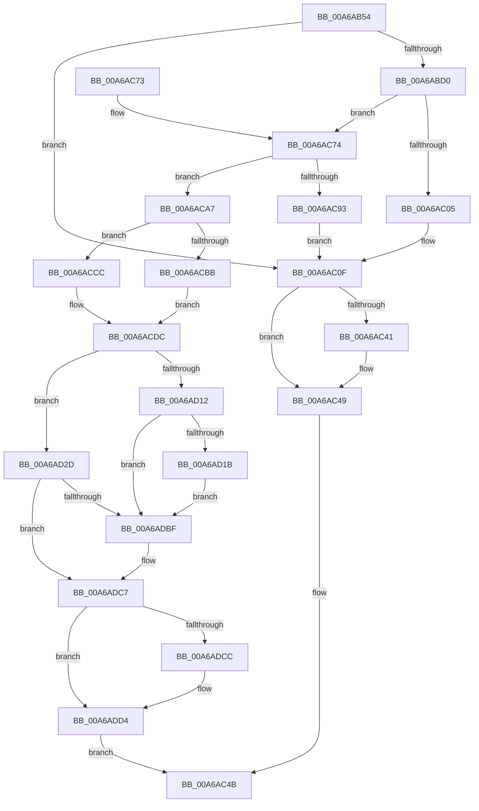

# SepRmLsaConnectRequest

- RVA: `0x00A6AB54`–`0x00A6ADDC` (길이 `648` bytes)
- VA: `0x0000000140A6AB54`
- 실행 섹션: `PAGE`
- PDB 이름 있음: `예`; PDB Function 태그: `아니요`
- unwind 정보 RVA: `0x000B4264`
- 디코드: `159`개 명령, `648/648` bytes 표시
- 미해석 바이트: `0` (있으면 어셈블리에 `.byte`로 보존)

> 이 문서는 커널 이미지의 기계어와 PDB 기호를 분석해 생성했습니다. 4번과 5번은 함수 원형과 자료형을 바이너리 사용 방식에서 추정한 C 해석이며 원본 소스 복구 결과는 아닙니다.

## 1. Dependencies

- 직접 호출 지점: **21**; 고유 호출 대상: **18**
- 직접 호출자로 확인된 함수: **1**
- RIP 상대 이미지 참조: **4**

### Outgoing calls
- `0x00A6ABC5` → [ZwOpenProcess](../../text/6A/ZwOpenProcess_function_006AD590.md) (function, `0x006AD590`)
- `0x00A6ABF5` → [ObReferenceObjectByHandle](../86/ObReferenceObjectByHandle_function_00868DB0.md) (function, `0x00868DB0`)
- `0x00A6AC0A` → [ZwClose](../../text/6A/ZwClose_function_006AD2B0.md) (function, `0x006AD2B0`)
- `0x00A6AC37` → [ZwAlpcAcceptConnectPort](../../text/6A/ZwAlpcAcceptConnectPort_function_006ADFF0.md) (function, `0x006ADFF0`)
- `0x00A6AC44` → [ObfDereferenceObject](../../text/2F/ObfDereferenceObject_function_002F9350.md) (function, `0x002F9350`)
- `0x00A6AC52` → [_security_check_cookie](../../text/6A/_security_check_cookie_function_006AC640.md) (function, `0x006AC640`)
- `0x00A6AC77` → [PsGetProcessServerSilo](../../text/44/PsGetProcessServerSilo_function_0044BEE0.md) (function, `0x0044BEE0`)
- `0x00A6AC82` → [PsGetServerSiloGlobals](../../text/22/PsGetServerSiloGlobals_function_002250A0.md) (function, `0x002250A0`)
- `0x00A6AC98` → [ZwClose](../../text/6A/ZwClose_function_006AD2B0.md) (function, `0x006AD2B0`)
- `0x00A6ACAF` → [PsIsHostSilo](../../text/44/PsIsHostSilo_function_00443B30.md) (function, `0x00443B30`)
- `0x00A6ACBE` → [SepRmVerifyLsaProtectionLevel](../79/SepRmVerifyLsaProtectionLevel_function_0079C2E8.md) (function, `0x0079C2E8`)
- `0x00A6ACD4` → [ObfReferenceObjectWithTag](../../text/21/ObfReferenceObjectWithTag_function_00210710.md) (function, `0x00210710`)
- `0x00A6AD06` → [ZwAlpcAcceptConnectPort](../../text/6A/ZwAlpcAcceptConnectPort_function_006ADFF0.md) (function, `0x006ADFF0`)
- `0x00A6AD23` → [ObfDereferenceObjectWithTag](../../text/2F/ObfDereferenceObjectWithTag_function_002F78E0.md) (function, `0x002F78E0`)
- `0x00A6AD37` → [memset](../../text/6C/memset_function_006C6C40.md) (function, `0x006C6C40`)
- `0x00A6AD5B` → [PsAttachSiloToCurrentThread](../../text/44/PsAttachSiloToCurrentThread_function_004428C0.md) (function, `0x004428C0`)
- `0x00A6AD6F` → [RtlInitUnicodeString](../../text/42/RtlInitUnicodeString_function_0042A780.md) (function, `0x0042A780`)
- `0x00A6ADAA` → [ZwAlpcConnectPort](../../text/6A/ZwAlpcConnectPort_function_006AE030.md) (function, `0x006AE030`)
- `0x00A6ADB5` → [PsDetachSiloFromCurrentThread](../../text/44/PsDetachSiloFromCurrentThread_function_00449AC0.md) (function, `0x00449AC0`)
- `0x00A6ADC2` → [SepRmCleanupRmLsaState](SepRmCleanupRmLsaState_function_00A6AEE8.md) (function, `0x00A6AEE8`)
- `0x00A6ADCF` → [ObfDereferenceObject](../../text/2F/ObfDereferenceObject_function_002F9350.md) (function, `0x002F9350`)

### Direct callers
- [SepRmCommandServerThread](SepRmCommandServerThread_function_00A6A8D0.md) at `0x00A6AABA`

### Static image references
- `0x00A6AB72` → RVA `0x00E0A740` (`.data`; read)
- `0x00A6ABD0` → RVA `0x00FC6A98` (`ALMOSTRO`; read)
- `0x00A6AC0F` → RVA `0x00FD9F18` (`PAGEDATA`; read)
- `0x00A6AD60` → RVA `0x00B05D40` (` ?? ::NNGAKEGL::`string'`; read)

## 2. Other-region calls and transfers

- 다른 실행 섹션으로 향하는 call: **18**
  - `0x00A6ABC5` → [ZwOpenProcess](../../text/6A/ZwOpenProcess_function_006AD590.md) (`PAGE` → `.text`)
  - `0x00A6AC0A` → [ZwClose](../../text/6A/ZwClose_function_006AD2B0.md) (`PAGE` → `.text`)
  - `0x00A6AC37` → [ZwAlpcAcceptConnectPort](../../text/6A/ZwAlpcAcceptConnectPort_function_006ADFF0.md) (`PAGE` → `.text`)
  - `0x00A6AC44` → [ObfDereferenceObject](../../text/2F/ObfDereferenceObject_function_002F9350.md) (`PAGE` → `.text`)
  - `0x00A6AC52` → [_security_check_cookie](../../text/6A/_security_check_cookie_function_006AC640.md) (`PAGE` → `.text`)
  - `0x00A6AC77` → [PsGetProcessServerSilo](../../text/44/PsGetProcessServerSilo_function_0044BEE0.md) (`PAGE` → `.text`)
  - `0x00A6AC82` → [PsGetServerSiloGlobals](../../text/22/PsGetServerSiloGlobals_function_002250A0.md) (`PAGE` → `.text`)
  - `0x00A6AC98` → [ZwClose](../../text/6A/ZwClose_function_006AD2B0.md) (`PAGE` → `.text`)
  - `0x00A6ACAF` → [PsIsHostSilo](../../text/44/PsIsHostSilo_function_00443B30.md) (`PAGE` → `.text`)
  - `0x00A6ACD4` → [ObfReferenceObjectWithTag](../../text/21/ObfReferenceObjectWithTag_function_00210710.md) (`PAGE` → `.text`)
  - `0x00A6AD06` → [ZwAlpcAcceptConnectPort](../../text/6A/ZwAlpcAcceptConnectPort_function_006ADFF0.md) (`PAGE` → `.text`)
  - `0x00A6AD23` → [ObfDereferenceObjectWithTag](../../text/2F/ObfDereferenceObjectWithTag_function_002F78E0.md) (`PAGE` → `.text`)
  - `0x00A6AD37` → [memset](../../text/6C/memset_function_006C6C40.md) (`PAGE` → `.text`)
  - `0x00A6AD5B` → [PsAttachSiloToCurrentThread](../../text/44/PsAttachSiloToCurrentThread_function_004428C0.md) (`PAGE` → `.text`)
  - `0x00A6AD6F` → [RtlInitUnicodeString](../../text/42/RtlInitUnicodeString_function_0042A780.md) (`PAGE` → `.text`)
  - `0x00A6ADAA` → [ZwAlpcConnectPort](../../text/6A/ZwAlpcConnectPort_function_006AE030.md) (`PAGE` → `.text`)
  - `0x00A6ADB5` → [PsDetachSiloFromCurrentThread](../../text/44/PsDetachSiloFromCurrentThread_function_00449AC0.md) (`PAGE` → `.text`)
  - `0x00A6ADCF` → [ObfDereferenceObject](../../text/2F/ObfDereferenceObject_function_002F9350.md) (`PAGE` → `.text`)
- 별도 외부 분기/꼬리 이동을 확인하지 못했습니다.

## 3. Assembly (complete function range)

```asm
00A6AB54  48 89 5C 24 10                  mov qword ptr [rsp + 0x10], rbx
00A6AB59  48 89 74 24 18                  mov qword ptr [rsp + 0x18], rsi
00A6AB5E  55                              push rbp
00A6AB5F  57                              push rdi
00A6AB60  41 54                           push r12
00A6AB62  41 56                           push r14
00A6AB64  41 57                           push r15
00A6AB66  48 8D 6C 24 F0                  lea rbp, [rsp - 0x10]
00A6AB6B  48 81 EC 10 01 00 00            sub rsp, 0x110
00A6AB72  48 8B 05 C7 FB 39 00            mov rax, qword ptr [rip + 0x39fbc7]
00A6AB79  48 33 C4                        xor rax, rsp
00A6AB7C  48 89 45 00                     mov qword ptr [rbp], rax
00A6AB80  45 33 E4                        xor r12d, r12d
00A6AB83  48 C7 45 80 30 00 00 00         mov qword ptr [rbp - 0x80], 0x30
00A6AB8B  0F 57 C0                        xorps xmm0, xmm0
00A6AB8E  48 C7 45 98 00 02 00 00         mov qword ptr [rbp - 0x68], 0x200
00A6AB96  4C 8B F1                        mov r14, rcx
00A6AB99  4C 89 64 24 60                  mov qword ptr [rsp + 0x60], r12
00A6AB9E  4C 8D 49 08                     lea r9, [rcx + 8]
00A6ABA2  4C 89 65 88                     mov qword ptr [rbp - 0x78], r12
00A6ABA6  41 8D 54 24 28                  lea edx, [r12 + 0x28]
00A6ABAB  4C 89 65 90                     mov qword ptr [rbp - 0x70], r12
00A6ABAF  4C 8D 45 80                     lea r8, [rbp - 0x80]
00A6ABB3  41 8B F4                        mov esi, r12d
00A6ABB6  48 8D 4C 24 60                  lea rcx, [rsp + 0x60]
00A6ABBB  0F 11 44 24 70                  movups xmmword ptr [rsp + 0x70], xmm0
00A6ABC0  F3 0F 7F 45 A0                  movdqu xmmword ptr [rbp - 0x60], xmm0
00A6ABC5  E8 C6 29 C4 FF                  call 0x1406ad590
00A6ABCA  8B D8                           mov ebx, eax
00A6ABCC  85 C0                           test eax, eax
00A6ABCE  78 3F                           js 0x140a6ac0f
00A6ABD0  4C 8B 05 C1 BE 55 00            mov r8, qword ptr [rip + 0x55bec1]
00A6ABD7  48 8D 44 24 68                  lea rax, [rsp + 0x68]
00A6ABDC  48 8B 4C 24 60                  mov rcx, qword ptr [rsp + 0x60]
00A6ABE1  45 33 C9                        xor r9d, r9d
00A6ABE4  4C 89 64 24 28                  mov qword ptr [rsp + 0x28], r12
00A6ABE9  33 D2                           xor edx, edx
00A6ABEB  48 89 44 24 20                  mov qword ptr [rsp + 0x20], rax
00A6ABF0  4C 89 64 24 68                  mov qword ptr [rsp + 0x68], r12
00A6ABF5  E8 B6 E1 DF FF                  call 0x140868db0
00A6ABFA  48 8B 74 24 68                  mov rsi, qword ptr [rsp + 0x68]
00A6ABFF  8B D8                           mov ebx, eax
00A6AC01  85 C0                           test eax, eax
00A6AC03  79 6F                           jns 0x140a6ac74
00A6AC05  48 8B 4C 24 60                  mov rcx, qword ptr [rsp + 0x60]
00A6AC0A  E8 A1 26 C4 FF                  call 0x1406ad2b0
00A6AC0F  48 8B 15 02 F3 56 00            mov rdx, qword ptr [rip + 0x56f302]
00A6AC16  45 33 C9                        xor r9d, r9d
00A6AC19  44 88 64 24 40                  mov byte ptr [rsp + 0x40], r12b
00A6AC1E  45 33 C0                        xor r8d, r8d
00A6AC21  4C 89 64 24 38                  mov qword ptr [rsp + 0x38], r12
00A6AC26  33 C9                           xor ecx, ecx
00A6AC28  4C 89 74 24 30                  mov qword ptr [rsp + 0x30], r14
00A6AC2D  4C 89 64 24 28                  mov qword ptr [rsp + 0x28], r12
00A6AC32  4C 89 64 24 20                  mov qword ptr [rsp + 0x20], r12
00A6AC37  E8 B4 33 C4 FF                  call 0x1406adff0
00A6AC3C  48 85 F6                        test rsi, rsi
00A6AC3F  74 08                           je 0x140a6ac49
00A6AC41  48 8B CE                        mov rcx, rsi
00A6AC44  E8 07 E7 88 FF                  call 0x1402f9350
00A6AC49  8B C3                           mov eax, ebx
00A6AC4B  48 8B 4D 00                     mov rcx, qword ptr [rbp]
00A6AC4F  48 33 CC                        xor rcx, rsp
00A6AC52  E8 E9 19 C4 FF                  call 0x1406ac640
00A6AC57  4C 8D 9C 24 10 01 00 00         lea r11, [rsp + 0x110]
00A6AC5F  49 8B 5B 38                     mov rbx, qword ptr [r11 + 0x38]
00A6AC63  49 8B 73 40                     mov rsi, qword ptr [r11 + 0x40]
00A6AC67  49 8B E3                        mov rsp, r11
00A6AC6A  41 5F                           pop r15
00A6AC6C  41 5E                           pop r14
00A6AC6E  41 5C                           pop r12
00A6AC70  5F                              pop rdi
00A6AC71  5D                              pop rbp
00A6AC72  C3                              ret
00A6AC73  CC                              int3
00A6AC74  48 8B CE                        mov rcx, rsi
00A6AC77  E8 64 12 9E FF                  call 0x14044bee0
00A6AC7C  48 8B C8                        mov rcx, rax
00A6AC7F  48 8B D8                        mov rbx, rax
00A6AC82  E8 19 A4 7B FF                  call 0x1402250a0
00A6AC87  48 8D B8 10 03 00 00            lea rdi, [rax + 0x310]
00A6AC8E  4C 39 27                        cmp qword ptr [rdi], r12
00A6AC91  74 14                           je 0x140a6aca7
00A6AC93  48 8B 4C 24 60                  mov rcx, qword ptr [rsp + 0x60]
00A6AC98  E8 13 26 C4 FF                  call 0x1406ad2b0
00A6AC9D  BB 01 00 00 C0                  mov ebx, 0xc0000001
00A6ACA2  E9 68 FF FF FF                  jmp 0x140a6ac0f
00A6ACA7  48 8B 44 24 60                  mov rax, qword ptr [rsp + 0x60]
00A6ACAC  48 89 07                        mov qword ptr [rdi], rax
00A6ACAF  E8 7C 8E 9D FF                  call 0x140443b30
00A6ACB4  44 8A F8                        mov r15b, al
00A6ACB7  84 C0                           test al, al
00A6ACB9  74 11                           je 0x140a6accc
00A6ACBB  48 8B CF                        mov rcx, rdi
00A6ACBE  E8 25 16 D3 FF                  call 0x14079c2e8
00A6ACC3  48 C7 C0 F8 FF FF FF            mov rax, 0xfffffffffffffff8
00A6ACCA  EB 10                           jmp 0x140a6acdc
00A6ACCC  BA 53 65 53 74                  mov edx, 0x74536553
00A6ACD1  48 8B CB                        mov rcx, rbx
00A6ACD4  E8 37 5A 7A FF                  call 0x140210710
00A6ACD9  48 8B C3                        mov rax, rbx
00A6ACDC  48 8B 15 35 F2 56 00            mov rdx, qword ptr [rip + 0x56f235]
00A6ACE3  48 8D 4F 18                     lea rcx, [rdi + 0x18]
00A6ACE7  C6 44 24 40 01                  mov byte ptr [rsp + 0x40], 1
00A6ACEC  45 33 C9                        xor r9d, r9d
00A6ACEF  4C 89 64 24 38                  mov qword ptr [rsp + 0x38], r12
00A6ACF4  45 33 C0                        xor r8d, r8d
00A6ACF7  4C 89 74 24 30                  mov qword ptr [rsp + 0x30], r14
00A6ACFC  48 89 44 24 28                  mov qword ptr [rsp + 0x28], rax
00A6AD01  4C 89 64 24 20                  mov qword ptr [rsp + 0x20], r12
00A6AD06  E8 E5 32 C4 FF                  call 0x1406adff0
00A6AD0B  44 8B F0                        mov r14d, eax
00A6AD0E  85 C0                           test eax, eax
00A6AD10  79 1B                           jns 0x140a6ad2d
00A6AD12  45 84 FF                        test r15b, r15b
00A6AD15  0F 85 A4 00 00 00               jne 0x140a6adbf
00A6AD1B  BA 53 65 53 74                  mov edx, 0x74536553
00A6AD20  48 8B CB                        mov rcx, rbx
00A6AD23  E8 B8 CB 88 FF                  call 0x1402f78e0
00A6AD28  E9 92 00 00 00                  jmp 0x140a6adbf
00A6AD2D  33 D2                           xor edx, edx
00A6AD2F  48 8D 4D B0                     lea rcx, [rbp - 0x50]
00A6AD33  44 8D 42 48                     lea r8d, [rdx + 0x48]
00A6AD37  E8 04 BF C5 FF                  call 0x1406c6c40
00A6AD3C  48 8B CB                        mov rcx, rbx
00A6AD3F  48 C7 45 C0 00 02 00 00         mov qword ptr [rbp - 0x40], 0x200
00A6AD47  C7 45 B4 0C 00 00 00            mov dword ptr [rbp - 0x4c], 0xc
00A6AD4E  C7 45 B8 02 00 00 00            mov dword ptr [rbp - 0x48], 2
00A6AD55  66 C7 45 BC 01 01               mov word ptr [rbp - 0x44], 0x101
00A6AD5B  E8 60 7B 9D FF                  call 0x1404428c0
00A6AD60  48 8D 15 D9 AF 09 00            lea rdx, [rip + 0x9afd9]
00A6AD67  48 8B D8                        mov rbx, rax
00A6AD6A  48 8D 4C 24 70                  lea rcx, [rsp + 0x70]
00A6AD6F  E8 0C FA 9B FF                  call 0x14042a780
00A6AD74  4C 89 64 24 50                  mov qword ptr [rsp + 0x50], r12
00A6AD79  48 8D 4F 08                     lea rcx, [rdi + 8]
00A6AD7D  4C 89 64 24 48                  mov qword ptr [rsp + 0x48], r12
00A6AD82  4C 8D 4D B0                     lea r9, [rbp - 0x50]
00A6AD86  4C 89 64 24 40                  mov qword ptr [rsp + 0x40], r12
00A6AD8B  48 8D 54 24 70                  lea rdx, [rsp + 0x70]
00A6AD90  4C 89 64 24 38                  mov qword ptr [rsp + 0x38], r12
00A6AD95  45 33 C0                        xor r8d, r8d
00A6AD98  4C 89 64 24 30                  mov qword ptr [rsp + 0x30], r12
00A6AD9D  4C 89 64 24 28                  mov qword ptr [rsp + 0x28], r12
00A6ADA2  C7 44 24 20 00 00 02 00         mov dword ptr [rsp + 0x20], 0x20000
00A6ADAA  E8 81 32 C4 FF                  call 0x1406ae030
00A6ADAF  48 8B CB                        mov rcx, rbx
00A6ADB2  44 8B F0                        mov r14d, eax
00A6ADB5  E8 06 ED 9D FF                  call 0x140449ac0
00A6ADBA  45 85 F6                        test r14d, r14d
00A6ADBD  79 08                           jns 0x140a6adc7
00A6ADBF  48 8B CF                        mov rcx, rdi
00A6ADC2  E8 21 01 00 00                  call 0x140a6aee8
00A6ADC7  48 85 F6                        test rsi, rsi
00A6ADCA  74 08                           je 0x140a6add4
00A6ADCC  48 8B CE                        mov rcx, rsi
00A6ADCF  E8 7C E5 88 FF                  call 0x1402f9350
00A6ADD4  41 8B C6                        mov eax, r14d
00A6ADD7  E9 6F FE FF FF                  jmp 0x140a6ac4b
```

## 4. C-style interpretation (structured pseudocode)

```c
__int64 __fastcall SepRmLsaConnectRequest(__int64 a1)
{
    __int64 result;
    __int64 v_r12;
    __int64 v_rsp;
    unsigned __int64 v_stack_m100;
    unsigned __int64 v_stack_m108;
    unsigned __int64 v_stack_m110;
    unsigned __int64 v_stack_m118;
    unsigned __int64 v_stack_m28;
    unsigned __int64 v_stack_m38;
    unsigned __int64 v_stack_m78;
    unsigned __int16 v_stack_m7C;
    unsigned int v_stack_m80;
    unsigned int v_stack_m84;
    unsigned __int64 v_stack_m88;
    unsigned __int64 v_stack_m98;
    unsigned __int64 v_stack_mA0;
    unsigned __int64 v_stack_mA8;
    unsigned __int64 v_stack_mB0;
    unsigned __int64 v_stack_mB8;
    unsigned __int64 v_stack_mC0;
    unsigned __int64 v_stack_mC8;
    unsigned __int64 v_stack_mD0;
    unsigned __int64 v_stack_mD8;
    unsigned __int64 v_stack_mE0;
    unsigned __int64 v_stack_mE8;
    unsigned __int64 v_stack_mF0;
    unsigned __int8 v_stack_mF8;
    unsigned __int64 v_stack_p10;
    unsigned __int64 v_stack_p18;

    v_stack_p10 = v_rbx;
    v_stack_p18 = v_rsi;
    v_rsp = (v_rsp) - (272);
    result = (*(unsigned __int64 *)(v_rip + 3800007)) ^ (v_rsp);
    v_stack_m38 = result;
    v_r12 = 0;
    v_stack_mB8 = 48;
    v_stack_mA0 = 512;
    v_stack_mD8 = 0;
    v_stack_mB0 = 0;
    v_stack_mA8 = 0;
    v_stack_mC8 = v_xmm0;
    v_stack_m98 = v_xmm0;
    result = ZwOpenProcess(v_stack_mD8, v_r12 + 40, v_stack_mB8, a1 + 8);
    if (sign_flag) goto loc_00A6AC0F;
    a4 = 0;
    v_stack_m110 = 0;
    a2 = 0;
    v_stack_m118 = v_stack_mD0;
    v_stack_mD0 = 0;
    result = ObReferenceObjectByHandle(v_stack_mD8, a2, *(unsigned __int64 *)(v_rip + 5619393), a4);
    if (!sign_flag) goto loc_00A6AC74;
    result = ZwClose(v_stack_mD8, a2, *(unsigned __int64 *)(v_rip + 5619393), a4);
loc_00A6AC0F:
    a4 = 0;
    v_stack_mF8 = 0;
    a3 = 0;
    v_stack_m100 = 0;
    a1 = 0;
    v_stack_m108 = 0;
    v_stack_m110 = 0;
    v_stack_m118 = 0;
    result = ZwAlpcAcceptConnectPort(a1, *(unsigned __int64 *)(v_rip + 5698306), a3, a4);
    if (v_stack_mD0 != 0) {
        a1 = v_stack_mD0;
        result = ObfDereferenceObject(a1, *(unsigned __int64 *)(v_rip + 5698306), a3, a4);
    }
loc_00A6AC4B:
    a1 = (v_stack_m38) ^ (v_rsp);
    result = _security_check_cookie(a1, *(unsigned __int64 *)(v_rip + 5698306), a3, a4);
    return result;
loc_00A6AC74:
    result = PsGetProcessServerSilo(*(unsigned __int64 *)(v_stack_m28 + 64), *(unsigned __int64 *)(v_rip + 5698306), a3, a4);
    result = PsGetServerSiloGlobals(result, *(unsigned __int64 *)(v_rip + 5698306), a3, a4);
    if ((*(unsigned __int64 *)(result + 784)) == 0) goto loc_00A6ACA7;
    result = ZwClose(v_stack_mB0, *(unsigned __int64 *)(v_rip + 5698306), a3, a4);
    goto loc_00A6AC0F;
loc_00A6ACA7:
    *(unsigned __int64 *)(result + 784) = v_stack_mB0;
    result = PsIsHostSilo(v_stack_mB0, *(unsigned __int64 *)(v_rip + 5698306), a3, a4);
    if ((unsigned __int8)(result) == 0) goto loc_00A6ACCC;
    result = SepRmVerifyLsaProtectionLevel(result + 784, *(unsigned __int64 *)(v_rip + 5698306), a3, a4);
    goto loc_00A6ACDC;
loc_00A6ACCC:
    result = ObfReferenceObjectWithTag((unsigned int)(0xC0000001ULL), (unsigned int)(0x74536553ULL), a3, a4);
loc_00A6ACDC:
    v_stack_mD0 = 1;
    a4 = 0;
    v_stack_mD8 = 0;
    a3 = 0;
    v_stack_mE0 = a1;
    v_stack_mE8 = (unsigned int)(0xC0000001ULL);
    v_stack_mF0 = 0;
    result = ZwAlpcAcceptConnectPort(result + 784 + 24, *(unsigned __int64 *)(v_rip + 5698101), a3, a4);
    if (!sign_flag) goto loc_00A6AD2D;
    if ((unsigned __int8)((unsigned __int8)(result)) != 0) goto loc_00A6ADBF;
    result = ObfDereferenceObjectWithTag((unsigned int)(0xC0000001ULL), (unsigned int)(0x74536553ULL), a3, a4);
    goto loc_00A6ADBF;
loc_00A6AD2D:
    a2 = 0;
    result = memset(v_stack_m88, a2, a2 + 72, a4);
    v_stack_m78 = 512;
    v_stack_m84 = 12;
    v_stack_m80 = 2;
    v_stack_m7C = 257;
    result = PsAttachSiloToCurrentThread((unsigned int)(0xC0000001ULL), a2, a2 + 72, a4);
    result = RtlInitUnicodeString(v_stack_mA0, v_rip + 634841, a2 + 72, a4);
    v_stack_mC0 = 0;
    v_stack_mC8 = 0;
    v_stack_mD0 = 0;
    v_stack_mD8 = 0;
    a3 = 0;
    v_stack_mE0 = 0;
    v_stack_mE8 = 0;
    v_stack_mF0 = 0x20000ULL;
    result = ZwAlpcConnectPort(result + 784 + 8, v_stack_mA0, a3, v_stack_m88);
    result = PsDetachSiloFromCurrentThread(result, v_stack_mA0, a3, v_stack_m88);
    if (sign_flag) {
        a1 = result + 784;
        result = SepRmCleanupRmLsaState(a1, v_stack_mA0, a3, v_stack_m88);
    }
    if (*(unsigned __int64 *)(v_stack_m28 + 64) != 0) {
        a1 = *(unsigned __int64 *)(v_stack_m28 + 64);
        result = ObfDereferenceObject(a1, v_stack_mA0, a3, v_stack_m88);
    }
    goto loc_00A6AC4B;
}
```

## 5. (Beta) C Style

```c
int64_t SepRmLsaConnectRequest(void *Arg1)
{
    uint8_t *arg1 = (uint8_t *)Arg1;

    int64_t result;
    int64_t local_r12;
    int64_t local_rsp;
    uint64_t v_stack_m100;
    uint64_t v_stack_m108;
    uint64_t v_stack_m110;
    uint64_t v_stack_m118;
    uint64_t v_stack_m28;
    uint64_t v_stack_m38;
    uint64_t v_stack_m78;
    uint16_t v_stack_m7C;
    uint32_t v_stack_m80;
    uint32_t v_stack_m84;
    uint64_t v_stack_m88;
    uint64_t v_stack_m98;
    uint64_t v_stack_mA0;
    uint64_t v_stack_mA8;
    uint64_t v_stack_mB0;
    uint64_t v_stack_mB8;
    uint64_t v_stack_mC0;
    uint64_t v_stack_mC8;
    uint64_t v_stack_mD0;
    uint64_t v_stack_mD8;
    uint64_t v_stack_mE0;
    uint64_t v_stack_mE8;
    uint64_t v_stack_mF0;
    uint8_t v_stack_mF8;
    uint64_t v_stack_p10;
    uint64_t v_stack_p18;

    v_stack_p10 = local_rbx;
    v_stack_p18 = local_rsi;
    local_rsp = (local_rsp) - (272);
    result = (*(uint64_t *)(v_rip + 0x39FBC7)) ^ (local_rsp);
    v_stack_m38 = result;
    local_r12 = 0;
    v_stack_mB8 = 48;
    v_stack_mA0 = 512;
    v_stack_mD8 = 0;
    v_stack_mB0 = 0;
    v_stack_mA8 = 0;
    v_stack_mC8 = v_xmm0;
    v_stack_m98 = v_xmm0;
    result = ZwOpenProcess(v_stack_mD8, local_r12 + 40, v_stack_mB8, Arg1 + 8);
    if (sign_flag) goto loc_00A6AC0F;
    a4 = 0;
    v_stack_m110 = 0;
    a2 = 0;
    v_stack_m118 = v_stack_mD0;
    v_stack_mD0 = 0;
    result = ObReferenceObjectByHandle(v_stack_mD8, a2, *(uint64_t *)(v_rip + 0x55BEC1), a4);
    if (!sign_flag) goto loc_00A6AC74;
    result = ZwClose(v_stack_mD8, a2, *(uint64_t *)(v_rip + 0x55BEC1), a4);
loc_00A6AC0F:
    a4 = 0;
    v_stack_mF8 = 0;
    a3 = 0;
    v_stack_m100 = 0;
    Arg1 = 0;
    v_stack_m108 = 0;
    v_stack_m110 = 0;
    v_stack_m118 = 0;
    result = ZwAlpcAcceptConnectPort(Arg1, *(uint64_t *)(v_rip + 0x56F302), a3, a4);
    if (v_stack_mD0 != 0) {
        Arg1 = v_stack_mD0;
        result = ObfDereferenceObject(Arg1, *(uint64_t *)(v_rip + 0x56F302), a3, a4);
    }
loc_00A6AC4B:
    Arg1 = (v_stack_m38) ^ (local_rsp);
    result = _security_check_cookie(Arg1, *(uint64_t *)(v_rip + 0x56F302), a3, a4);
    return result;
loc_00A6AC74:
    result = PsGetProcessServerSilo(*(uint64_t *)(v_stack_m28 + 0x40), *(uint64_t *)(v_rip + 0x56F302), a3, a4);
    result = PsGetServerSiloGlobals(result, *(uint64_t *)(v_rip + 0x56F302), a3, a4);
    if ((*(uint64_t *)(result + 0x310)) == 0) goto loc_00A6ACA7;
    result = ZwClose(v_stack_mB0, *(uint64_t *)(v_rip + 0x56F302), a3, a4);
    goto loc_00A6AC0F;
loc_00A6ACA7:
    *(uint64_t *)(result + 0x310) = v_stack_mB0;
    result = PsIsHostSilo(v_stack_mB0, *(uint64_t *)(v_rip + 0x56F302), a3, a4);
    if ((uint8_t)(result) == 0) goto loc_00A6ACCC;
    result = SepRmVerifyLsaProtectionLevel(result + 784, *(uint64_t *)(v_rip + 0x56F302), a3, a4);
    goto loc_00A6ACDC;
loc_00A6ACCC:
    result = ObfReferenceObjectWithTag((uint32_t)(0xC0000001ULL), (uint32_t)(0x74536553ULL), a3, a4);
loc_00A6ACDC:
    v_stack_mD0 = 1;
    a4 = 0;
    v_stack_mD8 = 0;
    a3 = 0;
    v_stack_mE0 = Arg1;
    v_stack_mE8 = (uint32_t)(0xC0000001ULL);
    v_stack_mF0 = 0;
    result = ZwAlpcAcceptConnectPort(result + 784 + 24, *(uint64_t *)(v_rip + 0x56F235), a3, a4);
    if (!sign_flag) goto loc_00A6AD2D;
    if ((uint8_t)((uint8_t)(result)) != 0) goto loc_00A6ADBF;
    result = ObfDereferenceObjectWithTag((uint32_t)(0xC0000001ULL), (uint32_t)(0x74536553ULL), a3, a4);
    goto loc_00A6ADBF;
loc_00A6AD2D:
    a2 = 0;
    result = memset(v_stack_m88, a2, a2 + 72, a4);
    v_stack_m78 = 512;
    v_stack_m84 = 12;
    v_stack_m80 = 2;
    v_stack_m7C = 257;
    result = PsAttachSiloToCurrentThread((uint32_t)(0xC0000001ULL), a2, a2 + 72, a4);
    result = RtlInitUnicodeString(v_stack_mA0, v_rip + 634841, a2 + 72, a4);
    v_stack_mC0 = 0;
    v_stack_mC8 = 0;
    v_stack_mD0 = 0;
    v_stack_mD8 = 0;
    a3 = 0;
    v_stack_mE0 = 0;
    v_stack_mE8 = 0;
    v_stack_mF0 = 0x20000ULL;
    result = ZwAlpcConnectPort(result + 784 + 8, v_stack_mA0, a3, v_stack_m88);
    result = PsDetachSiloFromCurrentThread(result, v_stack_mA0, a3, v_stack_m88);
    if (sign_flag) {
        Arg1 = result + 784;
        result = SepRmCleanupRmLsaState(Arg1, v_stack_mA0, a3, v_stack_m88);
    }
    if (*(uint64_t *)(v_stack_m28 + 0x40) != 0) {
        Arg1 = *(uint64_t *)(v_stack_m28 + 0x40);
        result = ObfDereferenceObject(Arg1, v_stack_mA0, a3, v_stack_m88);
    }
    goto loc_00A6AC4B;
}
```

### 관측된 메모리 오프셋

구조체 형식이 확인되지 않은 접근은 인자 기준의 오프셋으로만 기록했습니다.

| 기준 인자 | 오프셋 표현 | 폭 (bit) | 접근 |
|---|---:|---:|---|
| `Arg1` | `+ 0x8` | `64` | `R` |

## 6. Execution-region graph

[열기: 2D/3D 그래프와 함수 탐색 컨트롤 패널](../../../control-panel.html?section=page&rva=0x00A6AB54&view=graph)

- 2D 그래프는 위에서 아래로 흐르고, 3D 그래프는 빈 공간을 드래그해 회전합니다. Shift+드래그는 이동, 휠은 확대·축소, 함수 노드 선택은 대상 보고서 이동입니다.

### Static fallback


