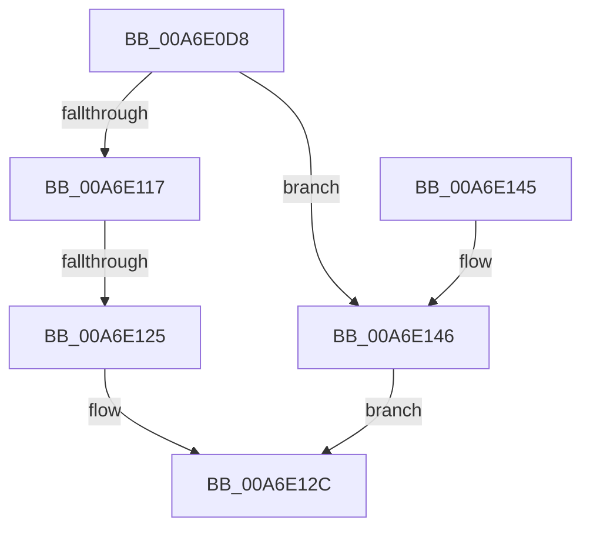

# SepSetTokenClaims

- RVA: `0x00A6E0D8`–`0x00A6E14B` (길이 `115` bytes)
- VA: `0x0000000140A6E0D8`
- 실행 섹션: `PAGE`
- PDB 이름 있음: `예`; PDB Function 태그: `예`
- unwind 정보 RVA: `0x000B4960`
- 디코드: `33`개 명령, `115/115` bytes 표시
- 미해석 바이트: `0` (있으면 어셈블리에 `.byte`로 보존)

> 이 문서는 커널 이미지의 기계어와 PDB 기호를 분석해 생성했습니다. 4번과 5번은 함수 원형과 자료형을 바이너리 사용 방식에서 추정한 C 해석이며 원본 소스 복구 결과는 아닙니다.

## 1. Dependencies

- 직접 호출 지점: **1**; 고유 호출 대상: **1**
- 직접 호출자로 확인된 함수: **1**
- RIP 상대 이미지 참조: **0**

### Outgoing calls
- `0x00A6E10B` → [SepCreateClaimAttributes](SepCreateClaimAttributes_function_00A6E154.md) (function, `0x00A6E154`)

### Direct callers
- [SepCreateTokenEx](../../text/4E/SepCreateTokenEx_function_004E9CD0.md) at `0x004EA780`

### Static image references
- 디코드된 RIP-relative 메모리 참조가 없습니다.

## 2. Other-region calls and transfers

- 다른 실행 섹션으로 향하는 call: **0**
- call이 아닌 외부 분기/꼬리 이동: **1**
  - `0x00A6E11F` → [sub_00B3F52A](../B3/Unknown_function_00B3F52A.md) (`tail-transfer`)

## 3. Assembly (complete function range)

```asm
00A6E0D8  4C 8B DC                        mov r11, rsp
00A6E0DB  49 89 5B 08                     mov qword ptr [r11 + 8], rbx
00A6E0DF  49 89 6B 10                     mov qword ptr [r11 + 0x10], rbp
00A6E0E3  49 89 73 18                     mov qword ptr [r11 + 0x18], rsi
00A6E0E7  57                              push rdi
00A6E0E8  41 56                           push r14
00A6E0EA  41 57                           push r15
00A6E0EC  48 83 EC 40                     sub rsp, 0x40
00A6E0F0  48 8B 84 24 80 00 00 00         mov rax, qword ptr [rsp + 0x80]
00A6E0F8  48 8B F9                        mov rdi, rcx
00A6E0FB  49 83 63 D8 00                  and qword ptr [r11 - 0x28], 0
00A6E100  49 8D 4B D8                     lea rcx, [r11 - 0x28]
00A6E104  49 89 43 C8                     mov qword ptr [r11 - 0x38], rax
00A6E108  45 32 F6                        xor r14b, r14b
00A6E10B  E8 44 00 00 00                  call 0x140a6e154
00A6E110  44 8B F8                        mov r15d, eax
00A6E113  85 C0                           test eax, eax
00A6E115  78 2F                           js 0x140a6e146
00A6E117  48 8B 5C 24 30                  mov rbx, qword ptr [rsp + 0x30]
00A6E11C  48 85 DB                        test rbx, rbx
00A6E11F  0F 85 05 14 0D 00               jne 0x140b3f52a
00A6E125  48 21 9F 48 04 00 00            and qword ptr [rdi + 0x448], rbx
00A6E12C  48 8B 5C 24 60                  mov rbx, qword ptr [rsp + 0x60]
00A6E131  48 8B 6C 24 68                  mov rbp, qword ptr [rsp + 0x68]
00A6E136  48 8B 74 24 70                  mov rsi, qword ptr [rsp + 0x70]
00A6E13B  48 83 C4 40                     add rsp, 0x40
00A6E13F  41 5F                           pop r15
00A6E141  41 5E                           pop r14
00A6E143  5F                              pop rdi
00A6E144  C3                              ret
00A6E145  CC                              int3
00A6E146  41 8B C7                        mov eax, r15d
00A6E149  EB E1                           jmp 0x140a6e12c
```

## 4. C-style interpretation (structured pseudocode)

```c
__int64 __fastcall SepSetTokenClaims(__int64 a1, __int64 a2, __int64 a3, __int64 a4, __int64 a5)
{
    __int64 result;
    __int64 v_r14;
    __int64 v_rsp;
    unsigned __int64 v_stack_m28;
    unsigned __int64 v_stack_p10;
    unsigned __int64 v_stack_p18;
    unsigned __int64 v_stack_p8;

    *(unsigned __int64 *)(v_rsp + 8) = v_rbx;
    *(unsigned __int64 *)(v_rsp + 16) = v_rbp;
    *(unsigned __int64 *)(v_rsp + 24) = v_rsi;
    v_rsp = (v_rsp) - (64);
    *(unsigned __int64 *)(v_rsp - 56) = a5;
    v_r14 = 0;
    result = SepCreateClaimAttributes(v_rsp - 40, a2, a3, a4);
    if (sign_flag) goto loc_00A6E146;
loc_00A6E12C:
    v_rsp = (v_rsp) + (64);
    return result;
loc_00A6E146:
    goto loc_00A6E12C;
}
```

## 5. (Beta) C Style

```c
int64_t SepSetTokenClaims(void *Arg1, int64_t Arg2, int64_t Arg3, int64_t Arg4, int64_t Arg5)
{
    uint8_t *arg1 = (uint8_t *)Arg1;

    int64_t result;
    int64_t local_r14;
    int64_t local_rsp;
    uint64_t v_stack_m28;
    uint64_t v_stack_p10;
    uint64_t v_stack_p18;
    uint64_t v_stack_p8;

    *(uint64_t *)(local_rsp + 0x8) = local_rbx;
    *(uint64_t *)(local_rsp + 0x10) = local_rbp;
    *(uint64_t *)(local_rsp + 0x18) = local_rsi;
    local_rsp = (local_rsp) - (64);
    *(uint64_t *)(local_rsp - 0x38) = Arg5;
    local_r14 = 0;
    result = SepCreateClaimAttributes(local_rsp - 40, Arg2, Arg3, Arg4);
    if (sign_flag) goto loc_00A6E146;
loc_00A6E12C:
    local_rsp = (local_rsp) + (64);
    return result;
loc_00A6E146:
    goto loc_00A6E12C;
}
```

### 관측된 메모리 오프셋

구조체 형식이 확인되지 않은 접근은 인자 기준의 오프셋으로만 기록했습니다.

| 기준 인자 | 오프셋 표현 | 폭 (bit) | 접근 |
|---|---:|---:|---|
| `Arg1` | `+ 0x448` | `64` | `R/W` |

## 6. Execution-region graph

[열기: 2D/3D 그래프와 함수 탐색 컨트롤 패널](../../../control-panel.html?section=page&rva=0x00A6E0D8&view=graph)

- 2D 그래프는 위에서 아래로 흐르고, 3D 그래프는 빈 공간을 드래그해 회전합니다. Shift+드래그는 이동, 휠은 확대·축소, 함수 노드 선택은 대상 보고서 이동입니다.

### Static fallback


