# SepSetTokenLowboxNumber

- RVA: `0x00A64D6C`–`0x00A6503A` (길이 `718` bytes)
- VA: `0x0000000140A64D6C`
- 실행 섹션: `PAGE`
- PDB 이름 있음: `예`; PDB Function 태그: `예`
- unwind 정보 RVA: `0x000B3820`
- 디코드: `189`개 명령, `718/718` bytes 표시
- 미해석 바이트: `0` (있으면 어셈블리에 `.byte`로 보존)

> 이 문서는 커널 이미지의 기계어와 PDB 기호를 분석해 생성했습니다. 4번과 5번은 함수 원형과 자료형을 바이너리 사용 방식에서 추정한 C 해석이며 원본 소스 복구 결과는 아닙니다.

## 1. Dependencies

- 직접 호출 지점: **21**; 고유 호출 대상: **9**
- 직접 호출자로 확인된 함수: **6**
- RIP 상대 이미지 참조: **3**

### Outgoing calls
- `0x00A64DF2` → [KeAbPreAcquire](../../text/21/KeAbPreAcquire_function_00210230.md) (function, `0x00210230`)
- `0x00A64E0F` → [ExfAcquirePushLockExclusiveEx](../../text/20/ExfAcquirePushLockExclusiveEx_function_0020FC90.md) (function, `0x0020FC90`)
- `0x00A64E28` → [SepGetLowBoxNumberEntry](SepGetLowBoxNumberEntry_function_00A65040.md) (function, `0x00A65040`)
- `0x00A64E54` → [KeAbPostRelease](../../text/2E/KeAbPostRelease_function_002E1600.md) (function, `0x002E1600`)
- `0x00A64E59` → [KeLeaveCriticalRegion](../../text/25/KeLeaveCriticalRegion_function_0025D8B0.md) (function, `0x0025D8B0`)
- `0x00A64E81` → [ExfReleasePushLockShared](../../text/26/ExfReleasePushLockShared_function_00263440.md) (function, `0x00263440`)
- `0x00A64EA4` → [KeAbPostRelease](../../text/2E/KeAbPostRelease_function_002E1600.md) (function, `0x002E1600`)
- `0x00A64EA9` → [KeLeaveCriticalRegion](../../text/25/KeLeaveCriticalRegion_function_0025D8B0.md) (function, `0x0025D8B0`)
- `0x00A64EDD` → [KeAbPreAcquire](../../text/21/KeAbPreAcquire_function_00210230.md) (function, `0x00210230`)
- `0x00A64F08` → [ExfAcquirePushLockSharedEx](../../text/21/ExfAcquirePushLockSharedEx_function_0021044C.md) (function, `0x0021044C`)
- `0x00A64F22` → [SepGetTokenSessionMapEntry](../../text/48/SepGetTokenSessionMapEntry_function_00489654.md) (function, `0x00489654`)
- `0x00A64F56` → [ExfReleasePushLockShared](../../text/26/ExfReleasePushLockShared_function_00263440.md) (function, `0x00263440`)
- `0x00A64F5E` → [KeAbPostRelease](../../text/2E/KeAbPostRelease_function_002E1600.md) (function, `0x002E1600`)
- `0x00A64F63` → [KeLeaveCriticalRegion](../../text/25/KeLeaveCriticalRegion_function_0025D8B0.md) (function, `0x0025D8B0`)
- `0x00A64F81` → [KeAbPreAcquire](../../text/21/KeAbPreAcquire_function_00210230.md) (function, `0x00210230`)
- `0x00A64F9A` → [ExfAcquirePushLockExclusiveEx](../../text/20/ExfAcquirePushLockExclusiveEx_function_0020FC90.md) (function, `0x0020FC90`)
- `0x00A64FB2` → [SepGetTokenSessionMapEntry](../../text/48/SepGetTokenSessionMapEntry_function_00489654.md) (function, `0x00489654`)
- `0x00A64FD6` → [ExfTryToWakePushLock](../../text/26/ExfTryToWakePushLock_function_00265DD0.md) (function, `0x00265DD0`)
- `0x00A64FE7` → [ExfTryToWakePushLock](../../text/26/ExfTryToWakePushLock_function_00265DD0.md) (function, `0x00265DD0`)
- `0x00A6500E` → [KeAbPreAcquire](../../text/21/KeAbPreAcquire_function_00210230.md) (function, `0x00210230`)
- `0x00A6502F` → [ExfAcquirePushLockExclusiveEx](../../text/20/ExfAcquirePushLockExclusiveEx_function_0020FC90.md) (function, `0x0020FC90`)

### Direct callers
- [SepGetAnonymousToken](../../text/30/SepGetAnonymousToken_function_00301830.md) at `0x00301946`
- [SepCreateAppContainerToken](../../text/4F/SepCreateAppContainerToken_function_004F43AC.md) at `0x004F4AE3`
- [SeExchangePrimaryToken](../7A/SeExchangePrimaryToken_function_007A07BC.md) at `0x007A0A94`
- [SeSubProcessToken](../AA/SeSubProcessToken_function_00AAD570.md) at `0x00AADA51`
- [NtCreateLowBoxToken](../AB/NtCreateLowBoxToken_function_00AB9880.md) at `0x00ABA174`
- [SeSetSessionIdToken](../AF/SeSetSessionIdToken_function_00AF1F0C.md) at `0x00AF20D4`

### Static image references
- `0x00A64DB4` → RVA `0x00F0FEA0` (`.data`; read)
- `0x00A64E6F` → RVA `0x00F0FE88` (`.data`; read)
- `0x00A64E88` → RVA `0x00F0FE88` (`.data`; read/write)

## 2. Other-region calls and transfers

- 다른 실행 섹션으로 향하는 call: **20**
  - `0x00A64DF2` → [KeAbPreAcquire](../../text/21/KeAbPreAcquire_function_00210230.md) (`PAGE` → `.text`)
  - `0x00A64E0F` → [ExfAcquirePushLockExclusiveEx](../../text/20/ExfAcquirePushLockExclusiveEx_function_0020FC90.md) (`PAGE` → `.text`)
  - `0x00A64E54` → [KeAbPostRelease](../../text/2E/KeAbPostRelease_function_002E1600.md) (`PAGE` → `.text`)
  - `0x00A64E59` → [KeLeaveCriticalRegion](../../text/25/KeLeaveCriticalRegion_function_0025D8B0.md) (`PAGE` → `.text`)
  - `0x00A64E81` → [ExfReleasePushLockShared](../../text/26/ExfReleasePushLockShared_function_00263440.md) (`PAGE` → `.text`)
  - `0x00A64EA4` → [KeAbPostRelease](../../text/2E/KeAbPostRelease_function_002E1600.md) (`PAGE` → `.text`)
  - `0x00A64EA9` → [KeLeaveCriticalRegion](../../text/25/KeLeaveCriticalRegion_function_0025D8B0.md) (`PAGE` → `.text`)
  - `0x00A64EDD` → [KeAbPreAcquire](../../text/21/KeAbPreAcquire_function_00210230.md) (`PAGE` → `.text`)
  - `0x00A64F08` → [ExfAcquirePushLockSharedEx](../../text/21/ExfAcquirePushLockSharedEx_function_0021044C.md) (`PAGE` → `.text`)
  - `0x00A64F22` → [SepGetTokenSessionMapEntry](../../text/48/SepGetTokenSessionMapEntry_function_00489654.md) (`PAGE` → `.text`)
  - `0x00A64F56` → [ExfReleasePushLockShared](../../text/26/ExfReleasePushLockShared_function_00263440.md) (`PAGE` → `.text`)
  - `0x00A64F5E` → [KeAbPostRelease](../../text/2E/KeAbPostRelease_function_002E1600.md) (`PAGE` → `.text`)
  - `0x00A64F63` → [KeLeaveCriticalRegion](../../text/25/KeLeaveCriticalRegion_function_0025D8B0.md) (`PAGE` → `.text`)
  - `0x00A64F81` → [KeAbPreAcquire](../../text/21/KeAbPreAcquire_function_00210230.md) (`PAGE` → `.text`)
  - `0x00A64F9A` → [ExfAcquirePushLockExclusiveEx](../../text/20/ExfAcquirePushLockExclusiveEx_function_0020FC90.md) (`PAGE` → `.text`)
  - `0x00A64FB2` → [SepGetTokenSessionMapEntry](../../text/48/SepGetTokenSessionMapEntry_function_00489654.md) (`PAGE` → `.text`)
  - `0x00A64FD6` → [ExfTryToWakePushLock](../../text/26/ExfTryToWakePushLock_function_00265DD0.md) (`PAGE` → `.text`)
  - `0x00A64FE7` → [ExfTryToWakePushLock](../../text/26/ExfTryToWakePushLock_function_00265DD0.md) (`PAGE` → `.text`)
  - `0x00A6500E` → [KeAbPreAcquire](../../text/21/KeAbPreAcquire_function_00210230.md) (`PAGE` → `.text`)
  - `0x00A6502F` → [ExfAcquirePushLockExclusiveEx](../../text/20/ExfAcquirePushLockExclusiveEx_function_0020FC90.md) (`PAGE` → `.text`)
- call이 아닌 외부 분기/꼬리 이동: **2**
  - `0x00A65020` → [sub_00B3E69E](../B3/Unknown_function_00B3E69E.md) (`tail-transfer`)
  - `0x00A65035` → [sub_00B3E69E](../B3/Unknown_function_00B3E69E.md) (`tail-transfer`)

## 3. Assembly (complete function range)

```asm
00A64D6C  48 89 54 24 10                  mov qword ptr [rsp + 0x10], rdx
00A64D71  48 89 4C 24 08                  mov qword ptr [rsp + 8], rcx
00A64D76  55                              push rbp
00A64D77  53                              push rbx
00A64D78  56                              push rsi
00A64D79  57                              push rdi
00A64D7A  41 54                           push r12
00A64D7C  41 55                           push r13
00A64D7E  41 56                           push r14
00A64D80  41 57                           push r15
00A64D82  48 8B EC                        mov rbp, rsp
00A64D85  48 83 EC 38                     sub rsp, 0x38
00A64D89  44 8B 71 78                     mov r14d, dword ptr [rcx + 0x78]
00A64D8D  33 D2                           xor edx, edx
00A64D8F  48 83 CB FF                     or rbx, 0xffffffffffffffff
00A64D93  48 89 55 60                     mov qword ptr [rbp + 0x60], rdx
00A64D97  48 89 55 E8                     mov qword ptr [rbp - 0x18], rdx
00A64D9B  4C 8B F9                        mov r15, rcx
00A64D9E  44 8A E2                        mov r12b, dl
00A64DA1  44 8A EA                        mov r13b, dl
00A64DA4  8B F2                           mov esi, edx
00A64DA6  41 83 FE 05                     cmp r14d, 5
00A64DAA  0F 83 12 01 00 00               jae 0x140a64ec2
00A64DB0  4B 8D 0C B6                     lea rcx, [r14 + r14*4]
00A64DB4  48 8D 05 E5 B0 4A 00            lea rax, [rip + 0x4ab0e5]
00A64DBB  4C 8D 34 C8                     lea r14, [rax + rcx*8]
00A64DBF  4C 89 75 60                     mov qword ptr [rbp + 0x60], r14
00A64DC3  41 38 56 20                     cmp byte ptr [r14 + 0x20], dl
00A64DC7  0F 84 24 02 00 00               je 0x140a64ff1
00A64DCD  85 F6                           test esi, esi
00A64DCF  0F 85 8B 00 00 00               jne 0x140a64e60
00A64DD5  65 48 8B 04 25 88 01 00 00      mov rax, qword ptr gs:[0x188]
00A64DDE  45 33 C0                        xor r8d, r8d
00A64DE1  48 8B 7D 60                     mov rdi, qword ptr [rbp + 0x60]
00A64DE5  33 D2                           xor edx, edx
00A64DE7  48 8B CF                        mov rcx, rdi
00A64DEA  66 01 98 E4 01 00 00            add word ptr [rax + 0x1e4], bx
00A64DF1  90                              nop
00A64DF2  E8 39 B4 7A FF                  call 0x140210230
00A64DF7  F0 48 0F BA 2F 00               lock bts qword ptr [rdi], 0
00A64DFD  48 8B 7D 60                     mov rdi, qword ptr [rbp + 0x60]
00A64E01  48 8B F0                        mov rsi, rax
00A64E04  73 0E                           jae 0x140a64e14
00A64E06  4C 8B C7                        mov r8, rdi
00A64E09  48 8B D0                        mov rdx, rax
00A64E0C  48 8B CF                        mov rcx, rdi
00A64E0F  E8 7C AE 7A FF                  call 0x14020fc90
00A64E14  48 85 F6                        test rsi, rsi
00A64E17  74 04                           je 0x140a64e1d
00A64E19  C6 46 0A 01                     mov byte ptr [rsi + 0xa], 1
00A64E1D  48 8B 55 50                     mov rdx, qword ptr [rbp + 0x50]
00A64E21  4C 8D 45 E8                     lea r8, [rbp - 0x18]
00A64E25  48 8B CF                        mov rcx, rdi
00A64E28  E8 13 02 00 00                  call 0x140a65040
00A64E2D  8B F0                           mov esi, eax
00A64E2F  85 C0                           test eax, eax
00A64E31  75 0B                           jne 0x140a64e3e
00A64E33  48 8B 45 E8                     mov rax, qword ptr [rbp - 0x18]
00A64E37  49 89 87 38 04 00 00            mov qword ptr [r15 + 0x438], rax
00A64E3E  48 8B C3                        mov rax, rbx
00A64E41  F0 48 0F C1 07                  lock xadd qword ptr [rdi], rax
00A64E46  24 06                           and al, 6
00A64E48  3C 02                           cmp al, 2
00A64E4A  0F 84 82 01 00 00               je 0x140a64fd2
00A64E50  48 8B 4D 60                     mov rcx, qword ptr [rbp + 0x60]
00A64E54  E8 A7 C7 87 FF                  call 0x1402e1600
00A64E59  E8 52 8A 7F FF                  call 0x14025d8b0
00A64E5E  33 D2                           xor edx, edx
00A64E60  45 84 ED                        test r13b, r13b
00A64E63  75 23                           jne 0x140a64e88
00A64E65  45 84 E4                        test r12b, r12b
00A64E68  74 44                           je 0x140a64eae
00A64E6A  B8 11 00 00 00                  mov eax, 0x11
00A64E6F  F0 48 0F B1 15 10 B0 4A 00      lock cmpxchg qword ptr [rip + 0x4ab010], rdx
00A64E78  74 23                           je 0x140a64e9d
00A64E7A  48 8D 0D 07 B0 4A 00            lea rcx, [rip + 0x4ab007]
00A64E81  E8 BA E5 7F FF                  call 0x140263440
00A64E86  EB 15                           jmp 0x140a64e9d
00A64E88  F0 48 0F C1 1D F7 AF 4A 00      lock xadd qword ptr [rip + 0x4aaff7], rbx
00A64E91  80 E3 06                        and bl, 6
00A64E94  80 FB 02                        cmp bl, 2
00A64E97  0F 84 43 01 00 00               je 0x140a64fe0
00A64E9D  48 8D 0D E4 AF 4A 00            lea rcx, [rip + 0x4aafe4]
00A64EA4  E8 57 C7 87 FF                  call 0x1402e1600
00A64EA9  E8 02 8A 7F FF                  call 0x14025d8b0
00A64EAE  8B C6                           mov eax, esi
00A64EB0  48 83 C4 38                     add rsp, 0x38
00A64EB4  41 5F                           pop r15
00A64EB6  41 5E                           pop r14
00A64EB8  41 5D                           pop r13
00A64EBA  41 5C                           pop r12
00A64EBC  5F                              pop rdi
00A64EBD  5E                              pop rsi
00A64EBE  5B                              pop rbx
00A64EBF  5D                              pop rbp
00A64EC0  C3                              ret
00A64EC1  CC                              int3
00A64EC2  65 48 8B 04 25 88 01 00 00      mov rax, qword ptr gs:[0x188]
00A64ECB  48 8D 0D B6 AF 4A 00            lea rcx, [rip + 0x4aafb6]
00A64ED2  45 33 C0                        xor r8d, r8d
00A64ED5  66 01 98 E4 01 00 00            add word ptr [rax + 0x1e4], bx
00A64EDC  90                              nop
00A64EDD  E8 4E B3 7A FF                  call 0x140210230
00A64EE2  48 8B F8                        mov rdi, rax
00A64EE5  33 C0                           xor eax, eax
00A64EE7  8D 48 11                        lea ecx, [rax + 0x11]
00A64EEA  F0 48 0F B1 0D 95 AF 4A 00      lock cmpxchg qword ptr [rip + 0x4aaf95], rcx
00A64EF3  74 18                           je 0x140a64f0d
00A64EF5  4C 8D 0D 8C AF 4A 00            lea r9, [rip + 0x4aaf8c]
00A64EFC  4C 8B C7                        mov r8, rdi
00A64EFF  33 D2                           xor edx, edx
00A64F01  48 8D 0D 80 AF 4A 00            lea rcx, [rip + 0x4aaf80]
00A64F08  E8 3F B5 7A FF                  call 0x14021044c
00A64F0D  48 85 FF                        test rdi, rdi
00A64F10  74 04                           je 0x140a64f16
00A64F12  C6 47 0A 01                     mov byte ptr [rdi + 0xa], 1
00A64F16  4C 8D 45 60                     lea r8, [rbp + 0x60]
00A64F1A  33 D2                           xor edx, edx
00A64F1C  41 8B CE                        mov ecx, r14d
00A64F1F  41 B4 01                        mov r12b, 1
00A64F22  E8 2D 47 A2 FF                  call 0x140489654
00A64F27  33 D2                           xor edx, edx
00A64F29  8B F0                           mov esi, eax
00A64F2B  85 C0                           test eax, eax
00A64F2D  0F 89 96 00 00 00               jns 0x140a64fc9
00A64F33  3D 25 02 00 C0                  cmp eax, 0xc0000225
00A64F38  0F 85 2C FF FF FF               jne 0x140a64e6a
00A64F3E  8D 42 11                        lea eax, [rdx + 0x11]
00A64F41  F0 48 0F B1 15 3E AF 4A 00      lock cmpxchg qword ptr [rip + 0x4aaf3e], rdx
00A64F4A  48 8D 35 37 AF 4A 00            lea rsi, [rip + 0x4aaf37]
00A64F51  74 08                           je 0x140a64f5b
00A64F53  48 8B CE                        mov rcx, rsi
00A64F56  E8 E5 E4 7F FF                  call 0x140263440
00A64F5B  48 8B CE                        mov rcx, rsi
00A64F5E  E8 9D C6 87 FF                  call 0x1402e1600
00A64F63  E8 48 89 7F FF                  call 0x14025d8b0
00A64F68  65 48 8B 04 25 88 01 00 00      mov rax, qword ptr gs:[0x188]
00A64F71  45 33 C0                        xor r8d, r8d
00A64F74  33 D2                           xor edx, edx
00A64F76  48 8B CE                        mov rcx, rsi
00A64F79  66 01 98 E4 01 00 00            add word ptr [rax + 0x1e4], bx
00A64F80  90                              nop
00A64F81  E8 AA B2 7A FF                  call 0x140210230
00A64F86  F0 48 0F BA 2E 00               lock bts qword ptr [rsi], 0
00A64F8C  48 8B F8                        mov rdi, rax
00A64F8F  73 0E                           jae 0x140a64f9f
00A64F91  4C 8B C6                        mov r8, rsi
00A64F94  48 8B D0                        mov rdx, rax
00A64F97  48 8B CE                        mov rcx, rsi
00A64F9A  E8 F1 AC 7A FF                  call 0x14020fc90
00A64F9F  48 85 FF                        test rdi, rdi
00A64FA2  74 04                           je 0x140a64fa8
00A64FA4  44 88 67 0A                     mov byte ptr [rdi + 0xa], r12b
00A64FA8  4C 8D 45 60                     lea r8, [rbp + 0x60]
00A64FAC  41 8A D4                        mov dl, r12b
00A64FAF  41 8B CE                        mov ecx, r14d
00A64FB2  E8 9D 46 A2 FF                  call 0x140489654
00A64FB7  33 D2                           xor edx, edx
00A64FB9  8B F0                           mov esi, eax
00A64FBB  44 8A E2                        mov r12b, dl
00A64FBE  41 B5 01                        mov r13b, 1
00A64FC1  85 C0                           test eax, eax
00A64FC3  0F 88 97 FE FF FF               js 0x140a64e60
00A64FC9  4C 8B 75 60                     mov r14, qword ptr [rbp + 0x60]
00A64FCD  E9 F1 FD FF FF                  jmp 0x140a64dc3
00A64FD2  48 8B 4D 60                     mov rcx, qword ptr [rbp + 0x60]
00A64FD6  E8 F5 0D 80 FF                  call 0x140265dd0
00A64FDB  E9 70 FE FF FF                  jmp 0x140a64e50
00A64FE0  48 8D 0D A1 AE 4A 00            lea rcx, [rip + 0x4aaea1]
00A64FE7  E8 E4 0D 80 FF                  call 0x140265dd0
00A64FEC  E9 AC FE FF FF                  jmp 0x140a64e9d
00A64FF1  65 48 8B 04 25 88 01 00 00      mov rax, qword ptr gs:[0x188]
00A64FFA  45 33 C0                        xor r8d, r8d
00A64FFD  48 8B 7D 60                     mov rdi, qword ptr [rbp + 0x60]
00A65001  33 D2                           xor edx, edx
00A65003  48 8B CF                        mov rcx, rdi
00A65006  66 01 98 E4 01 00 00            add word ptr [rax + 0x1e4], bx
00A6500D  90                              nop
00A6500E  E8 1D B2 7A FF                  call 0x140210230
00A65013  F0 48 0F BA 2F 00               lock bts qword ptr [rdi], 0
00A65019  48 8B 7D 60                     mov rdi, qword ptr [rbp + 0x60]
00A6501D  4C 8B F8                        mov r15, rax
00A65020  0F 83 78 96 0D 00               jae 0x140b3e69e
00A65026  4C 8B C7                        mov r8, rdi
00A65029  48 8B D0                        mov rdx, rax
00A6502C  48 8B CF                        mov rcx, rdi
00A6502F  E8 5C AC 7A FF                  call 0x14020fc90
00A65034  90                              nop
00A65035  E9 64 96 0D 00                  jmp 0x140b3e69e
```

## 4. C-style interpretation (structured pseudocode)

```c
__int64 __fastcall SepSetTokenLowboxNumber(__int64 a1, __int64 a2, int a3)
{
    __int64 result;
    __int64 v_rbx;
    __int64 v_rsp;
    unsigned __int64 v_stack_m58;
    unsigned __int64 v_stack_p10;
    unsigned __int64 v_stack_p20;
    unsigned __int64 v_stack_p8;

    v_stack_p10 = a2;
    v_stack_p8 = a1;
    v_rsp = (v_rsp) - (56);
    a2 = 0;
    v_rbx = (v_rbx) | (-1);
    v_stack_p20 = 0;
    v_stack_m58 = 0;
    if (((unsigned int)((unsigned int)(*(unsigned int *)(a1 + 120)))) >= 5) goto loc_00A64EC2;
    v_stack_p20 = v_rip + 4894949 + (unsigned int)(*(unsigned int *)(a1 + 120)) + (unsigned int)(*(unsigned int *)(a1 + 120)) * 4 * 8;
loc_00A64DC3:
    if ((*(unsigned __int8 *)(v_rip + 4894949 + (unsigned int)(*(unsigned int *)(a1 + 120)) + (unsigned int)(*(unsigned int *)(a1 + 120)) * 4 * 8 + 32)) == 0) goto loc_00A64FF1;
    if (0 != 0) goto loc_00A64E60;
    a3 = 0;
    a2 = 0;
    result = KeAbPreAcquire(v_stack_p20, a2, a3, a4);
    if (!(condition_is_above_or_equal)) {
        a3 = v_stack_p20;
        a2 = result;
        a1 = v_stack_p20;
        result = ExfAcquirePushLockExclusiveEx(a1, a2, a3, a4);
    }
    if (result != 0) {
        *(unsigned __int8 *)(result + 10) = 1;
    }
    result = SepGetLowBoxNumberEntry(v_stack_p20, v_stack_p10, v_stack_m58, a4);
    if ((unsigned int)(result) == 0) {
        result = v_stack_m58;
        *(unsigned __int64 *)(a1 + 1080) = result;
    }
    result = (unsigned __int8)((v_rbx) & (6));
    if (((unsigned __int8)(result)) == 2) goto loc_00A64FD2;
loc_00A64E50:
    result = KeAbPostRelease(v_stack_p20, v_stack_p10, v_stack_m58, a4);
    result = KeLeaveCriticalRegion(v_stack_p20, v_stack_p10, v_stack_m58, a4);
    a2 = 0;
loc_00A64E60:
    if (0 != 0) goto loc_00A64E88;
    if (0 == 0) goto loc_00A64EAE;
loc_00A64E6A:
    if (0 == 0) goto loc_00A64E9D;
    result = ExfReleasePushLockShared(v_rip + 4894727, a2, v_stack_m58, a4);
    goto loc_00A64E9D;
loc_00A64E88:
    v_rbx = (unsigned __int8)((v_rbx) & (6));
    if (((unsigned __int8)(v_rbx)) == 2) goto loc_00A64FE0;
loc_00A64E9D:
    result = KeAbPostRelease(v_rip + 4894692, a2, v_stack_m58, a4);
    result = KeLeaveCriticalRegion(v_rip + 4894692, a2, v_stack_m58, a4);
loc_00A64EAE:
    v_rsp = (v_rsp) + (56);
    return (unsigned int)((unsigned int)((unsigned int)((unsigned int)(result))));
loc_00A64EC2:
    a3 = 0;
    result = KeAbPreAcquire(v_rip + 4894646, a2, a3, a4);
    result = 0;
    if (!(condition_is_equal)) {
        a4 = v_rip + 4894604;
        a3 = 0;
        a2 = 0;
        a1 = v_rip + 4894592;
        result = ExfAcquirePushLockSharedEx(a1, a2, a3, a4);
    }
    if (result != 0) {
        *(unsigned __int8 *)(result + 10) = 1;
    }
    a2 = 0;
    result = SepGetTokenSessionMapEntry((unsigned int)((unsigned int)(v_rip + 4894949 + (unsigned int)(*(unsigned int *)(a1 + 120)) + (unsigned int)(*(unsigned int *)(a1 + 120)) * 4 * 8)), a2, v_stack_p20, a4);
    a2 = 0;
    if (!sign_flag) goto loc_00A64FC9;
    if (((unsigned int)(result)) != 0xC0000225ULL) goto loc_00A64E6A;
    result = a2 + 17;
    if (((unsigned int)(result)) != 0xC0000225ULL) {
        a1 = v_rip + 4894519;
        result = ExfReleasePushLockShared(a1, a2, v_stack_p20, a4);
    }
    result = KeAbPostRelease(v_rip + 4894519, a2, v_stack_p20, a4);
    result = KeLeaveCriticalRegion(v_rip + 4894519, a2, v_stack_p20, a4);
    a3 = 0;
    a2 = 0;
    result = KeAbPreAcquire(v_rip + 4894519, a2, a3, a4);
    if (!(condition_is_above_or_equal)) {
        a3 = v_rip + 4894519;
        a2 = result;
        a1 = v_rip + 4894519;
        result = ExfAcquirePushLockExclusiveEx(a1, a2, a3, a4);
    }
    if (result != 0) {
        *(unsigned __int8 *)(result + 10) = 1;
    }
    result = SepGetTokenSessionMapEntry((unsigned int)((unsigned int)(v_rip + 4894949 + (unsigned int)(*(unsigned int *)(a1 + 120)) + (unsigned int)(*(unsigned int *)(a1 + 120)) * 4 * 8)), 1, v_stack_p20, a4);
    a2 = 0;
    if (sign_flag) goto loc_00A64E60;
loc_00A64FC9:
    goto loc_00A64DC3;
loc_00A64FD2:
    result = ExfTryToWakePushLock(v_stack_p20, a2, v_stack_p20, a4);
    goto loc_00A64E50;
loc_00A64FE0:
    result = ExfTryToWakePushLock(v_rip + 4894369, a2, v_stack_p20, a4);
    goto loc_00A64E9D;
loc_00A64FF1:
    a3 = 0;
    a2 = 0;
    result = KeAbPreAcquire(v_stack_p20, a2, a3, a4);
    result = ExfAcquirePushLockExclusiveEx(v_stack_p20, result, v_stack_p20, a4);
}
```

## 5. (Beta) C Style

```c
int64_t SepSetTokenLowboxNumber(void *Arg1, int64_t Arg2, int32_t Arg3)
{
    uint8_t *arg1 = (uint8_t *)Arg1;

    int64_t result;
    int64_t local_rbx;
    int64_t local_rsp;
    uint64_t v_stack_m58;
    uint64_t v_stack_p10;
    uint64_t v_stack_p20;
    uint64_t v_stack_p8;

    v_stack_p10 = Arg2;
    v_stack_p8 = Arg1;
    local_rsp = (local_rsp) - (56);
    Arg2 = 0;
    local_rbx = (local_rbx) | (-1);
    v_stack_p20 = 0;
    v_stack_m58 = 0;
    if (((uint32_t)((uint32_t)(*(uint32_t *)(arg1 + 0x78)))) >= 5) goto loc_00A64EC2;
    v_stack_p20 = v_rip + 4894949 + (uint32_t)(*(uint32_t *)(arg1 + 0x78)) + (uint32_t)(*(uint32_t *)(arg1 + 0x78)) * 4 * 8;
loc_00A64DC3:
    if ((*(uint8_t *)(v_rip + 0x4AB0E5 + (uint32_t)(*(uint32_t *)(arg1 + 0x78)) + (uint32_t)(*(uint32_t *)(arg1 + 0x78)) * 4 * 8 + 0x20)) == 0) goto loc_00A64FF1;
    if (0 != 0) goto loc_00A64E60;
    Arg3 = 0;
    Arg2 = 0;
    result = KeAbPreAcquire(v_stack_p20, Arg2, Arg3, a4);
    if (!(condition_is_above_or_equal)) {
        Arg3 = v_stack_p20;
        Arg2 = result;
        Arg1 = v_stack_p20;
        result = ExfAcquirePushLockExclusiveEx(Arg1, Arg2, Arg3, a4);
    }
    if (result != 0) {
        *(uint8_t *)(result + 0xA) = 1;
    }
    result = SepGetLowBoxNumberEntry(v_stack_p20, v_stack_p10, v_stack_m58, a4);
    if ((uint32_t)(result) == 0) {
        result = v_stack_m58;
        *(uint64_t *)(arg1 + 0x438) = result;
    }
    result = (uint8_t)((local_rbx) & (6));
    if (((uint8_t)(result)) == 2) goto loc_00A64FD2;
loc_00A64E50:
    result = KeAbPostRelease(v_stack_p20, v_stack_p10, v_stack_m58, a4);
    result = KeLeaveCriticalRegion(v_stack_p20, v_stack_p10, v_stack_m58, a4);
    Arg2 = 0;
loc_00A64E60:
    if (0 != 0) goto loc_00A64E88;
    if (0 == 0) goto loc_00A64EAE;
loc_00A64E6A:
    if (0 == 0) goto loc_00A64E9D;
    result = ExfReleasePushLockShared(v_rip + 4894727, Arg2, v_stack_m58, a4);
    goto loc_00A64E9D;
loc_00A64E88:
    local_rbx = (uint8_t)((local_rbx) & (6));
    if (((uint8_t)(local_rbx)) == 2) goto loc_00A64FE0;
loc_00A64E9D:
    result = KeAbPostRelease(v_rip + 4894692, Arg2, v_stack_m58, a4);
    result = KeLeaveCriticalRegion(v_rip + 4894692, Arg2, v_stack_m58, a4);
loc_00A64EAE:
    local_rsp = (local_rsp) + (56);
    return (uint32_t)((uint32_t)((uint32_t)((uint32_t)(result))));
loc_00A64EC2:
    Arg3 = 0;
    result = KeAbPreAcquire(v_rip + 4894646, Arg2, Arg3, a4);
    result = 0;
    if (!(condition_is_equal)) {
        a4 = v_rip + 4894604;
        Arg3 = 0;
        Arg2 = 0;
        Arg1 = v_rip + 4894592;
        result = ExfAcquirePushLockSharedEx(Arg1, Arg2, Arg3, a4);
    }
    if (result != 0) {
        *(uint8_t *)(result + 0xA) = 1;
    }
    Arg2 = 0;
    result = SepGetTokenSessionMapEntry((uint32_t)((uint32_t)(v_rip + 4894949 + (uint32_t)(*(uint32_t *)(arg1 + 0x78)) + (uint32_t)(*(uint32_t *)(arg1 + 0x78)) * 4 * 8)), Arg2, v_stack_p20, a4);
    Arg2 = 0;
    if (!sign_flag) goto loc_00A64FC9;
    if (((uint32_t)(result)) != 0xC0000225ULL) goto loc_00A64E6A;
    result = Arg2 + 17;
    if (((uint32_t)(result)) != 0xC0000225ULL) {
        Arg1 = v_rip + 4894519;
        result = ExfReleasePushLockShared(Arg1, Arg2, v_stack_p20, a4);
    }
    result = KeAbPostRelease(v_rip + 4894519, Arg2, v_stack_p20, a4);
    result = KeLeaveCriticalRegion(v_rip + 4894519, Arg2, v_stack_p20, a4);
    Arg3 = 0;
    Arg2 = 0;
    result = KeAbPreAcquire(v_rip + 4894519, Arg2, Arg3, a4);
    if (!(condition_is_above_or_equal)) {
        Arg3 = v_rip + 4894519;
        Arg2 = result;
        Arg1 = v_rip + 4894519;
        result = ExfAcquirePushLockExclusiveEx(Arg1, Arg2, Arg3, a4);
    }
    if (result != 0) {
        *(uint8_t *)(result + 0xA) = 1;
    }
    result = SepGetTokenSessionMapEntry((uint32_t)((uint32_t)(v_rip + 4894949 + (uint32_t)(*(uint32_t *)(arg1 + 0x78)) + (uint32_t)(*(uint32_t *)(arg1 + 0x78)) * 4 * 8)), 1, v_stack_p20, a4);
    Arg2 = 0;
    if (sign_flag) goto loc_00A64E60;
loc_00A64FC9:
    goto loc_00A64DC3;
loc_00A64FD2:
    result = ExfTryToWakePushLock(v_stack_p20, Arg2, v_stack_p20, a4);
    goto loc_00A64E50;
loc_00A64FE0:
    result = ExfTryToWakePushLock(v_rip + 4894369, Arg2, v_stack_p20, a4);
    goto loc_00A64E9D;
loc_00A64FF1:
    Arg3 = 0;
    Arg2 = 0;
    result = KeAbPreAcquire(v_stack_p20, Arg2, Arg3, a4);
    result = ExfAcquirePushLockExclusiveEx(v_stack_p20, result, v_stack_p20, a4);
}
```

### 관측된 메모리 오프셋

구조체 형식이 확인되지 않은 접근은 인자 기준의 오프셋으로만 기록했습니다.

| 기준 인자 | 오프셋 표현 | 폭 (bit) | 접근 |
|---|---:|---:|---|
| `Arg1` | `+ 0x78` | `32` | `R` |
| `Arg1` | `+ 0x438` | `64` | `W` |

## 6. Execution-region graph

[열기: 2D/3D 그래프와 함수 탐색 컨트롤 패널](../../../control-panel.html?section=page&rva=0x00A64D6C&view=graph)

- 2D 그래프는 위에서 아래로 흐르고, 3D 그래프는 빈 공간을 드래그해 회전합니다. Shift+드래그는 이동, 휠은 확대·축소, 함수 노드 선택은 대상 보고서 이동입니다.

### Static fallback

```mermaid
flowchart TD
  bb_00A64D6C[BB_00A64D6C]
  bb_00A64DB0[BB_00A64DB0]
  bb_00A64DC3[BB_00A64DC3]
  bb_00A64DCD[BB_00A64DCD]
  bb_00A64DD5[BB_00A64DD5]
  bb_00A64E06[BB_00A64E06]
  bb_00A64E14[BB_00A64E14]
  bb_00A64E19[BB_00A64E19]
  bb_00A64E1D[BB_00A64E1D]
  bb_00A64E33[BB_00A64E33]
  bb_00A64E3E[BB_00A64E3E]
  bb_00A64E50[BB_00A64E50]
  bb_00A64E60[BB_00A64E60]
  bb_00A64E65[BB_00A64E65]
  bb_00A64E6A[BB_00A64E6A]
  bb_00A64E7A[BB_00A64E7A]
  bb_00A64E88[BB_00A64E88]
  bb_00A64E9D[BB_00A64E9D]
  bb_00A64EAE[BB_00A64EAE]
  bb_00A64EC1[BB_00A64EC1]
  bb_00A64EC2[BB_00A64EC2]
  bb_00A64EF5[BB_00A64EF5]
  bb_00A64F0D[BB_00A64F0D]
  bb_00A64F12[BB_00A64F12]
  bb_00A64F16[BB_00A64F16]
  bb_00A64F33[BB_00A64F33]
  bb_00A64F3E[BB_00A64F3E]
  bb_00A64F53[BB_00A64F53]
  bb_00A64F5B[BB_00A64F5B]
  bb_00A64F91[BB_00A64F91]
  bb_00A64F9F[BB_00A64F9F]
  bb_00A64FA4[BB_00A64FA4]
  bb_00A64FA8[BB_00A64FA8]
  bb_00A64FC9[BB_00A64FC9]
  bb_00A64FD2[BB_00A64FD2]
  bb_00A64FE0[BB_00A64FE0]
  bb_00A64FF1[BB_00A64FF1]
  bb_00A65026[BB_00A65026]
  bb_00A64D6C -->|branch| bb_00A64EC2
  bb_00A64D6C -->|fallthrough| bb_00A64DB0
  bb_00A64DB0 -->|flow| bb_00A64DC3
  bb_00A64DC3 -->|branch| bb_00A64FF1
  bb_00A64DC3 -->|fallthrough| bb_00A64DCD
  bb_00A64DCD -->|branch| bb_00A64E60
  bb_00A64DCD -->|fallthrough| bb_00A64DD5
  bb_00A64DD5 -->|branch| bb_00A64E14
  bb_00A64DD5 -->|fallthrough| bb_00A64E06
  bb_00A64E06 -->|flow| bb_00A64E14
  bb_00A64E14 -->|branch| bb_00A64E1D
  bb_00A64E14 -->|fallthrough| bb_00A64E19
  bb_00A64E19 -->|flow| bb_00A64E1D
  bb_00A64E1D -->|branch| bb_00A64E3E
  bb_00A64E1D -->|fallthrough| bb_00A64E33
  bb_00A64E33 -->|flow| bb_00A64E3E
  bb_00A64E3E -->|branch| bb_00A64FD2
  bb_00A64E3E -->|fallthrough| bb_00A64E50
  bb_00A64E50 -->|flow| bb_00A64E60
  bb_00A64E60 -->|branch| bb_00A64E88
  bb_00A64E60 -->|fallthrough| bb_00A64E65
  bb_00A64E65 -->|branch| bb_00A64EAE
  bb_00A64E65 -->|fallthrough| bb_00A64E6A
  bb_00A64E6A -->|branch| bb_00A64E9D
  bb_00A64E6A -->|fallthrough| bb_00A64E7A
  bb_00A64E7A -->|branch| bb_00A64E9D
  bb_00A64E88 -->|branch| bb_00A64FE0
  bb_00A64E88 -->|fallthrough| bb_00A64E9D
  bb_00A64E9D -->|flow| bb_00A64EAE
  bb_00A64EC1 -->|flow| bb_00A64EC2
  bb_00A64EC2 -->|branch| bb_00A64F0D
  bb_00A64EC2 -->|fallthrough| bb_00A64EF5
  bb_00A64EF5 -->|flow| bb_00A64F0D
  bb_00A64F0D -->|branch| bb_00A64F16
  bb_00A64F0D -->|fallthrough| bb_00A64F12
  bb_00A64F12 -->|flow| bb_00A64F16
  bb_00A64F16 -->|branch| bb_00A64FC9
  bb_00A64F16 -->|fallthrough| bb_00A64F33
  bb_00A64F33 -->|branch| bb_00A64E6A
  bb_00A64F33 -->|fallthrough| bb_00A64F3E
  bb_00A64F3E -->|branch| bb_00A64F5B
  bb_00A64F3E -->|fallthrough| bb_00A64F53
  bb_00A64F53 -->|flow| bb_00A64F5B
  bb_00A64F5B -->|branch| bb_00A64F9F
  bb_00A64F5B -->|fallthrough| bb_00A64F91
  bb_00A64F91 -->|flow| bb_00A64F9F
  bb_00A64F9F -->|branch| bb_00A64FA8
  bb_00A64F9F -->|fallthrough| bb_00A64FA4
  bb_00A64FA4 -->|flow| bb_00A64FA8
  bb_00A64FA8 -->|branch| bb_00A64E60
  bb_00A64FA8 -->|fallthrough| bb_00A64FC9
  bb_00A64FC9 -->|branch| bb_00A64DC3
  bb_00A64FD2 -->|branch| bb_00A64E50
  bb_00A64FE0 -->|branch| bb_00A64E9D
  bb_00A64FF1 -->|fallthrough| bb_00A65026
```


