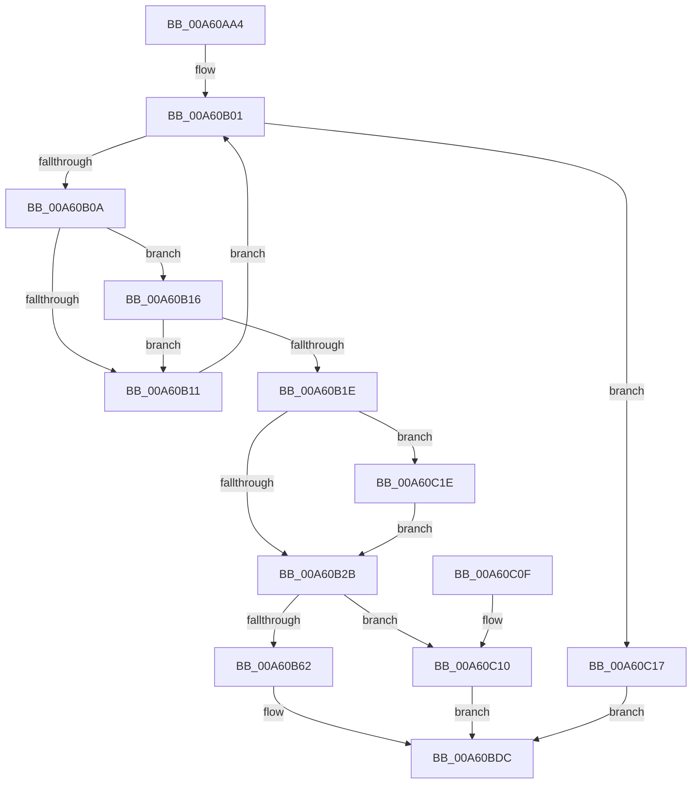

# SepUpdateLogonSessionTrack

- RVA: `0x00A60AA4`–`0x00A60C32` (길이 `398` bytes)
- VA: `0x0000000140A60AA4`
- 실행 섹션: `PAGE`
- PDB 이름 있음: `예`; PDB Function 태그: `아니요`
- unwind 정보 RVA: `0x000B2FF8`
- 디코드: `104`개 명령, `398/398` bytes 표시
- 미해석 바이트: `0` (있으면 어셈블리에 `.byte`로 보존)

> 이 문서는 커널 이미지의 기계어와 PDB 기호를 분석해 생성했습니다. 4번과 5번은 함수 원형과 자료형을 바이너리 사용 방식에서 추정한 C 해석이며 원본 소스 복구 결과는 아닙니다.

## 1. Dependencies

- 직접 호출 지점: **7**; 고유 호출 대상: **6**
- 직접 호출자로 확인된 함수: **1**
- RIP 상대 이미지 참조: **2**

### Outgoing calls
- `0x00A60AF1` → [ExAcquireResourceExclusiveLite](../../text/21/ExAcquireResourceExclusiveLite_function_00214E20.md) (function, `0x00214E20`)
- `0x00A60B51` → [ExAllocatePool2](../../poolcode/B8/ExAllocatePool2_function_00B820F0.md) (function, `0x00B820F0`)
- `0x00A60B82` → [memcpy](../../text/6C/memcpy_function_006C6840.md) (function, `0x006C6840`)
- `0x00A60BBD` → [memcpy](../../text/6C/memcpy_function_006C6840.md) (function, `0x006C6840`)
- `0x00A60BE8` → [ExReleaseResourceLite](../../text/25/ExReleaseResourceLite_function_0025FA10.md) (function, `0x0025FA10`)
- `0x00A60BED` → [KeLeaveCriticalRegion](../../text/25/KeLeaveCriticalRegion_function_0025D8B0.md) (function, `0x0025D8B0`)
- `0x00A60C20` → [ExFreePoolWithTag](../../poolcode/B8/ExFreePoolWithTag_function_00B82870.md) (function, `0x00B82870`)

### Direct callers
- [SepRmAddLogonSessionInfoWrkr](SepRmAddLogonSessionInfoWrkr_function_00A60A80.md) at `0x00A60A8D`

### Static image references
- `0x00A60AC3` → RVA `0x00E67F20` (`.data`; read)
- `0x00A60AF6` → RVA `0x00FD9AF0` (`PAGEDATA`; read)

## 2. Other-region calls and transfers

- 다른 실행 섹션으로 향하는 call: **7**
  - `0x00A60AF1` → [ExAcquireResourceExclusiveLite](../../text/21/ExAcquireResourceExclusiveLite_function_00214E20.md) (`PAGE` → `.text`)
  - `0x00A60B51` → [ExAllocatePool2](../../poolcode/B8/ExAllocatePool2_function_00B820F0.md) (`PAGE` → `POOLCODE`)
  - `0x00A60B82` → [memcpy](../../text/6C/memcpy_function_006C6840.md) (`PAGE` → `.text`)
  - `0x00A60BBD` → [memcpy](../../text/6C/memcpy_function_006C6840.md) (`PAGE` → `.text`)
  - `0x00A60BE8` → [ExReleaseResourceLite](../../text/25/ExReleaseResourceLite_function_0025FA10.md) (`PAGE` → `.text`)
  - `0x00A60BED` → [KeLeaveCriticalRegion](../../text/25/KeLeaveCriticalRegion_function_0025D8B0.md) (`PAGE` → `.text`)
  - `0x00A60C20` → [ExFreePoolWithTag](../../poolcode/B8/ExFreePoolWithTag_function_00B82870.md) (`PAGE` → `POOLCODE`)
- 별도 외부 분기/꼬리 이동을 확인하지 못했습니다.

## 3. Assembly (complete function range)

```asm
00A60AA4  48 8B C4                        mov rax, rsp
00A60AA7  48 89 58 08                     mov qword ptr [rax + 8], rbx
00A60AAB  48 89 68 10                     mov qword ptr [rax + 0x10], rbp
00A60AAF  48 89 70 18                     mov qword ptr [rax + 0x18], rsi
00A60AB3  48 89 78 20                     mov qword ptr [rax + 0x20], rdi
00A60AB7  41 56                           push r14
00A60AB9  48 83 EC 20                     sub rsp, 0x20
00A60ABD  69 29 24 0A 25 5B               imul ebp, dword ptr [rcx], 0x5b250a24
00A60AC3  4C 8D 35 56 74 40 00            lea r14, [rip + 0x407456]
00A60ACA  65 48 8B 04 25 88 01 00 00      mov rax, qword ptr gs:[0x188]
00A60AD3  48 8B F1                        mov rsi, rcx
00A60AD6  33 FF                           xor edi, edi
00A60AD8  B2 01                           mov dl, 1
00A60ADA  66 FF 88 E4 01 00 00            dec word ptr [rax + 0x1e4]
00A60AE1  90                              nop
00A60AE2  C1 ED 1C                        shr ebp, 0x1c
00A60AE5  8B C5                           mov eax, ebp
00A60AE7  83 E0 03                        and eax, 3
00A60AEA  48 6B C8 68                     imul rcx, rax, 0x68
00A60AEE  49 03 CE                        add rcx, r14
00A60AF1  E8 2A 43 7B FF                  call 0x140214e20
00A60AF6  48 8B 05 F3 8F 57 00            mov rax, qword ptr [rip + 0x578ff3]
00A60AFD  48 8B 1C E8                     mov rbx, qword ptr [rax + rbp*8]
00A60B01  48 85 DB                        test rbx, rbx
00A60B04  0F 84 0D 01 00 00               je 0x140a60c17
00A60B0A  8B 43 08                        mov eax, dword ptr [rbx + 8]
00A60B0D  39 06                           cmp dword ptr [rsi], eax
00A60B0F  74 05                           je 0x140a60b16
00A60B11  48 8B 1B                        mov rbx, qword ptr [rbx]
00A60B14  EB EB                           jmp 0x140a60b01
00A60B16  8B 43 0C                        mov eax, dword ptr [rbx + 0xc]
00A60B19  39 46 04                        cmp dword ptr [rsi + 4], eax
00A60B1C  75 F3                           jne 0x140a60b11
00A60B1E  48 8B 4B 48                     mov rcx, qword ptr [rbx + 0x48]
00A60B22  48 85 C9                        test rcx, rcx
00A60B25  0F 85 F3 00 00 00               jne 0x140a60c1e
00A60B2B  0F B7 4E 08                     movzx ecx, word ptr [rsi + 8]
00A60B2F  B8 F8 FF FF FF                  mov eax, 0xfffffff8
00A60B34  0F B7 56 18                     movzx edx, word ptr [rsi + 0x18]
00A60B38  48 83 C1 09                     add rcx, 9
00A60B3C  48 23 C8                        and rcx, rax
00A60B3F  48 83 C2 02                     add rdx, 2
00A60B43  48 03 D1                        add rdx, rcx
00A60B46  41 B8 53 65 4C 73               mov r8d, 0x734c6553
00A60B4C  B9 00 01 00 00                  mov ecx, 0x100
00A60B51  E8 9A 15 12 00                  call 0x140b820f0
00A60B56  48 8B C8                        mov rcx, rax
00A60B59  48 85 C0                        test rax, rax
00A60B5C  0F 84 AE 00 00 00               je 0x140a60c10
00A60B62  48 89 43 48                     mov qword ptr [rbx + 0x48], rax
00A60B66  48 8D 56 28                     lea rdx, [rsi + 0x28]
00A60B6A  0F B7 46 08                     movzx eax, word ptr [rsi + 8]
00A60B6E  48 83 C0 09                     add rax, 9
00A60B72  48 83 E0 F8                     and rax, 0xfffffffffffffff8
00A60B76  48 03 C1                        add rax, rcx
00A60B79  48 89 43 58                     mov qword ptr [rbx + 0x58], rax
00A60B7D  44 0F B7 46 08                  movzx r8d, word ptr [rsi + 8]
00A60B82  E8 B9 5C C6 FF                  call 0x1406c6840
00A60B87  0F B7 4E 08                     movzx ecx, word ptr [rsi + 8]
00A60B8B  66 89 4B 40                     mov word ptr [rbx + 0x40], cx
00A60B8F  8D 41 02                        lea eax, [rcx + 2]
00A60B92  48 D1 E9                        shr rcx, 1
00A60B95  66 89 43 42                     mov word ptr [rbx + 0x42], ax
00A60B99  48 8B 43 48                     mov rax, qword ptr [rbx + 0x48]
00A60B9D  66 89 3C 48                     mov word ptr [rax + rcx*2], di
00A60BA1  0F B7 56 08                     movzx edx, word ptr [rsi + 8]
00A60BA5  44 0F B7 46 18                  movzx r8d, word ptr [rsi + 0x18]
00A60BAA  48 83 C2 07                     add rdx, 7
00A60BAE  48 8B 4B 58                     mov rcx, qword ptr [rbx + 0x58]
00A60BB2  48 83 E2 F8                     and rdx, 0xfffffffffffffff8
00A60BB6  48 83 C2 28                     add rdx, 0x28
00A60BBA  48 03 D6                        add rdx, rsi
00A60BBD  E8 7E 5C C6 FF                  call 0x1406c6840
00A60BC2  0F B7 4E 18                     movzx ecx, word ptr [rsi + 0x18]
00A60BC6  66 89 4B 50                     mov word ptr [rbx + 0x50], cx
00A60BCA  8D 41 02                        lea eax, [rcx + 2]
00A60BCD  48 D1 E9                        shr rcx, 1
00A60BD0  66 89 43 52                     mov word ptr [rbx + 0x52], ax
00A60BD4  48 8B 43 58                     mov rax, qword ptr [rbx + 0x58]
00A60BD8  66 89 3C 48                     mov word ptr [rax + rcx*2], di
00A60BDC  8B CD                           mov ecx, ebp
00A60BDE  83 E1 03                        and ecx, 3
00A60BE1  48 6B C9 68                     imul rcx, rcx, 0x68
00A60BE5  49 03 CE                        add rcx, r14
00A60BE8  E8 23 EE 7F FF                  call 0x14025fa10
00A60BED  E8 BE CC 7F FF                  call 0x14025d8b0
00A60BF2  48 8B 5C 24 30                  mov rbx, qword ptr [rsp + 0x30]
00A60BF7  8B C7                           mov eax, edi
00A60BF9  48 8B 7C 24 48                  mov rdi, qword ptr [rsp + 0x48]
00A60BFE  48 8B 6C 24 38                  mov rbp, qword ptr [rsp + 0x38]
00A60C03  48 8B 74 24 40                  mov rsi, qword ptr [rsp + 0x40]
00A60C08  48 83 C4 20                     add rsp, 0x20
00A60C0C  41 5E                           pop r14
00A60C0E  C3                              ret
00A60C0F  CC                              int3
00A60C10  BF 9A 00 00 C0                  mov edi, 0xc000009a
00A60C15  EB C5                           jmp 0x140a60bdc
00A60C17  BF 5F 00 00 C0                  mov edi, 0xc000005f
00A60C1C  EB BE                           jmp 0x140a60bdc
00A60C1E  33 D2                           xor edx, edx
00A60C20  E8 4B 1C 12 00                  call 0x140b82870
00A60C25  48 89 7B 48                     mov qword ptr [rbx + 0x48], rdi
00A60C29  48 89 7B 58                     mov qword ptr [rbx + 0x58], rdi
00A60C2D  E9 F9 FE FF FF                  jmp 0x140a60b2b
```

## 4. C-style interpretation (structured pseudocode)

```c
__int64 __fastcall SepUpdateLogonSessionTrack(__int64 a1)
{
    __int64 result;
    __int64 v_rbp;
    __int64 v_rdi;
    __int64 v_rsp;
    unsigned __int64 v_stack_p10;
    unsigned __int64 v_stack_p18;
    unsigned __int64 v_stack_p20;
    unsigned __int64 v_stack_p8;

    *(unsigned __int64 *)(v_rsp + 8) = v_rbx;
    *(unsigned __int64 *)(v_rsp + 16) = v_rbp;
    *(unsigned __int64 *)(v_rsp + 24) = v_rsi;
    *(unsigned __int64 *)(v_rsp + 32) = v_rdi;
    v_rsp = (v_rsp) - (32);
    v_rbp = (unsigned int)((v_rbp) * (*(unsigned int *)(a1)));
    v_rdi = 0;
    v_rbp = (unsigned int)((v_rbp) >> (28));
    result = (unsigned int)(((unsigned int)((unsigned int)(v_rbp))) & (3));
    a1 = (a1) * (result);
    a1 = (a1) + (v_rip + 4224086);
    result = ExAcquireResourceExclusiveLite(a1, 1, a3, a4);
loc_00A60B01:
    if (*(unsigned __int64 *)(*(unsigned __int64 *)(v_rip + 5738483) + v_rbp * 8) == 0) goto loc_00A60C17;
    if ((*(unsigned int *)(a1)) == ((unsigned int)((unsigned int)(*(unsigned int *)(*(unsigned __int64 *)(*(unsigned __int64 *)(v_rip + 5738483) + v_rbp * 8) + 8))))) goto loc_00A60B16;
loc_00A60B11:
    goto loc_00A60B01;
loc_00A60B16:
    if ((*(unsigned int *)(a1 + 4)) != ((unsigned int)((unsigned int)(*(unsigned int *)(*(unsigned __int64 *)(*(unsigned __int64 *)(*(unsigned __int64 *)(v_rip + 5738483) + v_rbp * 8)) + 12))))) goto loc_00A60B11;
    if (*(unsigned __int64 *)(*(unsigned __int64 *)(*(unsigned __int64 *)(*(unsigned __int64 *)(v_rip + 5738483) + v_rbp * 8)) + 72) != 0) goto loc_00A60C1E;
loc_00A60B2B:
    a1 = (*(unsigned __int16 *)(a1 + 8)) + (9);
    a1 = (a1) & ((unsigned int)(0xFFFFFFF8ULL));
    a2 = (*(unsigned __int16 *)(a1 + 24)) + (2);
    a2 = (a2) + (a1);
    result = ExAllocatePool2(256, a2, (unsigned int)(0x734C6553ULL), a4);
    if (result == 0) goto loc_00A60C10;
    *(unsigned __int64 *)(*(unsigned __int64 *)(*(unsigned __int64 *)(*(unsigned __int64 *)(v_rip + 5738483) + v_rbp * 8)) + 72) = result;
    result = (*(unsigned __int16 *)(a1 + 8)) + (9);
    result = (result) & (-8);
    result = (result) + (result);
    *(unsigned __int64 *)(*(unsigned __int64 *)(*(unsigned __int64 *)(*(unsigned __int64 *)(v_rip + 5738483) + v_rbp * 8)) + 88) = result;
    result = memcpy(result, a1 + 40, *(unsigned __int16 *)(a1 + 8), a4);
    *(unsigned __int16 *)(*(unsigned __int64 *)(*(unsigned __int64 *)(*(unsigned __int64 *)(v_rip + 5738483) + v_rbp * 8)) + 64) = (unsigned __int16)(*(unsigned __int16 *)(a1 + 8));
    a1 = (*(unsigned __int16 *)(a1 + 8)) >> (1);
    *(unsigned __int16 *)(*(unsigned __int64 *)(*(unsigned __int64 *)(*(unsigned __int64 *)(v_rip + 5738483) + v_rbp * 8)) + 66) = (unsigned __int16)(*(unsigned __int16 *)(a1 + 8) + 2);
    *(unsigned __int16 *)(*(unsigned __int64 *)(*(unsigned __int64 *)(*(unsigned __int64 *)(*(unsigned __int64 *)(v_rip + 5738483) + v_rbp * 8)) + 72) + a1 * 2) = 0;
    a2 = (*(unsigned __int16 *)(a1 + 8)) + (7);
    a2 = (a2) & (-8);
    a2 = (a2) + (40);
    a2 = (a2) + (a1);
    result = memcpy(*(unsigned __int64 *)(*(unsigned __int64 *)(*(unsigned __int64 *)(*(unsigned __int64 *)(v_rip + 5738483) + v_rbp * 8)) + 88), a2, *(unsigned __int16 *)(a1 + 24), a4);
    *(unsigned __int16 *)(*(unsigned __int64 *)(*(unsigned __int64 *)(*(unsigned __int64 *)(v_rip + 5738483) + v_rbp * 8)) + 80) = (unsigned __int16)(*(unsigned __int16 *)(a1 + 24));
    a1 = (*(unsigned __int16 *)(a1 + 24)) >> (1);
    *(unsigned __int16 *)(*(unsigned __int64 *)(*(unsigned __int64 *)(*(unsigned __int64 *)(v_rip + 5738483) + v_rbp * 8)) + 82) = (unsigned __int16)(*(unsigned __int16 *)(a1 + 24) + 2);
    *(unsigned __int16 *)(*(unsigned __int64 *)(*(unsigned __int64 *)(*(unsigned __int64 *)(*(unsigned __int64 *)(v_rip + 5738483) + v_rbp * 8)) + 88) + a1 * 2) = 0;
loc_00A60BDC:
    a1 = (unsigned int)(((unsigned int)((unsigned int)(v_rbp))) & (3));
    a1 = (a1) * (a1);
    a1 = (a1) + (v_rip + 4224086);
    result = ExReleaseResourceLite(a1, a2, *(unsigned __int16 *)(a1 + 24), a4);
    result = KeLeaveCriticalRegion(a1, a2, *(unsigned __int16 *)(a1 + 24), a4);
    v_rsp = (v_rsp) + (32);
    return 0;
loc_00A60C10:
    goto loc_00A60BDC;
loc_00A60C17:
    goto loc_00A60BDC;
loc_00A60C1E:
    a2 = 0;
    result = ExFreePoolWithTag(a1, a2, *(unsigned __int16 *)(a1 + 24), a4);
    *(unsigned __int64 *)(v_stack_p8 + 72) = (unsigned int)(0xC000005FULL);
    *(unsigned __int64 *)(v_stack_p8 + 88) = (unsigned int)(0xC000005FULL);
    goto loc_00A60B2B;
}
```

## 5. (Beta) C Style

```c
int64_t SepUpdateLogonSessionTrack(void *Arg1)
{
    uint8_t *arg1 = (uint8_t *)Arg1;

    int64_t result;
    int64_t local_rbp;
    int64_t local_rdi;
    int64_t local_rsp;
    uint64_t v_stack_p10;
    uint64_t v_stack_p18;
    uint64_t v_stack_p20;
    uint64_t v_stack_p8;

    *(uint64_t *)(local_rsp + 0x8) = local_rbx;
    *(uint64_t *)(local_rsp + 0x10) = local_rbp;
    *(uint64_t *)(local_rsp + 0x18) = local_rsi;
    *(uint64_t *)(local_rsp + 0x20) = local_rdi;
    local_rsp = (local_rsp) - (32);
    local_rbp = (uint32_t)((local_rbp) * (*(uint32_t *)(arg1)));
    local_rdi = 0;
    local_rbp = (uint32_t)((local_rbp) >> (28));
    result = (uint32_t)(((uint32_t)((uint32_t)(local_rbp))) & (3));
    Arg1 = (Arg1) * (result);
    Arg1 = (Arg1) + (v_rip + 4224086);
    result = ExAcquireResourceExclusiveLite(Arg1, 1, a3, a4);
loc_00A60B01:
    if (*(uint64_t *)(*(uint64_t *)(v_rip + 0x578FF3) + local_rbp * 8) == 0) goto loc_00A60C17;
    if ((*(uint32_t *)(arg1)) == ((uint32_t)((uint32_t)(*(uint32_t *)(*(uint64_t *)(*(uint64_t *)(v_rip + 0x578FF3) + local_rbp * 8) + 0x8))))) goto loc_00A60B16;
loc_00A60B11:
    goto loc_00A60B01;
loc_00A60B16:
    if ((*(uint32_t *)(arg1 + 0x4)) != ((uint32_t)((uint32_t)(*(uint32_t *)(*(uint64_t *)(*(uint64_t *)(*(uint64_t *)(v_rip + 0x578FF3) + local_rbp * 8)) + 0xC))))) goto loc_00A60B11;
    if (*(uint64_t *)(*(uint64_t *)(*(uint64_t *)(*(uint64_t *)(v_rip + 0x578FF3) + local_rbp * 8)) + 0x48) != 0) goto loc_00A60C1E;
loc_00A60B2B:
    Arg1 = (*(uint16_t *)(arg1 + 0x8)) + (9);
    Arg1 = (Arg1) & ((uint32_t)(0xFFFFFFF8ULL));
    a2 = (*(uint16_t *)(arg1 + 0x18)) + (2);
    a2 = (a2) + (Arg1);
    result = ExAllocatePool2(256, a2, (uint32_t)(0x734C6553ULL), a4);
    if (result == 0) goto loc_00A60C10;
    *(uint64_t *)(*(uint64_t *)(*(uint64_t *)(*(uint64_t *)(v_rip + 0x578FF3) + local_rbp * 8)) + 0x48) = result;
    result = (*(uint16_t *)(arg1 + 0x8)) + (9);
    result = (result) & (-8);
    result = (result) + (result);
    *(uint64_t *)(*(uint64_t *)(*(uint64_t *)(*(uint64_t *)(v_rip + 0x578FF3) + local_rbp * 8)) + 0x58) = result;
    result = memcpy(result, Arg1 + 40, *(uint16_t *)(arg1 + 0x8), a4);
    *(uint16_t *)(*(uint64_t *)(*(uint64_t *)(*(uint64_t *)(v_rip + 0x578FF3) + local_rbp * 8)) + 0x40) = (uint16_t)(*(uint16_t *)(arg1 + 0x8));
    Arg1 = (*(uint16_t *)(arg1 + 0x8)) >> (1);
    *(uint16_t *)(*(uint64_t *)(*(uint64_t *)(*(uint64_t *)(v_rip + 0x578FF3) + local_rbp * 8)) + 0x42) = (uint16_t)(*(uint16_t *)(arg1 + 0x8) + 2);
    *(uint16_t *)(*(uint64_t *)(*(uint64_t *)(*(uint64_t *)(*(uint64_t *)(v_rip + 0x578FF3) + local_rbp * 8)) + 0x48) + arg1 * 2) = 0;
    a2 = (*(uint16_t *)(arg1 + 0x8)) + (7);
    a2 = (a2) & (-8);
    a2 = (a2) + (40);
    a2 = (a2) + (Arg1);
    result = memcpy(*(uint64_t *)(*(uint64_t *)(*(uint64_t *)(*(uint64_t *)(v_rip + 0x578FF3) + local_rbp * 8)) + 0x58), a2, *(uint16_t *)(arg1 + 0x18), a4);
    *(uint16_t *)(*(uint64_t *)(*(uint64_t *)(*(uint64_t *)(v_rip + 0x578FF3) + local_rbp * 8)) + 0x50) = (uint16_t)(*(uint16_t *)(arg1 + 0x18));
    Arg1 = (*(uint16_t *)(arg1 + 0x18)) >> (1);
    *(uint16_t *)(*(uint64_t *)(*(uint64_t *)(*(uint64_t *)(v_rip + 0x578FF3) + local_rbp * 8)) + 0x52) = (uint16_t)(*(uint16_t *)(arg1 + 0x18) + 2);
    *(uint16_t *)(*(uint64_t *)(*(uint64_t *)(*(uint64_t *)(*(uint64_t *)(v_rip + 0x578FF3) + local_rbp * 8)) + 0x58) + arg1 * 2) = 0;
loc_00A60BDC:
    Arg1 = (uint32_t)(((uint32_t)((uint32_t)(local_rbp))) & (3));
    Arg1 = (Arg1) * (Arg1);
    Arg1 = (Arg1) + (v_rip + 4224086);
    result = ExReleaseResourceLite(Arg1, a2, *(uint16_t *)(arg1 + 0x18), a4);
    result = KeLeaveCriticalRegion(Arg1, a2, *(uint16_t *)(arg1 + 0x18), a4);
    local_rsp = (local_rsp) + (32);
    return 0;
loc_00A60C10:
    goto loc_00A60BDC;
loc_00A60C17:
    goto loc_00A60BDC;
loc_00A60C1E:
    a2 = 0;
    result = ExFreePoolWithTag(Arg1, a2, *(uint16_t *)(arg1 + 0x18), a4);
    *(uint64_t *)(v_stack_p8 + 0x48) = (uint32_t)(0xC000005FULL);
    *(uint64_t *)(v_stack_p8 + 0x58) = (uint32_t)(0xC000005FULL);
    goto loc_00A60B2B;
}
```

### 관측된 메모리 오프셋

구조체 형식이 확인되지 않은 접근은 인자 기준의 오프셋으로만 기록했습니다.

| 기준 인자 | 오프셋 표현 | 폭 (bit) | 접근 |
|---|---:|---:|---|
| `Arg1` | `+ 0x0` | `32` | `R` |
| `Arg1` | `+ 0x4` | `32` | `R` |
| `Arg1` | `+ 0x8` | `16` | `R` |
| `Arg1` | `+ 0x18` | `16` | `R` |
| `Arg1` | `+ 0x28` | `64` | `R` |

## 6. Execution-region graph

[열기: 2D/3D 그래프와 함수 탐색 컨트롤 패널](../../../control-panel.html?section=page&rva=0x00A60AA4&view=graph)

- 2D 그래프는 위에서 아래로 흐르고, 3D 그래프는 빈 공간을 드래그해 회전합니다. Shift+드래그는 이동, 휠은 확대·축소, 함수 노드 선택은 대상 보고서 이동입니다.

### Static fallback


