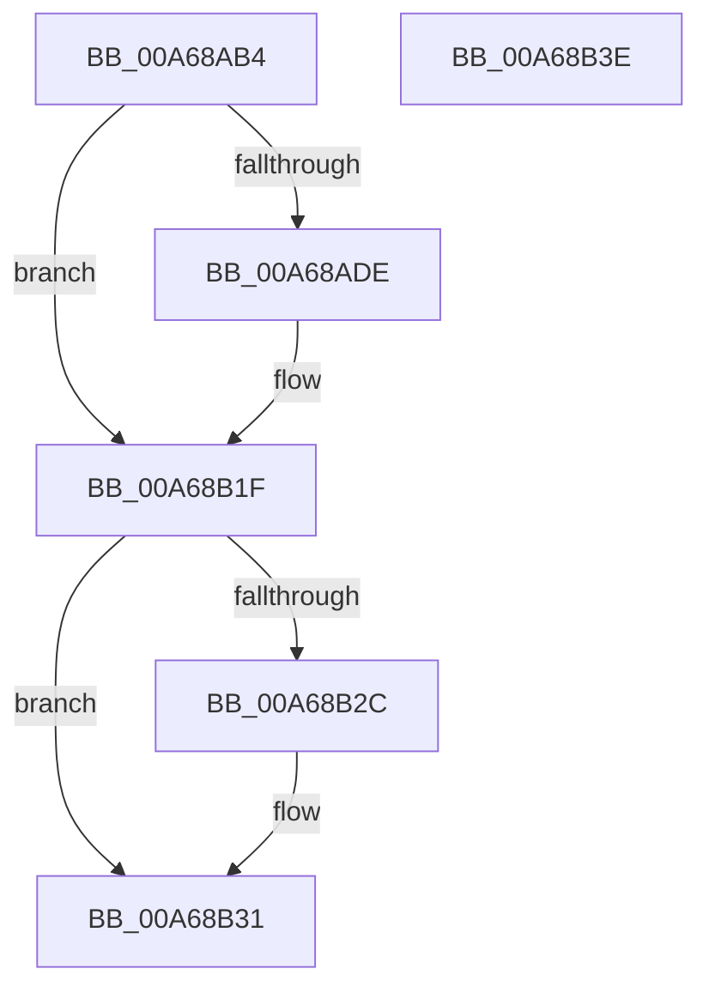

# SiGetDiskPartitionInformation

- RVA: `0x00A68AB4`–`0x00A68B3F` (길이 `139` bytes)
- VA: `0x0000000140A68AB4`
- 실행 섹션: `PAGE`
- PDB 이름 있음: `예`; PDB Function 태그: `아니요`
- unwind 정보 RVA: `0x0008C33C`
- 디코드: `36`개 명령, `139/139` bytes 표시
- 미해석 바이트: `0` (있으면 어셈블리에 `.byte`로 보존)

> 이 문서는 커널 이미지의 기계어와 PDB 기호를 분석해 생성했습니다. 4번과 5번은 함수 원형과 자료형을 바이너리 사용 방식에서 추정한 C 해석이며 원본 소스 복구 결과는 아닙니다.

## 1. Dependencies

- 직접 호출 지점: **3**; 고유 호출 대상: **3**
- 직접 호출자로 확인된 함수: **1**
- RIP 상대 이미지 참조: **0**

### Outgoing calls
- `0x00A68AD3` → [SiOpenDevice](SiOpenDevice_function_00A68B48.md) (function, `0x00A68B48`)
- `0x00A68B18` → [ZwDeviceIoControlFile](../../text/6A/ZwDeviceIoControlFile_function_006AD1B0.md) (function, `0x006AD1B0`)
- `0x00A68B2C` → [ZwClose](../../text/6A/ZwClose_function_006AD2B0.md) (function, `0x006AD2B0`)

### Direct callers
- [SiValidateSystemPartition](../../text/49/SiValidateSystemPartition_function_0049C280.md) at `0x0049C2CF`

### Static image references
- 디코드된 RIP-relative 메모리 참조가 없습니다.

## 2. Other-region calls and transfers

- 다른 실행 섹션으로 향하는 call: **2**
  - `0x00A68B18` → [ZwDeviceIoControlFile](../../text/6A/ZwDeviceIoControlFile_function_006AD1B0.md) (`PAGE` → `.text`)
  - `0x00A68B2C` → [ZwClose](../../text/6A/ZwClose_function_006AD2B0.md) (`PAGE` → `.text`)
- 별도 외부 분기/꼬리 이동을 확인하지 못했습니다.

## 3. Assembly (complete function range)

```asm
00A68AB4  48 8B C4                        mov rax, rsp
00A68AB7  48 89 58 08                     mov qword ptr [rax + 8], rbx
00A68ABB  57                              push rdi
00A68ABC  48 83 EC 60                     sub rsp, 0x60
00A68AC0  48 83 60 18 00                  and qword ptr [rax + 0x18], 0
00A68AC5  48 8B FA                        mov rdi, rdx
00A68AC8  0F 57 C0                        xorps xmm0, xmm0
00A68ACB  48 8D 50 18                     lea rdx, [rax + 0x18]
00A68ACF  0F 11 40 E8                     movups xmmword ptr [rax - 0x18], xmm0
00A68AD3  E8 70 00 00 00                  call 0x140a68b48
00A68AD8  8B D8                           mov ebx, eax
00A68ADA  85 C0                           test eax, eax
00A68ADC  78 41                           js 0x140a68b1f
00A68ADE  48 8B 8C 24 80 00 00 00         mov rcx, qword ptr [rsp + 0x80]
00A68AE6  48 8D 44 24 50                  lea rax, [rsp + 0x50]
00A68AEB  C7 44 24 48 90 00 00 00         mov dword ptr [rsp + 0x48], 0x90
00A68AF3  45 33 C9                        xor r9d, r9d
00A68AF6  48 89 7C 24 40                  mov qword ptr [rsp + 0x40], rdi
00A68AFB  45 33 C0                        xor r8d, r8d
00A68AFE  83 64 24 38 00                  and dword ptr [rsp + 0x38], 0
00A68B03  33 D2                           xor edx, edx
00A68B05  48 83 64 24 30 00               and qword ptr [rsp + 0x30], 0
00A68B0B  C7 44 24 28 48 00 07 00         mov dword ptr [rsp + 0x28], 0x70048
00A68B13  48 89 44 24 20                  mov qword ptr [rsp + 0x20], rax
00A68B18  E8 93 46 C4 FF                  call 0x1406ad1b0
00A68B1D  8B D8                           mov ebx, eax
00A68B1F  48 8B 8C 24 80 00 00 00         mov rcx, qword ptr [rsp + 0x80]
00A68B27  48 85 C9                        test rcx, rcx
00A68B2A  74 05                           je 0x140a68b31
00A68B2C  E8 7F 47 C4 FF                  call 0x1406ad2b0
00A68B31  8B C3                           mov eax, ebx
00A68B33  48 8B 5C 24 70                  mov rbx, qword ptr [rsp + 0x70]
00A68B38  48 83 C4 60                     add rsp, 0x60
00A68B3C  5F                              pop rdi
00A68B3D  C3                              ret
00A68B3E  CC                              int3
```

## 4. C-style interpretation (structured pseudocode)

```c
__int64 __fastcall SiGetDiskPartitionInformation(__int64 a1, __int64 a2, int a3, int a4)
{
    __int64 result;
    __int64 v_rbx;
    __int64 v_rsp;
    unsigned __int64 v_stack_m18;
    unsigned int v_stack_m20;
    unsigned __int64 v_stack_m28;
    unsigned int v_stack_m30;
    unsigned __int64 v_stack_m38;
    unsigned int v_stack_m40;
    unsigned __int64 v_stack_m48;
    unsigned __int64 v_stack_p18;
    unsigned __int64 v_stack_p8;

    *(unsigned __int64 *)(v_rsp + 8) = v_rbx;
    v_rsp = (v_rsp) - (96);
    *(unsigned __int64 *)(v_rsp - 24) = v_xmm0;
    result = SiOpenDevice(a1, v_rsp + 24, a3, a4);
    v_rbx = (unsigned int)((unsigned int)(result));
    if (!(sign_flag)) {
        a1 = v_stack_p18;
        result = v_stack_m18;
        v_stack_m20 = 144;
        a4 = 0;
        v_stack_m28 = a2;
        a3 = 0;
        a2 = 0;
        v_stack_m40 = 0x70048ULL;
        v_stack_m48 = result;
        result = ZwDeviceIoControlFile(a1, a2, a3, a4);
        v_rbx = (unsigned int)(result);
    }
    if (v_stack_p18 != 0) {
        result = ZwClose(v_stack_p18, a2, a3, a4);
    }
    v_rsp = (v_rsp) + (96);
    return (unsigned int)((unsigned int)(v_rbx));
}
```

## 5. (Beta) C Style

```c
int64_t SiGetDiskPartitionInformation(int64_t Arg1, int64_t Arg2, int32_t Arg3, int32_t Arg4)
{
    int64_t result;
    int64_t local_rbx;
    int64_t local_rsp;
    uint64_t v_stack_m18;
    uint32_t v_stack_m20;
    uint64_t v_stack_m28;
    uint32_t v_stack_m30;
    uint64_t v_stack_m38;
    uint32_t v_stack_m40;
    uint64_t v_stack_m48;
    uint64_t v_stack_p18;
    uint64_t v_stack_p8;

    *(uint64_t *)(local_rsp + 0x8) = local_rbx;
    local_rsp = (local_rsp) - (96);
    *(uint64_t *)(local_rsp - 0x18) = v_xmm0;
    result = SiOpenDevice(Arg1, local_rsp + 24, Arg3, Arg4);
    local_rbx = (uint32_t)((uint32_t)(result));
    if (!(sign_flag)) {
        Arg1 = v_stack_p18;
        result = v_stack_m18;
        v_stack_m20 = 144;
        Arg4 = 0;
        v_stack_m28 = Arg2;
        Arg3 = 0;
        Arg2 = 0;
        v_stack_m40 = 0x70048ULL;
        v_stack_m48 = result;
        result = ZwDeviceIoControlFile(Arg1, Arg2, Arg3, Arg4);
        local_rbx = (uint32_t)(result);
    }
    if (v_stack_p18 != 0) {
        result = ZwClose(v_stack_p18, Arg2, Arg3, Arg4);
    }
    local_rsp = (local_rsp) + (96);
    return (uint32_t)((uint32_t)(local_rbx));
}
```

## 6. Execution-region graph

[열기: 2D/3D 그래프와 함수 탐색 컨트롤 패널](../../../control-panel.html?section=page&rva=0x00A68AB4&view=graph)

- 2D 그래프는 위에서 아래로 흐르고, 3D 그래프는 빈 공간을 드래그해 회전합니다. Shift+드래그는 이동, 휠은 확대·축소, 함수 노드 선택은 대상 보고서 이동입니다.

### Static fallback


