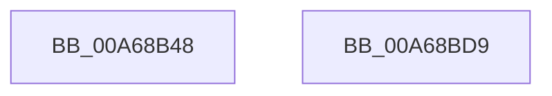

# SiOpenDevice

- RVA: `0x00A68B48`–`0x00A68BDA` (길이 `146` bytes)
- VA: `0x0000000140A68B48`
- 실행 섹션: `PAGE`
- PDB 이름 있음: `예`; PDB Function 태그: `아니요`
- unwind 정보 RVA: `0x000B3F9C`
- 디코드: `35`개 명령, `146/146` bytes 표시
- 미해석 바이트: `0` (있으면 어셈블리에 `.byte`로 보존)

> 이 문서는 커널 이미지의 기계어와 PDB 기호를 분석해 생성했습니다. 4번과 5번은 함수 원형과 자료형을 바이너리 사용 방식에서 추정한 C 해석이며 원본 소스 복구 결과는 아닙니다.

## 1. Dependencies

- 직접 호출 지점: **2**; 고유 호출 대상: **2**
- 직접 호출자로 확인된 함수: **5**
- RIP 상대 이미지 참조: **0**

### Outgoing calls
- `0x00A68B77` → [RtlInitUnicodeString](../../text/42/RtlInitUnicodeString_function_0042A780.md) (function, `0x0042A780`)
- `0x00A68BC3` → [ZwOpenFile](../../text/6A/ZwOpenFile_function_006AD730.md) (function, `0x006AD730`)

### Direct callers
- [SiGetDeviceNumberInformation](../82/SiGetDeviceNumberInformation_function_00827858.md) at `0x00827896`
- [SiGetDriveLayoutInformation](../82/SiGetDriveLayoutInformation_function_00827934.md) at `0x0082795A`
- [SiIssueSynchronousIoctl](../82/SiIssueSynchronousIoctl_function_00827A34.md) at `0x00827A60`
- [SiQueryProperty](SiQueryProperty_function_00A6896C.md) at `0x00A689B2`
- [SiGetDiskPartitionInformation](SiGetDiskPartitionInformation_function_00A68AB4.md) at `0x00A68AD3`

### Static image references
- 디코드된 RIP-relative 메모리 참조가 없습니다.

## 2. Other-region calls and transfers

- 다른 실행 섹션으로 향하는 call: **2**
  - `0x00A68B77` → [RtlInitUnicodeString](../../text/42/RtlInitUnicodeString_function_0042A780.md) (`PAGE` → `.text`)
  - `0x00A68BC3` → [ZwOpenFile](../../text/6A/ZwOpenFile_function_006AD730.md) (`PAGE` → `.text`)
- 별도 외부 분기/꼬리 이동을 확인하지 못했습니다.

## 3. Assembly (complete function range)

```asm
00A68B48  48 89 5C 24 08                  mov qword ptr [rsp + 8], rbx
00A68B4D  55                              push rbp
00A68B4E  48 8B EC                        mov rbp, rsp
00A68B51  48 81 EC 80 00 00 00            sub rsp, 0x80
00A68B58  33 C0                           xor eax, eax
00A68B5A  48 8B DA                        mov rbx, rdx
00A68B5D  48 21 02                        and qword ptr [rdx], rax
00A68B60  0F 57 C0                        xorps xmm0, xmm0
00A68B63  21 45 EC                        and dword ptr [rbp - 0x14], eax
00A68B66  48 8B D1                        mov rdx, rcx
00A68B69  89 45 D4                        mov dword ptr [rbp - 0x2c], eax
00A68B6C  48 8D 4D B0                     lea rcx, [rbp - 0x50]
00A68B70  21 45 D4                        and dword ptr [rbp - 0x2c], eax
00A68B73  0F 11 45 B0                     movups xmmword ptr [rbp - 0x50], xmm0
00A68B77  E8 04 1C 9C FF                  call 0x14042a780
00A68B7C  48 83 65 D8 00                  and qword ptr [rbp - 0x28], 0
00A68B81  48 8D 45 B0                     lea rax, [rbp - 0x50]
00A68B85  0F 57 C0                        xorps xmm0, xmm0
00A68B88  C7 44 24 28 20 00 00 00         mov dword ptr [rsp + 0x28], 0x20
00A68B90  4C 8D 4D C0                     lea r9, [rbp - 0x40]
00A68B94  48 89 45 E0                     mov qword ptr [rbp - 0x20], rax
00A68B98  4C 8D 45 D0                     lea r8, [rbp - 0x30]
00A68B9C  C7 45 D0 30 00 00 00            mov dword ptr [rbp - 0x30], 0x30
00A68BA3  BA 00 00 10 80                  mov edx, 0x80100000
00A68BA8  C7 45 E8 40 02 00 00            mov dword ptr [rbp - 0x18], 0x240
00A68BAF  48 8B CB                        mov rcx, rbx
00A68BB2  C7 44 24 20 03 00 00 00         mov dword ptr [rsp + 0x20], 3
00A68BBA  F3 0F 7F 45 F0                  movdqu xmmword ptr [rbp - 0x10], xmm0
00A68BBF  0F 11 45 C0                     movups xmmword ptr [rbp - 0x40], xmm0
00A68BC3  E8 68 4B C4 FF                  call 0x1406ad730
00A68BC8  48 8B 9C 24 90 00 00 00         mov rbx, qword ptr [rsp + 0x90]
00A68BD0  48 81 C4 80 00 00 00            add rsp, 0x80
00A68BD7  5D                              pop rbp
00A68BD8  C3                              ret
00A68BD9  CC                              int3
```

## 4. C-style interpretation (structured pseudocode)

```c
__int64 __fastcall SiOpenDevice(__int64 a1, __int64 a2)
{
    __int64 result;
    __int64 v_rsp;
    unsigned __int64 v_stack_m18;
    unsigned int v_stack_m1C;
    unsigned int v_stack_m20;
    unsigned __int64 v_stack_m28;
    unsigned __int64 v_stack_m30;
    unsigned int v_stack_m34;
    unsigned __int64 v_stack_m38;
    unsigned __int64 v_stack_m48;
    unsigned __int64 v_stack_m58;
    unsigned int v_stack_m60;
    unsigned int v_stack_m68;
    unsigned __int64 v_stack_p8;

    v_stack_p8 = v_rbx;
    v_rsp = (v_rsp) - (128);
    result = 0;
    v_stack_m34 = 0;
    v_stack_m58 = v_xmm0;
    result = RtlInitUnicodeString(v_stack_m58, a1, a3, a4);
    v_stack_m60 = 32;
    v_stack_m28 = v_stack_m58;
    v_stack_m38 = 48;
    v_stack_m20 = 576;
    v_stack_m68 = 3;
    v_stack_m18 = v_xmm0;
    v_stack_m48 = v_xmm0;
    result = ZwOpenFile(a2, (unsigned int)(0x80100000ULL), v_stack_m38, v_stack_m48);
    v_rsp = (v_rsp) + (128);
    return result;
}
```

## 5. (Beta) C Style

```c
int64_t SiOpenDevice(int64_t Arg1, void *Arg2)
{
    uint8_t *arg2 = (uint8_t *)Arg2;

    int64_t result;
    int64_t local_rsp;
    uint64_t v_stack_m18;
    uint32_t v_stack_m1C;
    uint32_t v_stack_m20;
    uint64_t v_stack_m28;
    uint64_t v_stack_m30;
    uint32_t v_stack_m34;
    uint64_t v_stack_m38;
    uint64_t v_stack_m48;
    uint64_t v_stack_m58;
    uint32_t v_stack_m60;
    uint32_t v_stack_m68;
    uint64_t v_stack_p8;

    v_stack_p8 = local_rbx;
    local_rsp = (local_rsp) - (128);
    result = 0;
    v_stack_m34 = 0;
    v_stack_m58 = v_xmm0;
    result = RtlInitUnicodeString(v_stack_m58, Arg1, a3, a4);
    v_stack_m60 = 32;
    v_stack_m28 = v_stack_m58;
    v_stack_m38 = 48;
    v_stack_m20 = 576;
    v_stack_m68 = 3;
    v_stack_m18 = v_xmm0;
    v_stack_m48 = v_xmm0;
    result = ZwOpenFile(Arg2, (uint32_t)(0x80100000ULL), v_stack_m38, v_stack_m48);
    local_rsp = (local_rsp) + (128);
    return result;
}
```

### 관측된 메모리 오프셋

구조체 형식이 확인되지 않은 접근은 인자 기준의 오프셋으로만 기록했습니다.

| 기준 인자 | 오프셋 표현 | 폭 (bit) | 접근 |
|---|---:|---:|---|
| `Arg2` | `+ 0x0` | `64` | `R/W` |

## 6. Execution-region graph

[열기: 2D/3D 그래프와 함수 탐색 컨트롤 패널](../../../control-panel.html?section=page&rva=0x00A68B48&view=graph)

- 2D 그래프는 위에서 아래로 흐르고, 3D 그래프는 빈 공간을 드래그해 회전합니다. Shift+드래그는 이동, 휠은 확대·축소, 함수 노드 선택은 대상 보고서 이동입니다.

### Static fallback


