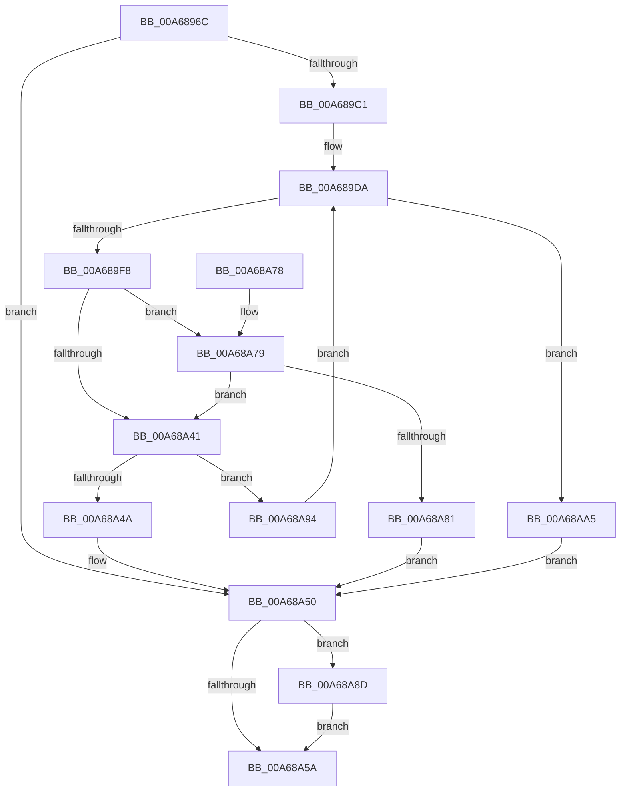

# SiQueryProperty

- RVA: `0x00A6896C`–`0x00A68AAC` (길이 `320` bytes)
- VA: `0x0000000140A6896C`
- 실행 섹션: `PAGE`
- PDB 이름 있음: `예`; PDB Function 태그: `아니요`
- unwind 정보 RVA: `0x000B3F80`
- 디코드: `90`개 명령, `320/320` bytes 표시
- 미해석 바이트: `0` (있으면 어셈블리에 `.byte`로 보존)

> 이 문서는 커널 이미지의 기계어와 PDB 기호를 분석해 생성했습니다. 4번과 5번은 함수 원형과 자료형을 바이너리 사용 방식에서 추정한 C 해석이며 원본 소스 복구 결과는 아닙니다.

## 1. Dependencies

- 직접 호출 지점: **7**; 고유 호출 대상: **6**
- 직접 호출자로 확인된 함수: **2**
- RIP 상대 이미지 참조: **1**

### Outgoing calls
- `0x00A689B2` → [SiOpenDevice](SiOpenDevice_function_00A68B48.md) (function, `0x00A68B48`)
- `0x00A689E7` → [ExAllocatePool2](../../poolcode/B8/ExAllocatePool2_function_00B820F0.md) (function, `0x00B820F0`)
- `0x00A68A32` → [ZwDeviceIoControlFile](../../text/6A/ZwDeviceIoControlFile_function_006AD1B0.md) (function, `0x006AD1B0`)
- `0x00A68A64` → [_security_check_cookie](../../text/6A/_security_check_cookie_function_006AC640.md) (function, `0x006AC640`)
- `0x00A68A86` → [ExFreePoolWithTag](../../poolcode/B8/ExFreePoolWithTag_function_00B82870.md) (function, `0x00B82870`)
- `0x00A68A8D` → [ZwClose](../../text/6A/ZwClose_function_006AD2B0.md) (function, `0x006AD2B0`)
- `0x00A68A9B` → [ExFreePoolWithTag](../../poolcode/B8/ExFreePoolWithTag_function_00B82870.md) (function, `0x00B82870`)

### Direct callers
- [SyspartGetPhysicalPartitions](../82/SyspartGetPhysicalPartitions_function_008275F8.md) at `0x0082764B`
- [SyspartIsSpace](../82/SyspartIsSpace_function_008276F8.md) at `0x00827719`

### Static image references
- `0x00A6897B` → RVA `0x00E0A740` (`.data`; read)

## 2. Other-region calls and transfers

- 다른 실행 섹션으로 향하는 call: **6**
  - `0x00A689E7` → [ExAllocatePool2](../../poolcode/B8/ExAllocatePool2_function_00B820F0.md) (`PAGE` → `POOLCODE`)
  - `0x00A68A32` → [ZwDeviceIoControlFile](../../text/6A/ZwDeviceIoControlFile_function_006AD1B0.md) (`PAGE` → `.text`)
  - `0x00A68A64` → [_security_check_cookie](../../text/6A/_security_check_cookie_function_006AC640.md) (`PAGE` → `.text`)
  - `0x00A68A86` → [ExFreePoolWithTag](../../poolcode/B8/ExFreePoolWithTag_function_00B82870.md) (`PAGE` → `POOLCODE`)
  - `0x00A68A8D` → [ZwClose](../../text/6A/ZwClose_function_006AD2B0.md) (`PAGE` → `.text`)
  - `0x00A68A9B` → [ExFreePoolWithTag](../../poolcode/B8/ExFreePoolWithTag_function_00B82870.md) (`PAGE` → `POOLCODE`)
- 별도 외부 분기/꼬리 이동을 확인하지 못했습니다.

## 3. Assembly (complete function range)

```asm
00A6896C  40 53                           push rbx
00A6896E  56                              push rsi
00A6896F  57                              push rdi
00A68970  41 56                           push r14
00A68972  41 57                           push r15
00A68974  48 81 EC 80 00 00 00            sub rsp, 0x80
00A6897B  48 8B 05 BE 1D 3A 00            mov rax, qword ptr [rip + 0x3a1dbe]
00A68982  48 33 C4                        xor rax, rsp
00A68985  48 89 44 24 78                  mov qword ptr [rsp + 0x78], rax
00A6898A  33 C0                           xor eax, eax
00A6898C  8B DA                           mov ebx, edx
00A6898E  48 21 44 24 50                  and qword ptr [rsp + 0x50], rax
00A68993  48 8D 54 24 50                  lea rdx, [rsp + 0x50]
00A68998  49 21 01                        and qword ptr [r9], rax
00A6899B  0F 57 C0                        xorps xmm0, xmm0
00A6899E  0F 11 44 24 58                  movups xmmword ptr [rsp + 0x58], xmm0
00A689A3  48 89 44 24 68                  mov qword ptr [rsp + 0x68], rax
00A689A8  4D 8B F1                        mov r14, r9
00A689AB  89 44 24 70                     mov dword ptr [rsp + 0x70], eax
00A689AF  41 8B F8                        mov edi, r8d
00A689B2  E8 91 01 00 00                  call 0x140a68b48
00A689B7  8B F0                           mov esi, eax
00A689B9  85 C0                           test eax, eax
00A689BB  0F 88 8F 00 00 00               js 0x140a68a50
00A689C1  83 64 24 6C 00                  and dword ptr [rsp + 0x6c], 0
00A689C6  41 BF 00 00 00 80               mov r15d, 0x80000000
00A689CC  89 5C 24 68                     mov dword ptr [rsp + 0x68], ebx
00A689D0  BB 08 00 00 00                  mov ebx, 8
00A689D5  3B FB                           cmp edi, ebx
00A689D7  0F 43 DF                        cmovae ebx, edi
00A689DA  8B D3                           mov edx, ebx
00A689DC  B9 00 01 00 00                  mov ecx, 0x100
00A689E1  41 B8 53 59 50 4B               mov r8d, 0x4b505953
00A689E7  E8 04 97 11 00                  call 0x140b820f0
00A689EC  48 8B F8                        mov rdi, rax
00A689EF  48 85 C0                        test rax, rax
00A689F2  0F 84 AD 00 00 00               je 0x140a68aa5
00A689F8  48 8B 4C 24 50                  mov rcx, qword ptr [rsp + 0x50]
00A689FD  45 33 C9                        xor r9d, r9d
00A68A00  89 5C 24 48                     mov dword ptr [rsp + 0x48], ebx
00A68A04  45 33 C0                        xor r8d, r8d
00A68A07  48 89 44 24 40                  mov qword ptr [rsp + 0x40], rax
00A68A0C  33 D2                           xor edx, edx
00A68A0E  C7 44 24 38 0C 00 00 00         mov dword ptr [rsp + 0x38], 0xc
00A68A16  48 8D 44 24 68                  lea rax, [rsp + 0x68]
00A68A1B  48 89 44 24 30                  mov qword ptr [rsp + 0x30], rax
00A68A20  48 8D 44 24 58                  lea rax, [rsp + 0x58]
00A68A25  C7 44 24 28 00 14 2D 00         mov dword ptr [rsp + 0x28], 0x2d1400
00A68A2D  48 89 44 24 20                  mov qword ptr [rsp + 0x20], rax
00A68A32  E8 79 47 C4 FF                  call 0x1406ad1b0
00A68A37  8B F0                           mov esi, eax
00A68A39  41 03 C7                        add eax, r15d
00A68A3C  41 85 C7                        test r15d, eax
00A68A3F  74 38                           je 0x140a68a79
00A68A41  8B 47 04                        mov eax, dword ptr [rdi + 4]
00A68A44  33 F6                           xor esi, esi
00A68A46  3B C3                           cmp eax, ebx
00A68A48  77 4A                           ja 0x140a68a94
00A68A4A  89 5F 04                        mov dword ptr [rdi + 4], ebx
00A68A4D  49 89 3E                        mov qword ptr [r14], rdi
00A68A50  48 8B 4C 24 50                  mov rcx, qword ptr [rsp + 0x50]
00A68A55  48 85 C9                        test rcx, rcx
00A68A58  75 33                           jne 0x140a68a8d
00A68A5A  8B C6                           mov eax, esi
00A68A5C  48 8B 4C 24 78                  mov rcx, qword ptr [rsp + 0x78]
00A68A61  48 33 CC                        xor rcx, rsp
00A68A64  E8 D7 3B C4 FF                  call 0x1406ac640
00A68A69  48 81 C4 80 00 00 00            add rsp, 0x80
00A68A70  41 5F                           pop r15
00A68A72  41 5E                           pop r14
00A68A74  5F                              pop rdi
00A68A75  5E                              pop rsi
00A68A76  5B                              pop rbx
00A68A77  C3                              ret
00A68A78  CC                              int3
00A68A79  81 FE 05 00 00 80               cmp esi, 0x80000005
00A68A7F  74 C0                           je 0x140a68a41
00A68A81  33 D2                           xor edx, edx
00A68A83  48 8B CF                        mov rcx, rdi
00A68A86  E8 E5 9D 11 00                  call 0x140b82870
00A68A8B  EB C3                           jmp 0x140a68a50
00A68A8D  E8 1E 48 C4 FF                  call 0x1406ad2b0
00A68A92  EB C6                           jmp 0x140a68a5a
00A68A94  33 D2                           xor edx, edx
00A68A96  48 8B CF                        mov rcx, rdi
00A68A99  8B D8                           mov ebx, eax
00A68A9B  E8 D0 9D 11 00                  call 0x140b82870
00A68AA0  E9 35 FF FF FF                  jmp 0x140a689da
00A68AA5  BE 9A 00 00 C0                  mov esi, 0xc000009a
00A68AAA  EB A4                           jmp 0x140a68a50
```

## 4. C-style interpretation (structured pseudocode)

```c
__int64 __fastcall SiQueryProperty(__int64 a1, int a2, int a3, __int64 a4)
{
    __int64 result;
    __int64 v_rbx;
    __int64 v_rsi;
    __int64 v_rsp;
    unsigned __int64 v_stack_m30;
    unsigned int v_stack_m38;
    unsigned int v_stack_m3C;
    unsigned __int64 v_stack_m40;
    unsigned __int64 v_stack_m50;
    unsigned __int64 v_stack_m58;
    unsigned int v_stack_m60;
    unsigned __int64 v_stack_m68;
    unsigned int v_stack_m70;
    unsigned __int64 v_stack_m78;
    unsigned int v_stack_m80;
    unsigned __int64 v_stack_m88;

    v_rsp = (v_rsp) - (128);
    result = (*(unsigned __int64 *)(v_rip + 3808702)) ^ (v_rsp);
    v_stack_m30 = result;
    result = 0;
    v_stack_m50 = v_xmm0;
    v_stack_m40 = 0;
    v_stack_m38 = 0;
    result = SiOpenDevice(a1, v_stack_m58, a3, a4);
    if (sign_flag) goto loc_00A68A50;
    v_stack_m40 = (unsigned int)((unsigned int)(a2));
    v_rbx = 8;
    if (((unsigned int)((unsigned int)(a3))) >= 8) { v_rbx = (unsigned int)((unsigned int)(a3)); }
loc_00A689DA:
    result = ExAllocatePool2(256, (unsigned int)((unsigned int)(v_rbx)), (unsigned int)(0x4B505953ULL), a4);
    if (result == 0) goto loc_00A68AA5;
    a4 = 0;
    v_stack_m60 = (unsigned int)(v_rbx);
    a3 = 0;
    v_stack_m68 = result;
    a2 = 0;
    v_stack_m70 = 12;
    v_stack_m78 = v_stack_m40;
    v_stack_m80 = 0x2D1400ULL;
    v_stack_m88 = v_stack_m50;
    result = ZwDeviceIoControlFile(v_stack_m58, a2, a3, a4);
    result = (unsigned int)((result) + ((unsigned int)((unsigned int)(0x80000000ULL))));
    if ((((unsigned int)((unsigned int)(0x80000000ULL))) & ((unsigned int)(result))) == 0) goto loc_00A68A79;
loc_00A68A41:
    v_rsi = 0;
    if (((unsigned int)((unsigned int)(*(unsigned int *)(result + 4)))) > ((unsigned int)(v_rbx))) goto loc_00A68A94;
    *(unsigned int *)(result + 4) = (unsigned int)(v_rbx);
    *(unsigned __int64 *)(a4) = result;
loc_00A68A50:
    if (v_stack_m58 != 0) goto loc_00A68A8D;
loc_00A68A5A:
    a1 = (v_stack_m30) ^ (v_rsp);
    result = _security_check_cookie(a1, a2, a3, a4);
    v_rsp = (v_rsp) + (128);
    return result;
loc_00A68A79:
    if (0 == 0x80000005ULL) goto loc_00A68A41;
    a2 = 0;
    result = ExFreePoolWithTag(result, a2, a3, a4);
    goto loc_00A68A50;
loc_00A68A8D:
    result = ZwClose(result, a2, a3, a4);
    goto loc_00A68A5A;
loc_00A68A94:
    a2 = 0;
    result = ExFreePoolWithTag(result, a2, a3, a4);
    goto loc_00A689DA;
loc_00A68AA5:
    goto loc_00A68A50;
}
```

## 5. (Beta) C Style

```c
int64_t SiQueryProperty(int64_t Arg1, int32_t Arg2, int32_t Arg3, void *Arg4)
{
    uint8_t *arg4 = (uint8_t *)Arg4;

    int64_t result;
    int64_t local_rbx;
    int64_t local_rsi;
    int64_t local_rsp;
    uint64_t v_stack_m30;
    uint32_t v_stack_m38;
    uint32_t v_stack_m3C;
    uint64_t v_stack_m40;
    uint64_t v_stack_m50;
    uint64_t v_stack_m58;
    uint32_t v_stack_m60;
    uint64_t v_stack_m68;
    uint32_t v_stack_m70;
    uint64_t v_stack_m78;
    uint32_t v_stack_m80;
    uint64_t v_stack_m88;

    local_rsp = (local_rsp) - (128);
    result = (*(uint64_t *)(v_rip + 0x3A1DBE)) ^ (local_rsp);
    v_stack_m30 = result;
    result = 0;
    v_stack_m50 = v_xmm0;
    v_stack_m40 = 0;
    v_stack_m38 = 0;
    result = SiOpenDevice(Arg1, v_stack_m58, Arg3, Arg4);
    if (sign_flag) goto loc_00A68A50;
    v_stack_m40 = (uint32_t)((uint32_t)(Arg2));
    local_rbx = 8;
    if (((uint32_t)((uint32_t)(Arg3))) >= 8) { local_rbx = (uint32_t)((uint32_t)(Arg3)); }
loc_00A689DA:
    result = ExAllocatePool2(256, (uint32_t)((uint32_t)(local_rbx)), (uint32_t)(0x4B505953ULL), Arg4);
    if (result == 0) goto loc_00A68AA5;
    Arg4 = 0;
    v_stack_m60 = (uint32_t)(local_rbx);
    Arg3 = 0;
    v_stack_m68 = result;
    Arg2 = 0;
    v_stack_m70 = 12;
    v_stack_m78 = v_stack_m40;
    v_stack_m80 = 0x2D1400ULL;
    v_stack_m88 = v_stack_m50;
    result = ZwDeviceIoControlFile(v_stack_m58, Arg2, Arg3, Arg4);
    result = (uint32_t)((result) + ((uint32_t)((uint32_t)(0x80000000ULL))));
    if ((((uint32_t)((uint32_t)(0x80000000ULL))) & ((uint32_t)(result))) == 0) goto loc_00A68A79;
loc_00A68A41:
    local_rsi = 0;
    if (((uint32_t)((uint32_t)(*(uint32_t *)(result + 0x4)))) > ((uint32_t)(local_rbx))) goto loc_00A68A94;
    *(uint32_t *)(result + 0x4) = (uint32_t)(local_rbx);
    *(uint64_t *)(arg4) = result;
loc_00A68A50:
    if (v_stack_m58 != 0) goto loc_00A68A8D;
loc_00A68A5A:
    Arg1 = (v_stack_m30) ^ (local_rsp);
    result = _security_check_cookie(Arg1, Arg2, Arg3, Arg4);
    local_rsp = (local_rsp) + (128);
    return result;
loc_00A68A79:
    if (0 == 0x80000005ULL) goto loc_00A68A41;
    Arg2 = 0;
    result = ExFreePoolWithTag(result, Arg2, Arg3, Arg4);
    goto loc_00A68A50;
loc_00A68A8D:
    result = ZwClose(result, Arg2, Arg3, Arg4);
    goto loc_00A68A5A;
loc_00A68A94:
    Arg2 = 0;
    result = ExFreePoolWithTag(result, Arg2, Arg3, Arg4);
    goto loc_00A689DA;
loc_00A68AA5:
    goto loc_00A68A50;
}
```

### 관측된 메모리 오프셋

구조체 형식이 확인되지 않은 접근은 인자 기준의 오프셋으로만 기록했습니다.

| 기준 인자 | 오프셋 표현 | 폭 (bit) | 접근 |
|---|---:|---:|---|
| `Arg4` | `+ 0x0` | `64` | `R/W` |
| `Arg4` | `+ 0x0` | `64` | `W` |

## 6. Execution-region graph

[열기: 2D/3D 그래프와 함수 탐색 컨트롤 패널](../../../control-panel.html?section=page&rva=0x00A6896C&view=graph)

- 2D 그래프는 위에서 아래로 흐르고, 3D 그래프는 빈 공간을 드래그해 회전합니다. Shift+드래그는 이동, 휠은 확대·축소, 함수 노드 선택은 대상 보고서 이동입니다.

### Static fallback


