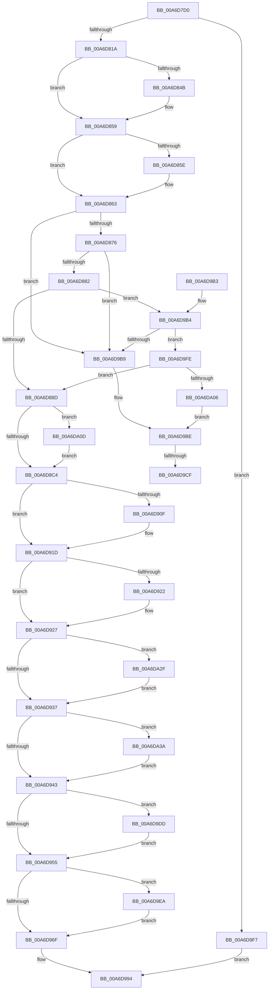

# SmKmStoreDelete

- RVA: `0x00A6D7D0`–`0x00A6DA54` (길이 `644` bytes)
- VA: `0x0000000140A6D7D0`
- 실행 섹션: `PAGE`
- PDB 이름 있음: `예`; PDB Function 태그: `예`
- unwind 정보 RVA: `0x000B46F8`
- 디코드: `163`개 명령, `644/644` bytes 표시
- 미해석 바이트: `0` (있으면 어셈블리에 `.byte`로 보존)

> 이 문서는 커널 이미지의 기계어와 PDB 기호를 분석해 생성했습니다. 4번과 5번은 함수 원형과 자료형을 바이너리 사용 방식에서 추정한 C 해석이며 원본 소스 복구 결과는 아닙니다.

## 1. Dependencies

- 직접 호출 지점: **20**; 고유 호출 대상: **11**
- 직접 호출자로 확인된 함수: **4**
- RIP 상대 이미지 참조: **1**

### Outgoing calls
- `0x00A6D807` → [SmKmStoreRefFromStoreIndex](../../text/43/SmKmStoreRefFromStoreIndex_function_004341A0.md) (function, `0x004341A0`)
- `0x00A6D83B` → [KeAbPreAcquire](../../text/21/KeAbPreAcquire_function_00210230.md) (function, `0x00210230`)
- `0x00A6D854` → [ExfAcquirePushLockExclusiveEx](../../text/20/ExfAcquirePushLockExclusiveEx_function_0020FC90.md) (function, `0x0020FC90`)
- `0x00A6D8A0` → [guard_dispatch_icall](../../text/6B/guard_dispatch_icall_function_006BAAD0.md) (function, `0x006BAAD0`)
- `0x00A6D8A9` → [ExWaitForRundownProtectionRelease](../../text/2A/ExWaitForRundownProtectionRelease_function_002A4CB0.md) (function, `0x002A4CB0`)
- `0x00A6D8B3` → [SmEtwEnabled](../../text/3A/SmEtwEnabled_function_003AF2D0.md) (function, `0x003AF2D0`)
- `0x00A6D8D7` → [guard_dispatch_icall](../../text/6B/guard_dispatch_icall_function_006BAAD0.md) (function, `0x006BAAD0`)
- `0x00A6D8FF` → [KeAbPreAcquire](../../text/21/KeAbPreAcquire_function_00210230.md) (function, `0x00210230`)
- `0x00A6D918` → [ExfAcquirePushLockExclusiveEx](../../text/20/ExfAcquirePushLockExclusiveEx_function_0020FC90.md) (function, `0x0020FC90`)
- `0x00A6D958` → [KeAbPostRelease](../../text/2E/KeAbPostRelease_function_002E1600.md) (function, `0x002E1600`)
- `0x00A6D95D` → [KeLeaveCriticalRegion](../../text/25/KeLeaveCriticalRegion_function_0025D8B0.md) (function, `0x0025D8B0`)
- `0x00A6D972` → [KeAbPostRelease](../../text/2E/KeAbPostRelease_function_002E1600.md) (function, `0x002E1600`)
- `0x00A6D977` → [KeLeaveCriticalRegion](../../text/25/KeLeaveCriticalRegion_function_0025D8B0.md) (function, `0x0025D8B0`)
- `0x00A6D98F` → [guard_dispatch_icall](../../text/6B/guard_dispatch_icall_function_006BAAD0.md) (function, `0x006BAAD0`)
- `0x00A6D9D2` → [ExfTryToWakePushLock](../../text/26/ExfTryToWakePushLock_function_00265DD0.md) (function, `0x00265DD0`)
- `0x00A6D9E0` → [ExfTryToWakePushLock](../../text/26/ExfTryToWakePushLock_function_00265DD0.md) (function, `0x00265DD0`)
- `0x00A6D9ED` → [ExfTryToWakePushLock](../../text/26/ExfTryToWakePushLock_function_00265DD0.md) (function, `0x00265DD0`)
- `0x00A6DA13` → [SmKmEtwLogStoreStats](../7A/SmKmEtwLogStoreStats_function_007A82AC.md) (function, `0x007A82AC`)
- `0x00A6DA25` → [SmKmEtwLogStoreChange](../7A/SmKmEtwLogStoreChange_function_007A8194.md) (function, `0x007A8194`)
- `0x00A6DA4A` → [guard_dispatch_icall](../../text/6B/guard_dispatch_icall_function_006BAAD0.md) (function, `0x006BAAD0`)

### Direct callers
- [SmKmStoreDeleteWhenEmptyWorker](../../text/43/SmKmStoreDeleteWhenEmptyWorker_function_00434130.md) at `0x00434168`
- [SmProcessDeleteRequest](../7A/SmProcessDeleteRequest_function_007A6728.md) at `0x007A678B`
- [SmKmCleanup](../7A/SmKmCleanup_function_007A8108.md) at `0x007A8151`
- [SmProcessCreateRequest](../A5/SmProcessCreateRequest_function_00A50DD0.md) at `0x00A512B1`

### Static image references
- `0x00A6DA1B` → RVA `0x000215E0` (`.rdata`; read)

## 2. Other-region calls and transfers

- 다른 실행 섹션으로 향하는 call: **18**
  - `0x00A6D807` → [SmKmStoreRefFromStoreIndex](../../text/43/SmKmStoreRefFromStoreIndex_function_004341A0.md) (`PAGE` → `.text`)
  - `0x00A6D83B` → [KeAbPreAcquire](../../text/21/KeAbPreAcquire_function_00210230.md) (`PAGE` → `.text`)
  - `0x00A6D854` → [ExfAcquirePushLockExclusiveEx](../../text/20/ExfAcquirePushLockExclusiveEx_function_0020FC90.md) (`PAGE` → `.text`)
  - `0x00A6D8A0` → [guard_dispatch_icall](../../text/6B/guard_dispatch_icall_function_006BAAD0.md) (`PAGE` → `.text`)
  - `0x00A6D8A9` → [ExWaitForRundownProtectionRelease](../../text/2A/ExWaitForRundownProtectionRelease_function_002A4CB0.md) (`PAGE` → `.text`)
  - `0x00A6D8B3` → [SmEtwEnabled](../../text/3A/SmEtwEnabled_function_003AF2D0.md) (`PAGE` → `.text`)
  - `0x00A6D8D7` → [guard_dispatch_icall](../../text/6B/guard_dispatch_icall_function_006BAAD0.md) (`PAGE` → `.text`)
  - `0x00A6D8FF` → [KeAbPreAcquire](../../text/21/KeAbPreAcquire_function_00210230.md) (`PAGE` → `.text`)
  - `0x00A6D918` → [ExfAcquirePushLockExclusiveEx](../../text/20/ExfAcquirePushLockExclusiveEx_function_0020FC90.md) (`PAGE` → `.text`)
  - `0x00A6D958` → [KeAbPostRelease](../../text/2E/KeAbPostRelease_function_002E1600.md) (`PAGE` → `.text`)
  - `0x00A6D95D` → [KeLeaveCriticalRegion](../../text/25/KeLeaveCriticalRegion_function_0025D8B0.md) (`PAGE` → `.text`)
  - `0x00A6D972` → [KeAbPostRelease](../../text/2E/KeAbPostRelease_function_002E1600.md) (`PAGE` → `.text`)
  - `0x00A6D977` → [KeLeaveCriticalRegion](../../text/25/KeLeaveCriticalRegion_function_0025D8B0.md) (`PAGE` → `.text`)
  - `0x00A6D98F` → [guard_dispatch_icall](../../text/6B/guard_dispatch_icall_function_006BAAD0.md) (`PAGE` → `.text`)
  - `0x00A6D9D2` → [ExfTryToWakePushLock](../../text/26/ExfTryToWakePushLock_function_00265DD0.md) (`PAGE` → `.text`)
  - `0x00A6D9E0` → [ExfTryToWakePushLock](../../text/26/ExfTryToWakePushLock_function_00265DD0.md) (`PAGE` → `.text`)
  - `0x00A6D9ED` → [ExfTryToWakePushLock](../../text/26/ExfTryToWakePushLock_function_00265DD0.md) (`PAGE` → `.text`)
  - `0x00A6DA4A` → [guard_dispatch_icall](../../text/6B/guard_dispatch_icall_function_006BAAD0.md) (`PAGE` → `.text`)
- call이 아닌 외부 분기/꼬리 이동: **2**
  - `0x00A6D9C9` → [sub_00B3F4E0](../B3/Unknown_function_00B3F4E0.md) (`tail-transfer`)
  - `0x00A6D9D8` → [sub_00B3F4E0](../B3/Unknown_function_00B3F4E0.md) (`tail-transfer`)

## 3. Assembly (complete function range)

```asm
00A6D7D0  48 8B C4                        mov rax, rsp
00A6D7D3  48 89 58 08                     mov qword ptr [rax + 8], rbx
00A6D7D7  48 89 68 10                     mov qword ptr [rax + 0x10], rbp
00A6D7DB  48 89 70 20                     mov qword ptr [rax + 0x20], rsi
00A6D7DF  44 88 40 18                     mov byte ptr [rax + 0x18], r8b
00A6D7E3  57                              push rdi
00A6D7E4  41 54                           push r12
00A6D7E6  41 55                           push r13
00A6D7E8  41 56                           push r14
00A6D7EA  41 57                           push r15
00A6D7EC  48 83 EC 20                     sub rsp, 0x20
00A6D7F0  44 8B E2                        mov r12d, edx
00A6D7F3  44 8B FA                        mov r15d, edx
00A6D7F6  41 81 E4 FF 03 00 00            and r12d, 0x3ff
00A6D7FD  41 C1 EF 0A                     shr r15d, 0xa
00A6D801  41 8B D4                        mov edx, r12d
00A6D804  48 8B E9                        mov rbp, rcx
00A6D807  E8 94 69 9C FF                  call 0x1404341a0
00A6D80C  33 FF                           xor edi, edi
00A6D80E  4C 8B F0                        mov r14, rax
00A6D811  48 85 C0                        test rax, rax
00A6D814  0F 84 DD 01 00 00               je 0x140a6d9f7
00A6D81A  48 8D 70 10                     lea rsi, [rax + 0x10]
00A6D81E  48 83 CB FF                     or rbx, 0xffffffffffffffff
00A6D822  65 48 8B 04 25 88 01 00 00      mov rax, qword ptr gs:[0x188]
00A6D82B  45 33 C0                        xor r8d, r8d
00A6D82E  33 D2                           xor edx, edx
00A6D830  48 8B CE                        mov rcx, rsi
00A6D833  66 01 98 E4 01 00 00            add word ptr [rax + 0x1e4], bx
00A6D83A  90                              nop
00A6D83B  E8 F0 29 7A FF                  call 0x140210230
00A6D840  F0 48 0F BA 2E 00               lock bts qword ptr [rsi], 0
00A6D846  4C 8B E8                        mov r13, rax
00A6D849  73 0E                           jae 0x140a6d859
00A6D84B  4C 8B C6                        mov r8, rsi
00A6D84E  48 8B D0                        mov rdx, rax
00A6D851  48 8B CE                        mov rcx, rsi
00A6D854  E8 37 24 7A FF                  call 0x14020fc90
00A6D859  4D 85 ED                        test r13, r13
00A6D85C  74 05                           je 0x140a6d863
00A6D85E  41 C6 45 0A 01                  mov byte ptr [r13 + 0xa], 1
00A6D863  41 0F B7 4E 20                  movzx ecx, word ptr [r14 + 0x20]
00A6D868  8B C1                           mov eax, ecx
00A6D86A  83 E0 3F                        and eax, 0x3f
00A6D86D  44 3B F8                        cmp r15d, eax
00A6D870  0F 85 43 01 00 00               jne 0x140a6d9b9
00A6D876  4D 8B 2E                        mov r13, qword ptr [r14]
00A6D879  4D 85 ED                        test r13, r13
00A6D87C  0F 84 37 01 00 00               je 0x140a6d9b9
00A6D882  40 38 7C 24 60                  cmp byte ptr [rsp + 0x60], dil
00A6D887  0F 85 27 01 00 00               jne 0x140a6d9b4
00A6D88D  48 8B 85 00 01 00 00            mov rax, qword ptr [rbp + 0x100]
00A6D894  41 B8 07 00 00 00               mov r8d, 7
00A6D89A  49 8B D5                        mov rdx, r13
00A6D89D  48 8B CD                        mov rcx, rbp
00A6D8A0  E8 2B D2 C4 FF                  call 0x1406baad0
00A6D8A5  49 8D 4E 08                     lea rcx, [r14 + 8]
00A6D8A9  E8 02 74 83 FF                  call 0x1402a4cb0
00A6D8AE  B9 04 00 00 00                  mov ecx, 4
00A6D8B3  E8 18 1A 94 FF                  call 0x1403af2d0
00A6D8B8  4C 8B F8                        mov r15, rax
00A6D8BB  48 85 C0                        test rax, rax
00A6D8BE  0F 85 49 01 00 00               jne 0x140a6da0d
00A6D8C4  48 8B 85 00 01 00 00            mov rax, qword ptr [rbp + 0x100]
00A6D8CB  41 B8 02 00 00 00               mov r8d, 2
00A6D8D1  49 8B D5                        mov rdx, r13
00A6D8D4  48 8B CD                        mov rcx, rbp
00A6D8D7  E8 F4 D1 C4 FF                  call 0x1406baad0
00A6D8DC  49 89 3E                        mov qword ptr [r14], rdi
00A6D8DF  45 33 C0                        xor r8d, r8d
00A6D8E2  65 48 8B 04 25 88 01 00 00      mov rax, qword ptr gs:[0x188]
00A6D8EB  4C 8D B5 A0 01 00 00            lea r14, [rbp + 0x1a0]
00A6D8F2  33 D2                           xor edx, edx
00A6D8F4  49 8B CE                        mov rcx, r14
00A6D8F7  66 01 98 E4 01 00 00            add word ptr [rax + 0x1e4], bx
00A6D8FE  90                              nop
00A6D8FF  E8 2C 29 7A FF                  call 0x140210230
00A6D904  F0 49 0F BA 2E 00               lock bts qword ptr [r14], 0
00A6D90A  4C 8B F8                        mov r15, rax
00A6D90D  73 0E                           jae 0x140a6d91d
00A6D90F  4D 8B C6                        mov r8, r14
00A6D912  48 8B D0                        mov rdx, rax
00A6D915  49 8B CE                        mov rcx, r14
00A6D918  E8 73 23 7A FF                  call 0x14020fc90
00A6D91D  4D 85 FF                        test r15, r15
00A6D920  74 05                           je 0x140a6d927
00A6D922  41 C6 47 0A 01                  mov byte ptr [r15 + 0xa], 1
00A6D927  83 C8 FF                        or eax, 0xffffffff
00A6D92A  44 39 A5 B0 01 00 00            cmp dword ptr [rbp + 0x1b0], r12d
00A6D931  0F 84 F8 00 00 00               je 0x140a6da2f
00A6D937  01 85 A8 01 00 00               add dword ptr [rbp + 0x1a8], eax
00A6D93D  0F 84 F7 00 00 00               je 0x140a6da3a
00A6D943  48 8B C3                        mov rax, rbx
00A6D946  F0 49 0F C1 06                  lock xadd qword ptr [r14], rax
00A6D94B  24 06                           and al, 6
00A6D94D  3C 02                           cmp al, 2
00A6D94F  0F 84 88 00 00 00               je 0x140a6d9dd
00A6D955  49 8B CE                        mov rcx, r14
00A6D958  E8 A3 3C 87 FF                  call 0x1402e1600
00A6D95D  E8 4E FF 7E FF                  call 0x14025d8b0
00A6D962  F0 48 0F C1 1E                  lock xadd qword ptr [rsi], rbx
00A6D967  80 E3 06                        and bl, 6
00A6D96A  80 FB 02                        cmp bl, 2
00A6D96D  74 7B                           je 0x140a6d9ea
00A6D96F  48 8B CE                        mov rcx, rsi
00A6D972  E8 89 3C 87 FF                  call 0x1402e1600
00A6D977  E8 34 FF 7E FF                  call 0x14025d8b0
00A6D97C  48 8B 85 00 01 00 00            mov rax, qword ptr [rbp + 0x100]
00A6D983  41 B8 01 00 00 00               mov r8d, 1
00A6D989  49 8B D5                        mov rdx, r13
00A6D98C  48 8B CD                        mov rcx, rbp
00A6D98F  E8 3C D1 C4 FF                  call 0x1406baad0
00A6D994  48 8B 5C 24 50                  mov rbx, qword ptr [rsp + 0x50]
00A6D999  8B C7                           mov eax, edi
00A6D99B  48 8B 6C 24 58                  mov rbp, qword ptr [rsp + 0x58]
00A6D9A0  48 8B 74 24 68                  mov rsi, qword ptr [rsp + 0x68]
00A6D9A5  48 83 C4 20                     add rsp, 0x20
00A6D9A9  41 5F                           pop r15
00A6D9AB  41 5E                           pop r14
00A6D9AD  41 5D                           pop r13
00A6D9AF  41 5C                           pop r12
00A6D9B1  5F                              pop rdi
00A6D9B2  C3                              ret
00A6D9B3  CC                              int3
00A6D9B4  F6 C1 40                        test cl, 0x40
00A6D9B7  74 45                           je 0x140a6d9fe
00A6D9B9  BF 59 00 00 C0                  mov edi, 0xc0000059
00A6D9BE  F0 48 0F C1 1E                  lock xadd qword ptr [rsi], rbx
00A6D9C3  80 E3 06                        and bl, 6
00A6D9C6  80 FB 02                        cmp bl, 2
00A6D9C9  0F 85 11 1B 0D 00               jne 0x140b3f4e0
00A6D9CF  48 8B CE                        mov rcx, rsi
00A6D9D2  E8 F9 83 7F FF                  call 0x140265dd0
00A6D9D7  90                              nop
00A6D9D8  E9 03 1B 0D 00                  jmp 0x140b3f4e0
00A6D9DD  49 8B CE                        mov rcx, r14
00A6D9E0  E8 EB 83 7F FF                  call 0x140265dd0
00A6D9E5  E9 6B FF FF FF                  jmp 0x140a6d955
00A6D9EA  48 8B CE                        mov rcx, rsi
00A6D9ED  E8 DE 83 7F FF                  call 0x140265dd0
00A6D9F2  E9 78 FF FF FF                  jmp 0x140a6d96f
00A6D9F7  BF 59 00 00 C0                  mov edi, 0xc0000059
00A6D9FC  EB 96                           jmp 0x140a6d994
00A6D9FE  84 C9                           test cl, cl
00A6DA00  0F 89 87 FE FF FF               jns 0x140a6d88d
00A6DA06  BF 22 00 00 C0                  mov edi, 0xc0000022
00A6DA0B  EB B1                           jmp 0x140a6d9be
00A6DA0D  49 8B 16                        mov rdx, qword ptr [r14]
00A6DA10  49 8B CF                        mov rcx, r15
00A6DA13  E8 94 A8 D3 FF                  call 0x1407a82ac
00A6DA18  49 8B 16                        mov rdx, qword ptr [r14]
00A6DA1B  4C 8D 05 BE 3B 5B FF            lea r8, [rip - 0xa4c442]
00A6DA22  49 8B CF                        mov rcx, r15
00A6DA25  E8 6A A7 D3 FF                  call 0x1407a8194
00A6DA2A  E9 95 FE FF FF                  jmp 0x140a6d8c4
00A6DA2F  89 85 B0 01 00 00               mov dword ptr [rbp + 0x1b0], eax
00A6DA35  E9 FD FE FF FF                  jmp 0x140a6d937
00A6DA3A  48 8B 85 00 01 00 00            mov rax, qword ptr [rbp + 0x100]
00A6DA41  33 D2                           xor edx, edx
00A6DA43  48 8B CD                        mov rcx, rbp
00A6DA46  44 8D 42 04                     lea r8d, [rdx + 4]
00A6DA4A  E8 81 D0 C4 FF                  call 0x1406baad0
00A6DA4F  E9 EF FE FF FF                  jmp 0x140a6d943
```

## 4. C-style interpretation (structured pseudocode)

```c
__int64 __fastcall SmKmStoreDelete(__int64 a1, int a2, int a3)
{
    __int64 result;
    __int64 v_r12;
    __int64 v_r15;
    __int64 v_rbx;
    __int64 v_rdi;
    __int64 v_rsp;
    unsigned __int64 v_stack_p10;
    unsigned __int8 v_stack_p18;
    unsigned __int64 v_stack_p20;
    unsigned __int64 v_stack_p8;

    *(unsigned __int64 *)(v_rsp + 8) = v_rbx;
    *(unsigned __int64 *)(v_rsp + 16) = v_rbp;
    *(unsigned __int64 *)(v_rsp + 32) = v_rsi;
    *(unsigned __int8 *)(v_rsp + 24) = (unsigned __int8)(a3);
    v_rsp = (v_rsp) - (32);
    v_r12 = (unsigned int)(((unsigned int)(a2)) & (0x3FFULL));
    v_r15 = (unsigned int)(((unsigned int)(a2)) >> (10));
    result = SmKmStoreRefFromStoreIndex(a1, (unsigned int)((unsigned int)(v_r12)), a3, a4);
    v_rdi = 0;
    if (result == 0) goto loc_00A6D9F7;
    v_rbx = (v_rbx) | (-1);
    a3 = 0;
    a2 = 0;
    result = KeAbPreAcquire(result + 16, a2, a3, a4);
    if (!(condition_is_above_or_equal)) {
        a3 = result + 16;
        a2 = result;
        a1 = result + 16;
        result = ExfAcquirePushLockExclusiveEx(a1, a2, a3, a4);
    }
    if (result != 0) {
        *(unsigned __int8 *)(result + 10) = 1;
    }
    result = (unsigned int)(((unsigned int)((unsigned int)(*(unsigned __int16 *)(result + 32)))) & (63));
    if (((unsigned int)(v_r15)) != ((unsigned int)(result))) goto loc_00A6D9B9;
    if (*(unsigned __int64 *)(result) == 0) goto loc_00A6D9B9;
    if (v_stack_p18 != 0) goto loc_00A6D9B4;
loc_00A6D88D:
    result = guard_dispatch_icall(a1, *(unsigned __int64 *)(result), 7, a4);
    result = ExWaitForRundownProtectionRelease(result + 8, *(unsigned __int64 *)(result), 7, a4);
    result = SmEtwEnabled(4, *(unsigned __int64 *)(result), 7, a4);
    if (result != 0) goto loc_00A6DA0D;
loc_00A6D8C4:
    result = guard_dispatch_icall(a1, *(unsigned __int64 *)(result), 2, a4);
    *(unsigned __int64 *)(result) = 0;
    a3 = 0;
    a2 = 0;
    result = KeAbPreAcquire(a1 + 416, a2, a3, a4);
    if (!(condition_is_above_or_equal)) {
        a3 = a1 + 416;
        a2 = result;
        a1 = a1 + 416;
        result = ExfAcquirePushLockExclusiveEx(a1, a2, a3, a4);
    }
    if (result != 0) {
        *(unsigned __int8 *)(result + 10) = 1;
    }
    result = (unsigned int)((result) | (0xFFFFFFFFULL));
    if ((*(unsigned int *)(a1 + 432)) == ((unsigned int)(v_r12))) goto loc_00A6DA2F;
loc_00A6D937:
    if ((*(unsigned int *)(a1 + 432)) == ((unsigned int)(v_r12))) goto loc_00A6DA3A;
loc_00A6D943:
    result = (unsigned __int8)((v_rbx) & (6));
    if (((unsigned __int8)(result)) == 2) goto loc_00A6D9DD;
loc_00A6D955:
    result = KeAbPostRelease(a1 + 416, a2, a3, a4);
    result = KeLeaveCriticalRegion(a1 + 416, a2, a3, a4);
    v_rbx = (unsigned __int8)((v_rbx) & (6));
    if (((unsigned __int8)(v_rbx)) == 2) goto loc_00A6D9EA;
loc_00A6D96F:
    result = KeAbPostRelease(result + 16, a2, a3, a4);
    result = KeLeaveCriticalRegion(result + 16, a2, a3, a4);
    result = guard_dispatch_icall(a1, *(unsigned __int64 *)(result), 1, a4);
loc_00A6D994:
    v_rsp = (v_rsp) + (32);
    return 0;
loc_00A6D9B4:
    if ((((unsigned __int8)(a1)) & (64)) == 0) goto loc_00A6D9FE;
loc_00A6D9B9:
loc_00A6D9BE:
    v_rbx = (unsigned __int8)((v_stack_p8) & (6));
    result = ExfTryToWakePushLock(v_stack_p20, *(unsigned __int64 *)(result), 1, a4);
loc_00A6D9DD:
    result = ExfTryToWakePushLock(a1 + 416, *(unsigned __int64 *)(result), 1, a4);
    goto loc_00A6D955;
loc_00A6D9EA:
    result = ExfTryToWakePushLock(v_stack_p20, *(unsigned __int64 *)(result), 1, a4);
    goto loc_00A6D96F;
loc_00A6D9F7:
    goto loc_00A6D994;
loc_00A6D9FE:
    if (!sign_flag) goto loc_00A6D88D;
    goto loc_00A6D9BE;
loc_00A6DA0D:
    result = SmKmEtwLogStoreStats(result, *(unsigned __int64 *)(a1 + 416), 1, a4);
    result = SmKmEtwLogStoreChange(result, *(unsigned __int64 *)(a1 + 416), v_rip - 10798146, a4);
    goto loc_00A6D8C4;
loc_00A6DA2F:
    *(unsigned int *)(v_stack_p10 + 432) = (unsigned int)(result);
    goto loc_00A6D937;
loc_00A6DA3A:
    a2 = 0;
    result = guard_dispatch_icall(v_stack_p10, a2, a2 + 4, a4);
    goto loc_00A6D943;
}
```

## 5. (Beta) C Style

```c
int64_t SmKmStoreDelete(void *Arg1, int32_t Arg2, int32_t Arg3)
{
    uint8_t *arg1 = (uint8_t *)Arg1;

    int64_t result;
    int64_t local_r12;
    int64_t local_r15;
    int64_t local_rbx;
    int64_t local_rdi;
    int64_t local_rsp;
    uint64_t v_stack_p10;
    uint8_t v_stack_p18;
    uint64_t v_stack_p20;
    uint64_t v_stack_p8;

    *(uint64_t *)(local_rsp + 0x8) = local_rbx;
    *(uint64_t *)(local_rsp + 0x10) = local_rbp;
    *(uint64_t *)(local_rsp + 0x20) = local_rsi;
    *(uint8_t *)(local_rsp + 0x18) = (uint8_t)(Arg3);
    local_rsp = (local_rsp) - (32);
    local_r12 = (uint32_t)(((uint32_t)(Arg2)) & (0x3FFULL));
    local_r15 = (uint32_t)(((uint32_t)(Arg2)) >> (10));
    result = SmKmStoreRefFromStoreIndex(Arg1, (uint32_t)((uint32_t)(local_r12)), Arg3, a4);
    local_rdi = 0;
    if (result == 0) goto loc_00A6D9F7;
    local_rbx = (local_rbx) | (-1);
    Arg3 = 0;
    Arg2 = 0;
    result = KeAbPreAcquire(result + 16, Arg2, Arg3, a4);
    if (!(condition_is_above_or_equal)) {
        Arg3 = result + 16;
        Arg2 = result;
        Arg1 = result + 16;
        result = ExfAcquirePushLockExclusiveEx(Arg1, Arg2, Arg3, a4);
    }
    if (result != 0) {
        *(uint8_t *)(result + 0xA) = 1;
    }
    result = (uint32_t)(((uint32_t)((uint32_t)(*(uint16_t *)(result + 0x20)))) & (63));
    if (((uint32_t)(local_r15)) != ((uint32_t)(result))) goto loc_00A6D9B9;
    if (*(uint64_t *)(result) == 0) goto loc_00A6D9B9;
    if (v_stack_p18 != 0) goto loc_00A6D9B4;
loc_00A6D88D:
    result = guard_dispatch_icall(Arg1, *(uint64_t *)(result), 7, a4);
    result = ExWaitForRundownProtectionRelease(result + 8, *(uint64_t *)(result), 7, a4);
    result = SmEtwEnabled(4, *(uint64_t *)(result), 7, a4);
    if (result != 0) goto loc_00A6DA0D;
loc_00A6D8C4:
    result = guard_dispatch_icall(Arg1, *(uint64_t *)(result), 2, a4);
    *(uint64_t *)(result) = 0;
    Arg3 = 0;
    Arg2 = 0;
    result = KeAbPreAcquire(Arg1 + 416, Arg2, Arg3, a4);
    if (!(condition_is_above_or_equal)) {
        Arg3 = Arg1 + 416;
        Arg2 = result;
        Arg1 = Arg1 + 416;
        result = ExfAcquirePushLockExclusiveEx(Arg1, Arg2, Arg3, a4);
    }
    if (result != 0) {
        *(uint8_t *)(result + 0xA) = 1;
    }
    result = (uint32_t)((result) | (0xFFFFFFFFULL));
    if ((*(uint32_t *)(arg1 + 0x1B0)) == ((uint32_t)(local_r12))) goto loc_00A6DA2F;
loc_00A6D937:
    if ((*(uint32_t *)(arg1 + 0x1B0)) == ((uint32_t)(local_r12))) goto loc_00A6DA3A;
loc_00A6D943:
    result = (uint8_t)((local_rbx) & (6));
    if (((uint8_t)(result)) == 2) goto loc_00A6D9DD;
loc_00A6D955:
    result = KeAbPostRelease(Arg1 + 416, Arg2, Arg3, a4);
    result = KeLeaveCriticalRegion(Arg1 + 416, Arg2, Arg3, a4);
    local_rbx = (uint8_t)((local_rbx) & (6));
    if (((uint8_t)(local_rbx)) == 2) goto loc_00A6D9EA;
loc_00A6D96F:
    result = KeAbPostRelease(result + 16, Arg2, Arg3, a4);
    result = KeLeaveCriticalRegion(result + 16, Arg2, Arg3, a4);
    result = guard_dispatch_icall(Arg1, *(uint64_t *)(result), 1, a4);
loc_00A6D994:
    local_rsp = (local_rsp) + (32);
    return 0;
loc_00A6D9B4:
    if ((((uint8_t)(Arg1)) & (64)) == 0) goto loc_00A6D9FE;
loc_00A6D9B9:
loc_00A6D9BE:
    local_rbx = (uint8_t)((v_stack_p8) & (6));
    result = ExfTryToWakePushLock(v_stack_p20, *(uint64_t *)(result), 1, a4);
loc_00A6D9DD:
    result = ExfTryToWakePushLock(Arg1 + 416, *(uint64_t *)(result), 1, a4);
    goto loc_00A6D955;
loc_00A6D9EA:
    result = ExfTryToWakePushLock(v_stack_p20, *(uint64_t *)(result), 1, a4);
    goto loc_00A6D96F;
loc_00A6D9F7:
    goto loc_00A6D994;
loc_00A6D9FE:
    if (!sign_flag) goto loc_00A6D88D;
    goto loc_00A6D9BE;
loc_00A6DA0D:
    result = SmKmEtwLogStoreStats(result, *(uint64_t *)(arg1 + 0x1A0), 1, a4);
    result = SmKmEtwLogStoreChange(result, *(uint64_t *)(arg1 + 0x1A0), v_rip - 10798146, a4);
    goto loc_00A6D8C4;
loc_00A6DA2F:
    *(uint32_t *)(v_stack_p10 + 0x1B0) = (uint32_t)(result);
    goto loc_00A6D937;
loc_00A6DA3A:
    Arg2 = 0;
    result = guard_dispatch_icall(v_stack_p10, Arg2, Arg2 + 4, a4);
    goto loc_00A6D943;
}
```

### 관측된 메모리 오프셋

구조체 형식이 확인되지 않은 접근은 인자 기준의 오프셋으로만 기록했습니다.

| 기준 인자 | 오프셋 표현 | 폭 (bit) | 접근 |
|---|---:|---:|---|
| `Arg1` | `+ 0x0` | `64` | `R/W` |
| `Arg1` | `+ 0x100` | `64` | `R` |
| `Arg1` | `+ 0x1A0` | `64` | `R` |
| `Arg1` | `+ 0x1A8` | `32` | `R/W` |
| `Arg1` | `+ 0x1B0` | `32` | `R` |
| `Arg1` | `+ 0x1B0` | `32` | `W` |

## 6. Execution-region graph

[열기: 2D/3D 그래프와 함수 탐색 컨트롤 패널](../../../control-panel.html?section=page&rva=0x00A6D7D0&view=graph)

- 2D 그래프는 위에서 아래로 흐르고, 3D 그래프는 빈 공간을 드래그해 회전합니다. Shift+드래그는 이동, 휠은 확대·축소, 함수 노드 선택은 대상 보고서 이동입니다.

### Static fallback


