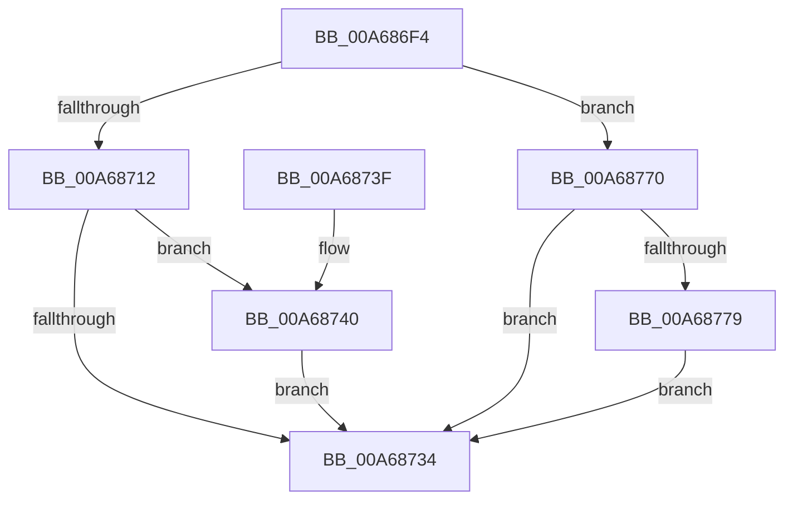

# SmProcessDeleteNotification

- RVA: `0x00A686F4`–`0x00A6878C` (길이 `152` bytes)
- VA: `0x0000000140A686F4`
- 실행 섹션: `PAGE`
- PDB 이름 있음: `예`; PDB Function 태그: `아니요`
- unwind 정보 RVA: `0x000B3F18`
- 디코드: `41`개 명령, `152/152` bytes 표시
- 미해석 바이트: `0` (있으면 어셈블리에 `.byte`로 보존)

> 이 문서는 커널 이미지의 기계어와 PDB 기호를 분석해 생성했습니다. 4번과 5번은 함수 원형과 자료형을 바이너리 사용 방식에서 추정한 C 해석이며 원본 소스 복구 결과는 아닙니다.

## 1. Dependencies

- 직접 호출 지점: **8**; 고유 호출 대상: **8**
- 직접 호출자로 확인된 함수: **1**
- RIP 상대 이미지 참조: **0**

### Outgoing calls
- `0x00A686FE` → [SmpGetProcessPartition](../../text/4A/SmpGetProcessPartition_function_004A3CCC.md) (function, `0x004A3CCC`)
- `0x00A6872A` → [SmpKeyedStoreEntryGet](../../text/34/SmpKeyedStoreEntryGet_function_00349FB0.md) (function, `0x00349FB0`)
- `0x00A68747` → [CmSiFreeMemory](../../text/47/CmSiFreeMemory_function_00475D80.md) (function, `0x00475D80`)
- `0x00A68751` → [SmKmStoreGet](../../text/34/SmKmStoreGet_function_00349F24.md) (function, `0x00349F24`)
- `0x00A6875F` → [SmKmStoreDeleteWhenEmpty](../../text/45/SmKmStoreDeleteWhenEmpty_function_00450D50.md) (function, `0x00450D50`)
- `0x00A68769` → [SmKmStoreDereference](../../text/20/SmKmStoreDereference_function_00206574.md) (function, `0x00206574`)
- `0x00A68770` → [SmCompressionProcessHoldsPartitionReference](../../text/4F/SmCompressionProcessHoldsPartitionReference_function_004F7DA0.md) (function, `0x004F7DA0`)
- `0x00A68785` → [KeSetEvent](../../text/33/KeSetEvent_function_0033F310.md) (function, `0x0033F310`)

### Direct callers
- [PspProcessDelete](../90/PspProcessDelete_function_00907B90.md) at `0x00907E28`

### Static image references
- 디코드된 RIP-relative 메모리 참조가 없습니다.

## 2. Other-region calls and transfers

- 다른 실행 섹션으로 향하는 call: **8**
  - `0x00A686FE` → [SmpGetProcessPartition](../../text/4A/SmpGetProcessPartition_function_004A3CCC.md) (`PAGE` → `.text`)
  - `0x00A6872A` → [SmpKeyedStoreEntryGet](../../text/34/SmpKeyedStoreEntryGet_function_00349FB0.md) (`PAGE` → `.text`)
  - `0x00A68747` → [CmSiFreeMemory](../../text/47/CmSiFreeMemory_function_00475D80.md) (`PAGE` → `.text`)
  - `0x00A68751` → [SmKmStoreGet](../../text/34/SmKmStoreGet_function_00349F24.md) (`PAGE` → `.text`)
  - `0x00A6875F` → [SmKmStoreDeleteWhenEmpty](../../text/45/SmKmStoreDeleteWhenEmpty_function_00450D50.md) (`PAGE` → `.text`)
  - `0x00A68769` → [SmKmStoreDereference](../../text/20/SmKmStoreDereference_function_00206574.md) (`PAGE` → `.text`)
  - `0x00A68770` → [SmCompressionProcessHoldsPartitionReference](../../text/4F/SmCompressionProcessHoldsPartitionReference_function_004F7DA0.md) (`PAGE` → `.text`)
  - `0x00A68785` → [KeSetEvent](../../text/33/KeSetEvent_function_0033F310.md) (`PAGE` → `.text`)
- 별도 외부 분기/꼬리 이동을 확인하지 못했습니다.

## 3. Assembly (complete function range)

```asm
00A686F4  48 89 5C 24 10                  mov qword ptr [rsp + 0x10], rbx
00A686F9  57                              push rdi
00A686FA  48 83 EC 20                     sub rsp, 0x20
00A686FE  E8 C9 B5 A3 FF                  call 0x1404a3ccc
00A68703  F7 81 FC 05 00 00 00 00 00 40   test dword ptr [rcx + 0x5fc], 0x40000000
00A6870D  48 8B F8                        mov rdi, rax
00A68710  75 5E                           jne 0x140a68770
00A68712  45 33 C9                        xor r9d, r9d
00A68715  48 89 4C 24 30                  mov qword ptr [rsp + 0x30], rcx
00A6871A  48 8D 88 B8 08 00 00            lea rcx, [rax + 0x8b8]
00A68721  48 8D 54 24 30                  lea rdx, [rsp + 0x30]
00A68726  45 8D 41 02                     lea r8d, [r9 + 2]
00A6872A  E8 81 18 8E FF                  call 0x140349fb0
00A6872F  48 85 C0                        test rax, rax
00A68732  75 0C                           jne 0x140a68740
00A68734  48 8B 5C 24 38                  mov rbx, qword ptr [rsp + 0x38]
00A68739  48 83 C4 20                     add rsp, 0x20
00A6873D  5F                              pop rdi
00A6873E  C3                              ret
00A6873F  CC                              int3
00A68740  0F B7 58 10                     movzx ebx, word ptr [rax + 0x10]
00A68744  48 8B C8                        mov rcx, rax
00A68747  E8 34 D6 A0 FF                  call 0x140475d80
00A6874C  8B D3                           mov edx, ebx
00A6874E  48 8B CF                        mov rcx, rdi
00A68751  E8 CE 17 8E FF                  call 0x140349f24
00A68756  41 B8 01 00 00 00               mov r8d, 1
00A6875C  48 8B D0                        mov rdx, rax
00A6875F  E8 EC 85 9E FF                  call 0x140450d50
00A68764  8B D3                           mov edx, ebx
00A68766  48 8B CF                        mov rcx, rdi
00A68769  E8 06 DE 79 FF                  call 0x140206574
00A6876E  EB C4                           jmp 0x140a68734
00A68770  E8 2B F6 A8 FF                  call 0x1404f7da0
00A68775  85 C0                           test eax, eax
00A68777  75 BB                           jne 0x140a68734
00A68779  48 8D 8F 80 08 00 00            lea rcx, [rdi + 0x880]
00A68780  45 33 C0                        xor r8d, r8d
00A68783  33 D2                           xor edx, edx
00A68785  E8 86 6B 8D FF                  call 0x14033f310
00A6878A  EB A8                           jmp 0x140a68734
```

## 4. C-style interpretation (structured pseudocode)

```c
__int64 __fastcall SmProcessDeleteNotification(__int64 a1, __int64 a2, __int64 a3, int a4)
{
    __int64 result;
    __int64 v_rsp;
    unsigned __int64 v_stack_p10;
    unsigned __int64 v_stack_p8;

    v_stack_p10 = v_rbx;
    v_rsp = (v_rsp) - (32);
    result = SmpGetProcessPartition(a1, a2, a3, a4);
    if (((*(unsigned int *)(a1 + 1532)) & (0x40000000ULL)) != 0) goto loc_00A68770;
    a4 = 0;
    v_stack_p8 = a1;
    result = SmpKeyedStoreEntryGet(result + 2232, v_stack_p8, a4 + 2, a4);
    if (result != 0) goto loc_00A68740;
loc_00A68734:
    v_rsp = (v_rsp) + (32);
    return result;
loc_00A68740:
    result = CmSiFreeMemory(result, v_stack_p8, a4 + 2, a4);
    result = SmKmStoreGet(result, (unsigned int)((unsigned int)(*(unsigned __int16 *)(result + 16))), a4 + 2, a4);
    result = SmKmStoreDeleteWhenEmpty(result, result, 1, a4);
    result = SmKmStoreDereference(result, (unsigned int)((unsigned int)(*(unsigned __int16 *)(result + 16))), 1, a4);
    goto loc_00A68734;
loc_00A68770:
    result = SmCompressionProcessHoldsPartitionReference(result, (unsigned int)((unsigned int)(*(unsigned __int16 *)(result + 16))), 1, a4);
    if ((unsigned int)(result) != 0) goto loc_00A68734;
    a3 = 0;
    a2 = 0;
    result = KeSetEvent(result + 2176, a2, a3, a4);
    goto loc_00A68734;
}
```

## 5. (Beta) C Style

```c
int64_t SmProcessDeleteNotification(int64_t Arg1, int64_t Arg2, int64_t Arg3, int32_t Arg4)
{
    int64_t result;
    int64_t local_rsp;
    uint64_t v_stack_p10;
    uint64_t v_stack_p8;

    v_stack_p10 = local_rbx;
    local_rsp = (local_rsp) - (32);
    result = SmpGetProcessPartition(Arg1, Arg2, Arg3, Arg4);
    if (((*(uint32_t *)(Arg1 + 0x5FC)) & (0x40000000ULL)) != 0) goto loc_00A68770;
    Arg4 = 0;
    v_stack_p8 = Arg1;
    result = SmpKeyedStoreEntryGet(result + 2232, v_stack_p8, Arg4 + 2, Arg4);
    if (result != 0) goto loc_00A68740;
loc_00A68734:
    local_rsp = (local_rsp) + (32);
    return result;
loc_00A68740:
    result = CmSiFreeMemory(result, v_stack_p8, Arg4 + 2, Arg4);
    result = SmKmStoreGet(result, (uint32_t)((uint32_t)(*(uint16_t *)(result + 0x10))), Arg4 + 2, Arg4);
    result = SmKmStoreDeleteWhenEmpty(result, result, 1, Arg4);
    result = SmKmStoreDereference(result, (uint32_t)((uint32_t)(*(uint16_t *)(result + 0x10))), 1, Arg4);
    goto loc_00A68734;
loc_00A68770:
    result = SmCompressionProcessHoldsPartitionReference(result, (uint32_t)((uint32_t)(*(uint16_t *)(result + 0x10))), 1, Arg4);
    if ((uint32_t)(result) != 0) goto loc_00A68734;
    Arg3 = 0;
    Arg2 = 0;
    result = KeSetEvent(result + 2176, Arg2, Arg3, Arg4);
    goto loc_00A68734;
}
```

## 6. Execution-region graph

[열기: 2D/3D 그래프와 함수 탐색 컨트롤 패널](../../../control-panel.html?section=page&rva=0x00A686F4&view=graph)

- 2D 그래프는 위에서 아래로 흐르고, 3D 그래프는 빈 공간을 드래그해 회전합니다. Shift+드래그는 이동, 휠은 확대·축소, 함수 노드 선택은 대상 보고서 이동입니다.

### Static fallback


