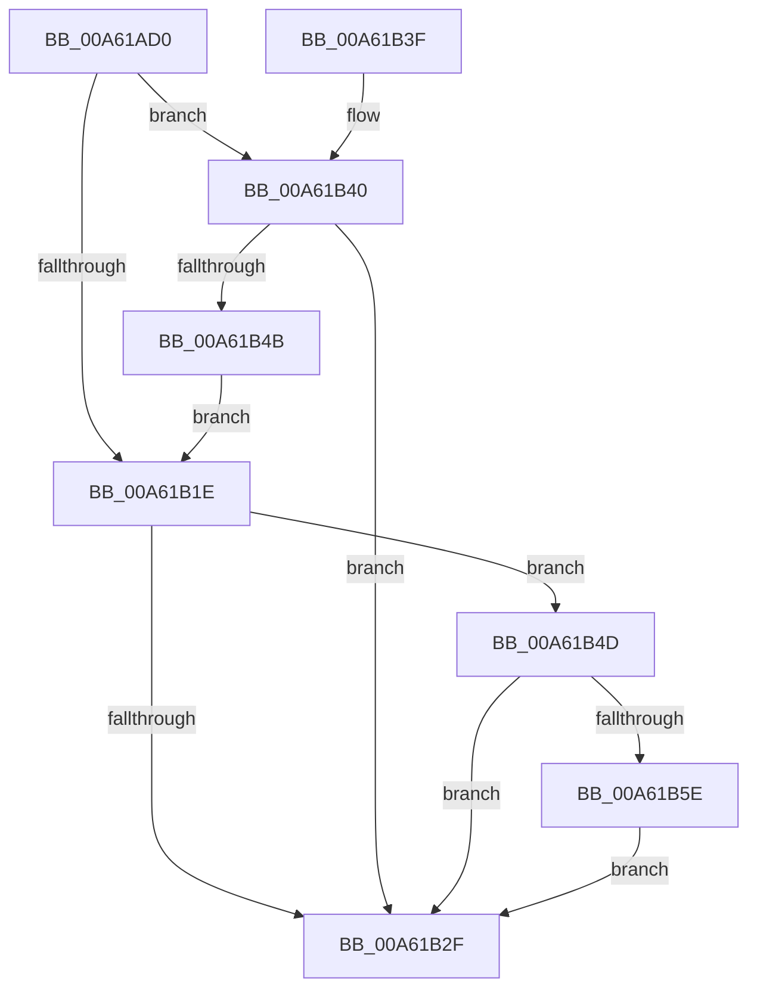

# SmStoreCompressionStart

- RVA: `0x00A61AD0`–`0x00A61B6E` (길이 `158` bytes)
- VA: `0x0000000140A61AD0`
- 실행 섹션: `PAGE`
- PDB 이름 있음: `예`; PDB Function 태그: `아니요`
- unwind 정보 RVA: `0x000B32A8`
- 디코드: `41`개 명령, `158/158` bytes 표시
- 미해석 바이트: `0` (있으면 어셈블리에 `.byte`로 보존)

> 이 문서는 커널 이미지의 기계어와 PDB 기호를 분석해 생성했습니다. 4번과 5번은 함수 원형과 자료형을 바이너리 사용 방식에서 추정한 C 해석이며 원본 소스 복구 결과는 아닙니다.

## 1. Dependencies

- 직접 호출 지점: **5**; 고유 호출 대상: **5**
- 직접 호출자로 확인된 함수: **1**
- RIP 상대 이미지 참조: **0**

### Outgoing calls
- `0x00A61AF7` → [SmpGetProcessPartition](../../text/4A/SmpGetProcessPartition_function_004A3CCC.md) (function, `0x004A3CCC`)
- `0x00A61B11` → [SmpKeyedStoreEntryGet](../../text/34/SmpKeyedStoreEntryGet_function_00349FB0.md) (function, `0x00349FB0`)
- `0x00A61B25` → [MmStoreFlushOutstandingEvictions](../../text/4B/MmStoreFlushOutstandingEvictions_function_004B769C.md) (function, `0x004B769C`)
- `0x00A61B55` → [MmQueryProcessWorkingSetSwapPages](../../text/2A/MmQueryProcessWorkingSetSwapPages_function_002A49BC.md) (function, `0x002A49BC`)
- `0x00A61B67` → [SmSwapStore](SmSwapStore_function_00A61D14.md) (function, `0x00A61D14`)

### Direct callers
- [MmProcessWorkingSetControl](MmProcessWorkingSetControl_function_00A616C4.md) at `0x00A618DA`

### Static image references
- 디코드된 RIP-relative 메모리 참조가 없습니다.

## 2. Other-region calls and transfers

- 다른 실행 섹션으로 향하는 call: **4**
  - `0x00A61AF7` → [SmpGetProcessPartition](../../text/4A/SmpGetProcessPartition_function_004A3CCC.md) (`PAGE` → `.text`)
  - `0x00A61B11` → [SmpKeyedStoreEntryGet](../../text/34/SmpKeyedStoreEntryGet_function_00349FB0.md) (`PAGE` → `.text`)
  - `0x00A61B25` → [MmStoreFlushOutstandingEvictions](../../text/4B/MmStoreFlushOutstandingEvictions_function_004B769C.md) (`PAGE` → `.text`)
  - `0x00A61B55` → [MmQueryProcessWorkingSetSwapPages](../../text/2A/MmQueryProcessWorkingSetSwapPages_function_002A49BC.md) (`PAGE` → `.text`)
- 별도 외부 분기/꼬리 이동을 확인하지 못했습니다.

## 3. Assembly (complete function range)

```asm
00A61AD0  48 89 5C 24 18                  mov qword ptr [rsp + 0x18], rbx
00A61AD5  48 89 74 24 20                  mov qword ptr [rsp + 0x20], rsi
00A61ADA  57                              push rdi
00A61ADB  48 83 EC 20                     sub rsp, 0x20
00A61ADF  65 48 8B 04 25 88 01 00 00      mov rax, qword ptr gs:[0x188]
00A61AE8  48 8B B8 B8 00 00 00            mov rdi, qword ptr [rax + 0xb8]
00A61AEF  48 8B CF                        mov rcx, rdi
00A61AF2  48 89 7C 24 30                  mov qword ptr [rsp + 0x30], rdi
00A61AF7  E8 D0 21 A4 FF                  call 0x1404a3ccc
00A61AFC  45 33 C9                        xor r9d, r9d
00A61AFF  48 8D 54 24 30                  lea rdx, [rsp + 0x30]
00A61B04  45 33 C0                        xor r8d, r8d
00A61B07  48 8B D8                        mov rbx, rax
00A61B0A  48 8D 88 B8 08 00 00            lea rcx, [rax + 0x8b8]
00A61B11  E8 9A 84 8E FF                  call 0x140349fb0
00A61B16  48 8B F0                        mov rsi, rax
00A61B19  48 85 C0                        test rax, rax
00A61B1C  74 22                           je 0x140a61b40
00A61B1E  48 8B 8B 30 08 00 00            mov rcx, qword ptr [rbx + 0x830]
00A61B25  E8 72 5B A5 FF                  call 0x1404b769c
00A61B2A  48 85 F6                        test rsi, rsi
00A61B2D  75 1E                           jne 0x140a61b4d
00A61B2F  48 8B 5C 24 40                  mov rbx, qword ptr [rsp + 0x40]
00A61B34  48 8B 74 24 48                  mov rsi, qword ptr [rsp + 0x48]
00A61B39  48 83 C4 20                     add rsp, 0x20
00A61B3D  5F                              pop rdi
00A61B3E  C3                              ret
00A61B3F  CC                              int3
00A61B40  8B 93 E0 08 00 00               mov edx, dword ptr [rbx + 0x8e0]
00A61B46  83 FA FF                        cmp edx, -1
00A61B49  74 E4                           je 0x140a61b2f
00A61B4B  EB D1                           jmp 0x140a61b1e
00A61B4D  48 8D 54 24 38                  lea rdx, [rsp + 0x38]
00A61B52  48 8B CF                        mov rcx, rdi
00A61B55  E8 62 2E 84 FF                  call 0x1402a49bc
00A61B5A  85 C0                           test eax, eax
00A61B5C  78 D1                           js 0x140a61b2f
00A61B5E  48 8B 8B 30 08 00 00            mov rcx, qword ptr [rbx + 0x830]
00A61B65  33 D2                           xor edx, edx
00A61B67  E8 A8 01 00 00                  call 0x140a61d14
00A61B6C  EB C1                           jmp 0x140a61b2f
```

## 4. C-style interpretation (structured pseudocode)

```c
__int64 __fastcall SmStoreCompressionStart(__int64 a1, __int64 a2, int a3, int a4)
{
    __int64 result;
    __int64 v_rsp;
    unsigned __int64 v_stack_p18;
    unsigned __int64 v_stack_p20;
    unsigned __int64 v_stack_p38;
    unsigned __int64 v_stack_p8;

    v_stack_p18 = v_rbx;
    v_stack_p20 = v_rsi;
    v_rsp = (v_rsp) - (32);
    v_stack_p8 = *(unsigned __int64 *)(*(unsigned __int64 *)(gs_base + (0 + 392)) + 184);
    result = SmpGetProcessPartition(*(unsigned __int64 *)(*(unsigned __int64 *)(gs_base + (0 + 392)) + 184), a2, a3, a4);
    a4 = 0;
    a3 = 0;
    result = SmpKeyedStoreEntryGet(result + 2232, v_stack_p8, a3, a4);
    if (result == 0) goto loc_00A61B40;
loc_00A61B1E:
    result = MmStoreFlushOutstandingEvictions(*(unsigned __int64 *)(result + 2096), v_stack_p8, a3, a4);
    if (result != 0) goto loc_00A61B4D;
loc_00A61B2F:
    v_rsp = (v_rsp) + (32);
    return result;
loc_00A61B40:
    if (((unsigned int)((unsigned int)(*(unsigned int *)(v_stack_p18 + 2272)))) == -1) goto loc_00A61B2F;
    goto loc_00A61B1E;
loc_00A61B4D:
    result = MmQueryProcessWorkingSetSwapPages(*(unsigned __int64 *)(*(unsigned __int64 *)(gs_base + (0 + 392)) + 184), v_stack_p38, a3, a4);
    if (sign_flag) goto loc_00A61B2F;
    a2 = 0;
    result = SmSwapStore(*(unsigned __int64 *)(v_stack_p18 + 2096), a2, a3, a4);
    goto loc_00A61B2F;
}
```

## 5. (Beta) C Style

```c
int64_t SmStoreCompressionStart(int64_t Arg1, int64_t Arg2, int32_t Arg3, int32_t Arg4)
{
    int64_t result;
    int64_t local_rsp;
    uint64_t v_stack_p18;
    uint64_t v_stack_p20;
    uint64_t v_stack_p38;
    uint64_t v_stack_p8;

    v_stack_p18 = local_rbx;
    v_stack_p20 = local_rsi;
    local_rsp = (local_rsp) - (32);
    v_stack_p8 = *(uint64_t *)(*(uint64_t *)(gs_base + (0 + 0x188)) + 0xB8);
    result = SmpGetProcessPartition(*(uint64_t *)(*(uint64_t *)(gs_base + (0 + 0x188)) + 0xB8), Arg2, Arg3, Arg4);
    Arg4 = 0;
    Arg3 = 0;
    result = SmpKeyedStoreEntryGet(result + 2232, v_stack_p8, Arg3, Arg4);
    if (result == 0) goto loc_00A61B40;
loc_00A61B1E:
    result = MmStoreFlushOutstandingEvictions(*(uint64_t *)(result + 0x830), v_stack_p8, Arg3, Arg4);
    if (result != 0) goto loc_00A61B4D;
loc_00A61B2F:
    local_rsp = (local_rsp) + (32);
    return result;
loc_00A61B40:
    if (((uint32_t)((uint32_t)(*(uint32_t *)(v_stack_p18 + 0x8E0)))) == -1) goto loc_00A61B2F;
    goto loc_00A61B1E;
loc_00A61B4D:
    result = MmQueryProcessWorkingSetSwapPages(*(uint64_t *)(*(uint64_t *)(gs_base + (0 + 0x188)) + 0xB8), v_stack_p38, Arg3, Arg4);
    if (sign_flag) goto loc_00A61B2F;
    Arg2 = 0;
    result = SmSwapStore(*(uint64_t *)(v_stack_p18 + 0x830), Arg2, Arg3, Arg4);
    goto loc_00A61B2F;
}
```

## 6. Execution-region graph

[열기: 2D/3D 그래프와 함수 탐색 컨트롤 패널](../../../control-panel.html?section=page&rva=0x00A61AD0&view=graph)

- 2D 그래프는 위에서 아래로 흐르고, 3D 그래프는 빈 공간을 드래그해 회전합니다. Shift+드래그는 이동, 휠은 확대·축소, 함수 노드 선택은 대상 보고서 이동입니다.

### Static fallback


