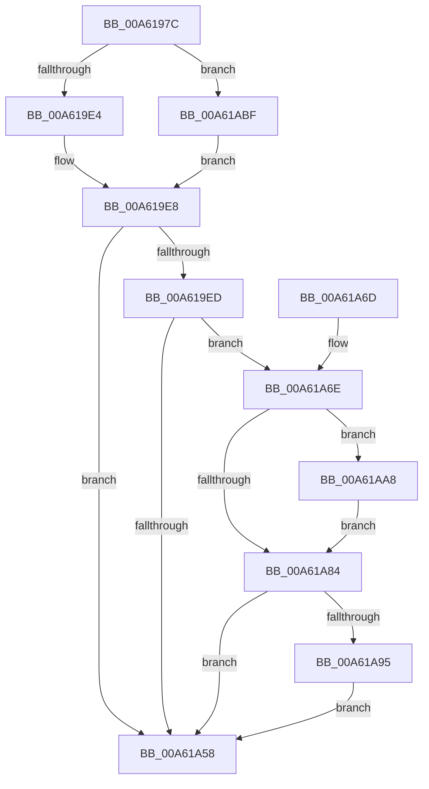

# SmStoreCompressionStop

- RVA: `0x00A6197C`–`0x00A61ACA` (길이 `334` bytes)
- VA: `0x0000000140A6197C`
- 실행 섹션: `PAGE`
- PDB 이름 있음: `예`; PDB Function 태그: `아니요`
- unwind 정보 RVA: `0x000B3290`
- 디코드: `86`개 명령, `334/334` bytes 표시
- 미해석 바이트: `0` (있으면 어셈블리에 `.byte`로 보존)

> 이 문서는 커널 이미지의 기계어와 PDB 기호를 분석해 생성했습니다. 4번과 5번은 함수 원형과 자료형을 바이너리 사용 방식에서 추정한 C 해석이며 원본 소스 복구 결과는 아닙니다.

## 1. Dependencies

- 직접 호출 지점: **10**; 고유 호출 대상: **9**
- 직접 호출자로 확인된 함수: **1**
- RIP 상대 이미지 참조: **1**

### Outgoing calls
- `0x00A619BA` → [SmpGetProcessPartition](../../text/4A/SmpGetProcessPartition_function_004A3CCC.md) (function, `0x004A3CCC`)
- `0x00A619D3` → [SmpKeyedStoreEntryGet](../../text/34/SmpKeyedStoreEntryGet_function_00349FB0.md) (function, `0x00349FB0`)
- `0x00A61A07` → [KeInitializeEvent](../../text/40/KeInitializeEvent_function_0040DD10.md) (function, `0x0040DD10`)
- `0x00A61A35` → [ExQueueWorkItemToPartition](../../text/35/ExQueueWorkItemToPartition_function_00356E2C.md) (function, `0x00356E2C`)
- `0x00A61A4E` → [KeWaitForSingleObject](../../text/20/KeWaitForSingleObject_function_0020E6B0.md) (function, `0x0020E6B0`)
- `0x00A61A7A` → [SmSwapStore](SmSwapStore_function_00A61D14.md) (function, `0x00A61D14`)
- `0x00A61A8C` → [MmQueryProcessWorkingSetSwapPages](../../text/2A/MmQueryProcessWorkingSetSwapPages_function_002A49BC.md) (function, `0x002A49BC`)
- `0x00A61AA1` → [SmSwapStore](SmSwapStore_function_00A61D14.md) (function, `0x00A61D14`)
- `0x00A61AAD` → [SmKmStoreGet](../../text/34/SmKmStoreGet_function_00349F24.md) (function, `0x00349F24`)
- `0x00A61AB8` → [SMKM_STORE_MGR<SM_TRAITS>::SmTrimWsStore](../../text/4B/SMKM_STORE_MGR_SM_TRAITS_SmTrimWsStore_function_004BEB1C.md) (function, `0x004BEB1C`)

### Direct callers
- [MmProcessWorkingSetControl](MmProcessWorkingSetControl_function_00A616C4.md) at `0x00A618CC`

### Static image references
- `0x00A61A11` → RVA `0x00A9DC00` (`SmpFlushStorePages`; read)

## 2. Other-region calls and transfers

- 다른 실행 섹션으로 향하는 call: **8**
  - `0x00A619BA` → [SmpGetProcessPartition](../../text/4A/SmpGetProcessPartition_function_004A3CCC.md) (`PAGE` → `.text`)
  - `0x00A619D3` → [SmpKeyedStoreEntryGet](../../text/34/SmpKeyedStoreEntryGet_function_00349FB0.md) (`PAGE` → `.text`)
  - `0x00A61A07` → [KeInitializeEvent](../../text/40/KeInitializeEvent_function_0040DD10.md) (`PAGE` → `.text`)
  - `0x00A61A35` → [ExQueueWorkItemToPartition](../../text/35/ExQueueWorkItemToPartition_function_00356E2C.md) (`PAGE` → `.text`)
  - `0x00A61A4E` → [KeWaitForSingleObject](../../text/20/KeWaitForSingleObject_function_0020E6B0.md) (`PAGE` → `.text`)
  - `0x00A61A8C` → [MmQueryProcessWorkingSetSwapPages](../../text/2A/MmQueryProcessWorkingSetSwapPages_function_002A49BC.md) (`PAGE` → `.text`)
  - `0x00A61AAD` → [SmKmStoreGet](../../text/34/SmKmStoreGet_function_00349F24.md) (`PAGE` → `.text`)
  - `0x00A61AB8` → [SMKM_STORE_MGR<SM_TRAITS>::SmTrimWsStore](../../text/4B/SMKM_STORE_MGR_SM_TRAITS_SmTrimWsStore_function_004BEB1C.md) (`PAGE` → `.text`)
- 별도 외부 분기/꼬리 이동을 확인하지 못했습니다.

## 3. Assembly (complete function range)

```asm
00A6197C  48 89 5C 24 08                  mov qword ptr [rsp + 8], rbx
00A61981  48 89 74 24 20                  mov qword ptr [rsp + 0x20], rsi
00A61986  55                              push rbp
00A61987  57                              push rdi
00A61988  41 56                           push r14
00A6198A  48 8B EC                        mov rbp, rsp
00A6198D  48 83 EC 70                     sub rsp, 0x70
00A61991  48 83 65 D8 00                  and qword ptr [rbp - 0x28], 0
00A61996  0F 57 C0                        xorps xmm0, xmm0
00A61999  48 83 65 E8 00                  and qword ptr [rbp - 0x18], 0
00A6199E  44 8B F1                        mov r14d, ecx
00A619A1  F3 0F 7F 45 C8                  movdqu xmmword ptr [rbp - 0x38], xmm0
00A619A6  65 48 8B 04 25 88 01 00 00      mov rax, qword ptr gs:[0x188]
00A619AF  48 8B 88 B8 00 00 00            mov rcx, qword ptr [rax + 0xb8]
00A619B6  48 89 4D 28                     mov qword ptr [rbp + 0x28], rcx
00A619BA  E8 0D 23 A4 FF                  call 0x1404a3ccc
00A619BF  45 33 C9                        xor r9d, r9d
00A619C2  48 8D 55 28                     lea rdx, [rbp + 0x28]
00A619C6  45 33 C0                        xor r8d, r8d
00A619C9  48 8B D8                        mov rbx, rax
00A619CC  48 8D 88 B8 08 00 00            lea rcx, [rax + 0x8b8]
00A619D3  E8 D8 85 8E FF                  call 0x140349fb0
00A619D8  48 8B F0                        mov rsi, rax
00A619DB  48 85 C0                        test rax, rax
00A619DE  0F 84 DB 00 00 00               je 0x140a61abf
00A619E4  0F B7 78 10                     movzx edi, word ptr [rax + 0x10]
00A619E8  83 FF FF                        cmp edi, -1
00A619EB  74 6B                           je 0x140a61a58
00A619ED  48 83 65 D8 00                  and qword ptr [rbp - 0x28], 0
00A619F2  48 8D 4D C8                     lea rcx, [rbp - 0x38]
00A619F6  0F 57 C0                        xorps xmm0, xmm0
00A619F9  48 89 5D C0                     mov qword ptr [rbp - 0x40], rbx
00A619FD  45 33 C0                        xor r8d, r8d
00A61A00  33 D2                           xor edx, edx
00A61A02  F3 0F 7F 45 C8                  movdqu xmmword ptr [rbp - 0x38], xmm0
00A61A07  E8 04 C3 9A FF                  call 0x14040dd10
00A61A0C  48 83 65 E0 00                  and qword ptr [rbp - 0x20], 0
00A61A11  48 8D 05 E8 C1 03 00            lea rax, [rip + 0x3c1e8]
00A61A18  48 89 45 F0                     mov qword ptr [rbp - 0x10], rax
00A61A1C  48 8D 4D E0                     lea rcx, [rbp - 0x20]
00A61A20  48 8D 45 C0                     lea rax, [rbp - 0x40]
00A61A24  41 83 C8 FF                     or r8d, 0xffffffff
00A61A28  48 89 45 F8                     mov qword ptr [rbp - 8], rax
00A61A2C  33 D2                           xor edx, edx
00A61A2E  4C 8B 8B 30 08 00 00            mov r9, qword ptr [rbx + 0x830]
00A61A35  E8 F2 53 8F FF                  call 0x140356e2c
00A61A3A  48 83 64 24 20 00               and qword ptr [rsp + 0x20], 0
00A61A40  48 8D 4D C8                     lea rcx, [rbp - 0x38]
00A61A44  45 33 C9                        xor r9d, r9d
00A61A47  45 33 C0                        xor r8d, r8d
00A61A4A  41 8D 51 1A                     lea edx, [r9 + 0x1a]
00A61A4E  E8 5D CC 7A FF                  call 0x14020e6b0
00A61A53  48 85 F6                        test rsi, rsi
00A61A56  75 16                           jne 0x140a61a6e
00A61A58  4C 8D 5C 24 70                  lea r11, [rsp + 0x70]
00A61A5D  49 8B 5B 20                     mov rbx, qword ptr [r11 + 0x20]
00A61A61  49 8B 73 38                     mov rsi, qword ptr [r11 + 0x38]
00A61A65  49 8B E3                        mov rsp, r11
00A61A68  41 5E                           pop r14
00A61A6A  5F                              pop rdi
00A61A6B  5D                              pop rbp
00A61A6C  C3                              ret
00A61A6D  CC                              int3
00A61A6E  48 8B 8B 30 08 00 00            mov rcx, qword ptr [rbx + 0x830]
00A61A75  BA 01 00 00 00                  mov edx, 1
00A61A7A  E8 95 02 00 00                  call 0x140a61d14
00A61A7F  45 85 F6                        test r14d, r14d
00A61A82  75 24                           jne 0x140a61aa8
00A61A84  48 8B 4D 28                     mov rcx, qword ptr [rbp + 0x28]
00A61A88  48 8D 55 30                     lea rdx, [rbp + 0x30]
00A61A8C  E8 2B 2F 84 FF                  call 0x1402a49bc
00A61A91  85 C0                           test eax, eax
00A61A93  79 C3                           jns 0x140a61a58
00A61A95  48 8B 8B 30 08 00 00            mov rcx, qword ptr [rbx + 0x830]
00A61A9C  BA 02 00 00 00                  mov edx, 2
00A61AA1  E8 6E 02 00 00                  call 0x140a61d14
00A61AA6  EB B0                           jmp 0x140a61a58
00A61AA8  8B D7                           mov edx, edi
00A61AAA  48 8B CB                        mov rcx, rbx
00A61AAD  E8 72 84 8E FF                  call 0x140349f24
00A61AB2  45 33 C0                        xor r8d, r8d
00A61AB5  48 8B D0                        mov rdx, rax
00A61AB8  E8 5F D0 A5 FF                  call 0x1404beb1c
00A61ABD  EB C5                           jmp 0x140a61a84
00A61ABF  8B BB E0 08 00 00               mov edi, dword ptr [rbx + 0x8e0]
00A61AC5  E9 1E FF FF FF                  jmp 0x140a619e8
```

## 4. C-style interpretation (structured pseudocode)

```c
__int64 __fastcall SmStoreCompressionStop(int a1, __int64 a2, int a3, int a4)
{
    __int64 result;
    __int64 v_rsp;
    unsigned __int64 v_stack_m18;
    unsigned __int64 v_stack_m20;
    unsigned __int64 v_stack_m28;
    unsigned __int64 v_stack_m30;
    unsigned __int64 v_stack_m38;
    unsigned __int64 v_stack_m40;
    unsigned __int64 v_stack_m50;
    unsigned __int64 v_stack_m58;
    unsigned __int64 v_stack_m68;
    unsigned __int64 v_stack_p10;
    unsigned __int64 v_stack_p18;
    unsigned __int64 v_stack_p20;
    unsigned __int64 v_stack_p8;

    v_stack_p8 = v_rbx;
    v_stack_p20 = v_rsi;
    v_rsp = (v_rsp) - (112);
    v_stack_m50 = v_xmm0;
    v_stack_p10 = *(unsigned __int64 *)(*(unsigned __int64 *)(gs_base + (0 + 392)) + 184);
    result = SmpGetProcessPartition(*(unsigned __int64 *)(*(unsigned __int64 *)(gs_base + (0 + 392)) + 184), a2, a3, a4);
    a4 = 0;
    a3 = 0;
    result = SmpKeyedStoreEntryGet(result + 2232, v_stack_p10, a3, a4);
    if (result == 0) goto loc_00A61ABF;
loc_00A619E8:
    if (((unsigned int)(*(unsigned __int16 *)(result + 16))) == -1) goto loc_00A61A58;
    v_stack_m58 = result;
    a3 = 0;
    a2 = 0;
    v_stack_m50 = v_xmm0;
    result = KeInitializeEvent(v_stack_m50, a2, a3, a4);
    v_stack_m28 = v_rip + 246248;
    a3 = (unsigned int)((a3) | (0xFFFFFFFFULL));
    v_stack_m20 = v_stack_m58;
    a2 = 0;
    result = ExQueueWorkItemToPartition(v_stack_m38, a2, a3, *(unsigned __int64 *)(result + 2096));
    a4 = 0;
    a3 = 0;
    result = KeWaitForSingleObject(v_stack_m50, a4 + 26, a3, a4);
    if (result != 0) goto loc_00A61A6E;
loc_00A61A58:
    return result;
loc_00A61A6E:
    result = SmSwapStore(*(unsigned __int64 *)(*(unsigned __int64 *)(v_stack_m18 + 32) + 2096), 1, a3, a4);
    if ((unsigned int)((unsigned int)(a1)) != 0) goto loc_00A61AA8;
loc_00A61A84:
    result = MmQueryProcessWorkingSetSwapPages(v_stack_p10, v_stack_p18, a3, a4);
    if (!sign_flag) goto loc_00A61A58;
    result = SmSwapStore(*(unsigned __int64 *)(*(unsigned __int64 *)(v_stack_m18 + 32) + 2096), 2, a3, a4);
    goto loc_00A61A58;
loc_00A61AA8:
    result = SmKmStoreGet(*(unsigned __int64 *)(v_stack_m18 + 32), (unsigned int)((unsigned int)(*(unsigned __int16 *)(result + 16))), a3, a4);
    a3 = 0;
    result = SMKM_STORE_MGR_SM_TRAITS___SmTrimWsStore(*(unsigned __int64 *)(v_stack_m18 + 32), result, a3, a4);
    goto loc_00A61A84;
loc_00A61ABF:
    goto loc_00A619E8;
}
```

## 5. (Beta) C Style

```c
int64_t SmStoreCompressionStop(int32_t Arg1, int64_t Arg2, int32_t Arg3, int32_t Arg4)
{
    int64_t result;
    int64_t local_rsp;
    uint64_t v_stack_m18;
    uint64_t v_stack_m20;
    uint64_t v_stack_m28;
    uint64_t v_stack_m30;
    uint64_t v_stack_m38;
    uint64_t v_stack_m40;
    uint64_t v_stack_m50;
    uint64_t v_stack_m58;
    uint64_t v_stack_m68;
    uint64_t v_stack_p10;
    uint64_t v_stack_p18;
    uint64_t v_stack_p20;
    uint64_t v_stack_p8;

    v_stack_p8 = local_rbx;
    v_stack_p20 = local_rsi;
    local_rsp = (local_rsp) - (112);
    v_stack_m50 = v_xmm0;
    v_stack_p10 = *(uint64_t *)(*(uint64_t *)(gs_base + (0 + 0x188)) + 0xB8);
    result = SmpGetProcessPartition(*(uint64_t *)(*(uint64_t *)(gs_base + (0 + 0x188)) + 0xB8), Arg2, Arg3, Arg4);
    Arg4 = 0;
    Arg3 = 0;
    result = SmpKeyedStoreEntryGet(result + 2232, v_stack_p10, Arg3, Arg4);
    if (result == 0) goto loc_00A61ABF;
loc_00A619E8:
    if (((uint32_t)(*(uint16_t *)(result + 0x10))) == -1) goto loc_00A61A58;
    v_stack_m58 = result;
    Arg3 = 0;
    Arg2 = 0;
    v_stack_m50 = v_xmm0;
    result = KeInitializeEvent(v_stack_m50, Arg2, Arg3, Arg4);
    v_stack_m28 = v_rip + 246248;
    Arg3 = (uint32_t)((Arg3) | (0xFFFFFFFFULL));
    v_stack_m20 = v_stack_m58;
    Arg2 = 0;
    result = ExQueueWorkItemToPartition(v_stack_m38, Arg2, Arg3, *(uint64_t *)(result + 0x830));
    Arg4 = 0;
    Arg3 = 0;
    result = KeWaitForSingleObject(v_stack_m50, Arg4 + 26, Arg3, Arg4);
    if (result != 0) goto loc_00A61A6E;
loc_00A61A58:
    return result;
loc_00A61A6E:
    result = SmSwapStore(*(uint64_t *)(*(uint64_t *)(v_stack_m18 + 0x20) + 0x830), 1, Arg3, Arg4);
    if ((uint32_t)((uint32_t)(Arg1)) != 0) goto loc_00A61AA8;
loc_00A61A84:
    result = MmQueryProcessWorkingSetSwapPages(v_stack_p10, v_stack_p18, Arg3, Arg4);
    if (!sign_flag) goto loc_00A61A58;
    result = SmSwapStore(*(uint64_t *)(*(uint64_t *)(v_stack_m18 + 0x20) + 0x830), 2, Arg3, Arg4);
    goto loc_00A61A58;
loc_00A61AA8:
    result = SmKmStoreGet(*(uint64_t *)(v_stack_m18 + 0x20), (uint32_t)((uint32_t)(*(uint16_t *)(result + 0x10))), Arg3, Arg4);
    Arg3 = 0;
    result = SMKM_STORE_MGR_SM_TRAITS___SmTrimWsStore(*(uint64_t *)(v_stack_m18 + 0x20), result, Arg3, Arg4);
    goto loc_00A61A84;
loc_00A61ABF:
    goto loc_00A619E8;
}
```

## 6. Execution-region graph

[열기: 2D/3D 그래프와 함수 탐색 컨트롤 패널](../../../control-panel.html?section=page&rva=0x00A6197C&view=graph)

- 2D 그래프는 위에서 아래로 흐르고, 3D 그래프는 빈 공간을 드래그해 회전합니다. Shift+드래그는 이동, 휠은 확대·축소, 함수 노드 선택은 대상 보고서 이동입니다.

### Static fallback


