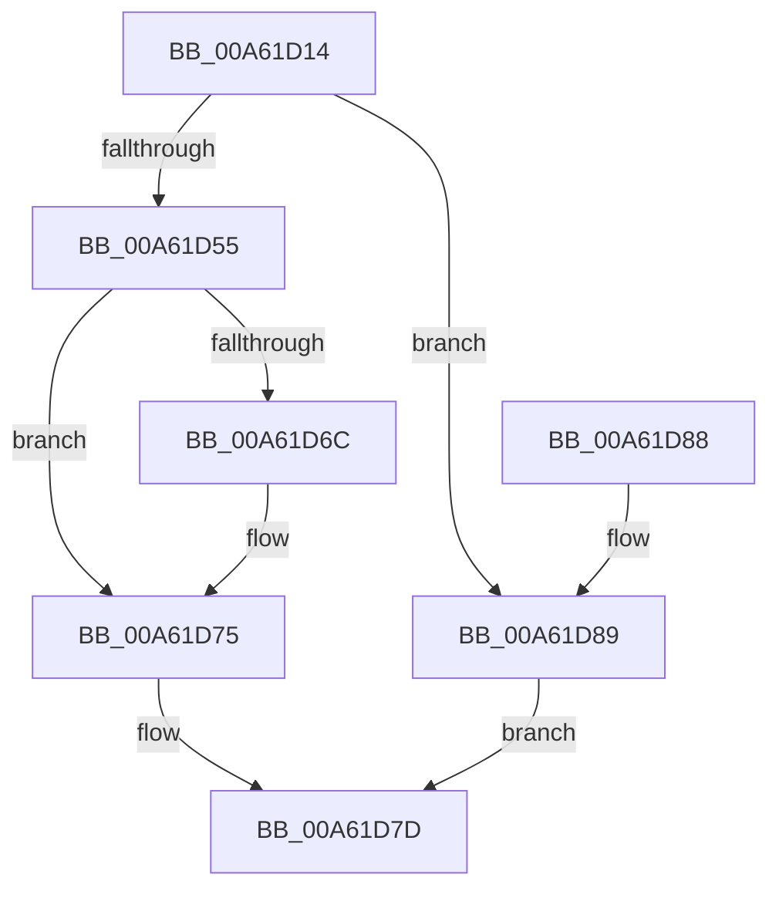

# SmSwapStore

- RVA: `0x00A61D14`–`0x00A61D90` (길이 `124` bytes)
- VA: `0x0000000140A61D14`
- 실행 섹션: `PAGE`
- PDB 이름 있음: `예`; PDB Function 태그: `아니요`
- unwind 정보 RVA: `0x00095058`
- 디코드: `33`개 명령, `124/124` bytes 표시
- 미해석 바이트: `0` (있으면 어셈블리에 `.byte`로 보존)

> 이 문서는 커널 이미지의 기계어와 PDB 기호를 분석해 생성했습니다. 4번과 5번은 함수 원형과 자료형을 바이너리 사용 방식에서 추정한 C 해석이며 원본 소스 복구 결과는 아닙니다.

## 1. Dependencies

- 직접 호출 지점: **3**; 고유 호출 대상: **3**
- 직접 호출자로 확인된 함수: **3**
- RIP 상대 이미지 참조: **0**

### Outgoing calls
- `0x00A61D4B` → [SmpKeyedStoreEntryGet](../../text/34/SmpKeyedStoreEntryGet_function_00349FB0.md) (function, `0x00349FB0`)
- `0x00A61D5C` → [SmKmStoreGet](../../text/34/SmKmStoreGet_function_00349F24.md) (function, `0x00349F24`)
- `0x00A61D78` → [SMKM_STORE_MGR<SM_TRAITS>::SmSwapStore](../../text/49/SMKM_STORE_MGR_SM_TRAITS_SmSwapStore_function_004969D4.md) (function, `0x004969D4`)

### Direct callers
- [SmStoreCompressionStop](SmStoreCompressionStop_function_00A6197C.md) at `0x00A61A7A`
- [SmStoreCompressionStop](SmStoreCompressionStop_function_00A6197C.md) at `0x00A61AA1`
- [SmStoreCompressionStart](SmStoreCompressionStart_function_00A61AD0.md) at `0x00A61B67`
- [MiInSwapStoreWorker](MiInSwapStoreWorker_function_00A61C60.md) at `0x00A61CAC`

### Static image references
- 디코드된 RIP-relative 메모리 참조가 없습니다.

## 2. Other-region calls and transfers

- 다른 실행 섹션으로 향하는 call: **3**
  - `0x00A61D4B` → [SmpKeyedStoreEntryGet](../../text/34/SmpKeyedStoreEntryGet_function_00349FB0.md) (`PAGE` → `.text`)
  - `0x00A61D5C` → [SmKmStoreGet](../../text/34/SmKmStoreGet_function_00349F24.md) (`PAGE` → `.text`)
  - `0x00A61D78` → [SMKM_STORE_MGR<SM_TRAITS>::SmSwapStore](../../text/49/SMKM_STORE_MGR_SM_TRAITS_SmSwapStore_function_004969D4.md) (`PAGE` → `.text`)
- 별도 외부 분기/꼬리 이동을 확인하지 못했습니다.

## 3. Assembly (complete function range)

```asm
00A61D14  48 89 5C 24 10                  mov qword ptr [rsp + 0x10], rbx
00A61D19  57                              push rdi
00A61D1A  48 83 EC 20                     sub rsp, 0x20
00A61D1E  65 48 8B 04 25 88 01 00 00      mov rax, qword ptr gs:[0x188]
00A61D27  8B FA                           mov edi, edx
00A61D29  48 8B 59 18                     mov rbx, qword ptr [rcx + 0x18]
00A61D2D  48 8D 54 24 30                  lea rdx, [rsp + 0x30]
00A61D32  45 33 C9                        xor r9d, r9d
00A61D35  45 33 C0                        xor r8d, r8d
00A61D38  48 8B 88 B8 00 00 00            mov rcx, qword ptr [rax + 0xb8]
00A61D3F  48 89 4C 24 30                  mov qword ptr [rsp + 0x30], rcx
00A61D44  48 8D 8B B8 08 00 00            lea rcx, [rbx + 0x8b8]
00A61D4B  E8 60 82 8E FF                  call 0x140349fb0
00A61D50  48 85 C0                        test rax, rax
00A61D53  74 34                           je 0x140a61d89
00A61D55  0F B7 50 10                     movzx edx, word ptr [rax + 0x10]
00A61D59  48 8B CB                        mov rcx, rbx
00A61D5C  E8 C3 81 8E FF                  call 0x140349f24
00A61D61  41 B8 02 00 00 00               mov r8d, 2
00A61D67  41 3B F8                        cmp edi, r8d
00A61D6A  74 09                           je 0x140a61d75
00A61D6C  45 33 C0                        xor r8d, r8d
00A61D6F  85 FF                           test edi, edi
00A61D71  41 0F 95 C0                     setne r8b
00A61D75  48 8B D0                        mov rdx, rax
00A61D78  E8 57 4C A3 FF                  call 0x1404969d4
00A61D7D  48 8B 5C 24 38                  mov rbx, qword ptr [rsp + 0x38]
00A61D82  48 83 C4 20                     add rsp, 0x20
00A61D86  5F                              pop rdi
00A61D87  C3                              ret
00A61D88  CC                              int3
00A61D89  B8 25 02 00 C0                  mov eax, 0xc0000225
00A61D8E  EB ED                           jmp 0x140a61d7d
```

## 4. C-style interpretation (structured pseudocode)

```c
__int64 __fastcall SmSwapStore(__int64 a1, int a2, int a3, int a4)
{
    __int64 result;
    __int64 v_rsp;
    unsigned __int64 v_stack_p10;
    unsigned __int64 v_stack_p8;

    v_stack_p10 = v_rbx;
    v_rsp = (v_rsp) - (32);
    a4 = 0;
    a3 = 0;
    v_stack_p8 = *(unsigned __int64 *)(*(unsigned __int64 *)(gs_base + (0 + 392)) + 184);
    result = SmpKeyedStoreEntryGet(*(unsigned __int64 *)(a1 + 24) + 2232, v_stack_p8, a3, a4);
    if (result == 0) goto loc_00A61D89;
    result = SmKmStoreGet(*(unsigned __int64 *)(a1 + 24), *(unsigned __int16 *)(result + 16), a3, a4);
    if (((unsigned int)((unsigned int)(a2))) != 2) {
        a3 = 0;
        a3 = ((unsigned int)((unsigned int)(a2)) != 0) ? 1 : 0;
    }
    result = SMKM_STORE_MGR_SM_TRAITS___SmSwapStore(*(unsigned __int64 *)(a1 + 24), result, a3, a4);
loc_00A61D7D:
    v_rsp = (v_rsp) + (32);
    return result;
loc_00A61D89:
    goto loc_00A61D7D;
}
```

## 5. (Beta) C Style

```c
int64_t SmSwapStore(void *Arg1, int32_t Arg2, int32_t Arg3, int32_t Arg4)
{
    uint8_t *arg1 = (uint8_t *)Arg1;

    int64_t result;
    int64_t local_rsp;
    uint64_t v_stack_p10;
    uint64_t v_stack_p8;

    v_stack_p10 = local_rbx;
    local_rsp = (local_rsp) - (32);
    Arg4 = 0;
    Arg3 = 0;
    v_stack_p8 = *(uint64_t *)(*(uint64_t *)(gs_base + (0 + 0x188)) + 0xB8);
    result = SmpKeyedStoreEntryGet(*(uint64_t *)(arg1 + 0x18) + 2232, v_stack_p8, Arg3, Arg4);
    if (result == 0) goto loc_00A61D89;
    result = SmKmStoreGet(*(uint64_t *)(arg1 + 0x18), *(uint16_t *)(result + 0x10), Arg3, Arg4);
    if (((uint32_t)((uint32_t)(Arg2))) != 2) {
        Arg3 = 0;
        Arg3 = ((uint32_t)((uint32_t)(Arg2)) != 0) ? 1 : 0;
    }
    result = SMKM_STORE_MGR_SM_TRAITS___SmSwapStore(*(uint64_t *)(arg1 + 0x18), result, Arg3, Arg4);
loc_00A61D7D:
    local_rsp = (local_rsp) + (32);
    return result;
loc_00A61D89:
    goto loc_00A61D7D;
}
```

### 관측된 메모리 오프셋

구조체 형식이 확인되지 않은 접근은 인자 기준의 오프셋으로만 기록했습니다.

| 기준 인자 | 오프셋 표현 | 폭 (bit) | 접근 |
|---|---:|---:|---|
| `Arg1` | `+ 0x18` | `64` | `R` |

## 6. Execution-region graph

[열기: 2D/3D 그래프와 함수 탐색 컨트롤 패널](../../../control-panel.html?section=page&rva=0x00A61D14&view=graph)

- 2D 그래프는 위에서 아래로 흐르고, 3D 그래프는 빈 공간을 드래그해 회전합니다. Shift+드래그는 이동, 휠은 확대·축소, 함수 노드 선택은 대상 보고서 이동입니다.

### Static fallback


