# SshNotifySystemSessionChange

- RVA: `0x00A602BC`–`0x00A606ED` (길이 `1,073` bytes)
- VA: `0x0000000140A602BC`
- 실행 섹션: `PAGE`
- PDB 이름 있음: `예`; PDB Function 태그: `아니요`
- unwind 정보 RVA: `0x000B2F70`
- 디코드: `275`개 명령, `1,073/1,073` bytes 표시
- 미해석 바이트: `0` (있으면 어셈블리에 `.byte`로 보존)

> 이 문서는 커널 이미지의 기계어와 PDB 기호를 분석해 생성했습니다. 4번과 5번은 함수 원형과 자료형을 바이너리 사용 방식에서 추정한 C 해석이며 원본 소스 복구 결과는 아닙니다.

## 1. Dependencies

- 직접 호출 지점: **23**; 고유 호출 대상: **12**
- 직접 호출자로 확인된 함수: **1**
- RIP 상대 이미지 참조: **8**

### Outgoing calls
- `0x00A6030E` → [memset](../../text/6C/memset_function_006C6C40.md) (function, `0x006C6C40`)
- `0x00A6031F` → [memset](../../text/6C/memset_function_006C6C40.md) (function, `0x006C6C40`)
- `0x00A60335` → [memset](../../text/6C/memset_function_006C6C40.md) (function, `0x006C6C40`)
- `0x00A60408` → [_security_check_cookie](../../text/6A/_security_check_cookie_function_006AC640.md) (function, `0x006AC640`)
- `0x00A60458` → [KeAbPreAcquire](../../text/21/KeAbPreAcquire_function_00210230.md) (function, `0x00210230`)
- `0x00A60472` → [ExfAcquirePushLockExclusiveEx](../../text/20/ExfAcquirePushLockExclusiveEx_function_0020FC90.md) (function, `0x0020FC90`)
- `0x00A604C6` → [SshpQueryAndResetBlockerAccounting](../../text/48/SshpQueryAndResetBlockerAccounting_function_00484F4C.md) (function, `0x00484F4C`)
- `0x00A60508` → [SshpWriteBlocker](../../text/49/SshpWriteBlocker_function_00496300.md) (function, `0x00496300`)
- `0x00A60520` → [SshpDereferenceBlocker](../../text/48/SshpDereferenceBlocker_function_00486960.md) (function, `0x00486960`)
- `0x00A60531` → [SshpReferenceBlocker](../../text/49/SshpReferenceBlocker_function_0049164C.md) (function, `0x0049164C`)
- `0x00A60553` → [SSHSupportReleasePushLockExclusive](../../text/49/SSHSupportReleasePushLockExclusive_function_004954EC.md) (function, `0x004954EC`)
- `0x00A60577` → [memset](../../text/6C/memset_function_006C6C40.md) (function, `0x006C6C40`)
- `0x00A6058B` → [KeAbPreAcquire](../../text/21/KeAbPreAcquire_function_00210230.md) (function, `0x00210230`)
- `0x00A605A4` → [ExfAcquirePushLockExclusiveEx](../../text/20/ExfAcquirePushLockExclusiveEx_function_0020FC90.md) (function, `0x0020FC90`)
- `0x00A605D1` → [KeAbPreAcquire](../../text/21/KeAbPreAcquire_function_00210230.md) (function, `0x00210230`)
- `0x00A605EA` → [ExfAcquirePushLockExclusiveEx](../../text/20/ExfAcquirePushLockExclusiveEx_function_0020FC90.md) (function, `0x0020FC90`)
- `0x00A60616` → [SshpFlushBlockerDataCache](SshpFlushBlockerDataCache_function_00A606F4.md) (function, `0x00A606F4`)
- `0x00A6061E` → [SSHSupportReleasePushLockExclusive](../../text/49/SSHSupportReleasePushLockExclusive_function_004954EC.md) (function, `0x004954EC`)
- `0x00A6062F` → [SSHSupportReleasePushLockExclusive](../../text/49/SSHSupportReleasePushLockExclusive_function_004954EC.md) (function, `0x004954EC`)
- `0x00A60688` → [guard_dispatch_icall](../../text/6B/guard_dispatch_icall_function_006BAAD0.md) (function, `0x006BAAD0`)
- `0x00A606C3` → [SshpFlushBlockerDataCache](SshpFlushBlockerDataCache_function_00A606F4.md) (function, `0x00A606F4`)
- `0x00A606D7` → [CmpFreePoolWithTag](../../text/44/CmpFreePoolWithTag_function_004489E0.md) (function, `0x004489E0`)
- `0x00A606E3` → [CmpFreePoolWithTag](../../text/44/CmpFreePoolWithTag_function_004489E0.md) (function, `0x004489E0`)

### Direct callers
- [PopSleepstudyStartNextSession](../AC/PopSleepstudyStartNextSession_function_00AC4720.md) at `0x00AC4B75`

### Static image references
- `0x00A602E2` → RVA `0x00E0A740` (`.data`; read)
- `0x00A6033A` → RVA `0x00F07018` (`.data`; read)
- `0x00A60341` → RVA `0x00F07040` (`.data`; read)
- `0x00A60368` → RVA `0x00E0841C` (`.data`; read)
- `0x00A603F1` → RVA `0x00F07040` (`.data`; write)
- `0x00A603F8` → RVA `0x00F07018` (`.data`; write)
- `0x00A6057C` → RVA `0x00F07030` (`.data`; read)
- `0x00A605B2` → RVA `0x00F07020` (`.data`; read)

## 2. Other-region calls and transfers

- 다른 실행 섹션으로 향하는 call: **21**
  - `0x00A6030E` → [memset](../../text/6C/memset_function_006C6C40.md) (`PAGE` → `.text`)
  - `0x00A6031F` → [memset](../../text/6C/memset_function_006C6C40.md) (`PAGE` → `.text`)
  - `0x00A60335` → [memset](../../text/6C/memset_function_006C6C40.md) (`PAGE` → `.text`)
  - `0x00A60408` → [_security_check_cookie](../../text/6A/_security_check_cookie_function_006AC640.md) (`PAGE` → `.text`)
  - `0x00A60458` → [KeAbPreAcquire](../../text/21/KeAbPreAcquire_function_00210230.md) (`PAGE` → `.text`)
  - `0x00A60472` → [ExfAcquirePushLockExclusiveEx](../../text/20/ExfAcquirePushLockExclusiveEx_function_0020FC90.md) (`PAGE` → `.text`)
  - `0x00A604C6` → [SshpQueryAndResetBlockerAccounting](../../text/48/SshpQueryAndResetBlockerAccounting_function_00484F4C.md) (`PAGE` → `.text`)
  - `0x00A60508` → [SshpWriteBlocker](../../text/49/SshpWriteBlocker_function_00496300.md) (`PAGE` → `.text`)
  - `0x00A60520` → [SshpDereferenceBlocker](../../text/48/SshpDereferenceBlocker_function_00486960.md) (`PAGE` → `.text`)
  - `0x00A60531` → [SshpReferenceBlocker](../../text/49/SshpReferenceBlocker_function_0049164C.md) (`PAGE` → `.text`)
  - `0x00A60553` → [SSHSupportReleasePushLockExclusive](../../text/49/SSHSupportReleasePushLockExclusive_function_004954EC.md) (`PAGE` → `.text`)
  - `0x00A60577` → [memset](../../text/6C/memset_function_006C6C40.md) (`PAGE` → `.text`)
  - `0x00A6058B` → [KeAbPreAcquire](../../text/21/KeAbPreAcquire_function_00210230.md) (`PAGE` → `.text`)
  - `0x00A605A4` → [ExfAcquirePushLockExclusiveEx](../../text/20/ExfAcquirePushLockExclusiveEx_function_0020FC90.md) (`PAGE` → `.text`)
  - `0x00A605D1` → [KeAbPreAcquire](../../text/21/KeAbPreAcquire_function_00210230.md) (`PAGE` → `.text`)
  - `0x00A605EA` → [ExfAcquirePushLockExclusiveEx](../../text/20/ExfAcquirePushLockExclusiveEx_function_0020FC90.md) (`PAGE` → `.text`)
  - `0x00A6061E` → [SSHSupportReleasePushLockExclusive](../../text/49/SSHSupportReleasePushLockExclusive_function_004954EC.md) (`PAGE` → `.text`)
  - `0x00A6062F` → [SSHSupportReleasePushLockExclusive](../../text/49/SSHSupportReleasePushLockExclusive_function_004954EC.md) (`PAGE` → `.text`)
  - `0x00A60688` → [guard_dispatch_icall](../../text/6B/guard_dispatch_icall_function_006BAAD0.md) (`PAGE` → `.text`)
  - `0x00A606D7` → [CmpFreePoolWithTag](../../text/44/CmpFreePoolWithTag_function_004489E0.md) (`PAGE` → `.text`)
  - `0x00A606E3` → [CmpFreePoolWithTag](../../text/44/CmpFreePoolWithTag_function_004489E0.md) (`PAGE` → `.text`)
- 별도 외부 분기/꼬리 이동을 확인하지 못했습니다.

## 3. Assembly (complete function range)

```asm
00A602BC  48 8B C4                        mov rax, rsp
00A602BF  48 89 58 08                     mov qword ptr [rax + 8], rbx
00A602C3  48 89 70 10                     mov qword ptr [rax + 0x10], rsi
00A602C7  48 89 78 18                     mov qword ptr [rax + 0x18], rdi
00A602CB  55                              push rbp
00A602CC  41 54                           push r12
00A602CE  41 55                           push r13
00A602D0  41 56                           push r14
00A602D2  41 57                           push r15
00A602D4  48 8D A8 28 FE FF FF            lea rbp, [rax - 0x1d8]
00A602DB  48 81 EC B0 02 00 00            sub rsp, 0x2b0
00A602E2  48 8B 05 57 A4 3A 00            mov rax, qword ptr [rip + 0x3aa457]
00A602E9  48 33 C4                        xor rax, rsp
00A602EC  48 89 85 A0 01 00 00            mov qword ptr [rbp + 0x1a0], rax
00A602F3  48 89 55 80                     mov qword ptr [rbp - 0x80], rdx
00A602F7  8B D9                           mov ebx, ecx
00A602F9  89 4C 24 44                     mov dword ptr [rsp + 0x44], ecx
00A602FD  BF 80 00 00 00                  mov edi, 0x80
00A60302  44 8B C7                        mov r8d, edi
00A60305  48 8D 8D 20 01 00 00            lea rcx, [rbp + 0x120]
00A6030C  33 D2                           xor edx, edx
00A6030E  E8 2D 69 C6 FF                  call 0x1406c6c40
00A60313  33 D2                           xor edx, edx
00A60315  48 8D 4D 90                     lea rcx, [rbp - 0x70]
00A60319  41 B8 08 01 00 00               mov r8d, 0x108
00A6031F  E8 1C 69 C6 FF                  call 0x1406c6c40
00A60324  44 8B C7                        mov r8d, edi
00A60327  C6 44 24 40 00                  mov byte ptr [rsp + 0x40], 0
00A6032C  33 D2                           xor edx, edx
00A6032E  48 8D 8D A0 00 00 00            lea rcx, [rbp + 0xa0]
00A60335  E8 06 69 C6 FF                  call 0x1406c6c40
00A6033A  83 3D D7 6C 4A 00 02            cmp dword ptr [rip + 0x4a6cd7], 2
00A60341  48 8B 15 F8 6C 4A 00            mov rdx, qword ptr [rip + 0x4a6cf8]
00A60348  48 89 54 24 78                  mov qword ptr [rsp + 0x78], rdx
00A6034D  4C 8B C2                        mov r8, rdx
00A60350  48 89 54 24 48                  mov qword ptr [rsp + 0x48], rdx
00A60355  0F 84 53 03 00 00               je 0x140a606ae
00A6035B  48 83 64 24 60 00               and qword ptr [rsp + 0x60], 0
00A60361  8B CB                           mov ecx, ebx
00A60363  83 64 24 50 00                  and dword ptr [rsp + 0x50], 0
00A60368  48 8D 1D AD 80 3A 00            lea rbx, [rip + 0x3a80ad]
00A6036F  41 BC 01 00 00 00               mov r12d, 1
00A60375  41 BE 09 00 00 00               mov r14d, 9
00A6037B  41 D3 E4                        shl r12d, cl
00A6037E  44 89 64 24 54                  mov dword ptr [rsp + 0x54], r12d
00A60383  4C 89 74 24 58                  mov qword ptr [rsp + 0x58], r14
00A60388  0F B6 43 FE                     movzx eax, byte ptr [rbx - 2]
00A6038C  BF 01 00 00 00                  mov edi, 1
00A60391  8B 0D 81 6C 4A 00               mov ecx, dword ptr [rip + 0x4a6c81]
00A60397  44 8B F8                        mov r15d, eax
00A6039A  D3 E7                           shl edi, cl
00A6039C  23 F8                           and edi, eax
00A6039E  45 23 FC                        and r15d, r12d
00A603A1  0F 85 88 00 00 00               jne 0x140a6042f
00A603A7  85 FF                           test edi, edi
00A603A9  0F 85 80 00 00 00               jne 0x140a6042f
00A603AF  4C 8B 44 24 48                  mov r8, qword ptr [rsp + 0x48]
00A603B4  48 83 C3 30                     add rbx, 0x30
00A603B8  49 83 EE 01                     sub r14, 1
00A603BC  4C 89 74 24 58                  mov qword ptr [rsp + 0x58], r14
00A603C1  75 C5                           jne 0x140a60388
00A603C3  8B 05 4F 6C 4A 00               mov eax, dword ptr [rip + 0x4a6c4f]
00A603C9  83 F8 02                        cmp eax, 2
00A603CC  0F 84 99 01 00 00               je 0x140a6056b
00A603D2  8B 5C 24 44                     mov ebx, dword ptr [rsp + 0x44]
00A603D6  83 F8 01                        cmp eax, 1
00A603D9  0F 84 83 01 00 00               je 0x140a60562
00A603DF  48 8B 4C 24 60                  mov rcx, qword ptr [rsp + 0x60]
00A603E4  48 85 C9                        test rcx, rcx
00A603E7  0F 85 F1 02 00 00               jne 0x140a606de
00A603ED  48 8B 45 80                     mov rax, qword ptr [rbp - 0x80]
00A603F1  48 89 05 48 6C 4A 00            mov qword ptr [rip + 0x4a6c48], rax
00A603F8  89 1D 1A 6C 4A 00               mov dword ptr [rip + 0x4a6c1a], ebx
00A603FE  48 8B 8D A0 01 00 00            mov rcx, qword ptr [rbp + 0x1a0]
00A60405  48 33 CC                        xor rcx, rsp
00A60408  E8 33 C2 C4 FF                  call 0x1406ac640
00A6040D  4C 8D 9C 24 B0 02 00 00         lea r11, [rsp + 0x2b0]
00A60415  49 8B 5B 30                     mov rbx, qword ptr [r11 + 0x30]
00A60419  49 8B 73 38                     mov rsi, qword ptr [r11 + 0x38]
00A6041D  49 8B 7B 40                     mov rdi, qword ptr [r11 + 0x40]
00A60421  49 8B E3                        mov rsp, r11
00A60424  41 5F                           pop r15
00A60426  41 5E                           pop r14
00A60428  41 5D                           pop r13
00A6042A  41 5C                           pop r12
00A6042C  5D                              pop rbp
00A6042D  C3                              ret
00A6042E  CC                              int3
00A6042F  8A 43 FD                        mov al, byte ptr [rbx - 3]
00A60432  4C 8D 6B E4                     lea r13, [rbx - 0x1c]
00A60436  84 C0                           test al, al
00A60438  48 8B CA                        mov rcx, rdx
00A6043B  49 0F 44 C8                     cmove rcx, r8
00A6043F  48 89 4C 24 68                  mov qword ptr [rsp + 0x68], rcx
00A60444  33 C9                           xor ecx, ecx
00A60446  84 C0                           test al, al
00A60448  0F 95 C1                        setne cl
00A6044B  45 33 C0                        xor r8d, r8d
00A6044E  48 89 4C 24 70                  mov qword ptr [rsp + 0x70], rcx
00A60453  33 D2                           xor edx, edx
00A60455  49 8B CD                        mov rcx, r13
00A60458  E8 D3 FD 7A FF                  call 0x140210230
00A6045D  F0 49 0F BA 6D 00 00            lock bts qword ptr [r13], 0
00A60464  48 8B F0                        mov rsi, rax
00A60467  73 0E                           jae 0x140a60477
00A60469  4D 8B C5                        mov r8, r13
00A6046C  48 8B D0                        mov rdx, rax
00A6046F  49 8B CD                        mov rcx, r13
00A60472  E8 19 F8 7A FF                  call 0x14020fc90
00A60477  48 85 F6                        test rsi, rsi
00A6047A  74 04                           je 0x140a60480
00A6047C  C6 46 0A 01                     mov byte ptr [rsi + 0xa], 1
00A60480  41 8B C7                        mov eax, r15d
00A60483  F7 D8                           neg eax
00A60485  8B 03                           mov eax, dword ptr [rbx]
00A60487  1B C9                           sbb ecx, ecx
00A60489  83 E0 FD                        and eax, 0xfffffffd
00A6048C  83 E1 02                        and ecx, 2
00A6048F  0B C8                           or ecx, eax
00A60491  48 8D 43 04                     lea rax, [rbx + 4]
00A60495  48 8B 30                        mov rsi, qword ptr [rax]
00A60498  89 0B                           mov dword ptr [rbx], ecx
00A6049A  48 3B F0                        cmp rsi, rax
00A6049D  0F 84 AD 00 00 00               je 0x140a60550
00A604A3  4C 8B 64 24 68                  mov r12, qword ptr [rsp + 0x68]
00A604A8  4C 8D 6B 04                     lea r13, [rbx + 4]
00A604AC  4C 8B 76 60                     mov r14, qword ptr [rsi + 0x60]
00A604B0  4C 8D 4C 24 40                  lea r9, [rsp + 0x40]
00A604B5  49 8B CE                        mov rcx, r14
00A604B8  4C 8D 85 A0 00 00 00            lea r8, [rbp + 0xa0]
00A604BF  48 8D 95 20 01 00 00            lea rdx, [rbp + 0x120]
00A604C6  E8 81 4A A2 FF                  call 0x140484f4c
00A604CB  85 FF                           test edi, edi
00A604CD  74 3E                           je 0x140a6050d
00A604CF  44 8A 4C 24 40                  mov r9b, byte ptr [rsp + 0x40]
00A604D4  48 8D 44 24 50                  lea rax, [rsp + 0x50]
00A604D9  48 89 44 24 38                  mov qword ptr [rsp + 0x38], rax
00A604DE  4C 8D 85 A0 00 00 00            lea r8, [rbp + 0xa0]
00A604E5  48 8D 44 24 60                  lea rax, [rsp + 0x60]
00A604EA  49 8B CE                        mov rcx, r14
00A604ED  48 89 44 24 30                  mov qword ptr [rsp + 0x30], rax
00A604F2  48 8D 95 20 01 00 00            lea rdx, [rbp + 0x120]
00A604F9  48 8B 44 24 70                  mov rax, qword ptr [rsp + 0x70]
00A604FE  48 89 44 24 28                  mov qword ptr [rsp + 0x28], rax
00A60503  4C 89 64 24 20                  mov qword ptr [rsp + 0x20], r12
00A60508  E8 F3 5D A3 FF                  call 0x140496300
00A6050D  45 85 FF                        test r15d, r15d
00A60510  75 15                           jne 0x140a60527
00A60512  85 FF                           test edi, edi
00A60514  74 20                           je 0x140a60536
00A60516  45 33 C0                        xor r8d, r8d
00A60519  41 8D 57 01                     lea edx, [r15 + 1]
00A6051D  49 8B CE                        mov rcx, r14
00A60520  E8 3B 64 A2 FF                  call 0x140486960
00A60525  EB 0F                           jmp 0x140a60536
00A60527  85 FF                           test edi, edi
00A60529  75 0B                           jne 0x140a60536
00A6052B  8D 57 01                        lea edx, [rdi + 1]
00A6052E  49 8B CE                        mov rcx, r14
00A60531  E8 16 11 A3 FF                  call 0x14049164c
00A60536  48 8B 36                        mov rsi, qword ptr [rsi]
00A60539  49 3B F5                        cmp rsi, r13
00A6053C  0F 85 6A FF FF FF               jne 0x140a604ac
00A60542  44 8B 64 24 54                  mov r12d, dword ptr [rsp + 0x54]
00A60547  4C 8D 6B E4                     lea r13, [rbx - 0x1c]
00A6054B  4C 8B 74 24 58                  mov r14, qword ptr [rsp + 0x58]
00A60550  49 8B CD                        mov rcx, r13
00A60553  E8 94 4F A3 FF                  call 0x1404954ec
00A60558  48 8B 54 24 78                  mov rdx, qword ptr [rsp + 0x78]
00A6055D  E9 4D FE FF FF                  jmp 0x140a603af
00A60562  83 FB 02                        cmp ebx, 2
00A60565  0F 84 74 FE FF FF               je 0x140a603df
00A6056B  33 D2                           xor edx, edx
00A6056D  48 8D 4D 90                     lea rcx, [rbp - 0x70]
00A60571  41 B8 08 01 00 00               mov r8d, 0x108
00A60577  E8 C4 66 C6 FF                  call 0x1406c6c40
00A6057C  48 8D 3D AD 6A 4A 00            lea rdi, [rip + 0x4a6aad]
00A60583  45 33 C0                        xor r8d, r8d
00A60586  48 8B CF                        mov rcx, rdi
00A60589  33 D2                           xor edx, edx
00A6058B  E8 A0 FC 7A FF                  call 0x140210230
00A60590  F0 48 0F BA 2F 00               lock bts qword ptr [rdi], 0
00A60596  48 8B D8                        mov rbx, rax
00A60599  73 0E                           jae 0x140a605a9
00A6059B  4C 8B C7                        mov r8, rdi
00A6059E  48 8B D0                        mov rdx, rax
00A605A1  48 8B CF                        mov rcx, rdi
00A605A4  E8 E7 F6 7A FF                  call 0x14020fc90
00A605A9  48 85 DB                        test rbx, rbx
00A605AC  74 04                           je 0x140a605b2
00A605AE  C6 43 0A 01                     mov byte ptr [rbx + 0xa], 1
00A605B2  48 8B 3D 67 6A 4A 00            mov rdi, qword ptr [rip + 0x4a6a67]
00A605B9  48 8D 05 60 6A 4A 00            lea rax, [rip + 0x4a6a60]
00A605C0  48 3B F8                        cmp rdi, rax
00A605C3  74 63                           je 0x140a60628
00A605C5  48 8D 77 10                     lea rsi, [rdi + 0x10]
00A605C9  45 33 C0                        xor r8d, r8d
00A605CC  48 8B CE                        mov rcx, rsi
00A605CF  33 D2                           xor edx, edx
00A605D1  E8 5A FC 7A FF                  call 0x140210230
00A605D6  F0 48 0F BA 2E 00               lock bts qword ptr [rsi], 0
00A605DC  48 8B D8                        mov rbx, rax
00A605DF  73 0E                           jae 0x140a605ef
00A605E1  4C 8B C6                        mov r8, rsi
00A605E4  48 8B D0                        mov rdx, rax
00A605E7  48 8B CE                        mov rcx, rsi
00A605EA  E8 A1 F6 7A FF                  call 0x14020fc90
00A605EF  48 85 DB                        test rbx, rbx
00A605F2  74 04                           je 0x140a605f8
00A605F4  C6 43 0A 01                     mov byte ptr [rbx + 0xa], 1
00A605F8  8B 47 18                        mov eax, dword ptr [rdi + 0x18]
00A605FB  4C 8D BF A8 00 00 00            lea r15, [rdi + 0xa8]
00A60602  89 45 90                        mov dword ptr [rbp - 0x70], eax
00A60605  49 8B 1F                        mov rbx, qword ptr [r15]
00A60608  49 3B DF                        cmp rbx, r15
00A6060B  75 30                           jne 0x140a6063d
00A6060D  48 8B 54 24 48                  mov rdx, qword ptr [rsp + 0x48]
00A60612  48 8D 4D 90                     lea rcx, [rbp - 0x70]
00A60616  E8 D9 00 00 00                  call 0x140a606f4
00A6061B  48 8B CE                        mov rcx, rsi
00A6061E  E8 C9 4E A3 FF                  call 0x1404954ec
00A60623  48 8B 3F                        mov rdi, qword ptr [rdi]
00A60626  EB 91                           jmp 0x140a605b9
00A60628  48 8D 0D 01 6A 4A 00            lea rcx, [rip + 0x4a6a01]
00A6062F  E8 B8 4E A3 FF                  call 0x1404954ec
00A60634  8B 5C 24 44                     mov ebx, dword ptr [rsp + 0x44]
00A60638  E9 A2 FD FF FF                  jmp 0x140a603df
00A6063D  48 8B 74 24 48                  mov rsi, qword ptr [rsp + 0x48]
00A60642  45 33 F6                        xor r14d, r14d
00A60645  44 39 73 28                     cmp dword ptr [rbx + 0x28], r14d
00A60649  76 52                           jbe 0x140a6069d
00A6064B  4C 8D 6B 18                     lea r13, [rbx + 0x18]
00A6064F  83 7D 94 08                     cmp dword ptr [rbp - 0x6c], 8
00A60653  73 67                           jae 0x140a606bc
00A60655  44 8B 65 94                     mov r12d, dword ptr [rbp - 0x6c]
00A60659  0F 57 C0                        xorps xmm0, xmm0
00A6065C  49 C1 E4 05                     shl r12, 5
00A60660  41 8B CE                        mov ecx, r14d
00A60663  48 C1 E1 05                     shl rcx, 5
00A60667  48 83 C1 30                     add rcx, 0x30
00A6066B  48 03 CB                        add rcx, rbx
00A6066E  4E 89 6C 25 A0                  mov qword ptr [rbp + r12 - 0x60], r13
00A60673  4A 89 4C 25 98                  mov qword ptr [rbp + r12 - 0x68], rcx
00A60678  4A 8D 54 25 A8                  lea rdx, [rbp + r12 - 0x58]
00A6067D  0F 11 02                        movups xmmword ptr [rdx], xmm0
00A60680  48 8B 41 18                     mov rax, qword ptr [rcx + 0x18]
00A60684  48 8B 49 10                     mov rcx, qword ptr [rcx + 0x10]
00A60688  E8 43 A4 C5 FF                  call 0x1406baad0
00A6068D  85 C0                           test eax, eax
00A6068F  78 39                           js 0x140a606ca
00A60691  FF 45 94                        inc dword ptr [rbp - 0x6c]
00A60694  41 FF C6                        inc r14d
00A60697  44 3B 73 28                     cmp r14d, dword ptr [rbx + 0x28]
00A6069B  72 B2                           jb 0x140a6064f
00A6069D  48 8B 1B                        mov rbx, qword ptr [rbx]
00A606A0  49 3B DF                        cmp rbx, r15
00A606A3  75 9D                           jne 0x140a60642
00A606A5  48 8D 77 10                     lea rsi, [rdi + 0x10]
00A606A9  E9 5F FF FF FF                  jmp 0x140a6060d
00A606AE  4C 8D 42 FF                     lea r8, [rdx - 1]
00A606B2  4C 89 44 24 48                  mov qword ptr [rsp + 0x48], r8
00A606B7  E9 9F FC FF FF                  jmp 0x140a6035b
00A606BC  48 8B D6                        mov rdx, rsi
00A606BF  48 8D 4D 90                     lea rcx, [rbp - 0x70]
00A606C3  E8 2C 00 00 00                  call 0x140a606f4
00A606C8  EB 8B                           jmp 0x140a60655
00A606CA  4A 8B 4C 25 B0                  mov rcx, qword ptr [rbp + r12 - 0x50]
00A606CF  48 85 C9                        test rcx, rcx
00A606D2  74 C0                           je 0x140a60694
00A606D4  8B 55 90                        mov edx, dword ptr [rbp - 0x70]
00A606D7  E8 04 83 9E FF                  call 0x1404489e0
00A606DC  EB B6                           jmp 0x140a60694
00A606DE  BA 73 73 68 70                  mov edx, 0x70687373
00A606E3  E8 F8 82 9E FF                  call 0x1404489e0
00A606E8  E9 00 FD FF FF                  jmp 0x140a603ed
```

## 4. C-style interpretation (structured pseudocode)

```c
__int64 __fastcall SshNotifySystemSessionChange(int a1, __int64 a2)
{
    __int64 result;
    __int64 v_r12;
    __int64 v_r14;
    __int64 v_r15;
    __int64 v_rbx;
    __int64 v_rdi;
    __int64 v_rsp;
    unsigned __int64 v_stack_m238;
    unsigned __int64 v_stack_m240;
    unsigned __int64 v_stack_m248;
    unsigned __int64 v_stack_m250;
    unsigned __int64 v_stack_m258;
    unsigned int v_stack_m25C;
    unsigned __int64 v_stack_m260;
    unsigned __int64 v_stack_m268;
    unsigned int v_stack_m26C;
    unsigned __int64 v_stack_m270;
    unsigned __int64 v_stack_m278;
    unsigned __int64 v_stack_m28;
    unsigned __int64 v_stack_m280;
    unsigned int v_stack_m284;
    unsigned int v_stack_m288;
    unsigned __int64 v_stack_m290;
    unsigned int v_stack_m294;
    unsigned __int8 v_stack_m298;

    *(unsigned __int64 *)(v_rsp + 8) = v_rbx;
    *(unsigned __int64 *)(v_rsp + 16) = v_rsi;
    *(unsigned __int64 *)(v_rsp + 24) = v_rdi;
    v_rsp = (v_rsp) - (688);
    result = (*(unsigned __int64 *)(v_rip + 3843159)) ^ (v_rsp);
    *(unsigned __int64 *)(v_rsp - 472 + 416) = result;
    *(unsigned __int64 *)(v_rsp - 472 - 128) = a2;
    v_stack_m294 = a1;
    a2 = 0;
    result = memset(v_rsp - 472 + 288, a2, 128, a4);
    a2 = 0;
    result = memset(v_rsp - 472 - 112, a2, 264, a4);
    v_stack_m298 = 0;
    a2 = 0;
    result = memset(v_rsp - 472 + 160, a2, 128, a4);
    v_stack_m260 = *(unsigned __int64 *)(v_rip + 4877560);
    v_stack_m290 = *(unsigned __int64 *)(v_rip + 4877560);
    if ((*(unsigned int *)(v_rip + 4877527)) == 2) goto loc_00A606AE;
loc_00A6035B:
    v_r12 = (unsigned int)((1) << ((unsigned __int8)((unsigned int)((unsigned int)((unsigned int)(a1))))));
    v_stack_m284 = (unsigned int)(v_r12);
    v_stack_m280 = 9;
loc_00A60388:
    v_rdi = (unsigned int)((1) << ((unsigned __int8)((unsigned int)(*(unsigned int *)(v_rip + 4877441)))));
    v_rdi = (unsigned int)((v_rdi) & ((unsigned int)(*(unsigned __int8 *)(v_rip + 3834029 - 2))));
    v_r15 = (unsigned int)(((unsigned int)((unsigned int)(*(unsigned __int8 *)(v_rip + 3834029 - 2)))) & ((unsigned int)(v_r12)));
    if (condition_is_not_equal) goto loc_00A6042F;
    if ((unsigned int)(v_rdi) != 0) goto loc_00A6042F;
loc_00A603AF:
    v_rbx = (v_rip + 3834029) + (48);
    v_r14 = (9) - (1);
    v_stack_m280 = v_r14;
    if (condition_is_not_equal) goto loc_00A60388;
    if (((unsigned int)((unsigned int)(*(unsigned int *)(v_rip + 4877391)))) == 2) goto loc_00A6056B;
    if (((unsigned int)((unsigned int)(*(unsigned int *)(v_rip + 4877391)))) == 1) goto loc_00A60562;
loc_00A603DF:
    if (v_stack_m278 != 0) goto loc_00A606DE;
loc_00A603ED:
    *(unsigned __int64 *)(v_rip + 4877384) = *(unsigned __int64 *)(v_rsp - 472 - 128);
    *(unsigned int *)(v_rip + 4877338) = (unsigned int)((unsigned int)(v_stack_m294));
    a1 = (*(unsigned __int64 *)(v_rsp - 472 + 416)) ^ (v_rsp);
    result = _security_check_cookie(a1, *(unsigned __int64 *)(v_rip + 4877560), v_stack_m290, a4);
    return result;
loc_00A6042F:
    a1 = *(unsigned __int64 *)(v_rip + 4877560);
    if ((unsigned __int8)(*(unsigned __int8 *)(*(unsigned __int64 *)(v_stack_m28 + 48) - 3)) == 0) { a1 = v_stack_m290; }
    v_stack_m248 = a1;
    a1 = 0;
    a1 = ((unsigned __int8)(*(unsigned __int8 *)(*(unsigned __int64 *)(v_stack_m28 + 48) - 3)) != 0) ? 1 : 0;
    a3 = 0;
    v_stack_m240 = a1;
    a2 = 0;
    result = KeAbPreAcquire(*(unsigned __int64 *)(v_stack_m28 + 48) - 28, a2, a3, a4);
    if (!(condition_is_above_or_equal)) {
        a3 = *(unsigned __int64 *)(v_stack_m28 + 48) - 28;
        a2 = result;
        a1 = *(unsigned __int64 *)(v_stack_m28 + 48) - 28;
        result = ExfAcquirePushLockExclusiveEx(a1, a2, a3, a4);
    }
    if (result != 0) {
        *(unsigned __int8 *)(result + 10) = 1;
    }
    result = (unsigned int)(-((unsigned int)((unsigned int)(v_r15))));
    result = (unsigned int)(((unsigned int)(*(unsigned int *)(*(unsigned __int64 *)(v_stack_m28 + 48)))) & (0xFFFFFFFDULL));
    a1 = (unsigned int)((a1) & (2));
    a1 = (unsigned int)((a1) | ((unsigned int)(result)));
    *(unsigned int *)(*(unsigned __int64 *)(v_stack_m28 + 48)) = a1;
    if ((*(unsigned __int64 *)(*(unsigned __int64 *)(v_stack_m28 + 48) + 4)) == (*(unsigned __int64 *)(v_stack_m28 + 48) + 4)) goto loc_00A60550;
loc_00A604AC:
    result = SshpQueryAndResetBlockerAccounting(*(unsigned __int64 *)(*(unsigned __int64 *)(*(unsigned __int64 *)(v_stack_m28 + 48) + 4) + 96), v_rsp - 472 + 288, v_rsp - 472 + 160, v_stack_m270);
    if ((unsigned int)(*(unsigned __int64 *)(v_stack_m28 + 64)) != 0) {
        a4 = v_stack_m270;
        result = v_stack_m260;
        v_stack_m278 = result;
        a3 = v_rsp - 472 + 160;
        result = v_stack_m250;
        a1 = *(unsigned __int64 *)(*(unsigned __int64 *)(*(unsigned __int64 *)(v_stack_m28 + 48) + 4) + 96);
        v_stack_m280 = result;
        a2 = v_rsp - 472 + 288;
        result = v_stack_m240;
        v_stack_m288 = result;
        v_stack_m290 = v_stack_m248;
        result = SshpWriteBlocker(a1, a2, a3, a4);
    }
    if ((unsigned int)(v_r15) != 0) goto loc_00A60527;
    if ((unsigned int)(*(unsigned __int64 *)(v_stack_m28 + 64)) == 0) goto loc_00A60536;
    a3 = 0;
    result = SshpDereferenceBlocker(*(unsigned __int64 *)(*(unsigned __int64 *)(*(unsigned __int64 *)(v_stack_m28 + 48) + 4) + 96), v_r15 + 1, a3, a4);
    goto loc_00A60536;
loc_00A60527:
    if ((unsigned int)(*(unsigned __int64 *)(v_stack_m28 + 64)) == 0) {
        a2 = *(unsigned __int64 *)(v_stack_m28 + 64) + 1;
        a1 = *(unsigned __int64 *)(*(unsigned __int64 *)(*(unsigned __int64 *)(v_stack_m28 + 48) + 4) + 96);
        result = SshpReferenceBlocker(a1, a2, a3, a4);
    }
    if ((*(unsigned __int64 *)(*(unsigned __int64 *)(*(unsigned __int64 *)(v_stack_m28 + 48) + 4))) != (*(unsigned __int64 *)(v_stack_m28 + 48) + 4)) goto loc_00A604AC;
loc_00A60550:
    result = SSHSupportReleasePushLockExclusive(*(unsigned __int64 *)(v_stack_m28 + 48) - 28, a2, a3, a4);
    goto loc_00A603AF;
loc_00A60562:
    if (((unsigned int)(*(unsigned __int64 *)(v_stack_m28 + 48))) == 2) goto loc_00A603DF;
loc_00A6056B:
    a2 = 0;
    result = memset(v_rsp - 472 - 112, a2, 264, a4);
    a3 = 0;
    a2 = 0;
    result = KeAbPreAcquire(v_rip + 4876973, a2, a3, a4);
    if (!(condition_is_above_or_equal)) {
        a3 = v_rip + 4876973;
        a2 = result;
        a1 = v_rip + 4876973;
        result = ExfAcquirePushLockExclusiveEx(a1, a2, a3, a4);
    }
    if (result != 0) {
        *(unsigned __int8 *)(result + 10) = 1;
    }
loc_00A605B9:
    if ((*(unsigned __int64 *)(v_rip + 4876903)) == (v_rip + 4876896)) goto loc_00A60628;
    a3 = 0;
    a2 = 0;
    result = KeAbPreAcquire(*(unsigned __int64 *)(v_rip + 4876903) + 16, a2, a3, a4);
    if (!(condition_is_above_or_equal)) {
        a3 = *(unsigned __int64 *)(v_rip + 4876903) + 16;
        a2 = result;
        a1 = *(unsigned __int64 *)(v_rip + 4876903) + 16;
        result = ExfAcquirePushLockExclusiveEx(a1, a2, a3, a4);
    }
    if (result != 0) {
        *(unsigned __int8 *)(result + 10) = 1;
    }
    *(unsigned int *)(v_rsp - 472 - 112) = (unsigned int)((unsigned int)(*(unsigned int *)(*(unsigned __int64 *)(v_rip + 4876903) + 24)));
    if ((*(unsigned __int64 *)(*(unsigned __int64 *)(v_rip + 4876903) + 168)) != (*(unsigned __int64 *)(v_rip + 4876903) + 168)) goto loc_00A6063D;
loc_00A6060D:
    result = SshpFlushBlockerDataCache(v_rsp - 472 - 112, v_stack_m268, a3, a4);
    result = SSHSupportReleasePushLockExclusive(*(unsigned __int64 *)(v_rip + 4876903) + 16, v_stack_m268, a3, a4);
    goto loc_00A605B9;
loc_00A60628:
    result = SSHSupportReleasePushLockExclusive(v_rip + 4876801, v_stack_m268, a3, a4);
    goto loc_00A603DF;
loc_00A6063D:
loc_00A60642:
    v_r14 = 0;
    if ((*(unsigned int *)((unsigned int)(v_stack_m26C) + 40)) <= 0) goto loc_00A6069D;
loc_00A6064F:
    if ((*(unsigned int *)(v_rsp - 472 - 108)) >= 8) goto loc_00A606BC;
loc_00A60655:
    v_r12 = ((unsigned int)(*(unsigned int *)(v_rsp - 472 - 108))) << (5);
    a1 = (0) << (5);
    a1 = (a1) + (48);
    a1 = (a1) + ((unsigned int)(v_stack_m26C));
    *(unsigned __int64 *)(v_rsp - 472 + v_r12 * 1 - 96) = (unsigned int)(v_stack_m26C) + 24;
    *(unsigned __int64 *)(v_rsp - 472 + v_r12 * 1 - 104) = a1;
    *(unsigned __int64 *)(v_rsp - 472 + v_r12 * 1 - 88) = v_xmm0;
    result = guard_dispatch_icall(*(unsigned __int64 *)(a1 + 16), v_rsp - 472 + v_r12 * 1 - 88, a3, a4);
    if (sign_flag) goto loc_00A606CA;
loc_00A60694:
    v_r14 = (unsigned int)((v_r14) + 1);
    if (((unsigned int)(v_r14)) < (*(unsigned int *)((unsigned int)(v_stack_m26C) + 40))) goto loc_00A6064F;
loc_00A6069D:
    if ((*(unsigned __int64 *)((unsigned int)(v_stack_m26C))) != (*(unsigned __int64 *)(v_rip + 4876903) + 168)) goto loc_00A60642;
    goto loc_00A6060D;
loc_00A606AE:
    v_stack_m268 = v_rsp - 472 + v_r12 * 1 - 88 - 1;
    goto loc_00A6035B;
loc_00A606BC:
    result = SshpFlushBlockerDataCache(v_rsp - 472 - 112, *(unsigned __int64 *)(*(unsigned __int64 *)(v_rip + 4876903)) + 16, v_rsp - 472 + v_r12 * 1 - 88 - 1, a4);
    goto loc_00A60655;
loc_00A606CA:
    if (*(unsigned __int64 *)(v_rsp - 472 + v_r12 * 1 - 80) == 0) goto loc_00A60694;
    result = CmpFreePoolWithTag(*(unsigned __int64 *)(v_rsp - 472 + v_r12 * 1 - 80), (unsigned int)(*(unsigned int *)(v_rsp - 472 - 112)), v_rsp - 472 + v_r12 * 1 - 88 - 1, a4);
    goto loc_00A60694;
loc_00A606DE:
    result = CmpFreePoolWithTag(*(unsigned __int64 *)(v_rsp - 472 + v_r12 * 1 - 80), (unsigned int)(0x70687373ULL), v_rsp - 472 + v_r12 * 1 - 88 - 1, a4);
    goto loc_00A603ED;
}
```

## 5. (Beta) C Style

```c
int64_t SshNotifySystemSessionChange(int32_t Arg1, int64_t Arg2)
{
    int64_t result;
    int64_t local_r12;
    int64_t local_r14;
    int64_t local_r15;
    int64_t local_rbx;
    int64_t local_rdi;
    int64_t local_rsp;
    uint64_t v_stack_m238;
    uint64_t v_stack_m240;
    uint64_t v_stack_m248;
    uint64_t v_stack_m250;
    uint64_t v_stack_m258;
    uint32_t v_stack_m25C;
    uint64_t v_stack_m260;
    uint64_t v_stack_m268;
    uint32_t v_stack_m26C;
    uint64_t v_stack_m270;
    uint64_t v_stack_m278;
    uint64_t v_stack_m28;
    uint64_t v_stack_m280;
    uint32_t v_stack_m284;
    uint32_t v_stack_m288;
    uint64_t v_stack_m290;
    uint32_t v_stack_m294;
    uint8_t v_stack_m298;

    *(uint64_t *)(local_rsp + 0x8) = local_rbx;
    *(uint64_t *)(local_rsp + 0x10) = local_rsi;
    *(uint64_t *)(local_rsp + 0x18) = local_rdi;
    local_rsp = (local_rsp) - (688);
    result = (*(uint64_t *)(v_rip + 0x3AA457)) ^ (local_rsp);
    *(uint64_t *)(local_rsp - 0x1D8 + 0x1A0) = result;
    *(uint64_t *)(local_rsp - 0x1D8 - 0x80) = Arg2;
    v_stack_m294 = Arg1;
    Arg2 = 0;
    result = memset(local_rsp - 472 + 288, Arg2, 128, a4);
    Arg2 = 0;
    result = memset(local_rsp - 472 - 112, Arg2, 264, a4);
    v_stack_m298 = 0;
    Arg2 = 0;
    result = memset(local_rsp - 472 + 160, Arg2, 128, a4);
    v_stack_m260 = *(uint64_t *)(v_rip + 0x4A6CF8);
    v_stack_m290 = *(uint64_t *)(v_rip + 0x4A6CF8);
    if ((*(uint32_t *)(v_rip + 0x4A6CD7)) == 2) goto loc_00A606AE;
loc_00A6035B:
    local_r12 = (uint32_t)((1) << ((uint8_t)((uint32_t)((uint32_t)((uint32_t)(Arg1))))));
    v_stack_m284 = (uint32_t)(local_r12);
    v_stack_m280 = 9;
loc_00A60388:
    local_rdi = (uint32_t)((1) << ((uint8_t)((uint32_t)(*(uint32_t *)(v_rip + 0x4A6C81)))));
    local_rdi = (uint32_t)((local_rdi) & ((uint32_t)(*(uint8_t *)(v_rip + 0x3A80AD - 0x2))));
    local_r15 = (uint32_t)(((uint32_t)((uint32_t)(*(uint8_t *)(v_rip + 0x3A80AD - 0x2)))) & ((uint32_t)(local_r12)));
    if (condition_is_not_equal) goto loc_00A6042F;
    if ((uint32_t)(local_rdi) != 0) goto loc_00A6042F;
loc_00A603AF:
    local_rbx = (v_rip + 3834029) + (48);
    local_r14 = (9) - (1);
    v_stack_m280 = local_r14;
    if (condition_is_not_equal) goto loc_00A60388;
    if (((uint32_t)((uint32_t)(*(uint32_t *)(v_rip + 0x4A6C4F)))) == 2) goto loc_00A6056B;
    if (((uint32_t)((uint32_t)(*(uint32_t *)(v_rip + 0x4A6C4F)))) == 1) goto loc_00A60562;
loc_00A603DF:
    if (v_stack_m278 != 0) goto loc_00A606DE;
loc_00A603ED:
    *(uint64_t *)(v_rip + 0x4A6C48) = *(uint64_t *)(local_rsp - 0x1D8 - 0x80);
    *(uint32_t *)(v_rip + 0x4A6C1A) = (uint32_t)((uint32_t)(v_stack_m294));
    Arg1 = (*(uint64_t *)(local_rsp - 0x1D8 + 0x1A0)) ^ (local_rsp);
    result = _security_check_cookie(Arg1, *(uint64_t *)(v_rip + 0x4A6CF8), v_stack_m290, a4);
    return result;
loc_00A6042F:
    Arg1 = *(uint64_t *)(v_rip + 0x4A6CF8);
    if ((uint8_t)(*(uint8_t *)(*(uint64_t *)(v_stack_m28 + 0x30) - 0x3)) == 0) { Arg1 = v_stack_m290; }
    v_stack_m248 = Arg1;
    Arg1 = 0;
    Arg1 = ((uint8_t)(*(uint8_t *)(*(uint64_t *)(v_stack_m28 + 0x30) - 0x3)) != 0) ? 1 : 0;
    a3 = 0;
    v_stack_m240 = Arg1;
    Arg2 = 0;
    result = KeAbPreAcquire(*(uint64_t *)(v_stack_m28 + 0x30) - 28, Arg2, a3, a4);
    if (!(condition_is_above_or_equal)) {
        a3 = *(uint64_t *)(v_stack_m28 + 0x30) - 28;
        Arg2 = result;
        Arg1 = *(uint64_t *)(v_stack_m28 + 0x30) - 28;
        result = ExfAcquirePushLockExclusiveEx(Arg1, Arg2, a3, a4);
    }
    if (result != 0) {
        *(uint8_t *)(result + 0xA) = 1;
    }
    result = (uint32_t)(-((uint32_t)((uint32_t)(local_r15))));
    result = (uint32_t)(((uint32_t)(*(uint32_t *)(*(uint64_t *)(v_stack_m28 + 0x30)))) & (0xFFFFFFFDULL));
    Arg1 = (uint32_t)((Arg1) & (2));
    Arg1 = (uint32_t)((Arg1) | ((uint32_t)(result)));
    *(uint32_t *)(*(uint64_t *)(v_stack_m28 + 0x30)) = Arg1;
    if ((*(uint64_t *)(*(uint64_t *)(v_stack_m28 + 0x30) + 0x4)) == (*(uint64_t *)(v_stack_m28 + 0x30) + 4)) goto loc_00A60550;
loc_00A604AC:
    result = SshpQueryAndResetBlockerAccounting(*(uint64_t *)(*(uint64_t *)(*(uint64_t *)(v_stack_m28 + 0x30) + 0x4) + 0x60), local_rsp - 472 + 288, local_rsp - 472 + 160, v_stack_m270);
    if ((uint32_t)(*(uint64_t *)(v_stack_m28 + 0x40)) != 0) {
        a4 = v_stack_m270;
        result = v_stack_m260;
        v_stack_m278 = result;
        a3 = local_rsp - 472 + 160;
        result = v_stack_m250;
        Arg1 = *(uint64_t *)(*(uint64_t *)(*(uint64_t *)(v_stack_m28 + 0x30) + 0x4) + 0x60);
        v_stack_m280 = result;
        Arg2 = local_rsp - 472 + 288;
        result = v_stack_m240;
        v_stack_m288 = result;
        v_stack_m290 = v_stack_m248;
        result = SshpWriteBlocker(Arg1, Arg2, a3, a4);
    }
    if ((uint32_t)(local_r15) != 0) goto loc_00A60527;
    if ((uint32_t)(*(uint64_t *)(v_stack_m28 + 0x40)) == 0) goto loc_00A60536;
    a3 = 0;
    result = SshpDereferenceBlocker(*(uint64_t *)(*(uint64_t *)(*(uint64_t *)(v_stack_m28 + 0x30) + 0x4) + 0x60), local_r15 + 1, a3, a4);
    goto loc_00A60536;
loc_00A60527:
    if ((uint32_t)(*(uint64_t *)(v_stack_m28 + 0x40)) == 0) {
        Arg2 = *(uint64_t *)(v_stack_m28 + 0x40) + 1;
        Arg1 = *(uint64_t *)(*(uint64_t *)(*(uint64_t *)(v_stack_m28 + 0x30) + 0x4) + 0x60);
        result = SshpReferenceBlocker(Arg1, Arg2, a3, a4);
    }
    if ((*(uint64_t *)(*(uint64_t *)(*(uint64_t *)(v_stack_m28 + 0x30) + 0x4))) != (*(uint64_t *)(v_stack_m28 + 0x30) + 4)) goto loc_00A604AC;
loc_00A60550:
    result = SSHSupportReleasePushLockExclusive(*(uint64_t *)(v_stack_m28 + 0x30) - 28, Arg2, a3, a4);
    goto loc_00A603AF;
loc_00A60562:
    if (((uint32_t)(*(uint64_t *)(v_stack_m28 + 0x30))) == 2) goto loc_00A603DF;
loc_00A6056B:
    Arg2 = 0;
    result = memset(local_rsp - 472 - 112, Arg2, 264, a4);
    a3 = 0;
    Arg2 = 0;
    result = KeAbPreAcquire(v_rip + 4876973, Arg2, a3, a4);
    if (!(condition_is_above_or_equal)) {
        a3 = v_rip + 4876973;
        Arg2 = result;
        Arg1 = v_rip + 4876973;
        result = ExfAcquirePushLockExclusiveEx(Arg1, Arg2, a3, a4);
    }
    if (result != 0) {
        *(uint8_t *)(result + 0xA) = 1;
    }
loc_00A605B9:
    if ((*(uint64_t *)(v_rip + 0x4A6A67)) == (v_rip + 4876896)) goto loc_00A60628;
    a3 = 0;
    Arg2 = 0;
    result = KeAbPreAcquire(*(uint64_t *)(v_rip + 0x4A6A67) + 16, Arg2, a3, a4);
    if (!(condition_is_above_or_equal)) {
        a3 = *(uint64_t *)(v_rip + 0x4A6A67) + 16;
        Arg2 = result;
        Arg1 = *(uint64_t *)(v_rip + 0x4A6A67) + 16;
        result = ExfAcquirePushLockExclusiveEx(Arg1, Arg2, a3, a4);
    }
    if (result != 0) {
        *(uint8_t *)(result + 0xA) = 1;
    }
    *(uint32_t *)(local_rsp - 0x1D8 - 0x70) = (uint32_t)((uint32_t)(*(uint32_t *)(*(uint64_t *)(v_rip + 0x4A6A67) + 0x18)));
    if ((*(uint64_t *)(*(uint64_t *)(v_rip + 0x4A6A67) + 0xA8)) != (*(uint64_t *)(v_rip + 0x4A6A67) + 168)) goto loc_00A6063D;
loc_00A6060D:
    result = SshpFlushBlockerDataCache(local_rsp - 472 - 112, v_stack_m268, a3, a4);
    result = SSHSupportReleasePushLockExclusive(*(uint64_t *)(v_rip + 0x4A6A67) + 16, v_stack_m268, a3, a4);
    goto loc_00A605B9;
loc_00A60628:
    result = SSHSupportReleasePushLockExclusive(v_rip + 4876801, v_stack_m268, a3, a4);
    goto loc_00A603DF;
loc_00A6063D:
loc_00A60642:
    local_r14 = 0;
    if ((*(uint32_t *)((uint32_t)(v_stack_m26C) + 0x28)) <= 0) goto loc_00A6069D;
loc_00A6064F:
    if ((*(uint32_t *)(local_rsp - 0x1D8 - 0x6C)) >= 8) goto loc_00A606BC;
loc_00A60655:
    local_r12 = ((uint32_t)(*(uint32_t *)(local_rsp - 0x1D8 - 0x6C))) << (5);
    Arg1 = (0) << (5);
    Arg1 = (Arg1) + (48);
    Arg1 = (Arg1) + ((uint32_t)(v_stack_m26C));
    *(uint64_t *)(local_rsp - 0x1D8 + local_r12 * 1 - 0x60) = (uint32_t)(v_stack_m26C) + 24;
    *(uint64_t *)(local_rsp - 0x1D8 + local_r12 * 1 - 0x68) = Arg1;
    *(uint64_t *)(local_rsp - 0x1D8 + local_r12 * 1 - 0x58) = v_xmm0;
    result = guard_dispatch_icall(*(uint64_t *)(Arg1 + 0x10), local_rsp - 472 + local_r12 * 1 - 88, a3, a4);
    if (sign_flag) goto loc_00A606CA;
loc_00A60694:
    local_r14 = (uint32_t)((local_r14) + 1);
    if (((uint32_t)(local_r14)) < (*(uint32_t *)((uint32_t)(v_stack_m26C) + 0x28))) goto loc_00A6064F;
loc_00A6069D:
    if ((*(uint64_t *)((uint32_t)(v_stack_m26C))) != (*(uint64_t *)(v_rip + 0x4A6A67) + 168)) goto loc_00A60642;
    goto loc_00A6060D;
loc_00A606AE:
    v_stack_m268 = local_rsp - 472 + local_r12 * 1 - 88 - 1;
    goto loc_00A6035B;
loc_00A606BC:
    result = SshpFlushBlockerDataCache(local_rsp - 472 - 112, *(uint64_t *)(*(uint64_t *)(v_rip + 0x4A6A67)) + 16, local_rsp - 472 + local_r12 * 1 - 88 - 1, a4);
    goto loc_00A60655;
loc_00A606CA:
    if (*(uint64_t *)(local_rsp - 0x1D8 + local_r12 * 1 - 0x50) == 0) goto loc_00A60694;
    result = CmpFreePoolWithTag(*(uint64_t *)(local_rsp - 0x1D8 + local_r12 * 1 - 0x50), (uint32_t)(*(uint32_t *)(local_rsp - 0x1D8 - 0x70)), local_rsp - 472 + local_r12 * 1 - 88 - 1, a4);
    goto loc_00A60694;
loc_00A606DE:
    result = CmpFreePoolWithTag(*(uint64_t *)(local_rsp - 0x1D8 + local_r12 * 1 - 0x50), (uint32_t)(0x70687373ULL), local_rsp - 472 + local_r12 * 1 - 88 - 1, a4);
    goto loc_00A603ED;
}
```

## 6. Execution-region graph

[열기: 2D/3D 그래프와 함수 탐색 컨트롤 패널](../../../control-panel.html?section=page&rva=0x00A602BC&view=graph)

- 2D 그래프는 위에서 아래로 흐르고, 3D 그래프는 빈 공간을 드래그해 회전합니다. Shift+드래그는 이동, 휠은 확대·축소, 함수 노드 선택은 대상 보고서 이동입니다.

### Static fallback

```mermaid
flowchart TD
  bb_00A602BC[BB_00A602BC]
  bb_00A6035B[BB_00A6035B]
  bb_00A60388[BB_00A60388]
  bb_00A603A7[BB_00A603A7]
  bb_00A603AF[BB_00A603AF]
  bb_00A603C3[BB_00A603C3]
  bb_00A603D2[BB_00A603D2]
  bb_00A603DF[BB_00A603DF]
  bb_00A603ED[BB_00A603ED]
  bb_00A6042E[BB_00A6042E]
  bb_00A6042F[BB_00A6042F]
  bb_00A60469[BB_00A60469]
  bb_00A60477[BB_00A60477]
  bb_00A6047C[BB_00A6047C]
  bb_00A60480[BB_00A60480]
  bb_00A604A3[BB_00A604A3]
  bb_00A604AC[BB_00A604AC]
  bb_00A604CF[BB_00A604CF]
  bb_00A6050D[BB_00A6050D]
  bb_00A60512[BB_00A60512]
  bb_00A60516[BB_00A60516]
  bb_00A60527[BB_00A60527]
  bb_00A6052B[BB_00A6052B]
  bb_00A60536[BB_00A60536]
  bb_00A60542[BB_00A60542]
  bb_00A60550[BB_00A60550]
  bb_00A60562[BB_00A60562]
  bb_00A6056B[BB_00A6056B]
  bb_00A6059B[BB_00A6059B]
  bb_00A605A9[BB_00A605A9]
  bb_00A605AE[BB_00A605AE]
  bb_00A605B2[BB_00A605B2]
  bb_00A605B9[BB_00A605B9]
  bb_00A605C5[BB_00A605C5]
  bb_00A605E1[BB_00A605E1]
  bb_00A605EF[BB_00A605EF]
  bb_00A605F4[BB_00A605F4]
  bb_00A605F8[BB_00A605F8]
  bb_00A6060D[BB_00A6060D]
  bb_00A60628[BB_00A60628]
  bb_00A6063D[BB_00A6063D]
  bb_00A60642[BB_00A60642]
  bb_00A6064B[BB_00A6064B]
  bb_00A6064F[BB_00A6064F]
  bb_00A60655[BB_00A60655]
  bb_00A60691[BB_00A60691]
  bb_00A60694[BB_00A60694]
  bb_00A6069D[BB_00A6069D]
  bb_00A606A5[BB_00A606A5]
  bb_00A606AE[BB_00A606AE]
  bb_00A606BC[BB_00A606BC]
  bb_00A606CA[BB_00A606CA]
  bb_00A606D4[BB_00A606D4]
  bb_00A606DE[BB_00A606DE]
  bb_00A602BC -->|branch| bb_00A606AE
  bb_00A602BC -->|fallthrough| bb_00A6035B
  bb_00A6035B -->|flow| bb_00A60388
  bb_00A60388 -->|branch| bb_00A6042F
  bb_00A60388 -->|fallthrough| bb_00A603A7
  bb_00A603A7 -->|branch| bb_00A6042F
  bb_00A603A7 -->|fallthrough| bb_00A603AF
  bb_00A603AF -->|branch| bb_00A60388
  bb_00A603AF -->|fallthrough| bb_00A603C3
  bb_00A603C3 -->|branch| bb_00A6056B
  bb_00A603C3 -->|fallthrough| bb_00A603D2
  bb_00A603D2 -->|branch| bb_00A60562
  bb_00A603D2 -->|fallthrough| bb_00A603DF
  bb_00A603DF -->|branch| bb_00A606DE
  bb_00A603DF -->|fallthrough| bb_00A603ED
  bb_00A6042E -->|flow| bb_00A6042F
  bb_00A6042F -->|branch| bb_00A60477
  bb_00A6042F -->|fallthrough| bb_00A60469
  bb_00A60469 -->|flow| bb_00A60477
  bb_00A60477 -->|branch| bb_00A60480
  bb_00A60477 -->|fallthrough| bb_00A6047C
  bb_00A6047C -->|flow| bb_00A60480
  bb_00A60480 -->|branch| bb_00A60550
  bb_00A60480 -->|fallthrough| bb_00A604A3
  bb_00A604A3 -->|flow| bb_00A604AC
  bb_00A604AC -->|branch| bb_00A6050D
  bb_00A604AC -->|fallthrough| bb_00A604CF
  bb_00A604CF -->|flow| bb_00A6050D
  bb_00A6050D -->|branch| bb_00A60527
  bb_00A6050D -->|fallthrough| bb_00A60512
  bb_00A60512 -->|branch| bb_00A60536
  bb_00A60512 -->|fallthrough| bb_00A60516
  bb_00A60516 -->|branch| bb_00A60536
  bb_00A60527 -->|branch| bb_00A60536
  bb_00A60527 -->|fallthrough| bb_00A6052B
  bb_00A6052B -->|flow| bb_00A60536
  bb_00A60536 -->|branch| bb_00A604AC
  bb_00A60536 -->|fallthrough| bb_00A60542
  bb_00A60542 -->|flow| bb_00A60550
  bb_00A60550 -->|branch| bb_00A603AF
  bb_00A60562 -->|branch| bb_00A603DF
  bb_00A60562 -->|fallthrough| bb_00A6056B
  bb_00A6056B -->|branch| bb_00A605A9
  bb_00A6056B -->|fallthrough| bb_00A6059B
  bb_00A6059B -->|flow| bb_00A605A9
  bb_00A605A9 -->|branch| bb_00A605B2
  bb_00A605A9 -->|fallthrough| bb_00A605AE
  bb_00A605AE -->|flow| bb_00A605B2
  bb_00A605B2 -->|flow| bb_00A605B9
  bb_00A605B9 -->|branch| bb_00A60628
  bb_00A605B9 -->|fallthrough| bb_00A605C5
  bb_00A605C5 -->|branch| bb_00A605EF
  bb_00A605C5 -->|fallthrough| bb_00A605E1
  bb_00A605E1 -->|flow| bb_00A605EF
  bb_00A605EF -->|branch| bb_00A605F8
  bb_00A605EF -->|fallthrough| bb_00A605F4
  bb_00A605F4 -->|flow| bb_00A605F8
  bb_00A605F8 -->|branch| bb_00A6063D
  bb_00A605F8 -->|fallthrough| bb_00A6060D
  bb_00A6060D -->|branch| bb_00A605B9
  bb_00A60628 -->|branch| bb_00A603DF
  bb_00A6063D -->|flow| bb_00A60642
  bb_00A60642 -->|branch| bb_00A6069D
  bb_00A60642 -->|fallthrough| bb_00A6064B
  bb_00A6064B -->|flow| bb_00A6064F
  bb_00A6064F -->|branch| bb_00A606BC
  bb_00A6064F -->|fallthrough| bb_00A60655
  bb_00A60655 -->|branch| bb_00A606CA
  bb_00A60655 -->|fallthrough| bb_00A60691
  bb_00A60691 -->|flow| bb_00A60694
  bb_00A60694 -->|branch| bb_00A6064F
  bb_00A60694 -->|fallthrough| bb_00A6069D
  bb_00A6069D -->|branch| bb_00A60642
  bb_00A6069D -->|fallthrough| bb_00A606A5
  bb_00A606A5 -->|branch| bb_00A6060D
  bb_00A606AE -->|branch| bb_00A6035B
  bb_00A606BC -->|branch| bb_00A60655
  bb_00A606CA -->|branch| bb_00A60694
  bb_00A606CA -->|fallthrough| bb_00A606D4
  bb_00A606D4 -->|branch| bb_00A60694
  bb_00A606DE -->|branch| bb_00A603ED
```


