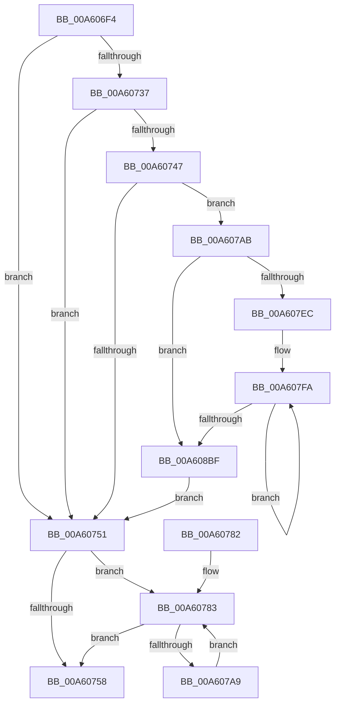

# SshpFlushBlockerDataCache

- RVA: `0x00A606F4`–`0x00A608FD` (길이 `521` bytes)
- VA: `0x0000000140A606F4`
- 실행 섹션: `PAGE`
- PDB 이름 있음: `예`; PDB Function 태그: `아니요`
- unwind 정보 RVA: `0x000B2F9C`
- 디코드: `128`개 명령, `521/521` bytes 표시
- 미해석 바이트: `0` (있으면 어셈블리에 `.byte`로 보존)

> 이 문서는 커널 이미지의 기계어와 PDB 기호를 분석해 생성했습니다. 4번과 5번은 함수 원형과 자료형을 바이너리 사용 방식에서 추정한 C 해석이며 원본 소스 복구 결과는 아닙니다.

## 1. Dependencies

- 직접 호출 지점: **4**; 고유 호출 대상: **4**
- 직접 호출자로 확인된 함수: **1**
- RIP 상대 이미지 참조: **3**

### Outgoing calls
- `0x00A6073E` → [SSHSupportEtwEventEnabled](../../text/39/SSHSupportEtwEventEnabled_function_00391484.md) (function, `0x00391484`)
- `0x00A60766` → [_security_check_cookie](../../text/6A/_security_check_cookie_function_006AC640.md) (function, `0x006AC640`)
- `0x00A60790` → [CmpFreePoolWithTag](../../text/44/CmpFreePoolWithTag_function_004489E0.md) (function, `0x004489E0`)
- `0x00A608F3` → [SSHSupportEtwWrite](../../text/4A/SSHSupportEtwWrite_function_004ADF5C.md) (function, `0x004ADF5C`)

### Direct callers
- [SshNotifySystemSessionChange](SshNotifySystemSessionChange_function_00A602BC.md) at `0x00A60616`
- [SshNotifySystemSessionChange](SshNotifySystemSessionChange_function_00A602BC.md) at `0x00A606C3`

### Static image references
- `0x00A60714` → RVA `0x00E0A740` (`.data`; read)
- `0x00A60725` → RVA `0x00F07038` (`.data`; read)
- `0x00A60737` → RVA `0x0001A7F0` (`.rdata`; read)

## 2. Other-region calls and transfers

- 다른 실행 섹션으로 향하는 call: **4**
  - `0x00A6073E` → [SSHSupportEtwEventEnabled](../../text/39/SSHSupportEtwEventEnabled_function_00391484.md) (`PAGE` → `.text`)
  - `0x00A60766` → [_security_check_cookie](../../text/6A/_security_check_cookie_function_006AC640.md) (`PAGE` → `.text`)
  - `0x00A60790` → [CmpFreePoolWithTag](../../text/44/CmpFreePoolWithTag_function_004489E0.md) (`PAGE` → `.text`)
  - `0x00A608F3` → [SSHSupportEtwWrite](../../text/4A/SSHSupportEtwWrite_function_004ADF5C.md) (`PAGE` → `.text`)
- 별도 외부 분기/꼬리 이동을 확인하지 못했습니다.

## 3. Assembly (complete function range)

```asm
00A606F4  48 89 5C 24 18                  mov qword ptr [rsp + 0x18], rbx
00A606F9  48 89 54 24 10                  mov qword ptr [rsp + 0x10], rdx
00A606FE  55                              push rbp
00A606FF  56                              push rsi
00A60700  57                              push rdi
00A60701  41 56                           push r14
00A60703  41 57                           push r15
00A60705  48 8D AC 24 C0 FD FF FF         lea rbp, [rsp - 0x240]
00A6070D  48 81 EC 40 03 00 00            sub rsp, 0x340
00A60714  48 8B 05 25 A0 3A 00            mov rax, qword ptr [rip + 0x3aa025]
00A6071B  48 33 C4                        xor rax, rsp
00A6071E  48 89 85 30 02 00 00            mov qword ptr [rbp + 0x230], rax
00A60725  8B 05 0D 69 4A 00               mov eax, dword ptr [rip + 0x4a690d]
00A6072B  48 8B F9                        mov rdi, rcx
00A6072E  C6 44 24 30 00                  mov byte ptr [rsp + 0x30], 0
00A60733  85 C0                           test eax, eax
00A60735  74 1A                           je 0x140a60751
00A60737  48 8D 15 B2 A0 5B FF            lea rdx, [rip - 0xa45f4e]
00A6073E  E8 41 0D 93 FF                  call 0x140391484
00A60743  84 C0                           test al, al
00A60745  74 0A                           je 0x140a60751
00A60747  48 8D 57 04                     lea rdx, [rdi + 4]
00A6074B  8B 0A                           mov ecx, dword ptr [rdx]
00A6074D  85 C9                           test ecx, ecx
00A6074F  75 5A                           jne 0x140a607ab
00A60751  33 F6                           xor esi, esi
00A60753  39 77 04                        cmp dword ptr [rdi + 4], esi
00A60756  77 2B                           ja 0x140a60783
00A60758  83 67 04 00                     and dword ptr [rdi + 4], 0
00A6075C  48 8B 8D 30 02 00 00            mov rcx, qword ptr [rbp + 0x230]
00A60763  48 33 CC                        xor rcx, rsp
00A60766  E8 D5 BE C4 FF                  call 0x1406ac640
00A6076B  48 8B 9C 24 80 03 00 00         mov rbx, qword ptr [rsp + 0x380]
00A60773  48 81 C4 40 03 00 00            add rsp, 0x340
00A6077A  41 5F                           pop r15
00A6077C  41 5E                           pop r14
00A6077E  5F                              pop rdi
00A6077F  5E                              pop rsi
00A60780  5D                              pop rbp
00A60781  C3                              ret
00A60782  CC                              int3
00A60783  8B 17                           mov edx, dword ptr [rdi]
00A60785  8B DE                           mov ebx, esi
00A60787  48 C1 E3 05                     shl rbx, 5
00A6078B  48 8B 4C 3B 20                  mov rcx, qword ptr [rbx + rdi + 0x20]
00A60790  E8 4B 82 9E FF                  call 0x1404489e0
00A60795  0F 57 C0                        xorps xmm0, xmm0
00A60798  FF C6                           inc esi
00A6079A  0F 11 44 3B 08                  movups xmmword ptr [rbx + rdi + 8], xmm0
00A6079F  0F 11 44 3B 18                  movups xmmword ptr [rbx + rdi + 0x18], xmm0
00A607A4  3B 77 04                        cmp esi, dword ptr [rdi + 4]
00A607A7  73 AF                           jae 0x140a60758
00A607A9  EB D8                           jmp 0x140a60783
00A607AB  8A 85 78 02 00 00               mov al, byte ptr [rbp + 0x278]
00A607B1  41 BB 02 00 00 00               mov r11d, 2
00A607B7  83 64 24 4C 00                  and dword ptr [rsp + 0x4c], 0
00A607BC  83 64 24 5C 00                  and dword ptr [rsp + 0x5c], 0
00A607C1  88 44 24 30                     mov byte ptr [rsp + 0x30], al
00A607C5  48 8D 44 24 30                  lea rax, [rsp + 0x30]
00A607CA  48 89 44 24 40                  mov qword ptr [rsp + 0x40], rax
00A607CF  C7 44 24 48 01 00 00 00         mov dword ptr [rsp + 0x48], 1
00A607D7  48 89 54 24 50                  mov qword ptr [rsp + 0x50], rdx
00A607DC  C7 44 24 58 04 00 00 00         mov dword ptr [rsp + 0x58], 4
00A607E4  85 C9                           test ecx, ecx
00A607E6  0F 84 D3 00 00 00               je 0x140a608bf
00A607EC  41 8D 5B 02                     lea ebx, [r11 + 2]
00A607F0  45 33 F6                        xor r14d, r14d
00A607F3  48 8D 77 10                     lea rsi, [rdi + 0x10]
00A607F7  4C 8B F9                        mov r15, rcx
00A607FA  4C 8B 46 F8                     mov r8, qword ptr [rsi - 8]
00A607FE  48 8D 95 F0 01 00 00            lea rdx, [rbp + 0x1f0]
00A60805  44 0F B7 56 08                  movzx r10d, word ptr [rsi + 8]
00A6080A  4C 8D 8D 10 02 00 00            lea r9, [rbp + 0x210]
00A60811  49 03 D6                        add rdx, r14
00A60814  41 8B CB                        mov ecx, r11d
00A60817  48 03 C9                        add rcx, rcx
00A6081A  4D 03 CE                        add r9, r14
00A6081D  41 0F B7 00                     movzx eax, word ptr [r8]
00A60821  41 83 C3 05                     add r11d, 5
00A60825  D1 E8                           shr eax, 1
00A60827  49 83 C6 04                     add r14, 4
00A6082B  89 02                           mov dword ptr [rdx], eax
00A6082D  41 8B C2                        mov eax, r10d
00A60830  83 64 CC 4C 00                  and dword ptr [rsp + rcx*8 + 0x4c], 0
00A60835  C7 44 CC 48 10 00 00 00         mov dword ptr [rsp + rcx*8 + 0x48], 0x10
00A6083D  D1 E8                           shr eax, 1
00A6083F  41 89 01                        mov dword ptr [r9], eax
00A60842  48 8B 06                        mov rax, qword ptr [rsi]
00A60845  48 8D 76 20                     lea rsi, [rsi + 0x20]
00A60849  48 89 44 CC 40                  mov qword ptr [rsp + rcx*8 + 0x40], rax
00A6084E  8D 4B FF                        lea ecx, [rbx - 1]
00A60851  48 03 C9                        add rcx, rcx
00A60854  83 64 CC 4C 00                  and dword ptr [rsp + rcx*8 + 0x4c], 0
00A60859  48 89 54 CC 40                  mov qword ptr [rsp + rcx*8 + 0x40], rdx
00A6085E  C7 44 CC 48 04 00 00 00         mov dword ptr [rsp + rcx*8 + 0x48], 4
00A60866  41 0F B7 08                     movzx ecx, word ptr [r8]
00A6086A  49 8B 40 08                     mov rax, qword ptr [r8 + 8]
00A6086E  8B D3                           mov edx, ebx
00A60870  48 03 D2                        add rdx, rdx
00A60873  83 64 D4 4C 00                  and dword ptr [rsp + rdx*8 + 0x4c], 0
00A60878  89 4C D4 48                     mov dword ptr [rsp + rdx*8 + 0x48], ecx
00A6087C  8D 4B 01                        lea ecx, [rbx + 1]
00A6087F  48 89 44 D4 40                  mov qword ptr [rsp + rdx*8 + 0x40], rax
00A60884  48 03 C9                        add rcx, rcx
00A60887  48 8B 46 F0                     mov rax, qword ptr [rsi - 0x10]
00A6088B  83 64 CC 4C 00                  and dword ptr [rsp + rcx*8 + 0x4c], 0
00A60890  4C 89 4C CC 40                  mov qword ptr [rsp + rcx*8 + 0x40], r9
00A60895  C7 44 CC 48 04 00 00 00         mov dword ptr [rsp + rcx*8 + 0x48], 4
00A6089D  8D 4B 02                        lea ecx, [rbx + 2]
00A608A0  48 03 C9                        add rcx, rcx
00A608A3  83 C3 05                        add ebx, 5
00A608A6  83 64 CC 4C 00                  and dword ptr [rsp + rcx*8 + 0x4c], 0
00A608AB  48 89 44 CC 40                  mov qword ptr [rsp + rcx*8 + 0x40], rax
00A608B0  44 89 54 CC 48                  mov dword ptr [rsp + rcx*8 + 0x48], r10d
00A608B5  49 83 EF 01                     sub r15, 1
00A608B9  0F 85 3B FF FF FF               jne 0x140a607fa
00A608BF  41 8B C3                        mov eax, r11d
00A608C2  48 8D 8D 78 02 00 00            lea rcx, [rbp + 0x278]
00A608C9  48 03 C0                        add rax, rax
00A608CC  45 8D 4B 01                     lea r9d, [r11 + 1]
00A608D0  48 8D 15 19 9F 5B FF            lea rdx, [rip - 0xa460e7]
00A608D7  83 64 C4 4C 00                  and dword ptr [rsp + rax*8 + 0x4c], 0
00A608DC  48 89 4C C4 40                  mov qword ptr [rsp + rax*8 + 0x40], rcx
00A608E1  C7 44 C4 48 08 00 00 00         mov dword ptr [rsp + rax*8 + 0x48], 8
00A608E9  48 8D 44 24 40                  lea rax, [rsp + 0x40]
00A608EE  48 89 44 24 20                  mov qword ptr [rsp + 0x20], rax
00A608F3  E8 64 D6 A4 FF                  call 0x1404adf5c
00A608F8  E9 54 FE FF FF                  jmp 0x140a60751
```

## 4. C-style interpretation (structured pseudocode)

```c
__int64 __fastcall SshpFlushBlockerDataCache(__int64 a1, __int64 a2)
{
    __int64 result;
    __int64 v_r11;
    __int64 v_r14;
    __int64 v_r15;
    __int64 v_rbx;
    __int64 v_rsi;
    __int64 v_rsp;
    unsigned __int64 v_stack_m268;
    unsigned __int8 v_stack_m338;
    unsigned __int64 v_stack_m38;
    unsigned __int64 v_stack_m58;
    unsigned __int64 v_stack_m78;
    unsigned __int64 v_stack_p10;
    unsigned __int64 v_stack_p18;
    unsigned __int64 v_stack_p20;
    unsigned __int8 v_stack_p30;
    unsigned __int64 v_stack_p40;
    unsigned int v_stack_p48;
    unsigned int v_stack_p4C;
    unsigned __int64 v_stack_p50;
    unsigned int v_stack_p58;
    unsigned int v_stack_p5C;

    v_stack_p18 = v_rbx;
    v_stack_p10 = a2;
    v_rsp = (v_rsp) - (832);
    result = (*(unsigned __int64 *)(v_rip + 3842085)) ^ (v_rsp);
    v_stack_m38 = result;
    v_stack_m338 = 0;
    if ((unsigned int)((unsigned int)(*(unsigned int *)(v_rip + 4876557))) == 0) goto loc_00A60751;
    result = SSHSupportEtwEventEnabled(a1, v_rip - 10772302, a3, a4);
    if ((unsigned __int8)(result) == 0) goto loc_00A60751;
    if ((unsigned int)((unsigned int)(*(unsigned int *)(a1 + 4))) != 0) goto loc_00A607AB;
loc_00A60751:
    v_rsi = 0;
    if ((*(unsigned int *)(a1 + 4)) > 0) goto loc_00A60783;
loc_00A60758:
    a1 = (v_stack_m38) ^ (v_rsp);
    result = _security_check_cookie(a1, a1 + 4, a3, a4);
    v_rsp = (v_rsp) + (832);
    return result;
loc_00A60783:
    v_rbx = (0) << (5);
    result = CmpFreePoolWithTag(*(unsigned __int64 *)(v_rbx + a1 * 1 + 32), (unsigned int)(*(unsigned int *)(a1)), a3, a4);
    v_rsi = (unsigned int)((v_rsi) + 1);
    *(unsigned __int64 *)(v_rbx + a1 * 1 + 8) = v_xmm0;
    *(unsigned __int64 *)(v_rbx + a1 * 1 + 24) = v_xmm0;
    if (((unsigned int)(v_rsi)) >= (*(unsigned int *)(a1 + 4))) goto loc_00A60758;
    goto loc_00A60783;
loc_00A607AB:
    v_stack_p30 = (unsigned __int8)(v_stack_p10);
    v_stack_p40 = v_stack_p30;
    v_stack_p48 = 1;
    v_stack_p50 = (unsigned int)(*(unsigned int *)(a1));
    v_stack_p58 = 4;
    if ((unsigned int)(*(unsigned __int64 *)(v_rbx + a1 * 1 + 32)) == 0) goto loc_00A608BF;
    v_r14 = 0;
loc_00A607FA:
    a2 = (v_stack_m78) + (0);
    a1 = (2) + (2);
    a4 = (v_stack_m58) + (0);
    v_r11 = (unsigned int)((2) + (5));
    result = (unsigned int)((*(unsigned __int16 *)(*(unsigned __int64 *)(a1 + 16 - 8))) >> (1));
    v_r14 = (v_r14) + (4);
    *(unsigned int *)(a2) = (unsigned int)(result);
    *(unsigned int *)(v_rsp + a1 * 8 + 72) = 16;
    result = (unsigned int)(((unsigned int)((unsigned int)(*(unsigned __int16 *)(a1 + 16 + 8)))) >> (1));
    *(unsigned int *)(a4) = (unsigned int)(result);
    *(unsigned __int64 *)(v_rsp + a1 * 8 + 64) = *(unsigned __int64 *)(a1 + 16);
    a1 = (2 + 2 - 1) + (2 + 2 - 1);
    *(unsigned __int64 *)(v_rsp + a1 * 8 + 64) = a2;
    *(unsigned int *)(v_rsp + a1 * 8 + 72) = 4;
    a2 = ((unsigned int)((unsigned int)(2 + 2))) + ((unsigned int)((unsigned int)(2 + 2)));
    *(unsigned int *)(v_rsp + a2 * 8 + 72) = (unsigned int)(*(unsigned __int16 *)(*(unsigned __int64 *)(a1 + 16 - 8)));
    *(unsigned __int64 *)(v_rsp + a2 * 8 + 64) = *(unsigned __int64 *)(*(unsigned __int64 *)(a1 + 16 - 8) + 8);
    a1 = (2 + 2 + 1) + (2 + 2 + 1);
    *(unsigned __int64 *)(v_rsp + a1 * 8 + 64) = a4;
    *(unsigned int *)(v_rsp + a1 * 8 + 72) = 4;
    a1 = (2 + 2 + 2) + (2 + 2 + 2);
    v_rbx = (unsigned int)((2 + 2) + (5));
    *(unsigned __int64 *)(v_rsp + a1 * 8 + 64) = *(unsigned __int64 *)(a1 + 16 + 32 - 16);
    *(unsigned int *)(v_rsp + a1 * 8 + 72) = (unsigned int)(*(unsigned __int16 *)(a1 + 16 + 8));
    v_r15 = (*(unsigned __int64 *)(v_rbx + a1 * 1 + 32)) - (1);
    if (condition_is_not_equal) goto loc_00A607FA;
loc_00A608BF:
    result = ((unsigned int)((unsigned int)(v_r11))) + ((unsigned int)((unsigned int)(v_r11)));
    *(unsigned __int64 *)(v_rsp + result * 8 + 64) = v_stack_p10;
    *(unsigned int *)(v_rsp + result * 8 + 72) = 8;
    v_stack_p20 = v_stack_p40;
    result = SSHSupportEtwWrite(v_stack_p10, v_rip - 10772711, *(unsigned __int64 *)(a1 + 16 - 8), v_r11 + 1);
    goto loc_00A60751;
}
```

## 5. (Beta) C Style

```c
int64_t SshpFlushBlockerDataCache(void *Arg1, int64_t Arg2)
{
    uint8_t *arg1 = (uint8_t *)Arg1;

    int64_t result;
    int64_t local_r11;
    int64_t local_r14;
    int64_t local_r15;
    int64_t local_rbx;
    int64_t local_rsi;
    int64_t local_rsp;
    uint64_t v_stack_m268;
    uint8_t v_stack_m338;
    uint64_t v_stack_m38;
    uint64_t v_stack_m58;
    uint64_t v_stack_m78;
    uint64_t v_stack_p10;
    uint64_t v_stack_p18;
    uint64_t v_stack_p20;
    uint8_t v_stack_p30;
    uint64_t v_stack_p40;
    uint32_t v_stack_p48;
    uint32_t v_stack_p4C;
    uint64_t v_stack_p50;
    uint32_t v_stack_p58;
    uint32_t v_stack_p5C;

    v_stack_p18 = local_rbx;
    v_stack_p10 = Arg2;
    local_rsp = (local_rsp) - (832);
    result = (*(uint64_t *)(v_rip + 0x3AA025)) ^ (local_rsp);
    v_stack_m38 = result;
    v_stack_m338 = 0;
    if ((uint32_t)((uint32_t)(*(uint32_t *)(v_rip + 0x4A690D))) == 0) goto loc_00A60751;
    result = SSHSupportEtwEventEnabled(Arg1, v_rip - 10772302, a3, a4);
    if ((uint8_t)(result) == 0) goto loc_00A60751;
    if ((uint32_t)((uint32_t)(*(uint32_t *)(arg1 + 0x4))) != 0) goto loc_00A607AB;
loc_00A60751:
    local_rsi = 0;
    if ((*(uint32_t *)(arg1 + 0x4)) > 0) goto loc_00A60783;
loc_00A60758:
    Arg1 = (v_stack_m38) ^ (local_rsp);
    result = _security_check_cookie(Arg1, Arg1 + 4, a3, a4);
    local_rsp = (local_rsp) + (832);
    return result;
loc_00A60783:
    local_rbx = (0) << (5);
    result = CmpFreePoolWithTag(*(uint64_t *)(local_rbx + arg1 * 1 + 0x20), (uint32_t)(*(uint32_t *)(arg1)), a3, a4);
    local_rsi = (uint32_t)((local_rsi) + 1);
    *(uint64_t *)(local_rbx + arg1 * 1 + 0x8) = v_xmm0;
    *(uint64_t *)(local_rbx + arg1 * 1 + 0x18) = v_xmm0;
    if (((uint32_t)(local_rsi)) >= (*(uint32_t *)(arg1 + 0x4))) goto loc_00A60758;
    goto loc_00A60783;
loc_00A607AB:
    v_stack_p30 = (uint8_t)(v_stack_p10);
    v_stack_p40 = v_stack_p30;
    v_stack_p48 = 1;
    v_stack_p50 = (uint32_t)(*(uint32_t *)(arg1));
    v_stack_p58 = 4;
    if ((uint32_t)(*(uint64_t *)(local_rbx + arg1 * 1 + 0x20)) == 0) goto loc_00A608BF;
    local_r14 = 0;
loc_00A607FA:
    Arg2 = (v_stack_m78) + (0);
    Arg1 = (2) + (2);
    a4 = (v_stack_m58) + (0);
    local_r11 = (uint32_t)((2) + (5));
    result = (uint32_t)((*(uint16_t *)(*(uint64_t *)(arg1 + 0x10 - 0x8))) >> (1));
    local_r14 = (local_r14) + (4);
    *(uint32_t *)(Arg2) = (uint32_t)(result);
    *(uint32_t *)(local_rsp + arg1 * 8 + 0x48) = 16;
    result = (uint32_t)(((uint32_t)((uint32_t)(*(uint16_t *)(arg1 + 0x10 + 0x8)))) >> (1));
    *(uint32_t *)(a4) = (uint32_t)(result);
    *(uint64_t *)(local_rsp + arg1 * 8 + 0x40) = *(uint64_t *)(arg1 + 0x10);
    Arg1 = (2 + 2 - 1) + (2 + 2 - 1);
    *(uint64_t *)(local_rsp + arg1 * 8 + 0x40) = Arg2;
    *(uint32_t *)(local_rsp + arg1 * 8 + 0x48) = 4;
    Arg2 = ((uint32_t)((uint32_t)(2 + 2))) + ((uint32_t)((uint32_t)(2 + 2)));
    *(uint32_t *)(local_rsp + Arg2 * 8 + 0x48) = (uint32_t)(*(uint16_t *)(*(uint64_t *)(arg1 + 0x10 - 0x8)));
    *(uint64_t *)(local_rsp + Arg2 * 8 + 0x40) = *(uint64_t *)(*(uint64_t *)(arg1 + 0x10 - 0x8) + 0x8);
    Arg1 = (2 + 2 + 1) + (2 + 2 + 1);
    *(uint64_t *)(local_rsp + arg1 * 8 + 0x40) = a4;
    *(uint32_t *)(local_rsp + arg1 * 8 + 0x48) = 4;
    Arg1 = (2 + 2 + 2) + (2 + 2 + 2);
    local_rbx = (uint32_t)((2 + 2) + (5));
    *(uint64_t *)(local_rsp + arg1 * 8 + 0x40) = *(uint64_t *)(arg1 + 0x10 + 0x20 - 0x10);
    *(uint32_t *)(local_rsp + arg1 * 8 + 0x48) = (uint32_t)(*(uint16_t *)(arg1 + 0x10 + 0x8));
    local_r15 = (*(uint64_t *)(local_rbx + arg1 * 1 + 0x20)) - (1);
    if (condition_is_not_equal) goto loc_00A607FA;
loc_00A608BF:
    result = ((uint32_t)((uint32_t)(local_r11))) + ((uint32_t)((uint32_t)(local_r11)));
    *(uint64_t *)(local_rsp + result * 8 + 0x40) = v_stack_p10;
    *(uint32_t *)(local_rsp + result * 8 + 0x48) = 8;
    v_stack_p20 = v_stack_p40;
    result = SSHSupportEtwWrite(v_stack_p10, v_rip - 10772711, *(uint64_t *)(arg1 + 0x10 - 0x8), local_r11 + 1);
    goto loc_00A60751;
}
```

### 관측된 메모리 오프셋

구조체 형식이 확인되지 않은 접근은 인자 기준의 오프셋으로만 기록했습니다.

| 기준 인자 | 오프셋 표현 | 폭 (bit) | 접근 |
|---|---:|---:|---|
| `Arg1` | `- 0x10` | `64` | `R` |
| `Arg1` | `- 0x8` | `64` | `R` |
| `Arg1` | `+ 0x0` | `32` | `R` |
| `Arg1` | `+ 0x0` | `64` | `R` |
| `Arg1` | `+ 0x4` | `32` | `R` |
| `Arg1` | `+ 0x4` | `32` | `R/W` |
| `Arg1` | `+ 0x4` | `64` | `R` |
| `Arg1` | `+ 0x8` | `16` | `R` |
| `Arg1` | `+ 0x10` | `64` | `R` |
| `Arg1` | `+ 0x20` | `64` | `R` |

## 6. Execution-region graph

[열기: 2D/3D 그래프와 함수 탐색 컨트롤 패널](../../../control-panel.html?section=page&rva=0x00A606F4&view=graph)

- 2D 그래프는 위에서 아래로 흐르고, 3D 그래프는 빈 공간을 드래그해 회전합니다. Shift+드래그는 이동, 휠은 확대·축소, 함수 노드 선택은 대상 보고서 이동입니다.

### Static fallback


