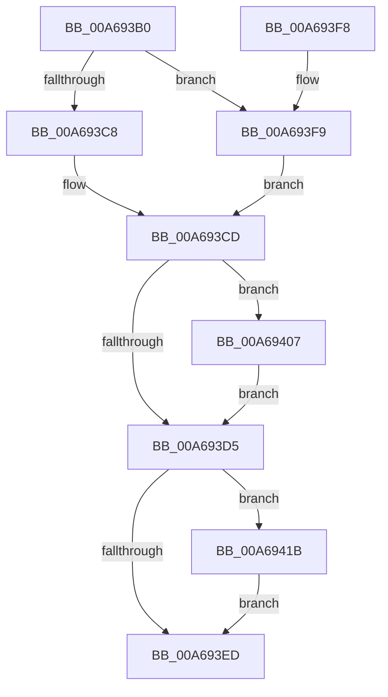

# TlgAggregateInternalFlushWorkItemRoutineKernelMode

- RVA: `0x00A693B0`–`0x00A69432` (길이 `130` bytes)
- VA: `0x0000000140A693B0`
- 실행 섹션: `PAGE`
- PDB 이름 있음: `예`; PDB Function 태그: `아니요`
- unwind 정보 RVA: `0x000B4074`
- 디코드: `33`개 명령, `130/130` bytes 표시
- 미해석 바이트: `0` (있으면 어셈블리에 `.byte`로 보존)

> 이 문서는 커널 이미지의 기계어와 PDB 기호를 분석해 생성했습니다. 4번과 5번은 함수 원형과 자료형을 바이너리 사용 방식에서 추정한 C 해석이며 원본 소스 복구 결과는 아닙니다.

## 1. Dependencies

- 직접 호출 지점: **4**; 고유 호출 대상: **4**
- 직접 호출자로 확인된 함수: **0**
- RIP 상대 이미지 참조: **0**

### Outgoing calls
- `0x00A693C8` → [LookUpTableFlushPartial](LookUpTableFlushPartial_function_00A69438.md) (function, `0x00A69438`)
- `0x00A69400` → [LookUpTableFlushComplete](LookUpTableFlushComplete_function_00A6957C.md) (function, `0x00A6957C`)
- `0x00A69414` → [EnableFlushTimer](../../text/45/EnableFlushTimer_function_0045B5B8.md) (function, `0x0045B5B8`)
- `0x00A6942B` → [KeSetEvent](../../text/33/KeSetEvent_function_0033F310.md) (function, `0x0033F310`)

### Direct callers
- 이 함수 시작 RVA로 연결되는 직접 call은 확인되지 않았습니다. 간접 호출은 완전히 역산할 수 없습니다.

### Static image references
- 디코드된 RIP-relative 메모리 참조가 없습니다.

## 2. Other-region calls and transfers

- 다른 실행 섹션으로 향하는 call: **2**
  - `0x00A69414` → [EnableFlushTimer](../../text/45/EnableFlushTimer_function_0045B5B8.md) (`PAGE` → `.text`)
  - `0x00A6942B` → [KeSetEvent](../../text/33/KeSetEvent_function_0033F310.md) (`PAGE` → `.text`)
- 별도 외부 분기/꼬리 이동을 확인하지 못했습니다.

## 3. Assembly (complete function range)

```asm
00A693B0  48 89 5C 24 08                  mov qword ptr [rsp + 8], rbx
00A693B5  57                              push rdi
00A693B6  48 83 EC 20                     sub rsp, 0x20
00A693BA  33 FF                           xor edi, edi
00A693BC  48 8B D9                        mov rbx, rcx
00A693BF  40 38 B9 74 01 00 00            cmp byte ptr [rcx + 0x174], dil
00A693C6  75 31                           jne 0x140a693f9
00A693C8  E8 6B 00 00 00                  call 0x140a69438
00A693CD  39 BB 00 01 00 00               cmp dword ptr [rbx + 0x100], edi
00A693D3  75 32                           jne 0x140a69407
00A693D5  48 8B 8B 08 01 00 00            mov rcx, qword ptr [rbx + 0x108]
00A693DC  B8 01 00 00 00                  mov eax, 1
00A693E1  66 F0 0F B1 79 38               lock cmpxchg word ptr [rcx + 0x38], di
00A693E7  66 83 F8 02                     cmp ax, 2
00A693EB  74 2E                           je 0x140a6941b
00A693ED  48 8B 5C 24 30                  mov rbx, qword ptr [rsp + 0x30]
00A693F2  48 83 C4 20                     add rsp, 0x20
00A693F6  5F                              pop rdi
00A693F7  C3                              ret
00A693F8  CC                              int3
00A693F9  40 88 B9 74 01 00 00            mov byte ptr [rcx + 0x174], dil
00A69400  E8 77 01 00 00                  call 0x140a6957c
00A69405  EB C6                           jmp 0x140a693cd
00A69407  8B 93 70 01 00 00               mov edx, dword ptr [rbx + 0x170]
00A6940D  48 8B 8B 68 01 00 00            mov rcx, qword ptr [rbx + 0x168]
00A69414  E8 9F 21 9F FF                  call 0x14045b5b8
00A69419  EB BA                           jmp 0x140a693d5
00A6941B  48 8B 8B 08 01 00 00            mov rcx, qword ptr [rbx + 0x108]
00A69422  45 33 C0                        xor r8d, r8d
00A69425  48 83 C1 20                     add rcx, 0x20
00A69429  33 D2                           xor edx, edx
00A6942B  E8 E0 5E 8D FF                  call 0x14033f310
00A69430  EB BB                           jmp 0x140a693ed
```

## 4. C-style interpretation (structured pseudocode)

```c
__int64 __fastcall TlgAggregateInternalFlushWorkItemRoutineKernelMode(__int64 a1, __int64 a2, int a3)
{
    __int64 result;
    __int64 v_rdi;
    __int64 v_rsp;
    unsigned __int64 v_stack_p8;

    v_stack_p8 = v_rbx;
    v_rsp = (v_rsp) - (32);
    v_rdi = 0;
    if ((*(unsigned __int8 *)(a1 + 372)) != 0) goto loc_00A693F9;
    result = LookUpTableFlushPartial(a1, a2, a3, a4);
loc_00A693CD:
    if ((*(unsigned int *)(a1 + 256)) != 0) goto loc_00A69407;
loc_00A693D5:
    if (1 == 2) goto loc_00A6941B;
loc_00A693ED:
    v_rsp = (v_rsp) + (32);
    return 1;
loc_00A693F9:
    *(unsigned __int8 *)(*(unsigned __int64 *)(a1 + 264) + 372) = 0;
    result = LookUpTableFlushComplete(*(unsigned __int64 *)(a1 + 264), a2, a3, a4);
    goto loc_00A693CD;
loc_00A69407:
    result = EnableFlushTimer(*(unsigned __int64 *)(v_stack_p8 + 360), (unsigned int)(*(unsigned int *)(v_stack_p8 + 368)), a3, a4);
    goto loc_00A693D5;
loc_00A6941B:
    a3 = 0;
    a1 = (*(unsigned __int64 *)(v_stack_p8 + 264)) + (32);
    a2 = 0;
    result = KeSetEvent(a1, a2, a3, a4);
    goto loc_00A693ED;
}
```

## 5. (Beta) C Style

```c
int64_t TlgAggregateInternalFlushWorkItemRoutineKernelMode(void *Arg1, int64_t Arg2, int32_t Arg3)
{
    uint8_t *arg1 = (uint8_t *)Arg1;

    int64_t result;
    int64_t local_rdi;
    int64_t local_rsp;
    uint64_t v_stack_p8;

    v_stack_p8 = local_rbx;
    local_rsp = (local_rsp) - (32);
    local_rdi = 0;
    if ((*(uint8_t *)(arg1 + 0x174)) != 0) goto loc_00A693F9;
    result = LookUpTableFlushPartial(Arg1, Arg2, Arg3, a4);
loc_00A693CD:
    if ((*(uint32_t *)(arg1 + 0x100)) != 0) goto loc_00A69407;
loc_00A693D5:
    if (1 == 2) goto loc_00A6941B;
loc_00A693ED:
    local_rsp = (local_rsp) + (32);
    return 1;
loc_00A693F9:
    *(uint8_t *)(*(uint64_t *)(arg1 + 0x108) + 0x174) = 0;
    result = LookUpTableFlushComplete(*(uint64_t *)(arg1 + 0x108), Arg2, Arg3, a4);
    goto loc_00A693CD;
loc_00A69407:
    result = EnableFlushTimer(*(uint64_t *)(v_stack_p8 + 0x168), (uint32_t)(*(uint32_t *)(v_stack_p8 + 0x170)), Arg3, a4);
    goto loc_00A693D5;
loc_00A6941B:
    Arg3 = 0;
    Arg1 = (*(uint64_t *)(v_stack_p8 + 0x108)) + (32);
    Arg2 = 0;
    result = KeSetEvent(Arg1, Arg2, Arg3, a4);
    goto loc_00A693ED;
}
```

### 관측된 메모리 오프셋

구조체 형식이 확인되지 않은 접근은 인자 기준의 오프셋으로만 기록했습니다.

| 기준 인자 | 오프셋 표현 | 폭 (bit) | 접근 |
|---|---:|---:|---|
| `Arg1` | `+ 0x100` | `32` | `R` |
| `Arg1` | `+ 0x108` | `64` | `R` |
| `Arg1` | `+ 0x168` | `64` | `R` |
| `Arg1` | `+ 0x170` | `32` | `R` |
| `Arg1` | `+ 0x174` | `8` | `R` |
| `Arg1` | `+ 0x174` | `8` | `W` |

## 6. Execution-region graph

[열기: 2D/3D 그래프와 함수 탐색 컨트롤 패널](../../../control-panel.html?section=page&rva=0x00A693B0&view=graph)

- 2D 그래프는 위에서 아래로 흐르고, 3D 그래프는 빈 공간을 드래그해 회전합니다. Shift+드래그는 이동, 휠은 확대·축소, 함수 노드 선택은 대상 보고서 이동입니다.

### Static fallback


