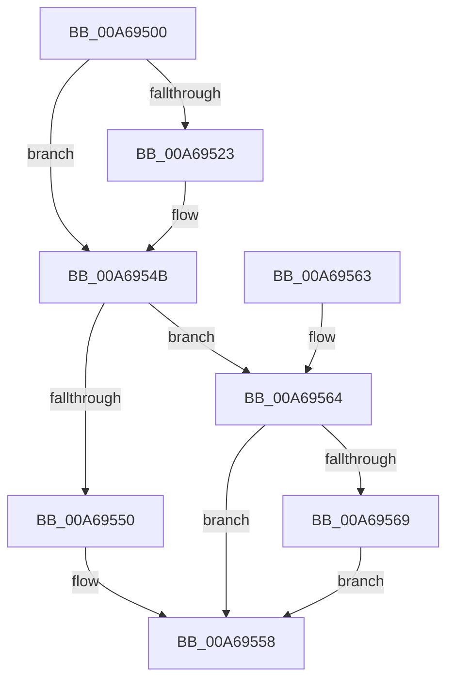

# TlgAggregateInternalRegisteredProviderEtwCallback

- RVA: `0x00A69500`–`0x00A69573` (길이 `115` bytes)
- VA: `0x0000000140A69500`
- 실행 섹션: `PAGE`
- PDB 이름 있음: `예`; PDB Function 태그: `아니요`
- unwind 정보 RVA: `0x000B4084`
- 디코드: `31`개 명령, `115/115` bytes 표시
- 미해석 바이트: `0` (있으면 어셈블리에 `.byte`로 보존)

> 이 문서는 커널 이미지의 기계어와 PDB 기호를 분석해 생성했습니다. 4번과 5번은 함수 원형과 자료형을 바이너리 사용 방식에서 추정한 C 해석이며 원본 소스 복구 결과는 아닙니다.

## 1. Dependencies

- 직접 호출 지점: **3**; 고유 호출 대상: **3**
- 직접 호출자로 확인된 함수: **0**
- RIP 상대 이미지 참조: **0**

### Outgoing calls
- `0x00A69546` → [guard_dispatch_icall](../../text/6B/guard_dispatch_icall_function_006BAAD0.md) (function, `0x006BAAD0`)
- `0x00A69553` → [LookUpTableFlushComplete](LookUpTableFlushComplete_function_00A6957C.md) (function, `0x00A6957C`)
- `0x00A6956C` → [LookUpTableFlushPartial](LookUpTableFlushPartial_function_00A69438.md) (function, `0x00A69438`)

### Direct callers
- 이 함수 시작 RVA로 연결되는 직접 call은 확인되지 않았습니다. 간접 호출은 완전히 역산할 수 없습니다.

### Static image references
- 디코드된 RIP-relative 메모리 참조가 없습니다.

## 2. Other-region calls and transfers

- 다른 실행 섹션으로 향하는 call: **1**
  - `0x00A69546` → [guard_dispatch_icall](../../text/6B/guard_dispatch_icall_function_006BAAD0.md) (`PAGE` → `.text`)
- 별도 외부 분기/꼬리 이동을 확인하지 못했습니다.

## 3. Assembly (complete function range)

```asm
00A69500  48 89 5C 24 08                  mov qword ptr [rsp + 8], rbx
00A69505  57                              push rdi
00A69506  48 83 EC 40                     sub rsp, 0x40
00A6950A  48 8B 9C 24 80 00 00 00         mov rbx, qword ptr [rsp + 0x80]
00A69512  45 8A D8                        mov r11b, r8b
00A69515  8B FA                           mov edi, edx
00A69517  48 8B 83 48 01 00 00            mov rax, qword ptr [rbx + 0x148]
00A6951E  48 85 C0                        test rax, rax
00A69521  74 28                           je 0x140a6954b
00A69523  4C 8B 93 50 01 00 00            mov r10, qword ptr [rbx + 0x150]
00A6952A  4C 8B 44 24 70                  mov r8, qword ptr [rsp + 0x70]
00A6952F  4C 89 54 24 30                  mov qword ptr [rsp + 0x30], r10
00A69534  4C 8B 54 24 78                  mov r10, qword ptr [rsp + 0x78]
00A69539  4C 89 54 24 28                  mov qword ptr [rsp + 0x28], r10
00A6953E  4C 89 44 24 20                  mov qword ptr [rsp + 0x20], r8
00A69543  45 8A C3                        mov r8b, r11b
00A69546  E8 85 15 C5 FF                  call 0x1406baad0
00A6954B  83 FF 01                        cmp edi, 1
00A6954E  75 14                           jne 0x140a69564
00A69550  48 8B CB                        mov rcx, rbx
00A69553  E8 24 00 00 00                  call 0x140a6957c
00A69558  48 8B 5C 24 50                  mov rbx, qword ptr [rsp + 0x50]
00A6955D  48 83 C4 40                     add rsp, 0x40
00A69561  5F                              pop rdi
00A69562  C3                              ret
00A69563  CC                              int3
00A69564  83 FF 02                        cmp edi, 2
00A69567  75 EF                           jne 0x140a69558
00A69569  48 8B CB                        mov rcx, rbx
00A6956C  E8 C7 FE FF FF                  call 0x140a69438
00A69571  EB E5                           jmp 0x140a69558
```

## 4. C-style interpretation (structured pseudocode)

```c
__int64 __fastcall TlgAggregateInternalRegisteredProviderEtwCallback(__int64 a1, int a2, unsigned __int8 a3, __int64 a4, __int64 a5, __int64 a6, __int64 a7)
{
    __int64 result;
    __int64 v_r10;
    __int64 v_rsp;
    unsigned __int64 v_stack_m18;
    unsigned __int64 v_stack_m20;
    unsigned __int64 v_stack_m28;
    unsigned __int64 v_stack_p8;

    v_stack_p8 = v_rbx;
    v_rsp = (v_rsp) - (64);
    result = *(unsigned __int64 *)(a7 + 328);
    if (*(unsigned __int64 *)(a7 + 328) != 0) {
        v_r10 = *(unsigned __int64 *)(a7 + 336);
        a3 = a5;
        v_stack_m18 = v_r10;
        v_r10 = a6;
        v_stack_m20 = v_r10;
        v_stack_m28 = a3;
        a3 = a3;
        result = guard_dispatch_icall(a1, a2, a3, a4);
    }
    if (((unsigned int)((unsigned int)(a2))) != 1) goto loc_00A69564;
    result = LookUpTableFlushComplete(a7, a2, a3, a4);
loc_00A69558:
    v_rsp = (v_rsp) + (64);
    return result;
loc_00A69564:
    if (((unsigned int)((unsigned int)(a2))) != 2) goto loc_00A69558;
    result = LookUpTableFlushPartial(v_stack_p8, a2, a3, a4);
    goto loc_00A69558;
}
```

## 5. (Beta) C Style

```c
int64_t TlgAggregateInternalRegisteredProviderEtwCallback(int64_t Arg1, int32_t Arg2, uint8_t Arg3, int64_t Arg4, int64_t Arg5, int64_t Arg6, void *Arg7)
{
    uint8_t *arg7 = (uint8_t *)Arg7;

    int64_t result;
    int64_t local_r10;
    int64_t local_rsp;
    uint64_t v_stack_m18;
    uint64_t v_stack_m20;
    uint64_t v_stack_m28;
    uint64_t v_stack_p8;

    v_stack_p8 = local_rbx;
    local_rsp = (local_rsp) - (64);
    result = *(uint64_t *)(arg7 + 0x148);
    if (*(uint64_t *)(arg7 + 0x148) != 0) {
        local_r10 = *(uint64_t *)(arg7 + 0x150);
        Arg3 = Arg5;
        v_stack_m18 = local_r10;
        local_r10 = Arg6;
        v_stack_m20 = local_r10;
        v_stack_m28 = Arg3;
        Arg3 = Arg3;
        result = guard_dispatch_icall(Arg1, Arg2, Arg3, Arg4);
    }
    if (((uint32_t)((uint32_t)(Arg2))) != 1) goto loc_00A69564;
    result = LookUpTableFlushComplete(Arg7, Arg2, Arg3, Arg4);
loc_00A69558:
    local_rsp = (local_rsp) + (64);
    return result;
loc_00A69564:
    if (((uint32_t)((uint32_t)(Arg2))) != 2) goto loc_00A69558;
    result = LookUpTableFlushPartial(v_stack_p8, Arg2, Arg3, Arg4);
    goto loc_00A69558;
}
```

### 관측된 메모리 오프셋

구조체 형식이 확인되지 않은 접근은 인자 기준의 오프셋으로만 기록했습니다.

| 기준 인자 | 오프셋 표현 | 폭 (bit) | 접근 |
|---|---:|---:|---|
| `Arg7` | `+ 0x148` | `64` | `R` |
| `Arg7` | `+ 0x150` | `64` | `R` |

## 6. Execution-region graph

[열기: 2D/3D 그래프와 함수 탐색 컨트롤 패널](../../../control-panel.html?section=page&rva=0x00A69500&view=graph)

- 2D 그래프는 위에서 아래로 흐르고, 3D 그래프는 빈 공간을 드래그해 회전합니다. Shift+드래그는 이동, 휠은 확대·축소, 함수 노드 선택은 대상 보고서 이동입니다.

### Static fallback


