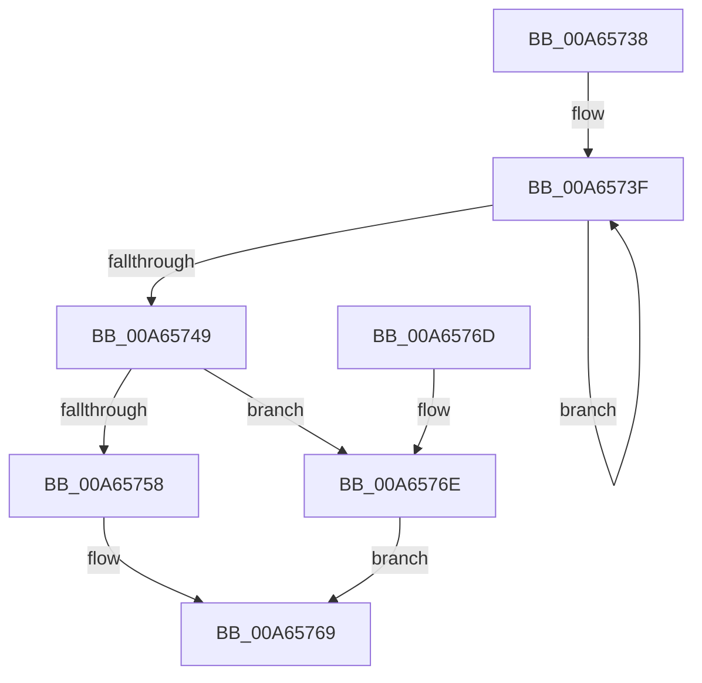

# ULongAddStringSize

- RVA: `0x00A65738`–`0x00A65775` (길이 `61` bytes)
- VA: `0x0000000140A65738`
- 실행 섹션: `PAGE`
- PDB 이름 있음: `예`; PDB Function 태그: `아니요`
- unwind 정보 RVA: `0x000DB714`
- 디코드: `20`개 명령, `61/61` bytes 표시
- 미해석 바이트: `0` (있으면 어셈블리에 `.byte`로 보존)

> 이 문서는 커널 이미지의 기계어와 PDB 기호를 분석해 생성했습니다. 4번과 5번은 함수 원형과 자료형을 바이너리 사용 방식에서 추정한 C 해석이며 원본 소스 복구 결과는 아닙니다.

## 1. Dependencies

- 직접 호출 지점: **0**; 고유 호출 대상: **0**
- 직접 호출자로 확인된 함수: **2**
- RIP 상대 이미지 참조: **0**

### Outgoing calls
- 직접 디코드된 call 명령이 없습니다.

### Direct callers
- [sub_00B32900](../B3/Unknown_function_00B32900.md) at `0x00B3297B`
- [sub_00B32AA2](../B3/Unknown_function_00B32AA2.md) at `0x00B32C7E`

### Static image references
- 디코드된 RIP-relative 메모리 참조가 없습니다.

## 2. Other-region calls and transfers

- 다른 실행 섹션으로 향하는 call: **0**
- 별도 외부 분기/꼬리 이동을 확인하지 못했습니다.

## 3. Assembly (complete function range)

```asm
00A65738  44 8B C9                        mov r9d, ecx
00A6573B  48 83 C8 FF                     or rax, 0xffffffffffffffff
00A6573F  48 FF C0                        inc rax
00A65742  66 83 3C 42 00                  cmp word ptr [rdx + rax*2], 0
00A65747  75 F6                           jne 0x140a6573f
00A65749  8B D0                           mov edx, eax
00A6574B  B9 FF FF FF FF                  mov ecx, 0xffffffff
00A65750  48 03 D2                        add rdx, rdx
00A65753  48 3B D1                        cmp rdx, rcx
00A65756  77 16                           ja 0x140a6576e
00A65758  42 8D 04 0A                     lea eax, [rdx + r9]
00A6575C  41 3B C1                        cmp eax, r9d
00A6575F  0F 43 C8                        cmovae ecx, eax
00A65762  1B C0                           sbb eax, eax
00A65764  25 95 00 00 C0                  and eax, 0xc0000095
00A65769  41 89 08                        mov dword ptr [r8], ecx
00A6576C  C3                              ret
00A6576D  CC                              int3
00A6576E  B8 95 00 00 C0                  mov eax, 0xc0000095
00A65773  EB F4                           jmp 0x140a65769
```

## 4. C-style interpretation (structured pseudocode)

```c
__int64 __fastcall ULongAddStringSize(int a1, __int64 a2, __int64 a3)
{
    __int64 result;

    result = (result) | (-1);
loc_00A6573F:
    result = (result) + 1;
    if ((*(unsigned __int16 *)(a2 + result * 2)) != 0) goto loc_00A6573F;
    a2 = ((unsigned int)((unsigned int)(result))) + ((unsigned int)((unsigned int)(result)));
    if (a2 > ((unsigned int)(0xFFFFFFFFULL))) goto loc_00A6576E;
    a1 = (unsigned int)(0xFFFFFFFFULL);
    if (((unsigned int)(a2 + (unsigned int)(a1) * 1)) >= ((unsigned int)((unsigned int)(a1)))) { a1 = (unsigned int)(a2 + (unsigned int)(a1) * 1); }
    result = (unsigned int)((a2 + (unsigned int)(a1) * 1) & (0xC0000095ULL));
loc_00A65769:
    *(unsigned int *)(a3) = a1;
    return result;
loc_00A6576E:
    goto loc_00A65769;
}
```

## 5. (Beta) C Style

```c
int64_t ULongAddStringSize(int32_t Arg1, void *Arg2, void *Arg3)
{
    uint8_t *arg2 = (uint8_t *)Arg2;
    uint8_t *arg3 = (uint8_t *)Arg3;

    int64_t result;

    result = (result) | (-1);
loc_00A6573F:
    result = (result) + 1;
    if ((*(uint16_t *)(arg2 + result * 2)) != 0) goto loc_00A6573F;
    Arg2 = ((uint32_t)((uint32_t)(result))) + ((uint32_t)((uint32_t)(result)));
    if (Arg2 > ((uint32_t)(0xFFFFFFFFULL))) goto loc_00A6576E;
    Arg1 = (uint32_t)(0xFFFFFFFFULL);
    if (((uint32_t)(Arg2 + (uint32_t)(Arg1) * 1)) >= ((uint32_t)((uint32_t)(Arg1)))) { Arg1 = (uint32_t)(Arg2 + (uint32_t)(Arg1) * 1); }
    result = (uint32_t)((Arg2 + (uint32_t)(Arg1) * 1) & (0xC0000095ULL));
loc_00A65769:
    *(uint32_t *)(arg3) = Arg1;
    return result;
loc_00A6576E:
    goto loc_00A65769;
}
```

### 관측된 메모리 오프셋

구조체 형식이 확인되지 않은 접근은 인자 기준의 오프셋으로만 기록했습니다.

| 기준 인자 | 오프셋 표현 | 폭 (bit) | 접근 |
|---|---:|---:|---|
| `Arg2` | `+ 0x0 + rax*2` | `16` | `R` |
| `Arg3` | `+ 0x0` | `32` | `W` |

## 6. Execution-region graph

[열기: 2D/3D 그래프와 함수 탐색 컨트롤 패널](../../../control-panel.html?section=page&rva=0x00A65738&view=graph)

- 2D 그래프는 위에서 아래로 흐르고, 3D 그래프는 빈 공간을 드래그해 회전합니다. Shift+드래그는 이동, 휠은 확대·축소, 함수 노드 선택은 대상 보고서 이동입니다.

### Static fallback


