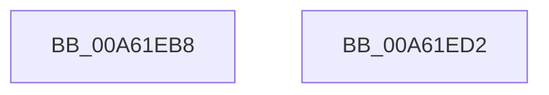

# UNLOCK_TRANSACTION_LIST

- RVA: `0x00A61EB8`–`0x00A61ED3` (길이 `27` bytes)
- VA: `0x0000000140A61EB8`
- 실행 섹션: `PAGE`
- PDB 이름 있음: `예`; PDB Function 태그: `아니요`
- unwind 정보 RVA: `0x0005C788`
- 디코드: `7`개 명령, `27/27` bytes 표시
- 미해석 바이트: `0` (있으면 어셈블리에 `.byte`로 보존)

> 이 문서는 커널 이미지의 기계어와 PDB 기호를 분석해 생성했습니다. 4번과 5번은 함수 원형과 자료형을 바이너리 사용 방식에서 추정한 C 해석이며 원본 소스 복구 결과는 아닙니다.

## 1. Dependencies

- 직접 호출 지점: **2**; 고유 호출 대상: **2**
- 직접 호출자로 확인된 함수: **2**
- RIP 상대 이미지 참조: **1**

### Outgoing calls
- `0x00A61EC3` → [ExReleaseFastMutexUnsafe](../../text/25/ExReleaseFastMutexUnsafe_function_002503A0.md) (function, `0x002503A0`)
- `0x00A61EC8` → [KeLeaveCriticalRegion](../../text/25/KeLeaveCriticalRegion_function_0025D8B0.md) (function, `0x0025D8B0`)

### Direct callers
- [CmpTransEnlistUowInCmTrans](../../text/48/CmpTransEnlistUowInCmTrans_function_0048B330.md) at `0x0048B360`
- [CmpTransEnlistUowInCmTrans](../../text/48/CmpTransEnlistUowInCmTrans_function_0048B330.md) at `0x0048B384`
- [CmpRundownUnitOfWork](../87/CmpRundownUnitOfWork_function_0087497C.md) at `0x00874A22`

### Static image references
- `0x00A61EBC` → RVA `0x00EF5820` (`.data`; read)

## 2. Other-region calls and transfers

- 다른 실행 섹션으로 향하는 call: **2**
  - `0x00A61EC3` → [ExReleaseFastMutexUnsafe](../../text/25/ExReleaseFastMutexUnsafe_function_002503A0.md) (`PAGE` → `.text`)
  - `0x00A61EC8` → [KeLeaveCriticalRegion](../../text/25/KeLeaveCriticalRegion_function_0025D8B0.md) (`PAGE` → `.text`)
- 별도 외부 분기/꼬리 이동을 확인하지 못했습니다.

## 3. Assembly (complete function range)

```asm
00A61EB8  48 83 EC 28                     sub rsp, 0x28
00A61EBC  48 8D 0D 5D 39 49 00            lea rcx, [rip + 0x49395d]
00A61EC3  E8 D8 E4 7E FF                  call 0x1402503a0
00A61EC8  E8 E3 B9 7F FF                  call 0x14025d8b0
00A61ECD  48 83 C4 28                     add rsp, 0x28
00A61ED1  C3                              ret
00A61ED2  CC                              int3
```

## 4. C-style interpretation (structured pseudocode)

```c
__int64 __fastcall UNLOCK_TRANSACTION_LIST(void)
{
    __int64 result;
    __int64 v_rsp;

    v_rsp = (v_rsp) - (40);
    result = ExReleaseFastMutexUnsafe(v_rip + 4798813, a2, a3, a4);
    result = KeLeaveCriticalRegion(v_rip + 4798813, a2, a3, a4);
    v_rsp = (v_rsp) + (40);
    return result;
}
```

## 5. (Beta) C Style

```c
void UNLOCK_TRANSACTION_LIST(void)
{
    int64_t result;
    int64_t local_rsp;

    local_rsp = (local_rsp) - (40);
    result = ExReleaseFastMutexUnsafe(v_rip + 4798813, a2, a3, a4);
    result = KeLeaveCriticalRegion(v_rip + 4798813, a2, a3, a4);
    local_rsp = (local_rsp) + (40);
    return result;
}
```

## 6. Execution-region graph

[열기: 2D/3D 그래프와 함수 탐색 컨트롤 패널](../../../control-panel.html?section=page&rva=0x00A61EB8&view=graph)

- 2D 그래프는 위에서 아래로 흐르고, 3D 그래프는 빈 공간을 드래그해 회전합니다. Shift+드래그는 이동, 휠은 확대·축소, 함수 노드 선택은 대상 보고서 이동입니다.

### Static fallback


