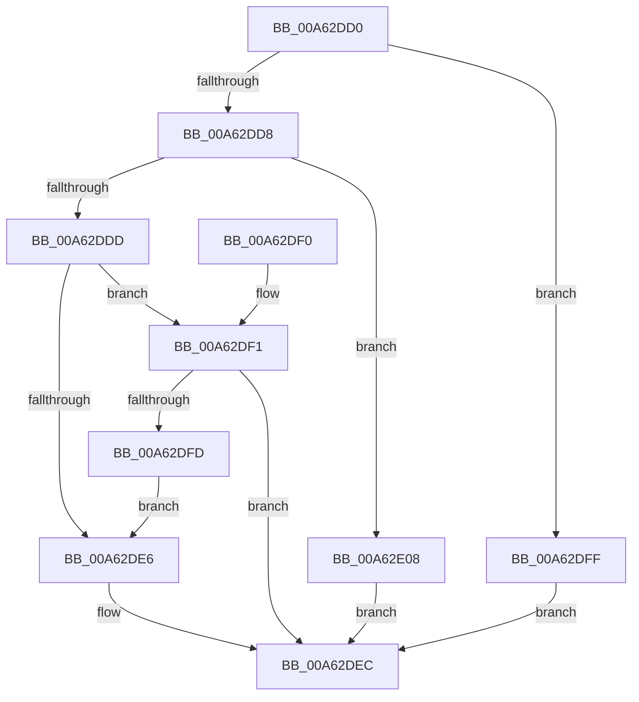

# sub_00A62DD0

- RVA: `0x00A62DD0`–`0x00A62E0E` (길이 `62` bytes)
- VA: `0x0000000140A62DD0`
- 실행 섹션: `PAGE`
- PDB 이름 있음: `아니요`; PDB Function 태그: `아니요`
- unwind 정보 RVA: `0x000DB714`
- 디코드: `23`개 명령, `62/62` bytes 표시
- 미해석 바이트: `0` (있으면 어셈블리에 `.byte`로 보존)

> 이 문서는 커널 이미지의 기계어와 PDB 기호를 분석해 생성했습니다. 4번과 5번은 함수 원형과 자료형을 바이너리 사용 방식에서 추정한 C 해석이며 원본 소스 복구 결과는 아닙니다.

## 1. Dependencies

- 직접 호출 지점: **0**; 고유 호출 대상: **0**
- 직접 호출자로 확인된 함수: **0**
- RIP 상대 이미지 참조: **0**

### Outgoing calls
- 직접 디코드된 call 명령이 없습니다.

### Direct callers
- 이 함수 시작 RVA로 연결되는 직접 call은 확인되지 않았습니다. 간접 호출은 완전히 역산할 수 없습니다.

### Static image references
- 디코드된 RIP-relative 메모리 참조가 없습니다.

## 2. Other-region calls and transfers

- 다른 실행 섹션으로 향하는 call: **0**
- 별도 외부 분기/꼬리 이동을 확인하지 못했습니다.

## 3. Assembly (complete function range)

```asm
00A62DD0  45 33 C0                        xor r8d, r8d
00A62DD3  48 85 C9                        test rcx, rcx
00A62DD6  74 27                           je 0x140a62dff
00A62DD8  48 85 D2                        test rdx, rdx
00A62DDB  74 2B                           je 0x140a62e08
00A62DDD  4C 8B 49 20                     mov r9, qword ptr [rcx + 0x20]
00A62DE1  49 3B D1                        cmp rdx, r9
00A62DE4  73 0B                           jae 0x140a62df1
00A62DE6  4C 8B C2                        mov r8, rdx
00A62DE9  4D 2B C1                        sub r8, r9
00A62DEC  49 8B C0                        mov rax, r8
00A62DEF  C3                              ret
00A62DF0  CC                              int3
00A62DF1  48 8B 49 08                     mov rcx, qword ptr [rcx + 8]
00A62DF5  49 03 C9                        add rcx, r9
00A62DF8  48 3B D1                        cmp rdx, rcx
00A62DFB  72 EF                           jb 0x140a62dec
00A62DFD  EB E7                           jmp 0x140a62de6
00A62DFF  48 85 D2                        test rdx, rdx
00A62E02  41 0F 95 C0                     setne r8b
00A62E06  EB E4                           jmp 0x140a62dec
00A62E08  49 83 C8 FF                     or r8, 0xffffffffffffffff
00A62E0C  EB DE                           jmp 0x140a62dec
```

## 4. C-style interpretation (structured pseudocode)

```c
__int64 __fastcall sub_00A62DD0(__int64 a1, __int64 a2, int a3)
{
    a3 = 0;
    if (a1 == 0) goto loc_00A62DFF;
    if (a2 == 0) goto loc_00A62E08;
    if (a2 >= (*(unsigned __int64 *)(a1 + 32))) goto loc_00A62DF1;
loc_00A62DE6:
    a3 = (a2) - (*(unsigned __int64 *)(a1 + 32));
loc_00A62DEC:
    return a3;
loc_00A62DF1:
    a1 = (*(unsigned __int64 *)(a1 + 8)) + (*(unsigned __int64 *)(a1 + 32));
    if (a2 < a1) goto loc_00A62DEC;
    goto loc_00A62DE6;
loc_00A62DFF:
    a3 = (a2 != 0) ? 1 : 0;
    goto loc_00A62DEC;
loc_00A62E08:
    a3 = (a3) | (-1);
    goto loc_00A62DEC;
}
```

## 5. (Beta) C Style

```c
int64_t sub_00A62DD0(int64_t Arg1, int64_t Arg2, int32_t Arg3)
{
    Arg3 = 0;
    if (Arg1 == 0) goto loc_00A62DFF;
    if (Arg2 == 0) goto loc_00A62E08;
    if (Arg2 >= (*(uint64_t *)(Arg1 + 0x20))) goto loc_00A62DF1;
loc_00A62DE6:
    Arg3 = (Arg2) - (*(uint64_t *)(Arg1 + 0x20));
loc_00A62DEC:
    return Arg3;
loc_00A62DF1:
    Arg1 = (*(uint64_t *)(Arg1 + 0x8)) + (*(uint64_t *)(Arg1 + 0x20));
    if (Arg2 < Arg1) goto loc_00A62DEC;
    goto loc_00A62DE6;
loc_00A62DFF:
    Arg3 = (Arg2 != 0) ? 1 : 0;
    goto loc_00A62DEC;
loc_00A62E08:
    Arg3 = (Arg3) | (-1);
    goto loc_00A62DEC;
}
```

## 6. Execution-region graph

[열기: 2D/3D 그래프와 함수 탐색 컨트롤 패널](../../../control-panel.html?section=page&rva=0x00A62DD0&view=graph)

- 2D 그래프는 위에서 아래로 흐르고, 3D 그래프는 빈 공간을 드래그해 회전합니다. Shift+드래그는 이동, 휠은 확대·축소, 함수 노드 선택은 대상 보고서 이동입니다.

### Static fallback


