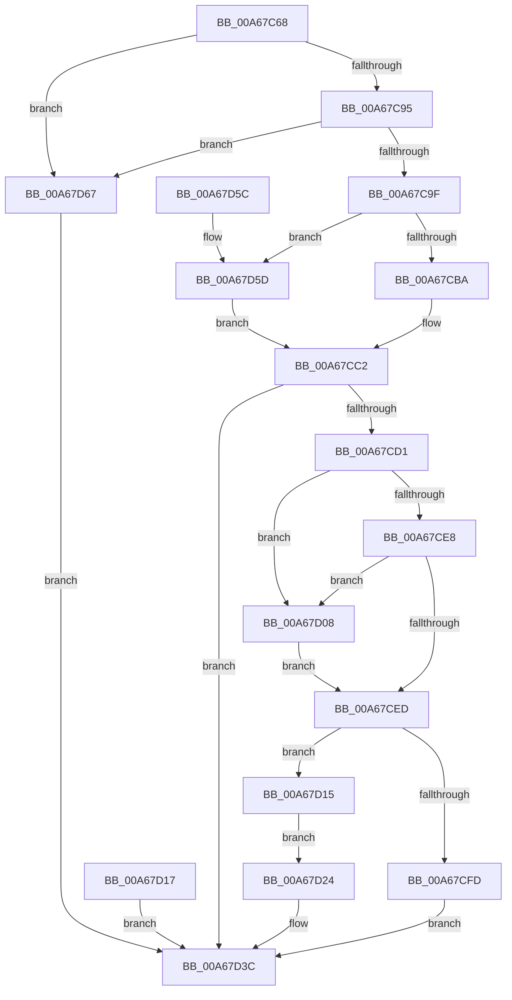

# sub_00A67C68

- RVA: `0x00A67C68`–`0x00A67D6E` (길이 `262` bytes)
- VA: `0x0000000140A67C68`
- 실행 섹션: `PAGE`
- PDB 이름 있음: `아니요`; PDB Function 태그: `아니요`
- unwind 정보 RVA: `0x000B3D24`
- 디코드: `72`개 명령, `262/262` bytes 표시
- 미해석 바이트: `0` (있으면 어셈블리에 `.byte`로 보존)

> 이 문서는 커널 이미지의 기계어와 PDB 기호를 분석해 생성했습니다. 4번과 5번은 함수 원형과 자료형을 바이너리 사용 방식에서 추정한 C 해석이며 원본 소스 복구 결과는 아닙니다.

## 1. Dependencies

- 직접 호출 지점: **5**; 고유 호출 대상: **4**
- 직접 호출자로 확인된 함수: **1**
- RIP 상대 이미지 참조: **0**

### Outgoing calls
- `0x00A67CAC` → [ExAllocatePool2](../../poolcode/B8/ExAllocatePool2_function_00B820F0.md) (function, `0x00B820F0`)
- `0x00A67CC4` → [PdcCloseEvent](../8D/PdcCloseEvent_function_008D2404.md) (function, `0x008D2404`)
- `0x00A67D2B` → [WbHeapExecutionUnloadModule](WbHeapExecutionUnloadModule_function_00A67D74.md) (function, `0x00A67D74`)
- `0x00A67D37` → [sub_00A67E80](Unknown_function_00A67E80.md) (function, `0x00A67E80`)
- `0x00A67D3F` → [PdcCloseEvent](../8D/PdcCloseEvent_function_008D2404.md) (function, `0x008D2404`)

### Direct callers
- [sub_008D3420](../8D/Unknown_function_008D3420.md) at `0x008D3650`

### Static image references
- 디코드된 RIP-relative 메모리 참조가 없습니다.

## 2. Other-region calls and transfers

- 다른 실행 섹션으로 향하는 call: **1**
  - `0x00A67CAC` → [ExAllocatePool2](../../poolcode/B8/ExAllocatePool2_function_00B820F0.md) (`PAGE` → `POOLCODE`)
- 별도 외부 분기/꼬리 이동을 확인하지 못했습니다.

## 3. Assembly (complete function range)

```asm
00A67C68  48 8B C4                        mov rax, rsp
00A67C6B  48 89 58 08                     mov qword ptr [rax + 8], rbx
00A67C6F  48 89 70 10                     mov qword ptr [rax + 0x10], rsi
00A67C73  48 89 78 18                     mov qword ptr [rax + 0x18], rdi
00A67C77  41 56                           push r14
00A67C79  48 83 EC 30                     sub rsp, 0x30
00A67C7D  48 8B F2                        mov rsi, rdx
00A67C80  4C 8B F1                        mov r14, rcx
00A67C83  33 FF                           xor edi, edi
00A67C85  48 89 78 20                     mov qword ptr [rax + 0x20], rdi
00A67C89  8D 57 10                        lea edx, [rdi + 0x10]
00A67C8C  44 3B C2                        cmp r8d, edx
00A67C8F  0F 82 D2 00 00 00               jb 0x140a67d67
00A67C95  48 83 3E 09                     cmp qword ptr [rsi], 9
00A67C99  0F 85 C8 00 00 00               jne 0x140a67d67
00A67C9F  33 DB                           xor ebx, ebx
00A67CA1  B9 00 01 00 00                  mov ecx, 0x100
00A67CA6  41 B8 57 41 52 42               mov r8d, 0x42524157
00A67CAC  E8 3F A4 11 00                  call 0x140b820f0
00A67CB1  48 85 C0                        test rax, rax
00A67CB4  0F 84 A3 00 00 00               je 0x140a67d5d
00A67CBA  48 8B F8                        mov rdi, rax
00A67CBD  48 89 44 24 58                  mov qword ptr [rsp + 0x58], rax
00A67CC2  33 C9                           xor ecx, ecx
00A67CC4  E8 3B A7 E6 FF                  call 0x1408d2404
00A67CC9  89 5C 24 24                     mov dword ptr [rsp + 0x24], ebx
00A67CCD  85 DB                           test ebx, ebx
00A67CCF  78 6B                           js 0x140a67d3c
00A67CD1  48 8B 46 08                     mov rax, qword ptr [rsi + 8]
00A67CD5  48 8D 48 10                     lea rcx, [rax + 0x10]
00A67CD9  48 BA 00 00 FF FF FF 7F 00 00   movabs rdx, 0x7fffffff0000
00A67CE3  48 3B CA                        cmp rcx, rdx
00A67CE6  77 20                           ja 0x140a67d08
00A67CE8  48 3B C8                        cmp rcx, rax
00A67CEB  72 1B                           jb 0x140a67d08
00A67CED  48 8B 46 08                     mov rax, qword ptr [rsi + 8]
00A67CF1  0F 10 00                        movups xmm0, xmmword ptr [rax]
00A67CF4  F3 0F 7F 07                     movdqu xmmword ptr [rdi], xmm0
00A67CF8  83 3F 00                        cmp dword ptr [rdi], 0
00A67CFB  74 18                           je 0x140a67d15
00A67CFD  BB 0D 00 00 C0                  mov ebx, 0xc000000d
00A67D02  89 5C 24 24                     mov dword ptr [rsp + 0x24], ebx
00A67D06  EB 34                           jmp 0x140a67d3c
00A67D08  8A 02                           mov al, byte ptr [rdx]
00A67D0A  48 8B 7C 24 58                  mov rdi, qword ptr [rsp + 0x58]
00A67D0F  8B 5C 24 24                     mov ebx, dword ptr [rsp + 0x24]
00A67D13  EB D8                           jmp 0x140a67ced
00A67D15  EB 0D                           jmp 0x140a67d24
00A67D17  8B D8                           mov ebx, eax
00A67D19  89 44 24 24                     mov dword ptr [rsp + 0x24], eax
00A67D1D  48 8B 7C 24 58                  mov rdi, qword ptr [rsp + 0x58]
00A67D22  EB 18                           jmp 0x140a67d3c
00A67D24  48 8B 57 08                     mov rdx, qword ptr [rdi + 8]
00A67D28  49 8B CE                        mov rcx, r14
00A67D2B  E8 44 00 00 00                  call 0x140a67d74
00A67D30  48 8B 57 08                     mov rdx, qword ptr [rdi + 8]
00A67D34  49 8B CE                        mov rcx, r14
00A67D37  E8 44 01 00 00                  call 0x140a67e80
00A67D3C  48 8B CF                        mov rcx, rdi
00A67D3F  E8 C0 A6 E6 FF                  call 0x1408d2404
00A67D44  8B C3                           mov eax, ebx
00A67D46  48 8B 5C 24 40                  mov rbx, qword ptr [rsp + 0x40]
00A67D4B  48 8B 74 24 48                  mov rsi, qword ptr [rsp + 0x48]
00A67D50  48 8B 7C 24 50                  mov rdi, qword ptr [rsp + 0x50]
00A67D55  48 83 C4 30                     add rsp, 0x30
00A67D59  41 5E                           pop r14
00A67D5B  C3                              ret
00A67D5C  CC                              int3
00A67D5D  BB 17 00 00 C0                  mov ebx, 0xc0000017
00A67D62  E9 5B FF FF FF                  jmp 0x140a67cc2
00A67D67  BB 0D 00 00 C0                  mov ebx, 0xc000000d
00A67D6C  EB CE                           jmp 0x140a67d3c
```

## 4. C-style interpretation (structured pseudocode)

```c
__int64 __fastcall sub_00A67C68(__int64 a1, __int64 a2, int a3)
{
    __int64 result;
    __int64 v_rbx;
    __int64 v_rdi;
    __int64 v_rsp;
    unsigned int v_stack_m14;
    unsigned __int64 v_stack_p10;
    unsigned __int64 v_stack_p18;
    unsigned __int64 v_stack_p20;
    unsigned __int64 v_stack_p8;

    *(unsigned __int64 *)(v_rsp + 8) = v_rbx;
    *(unsigned __int64 *)(v_rsp + 16) = v_rsi;
    *(unsigned __int64 *)(v_rsp + 24) = v_rdi;
    v_rsp = (v_rsp) - (48);
    v_rdi = 0;
    *(unsigned __int64 *)(v_rsp + 32) = 0;
    if (a3 < ((unsigned int)(v_rdi + 16))) goto loc_00A67D67;
    if ((*(unsigned __int64 *)(a2)) != 9) goto loc_00A67D67;
    v_rbx = 0;
    result = ExAllocatePool2(256, v_rdi + 16, (unsigned int)(0x42524157ULL), a4);
    if (result == 0) goto loc_00A67D5D;
    v_stack_p20 = result;
loc_00A67CC2:
    a1 = 0;
    result = PdcCloseEvent(a1, v_rdi + 16, (unsigned int)(0x42524157ULL), a4);
    v_stack_m14 = 0;
    if (sign_flag) goto loc_00A67D3C;
    if ((*(unsigned __int64 *)(a2 + 8) + 16) > (v_rdi + 16)) goto loc_00A67D08;
    if ((*(unsigned __int64 *)(a2 + 8) + 16) < (*(unsigned __int64 *)(a2 + 8))) goto loc_00A67D08;
loc_00A67CED:
    *(unsigned __int64 *)(result) = v_xmm0;
    if ((*(unsigned int *)(result)) == 0) goto loc_00A67D15;
    v_stack_m14 = (unsigned int)((unsigned int)(0xC000000DULL));
    goto loc_00A67D3C;
loc_00A67D08:
    goto loc_00A67CED;
loc_00A67D15:
    goto loc_00A67D24;
loc_00A67D24:
    result = WbHeapExecutionUnloadModule(0, *(unsigned __int64 *)(v_stack_p20 + 8), (unsigned int)(0x42524157ULL), a4);
    result = sub_00A67E80(0, *(unsigned __int64 *)(v_stack_p20 + 8), (unsigned int)(0x42524157ULL), a4);
loc_00A67D3C:
    result = PdcCloseEvent(v_stack_p20, *(unsigned __int64 *)(v_stack_p20 + 8), (unsigned int)(0x42524157ULL), a4);
    v_rsp = (v_rsp) + (48);
    return (unsigned int)((unsigned int)((unsigned int)(v_stack_m14)));
loc_00A67D5D:
    goto loc_00A67CC2;
loc_00A67D67:
    goto loc_00A67D3C;
}
```

## 5. (Beta) C Style

```c
int64_t sub_00A67C68(int64_t Arg1, void *Arg2, int32_t Arg3)
{
    uint8_t *arg2 = (uint8_t *)Arg2;

    int64_t result;
    int64_t local_rbx;
    int64_t local_rdi;
    int64_t local_rsp;
    uint32_t v_stack_m14;
    uint64_t v_stack_p10;
    uint64_t v_stack_p18;
    uint64_t v_stack_p20;
    uint64_t v_stack_p8;

    *(uint64_t *)(local_rsp + 0x8) = local_rbx;
    *(uint64_t *)(local_rsp + 0x10) = local_rsi;
    *(uint64_t *)(local_rsp + 0x18) = local_rdi;
    local_rsp = (local_rsp) - (48);
    local_rdi = 0;
    *(uint64_t *)(local_rsp + 0x20) = 0;
    if (Arg3 < ((uint32_t)(local_rdi + 16))) goto loc_00A67D67;
    if ((*(uint64_t *)(arg2)) != 9) goto loc_00A67D67;
    local_rbx = 0;
    result = ExAllocatePool2(256, local_rdi + 16, (uint32_t)(0x42524157ULL), a4);
    if (result == 0) goto loc_00A67D5D;
    v_stack_p20 = result;
loc_00A67CC2:
    Arg1 = 0;
    result = PdcCloseEvent(Arg1, local_rdi + 16, (uint32_t)(0x42524157ULL), a4);
    v_stack_m14 = 0;
    if (sign_flag) goto loc_00A67D3C;
    if ((*(uint64_t *)(arg2 + 0x8) + 16) > (local_rdi + 16)) goto loc_00A67D08;
    if ((*(uint64_t *)(arg2 + 0x8) + 16) < (*(uint64_t *)(arg2 + 0x8))) goto loc_00A67D08;
loc_00A67CED:
    *(uint64_t *)(result) = v_xmm0;
    if ((*(uint32_t *)(result)) == 0) goto loc_00A67D15;
    v_stack_m14 = (uint32_t)((uint32_t)(0xC000000DULL));
    goto loc_00A67D3C;
loc_00A67D08:
    goto loc_00A67CED;
loc_00A67D15:
    goto loc_00A67D24;
loc_00A67D24:
    result = WbHeapExecutionUnloadModule(0, *(uint64_t *)(v_stack_p20 + 0x8), (uint32_t)(0x42524157ULL), a4);
    result = sub_00A67E80(0, *(uint64_t *)(v_stack_p20 + 0x8), (uint32_t)(0x42524157ULL), a4);
loc_00A67D3C:
    result = PdcCloseEvent(v_stack_p20, *(uint64_t *)(v_stack_p20 + 0x8), (uint32_t)(0x42524157ULL), a4);
    local_rsp = (local_rsp) + (48);
    return (uint32_t)((uint32_t)((uint32_t)(v_stack_m14)));
loc_00A67D5D:
    goto loc_00A67CC2;
loc_00A67D67:
    goto loc_00A67D3C;
}
```

### 관측된 메모리 오프셋

구조체 형식이 확인되지 않은 접근은 인자 기준의 오프셋으로만 기록했습니다.

| 기준 인자 | 오프셋 표현 | 폭 (bit) | 접근 |
|---|---:|---:|---|
| `Arg2` | `+ 0x0` | `64` | `R` |
| `Arg2` | `+ 0x8` | `64` | `R` |

## 6. Execution-region graph

[열기: 2D/3D 그래프와 함수 탐색 컨트롤 패널](../../../control-panel.html?section=page&rva=0x00A67C68&view=graph)

- 2D 그래프는 위에서 아래로 흐르고, 3D 그래프는 빈 공간을 드래그해 회전합니다. Shift+드래그는 이동, 휠은 확대·축소, 함수 노드 선택은 대상 보고서 이동입니다.

### Static fallback


