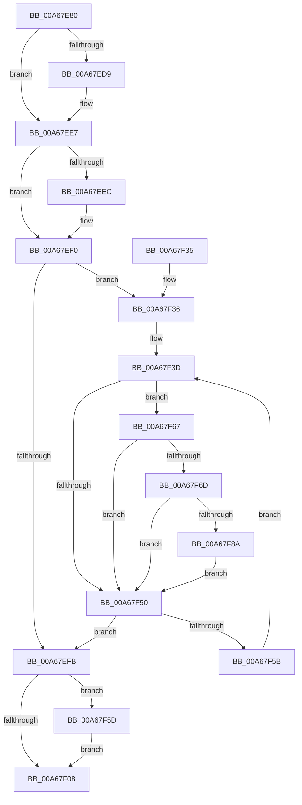

# sub_00A67E80

- RVA: `0x00A67E80`–`0x00A67F96` (길이 `278` bytes)
- VA: `0x0000000140A67E80`
- 실행 섹션: `PAGE`
- PDB 이름 있음: `아니요`; PDB Function 태그: `아니요`
- unwind 정보 RVA: `0x000A3E78`
- 디코드: `82`개 명령, `278/278` bytes 표시
- 미해석 바이트: `0` (있으면 어셈블리에 `.byte`로 보존)

> 이 문서는 커널 이미지의 기계어와 PDB 기호를 분석해 생성했습니다. 4번과 5번은 함수 원형과 자료형을 바이너리 사용 방식에서 추정한 C 해석이며 원본 소스 복구 결과는 아닙니다.

## 1. Dependencies

- 직접 호출 지점: **7**; 고유 호출 대상: **7**
- 직접 호출자로 확인된 함수: **1**
- RIP 상대 이미지 참조: **0**

### Outgoing calls
- `0x00A67EC9` → [KeAbPreAcquire](../../text/21/KeAbPreAcquire_function_00210230.md) (function, `0x00210230`)
- `0x00A67EE2` → [ExfAcquirePushLockExclusiveEx](../../text/20/ExfAcquirePushLockExclusiveEx_function_0020FC90.md) (function, `0x0020FC90`)
- `0x00A67F0B` → [KeAbPostRelease](../../text/2E/KeAbPostRelease_function_002E1600.md) (function, `0x002E1600`)
- `0x00A67F10` → [KeLeaveGuardedRegion](../../text/2E/KeLeaveGuardedRegion_function_002E2C40.md) (function, `0x002E2C40`)
- `0x00A67F60` → [ExfTryToWakePushLock](../../text/26/ExfTryToWakePushLock_function_00265DD0.md) (function, `0x00265DD0`)
- `0x00A67F7E` → [sub_00A67F9C](Unknown_function_00A67F9C.md) (function, `0x00A67F9C`)
- `0x00A67F8D` → [sub_009A0698](../9A/Unknown_function_009A0698.md) (function, `0x009A0698`)

### Direct callers
- [sub_00A67C68](Unknown_function_00A67C68.md) at `0x00A67D37`

### Static image references
- 디코드된 RIP-relative 메모리 참조가 없습니다.

## 2. Other-region calls and transfers

- 다른 실행 섹션으로 향하는 call: **5**
  - `0x00A67EC9` → [KeAbPreAcquire](../../text/21/KeAbPreAcquire_function_00210230.md) (`PAGE` → `.text`)
  - `0x00A67EE2` → [ExfAcquirePushLockExclusiveEx](../../text/20/ExfAcquirePushLockExclusiveEx_function_0020FC90.md) (`PAGE` → `.text`)
  - `0x00A67F0B` → [KeAbPostRelease](../../text/2E/KeAbPostRelease_function_002E1600.md) (`PAGE` → `.text`)
  - `0x00A67F10` → [KeLeaveGuardedRegion](../../text/2E/KeLeaveGuardedRegion_function_002E2C40.md) (`PAGE` → `.text`)
  - `0x00A67F60` → [ExfTryToWakePushLock](../../text/26/ExfTryToWakePushLock_function_00265DD0.md) (`PAGE` → `.text`)
- 별도 외부 분기/꼬리 이동을 확인하지 못했습니다.

## 3. Assembly (complete function range)

```asm
00A67E80  48 89 5C 24 08                  mov qword ptr [rsp + 8], rbx
00A67E85  48 89 6C 24 10                  mov qword ptr [rsp + 0x10], rbp
00A67E8A  48 89 74 24 18                  mov qword ptr [rsp + 0x18], rsi
00A67E8F  57                              push rdi
00A67E90  41 54                           push r12
00A67E92  41 55                           push r13
00A67E94  41 56                           push r14
00A67E96  41 57                           push r15
00A67E98  48 83 EC 30                     sub rsp, 0x30
00A67E9C  65 48 8B 04 25 88 01 00 00      mov rax, qword ptr gs:[0x188]
00A67EA5  48 8D B9 B0 00 00 00            lea rdi, [rcx + 0xb0]
00A67EAC  4C 8B EA                        mov r13, rdx
00A67EAF  4C 8B F1                        mov r14, rcx
00A67EB2  48 83 CB FF                     or rbx, 0xffffffffffffffff
00A67EB6  45 33 C0                        xor r8d, r8d
00A67EB9  33 D2                           xor edx, edx
00A67EBB  48 8B CF                        mov rcx, rdi
00A67EBE  66 01 98 E6 01 00 00            add word ptr [rax + 0x1e6], bx
00A67EC5  45 33 E4                        xor r12d, r12d
00A67EC8  90                              nop
00A67EC9  E8 62 83 7A FF                  call 0x140210230
00A67ECE  F0 48 0F BA 2F 00               lock bts qword ptr [rdi], 0
00A67ED4  48 8B F0                        mov rsi, rax
00A67ED7  73 0E                           jae 0x140a67ee7
00A67ED9  4C 8B C7                        mov r8, rdi
00A67EDC  48 8B D0                        mov rdx, rax
00A67EDF  48 8B CF                        mov rcx, rdi
00A67EE2  E8 A9 7D 7A FF                  call 0x14020fc90
00A67EE7  48 85 F6                        test rsi, rsi
00A67EEA  74 04                           je 0x140a67ef0
00A67EEC  C6 46 0A 01                     mov byte ptr [rsi + 0xa], 1
00A67EF0  33 F6                           xor esi, esi
00A67EF2  41 39 B6 8C 00 00 00            cmp dword ptr [r14 + 0x8c], esi
00A67EF9  77 3B                           ja 0x140a67f36
00A67EFB  F0 48 0F C1 1F                  lock xadd qword ptr [rdi], rbx
00A67F00  80 E3 06                        and bl, 6
00A67F03  80 FB 02                        cmp bl, 2
00A67F06  74 55                           je 0x140a67f5d
00A67F08  48 8B CF                        mov rcx, rdi
00A67F0B  E8 F0 96 87 FF                  call 0x1402e1600
00A67F10  E8 2B AD 87 FF                  call 0x1402e2c40
00A67F15  48 8B 5C 24 60                  mov rbx, qword ptr [rsp + 0x60]
00A67F1A  41 8B C4                        mov eax, r12d
00A67F1D  48 8B 6C 24 68                  mov rbp, qword ptr [rsp + 0x68]
00A67F22  48 8B 74 24 70                  mov rsi, qword ptr [rsp + 0x70]
00A67F27  48 83 C4 30                     add rsp, 0x30
00A67F2B  41 5F                           pop r15
00A67F2D  41 5E                           pop r14
00A67F2F  41 5D                           pop r13
00A67F31  41 5C                           pop r12
00A67F33  5F                              pop rdi
00A67F34  C3                              ret
00A67F35  CC                              int3
00A67F36  4D 8D BE 88 00 00 00            lea r15, [r14 + 0x88]
00A67F3D  49 8B 47 10                     mov rax, qword ptr [r15 + 0x10]
00A67F41  8B CE                           mov ecx, esi
00A67F43  41 0F AF 0F                     imul ecx, dword ptr [r15]
00A67F47  48 8B 2C 01                     mov rbp, qword ptr [rcx + rax]
00A67F4B  48 85 ED                        test rbp, rbp
00A67F4E  75 17                           jne 0x140a67f67
00A67F50  FF C6                           inc esi
00A67F52  41 3B B6 8C 00 00 00            cmp esi, dword ptr [r14 + 0x8c]
00A67F59  73 A0                           jae 0x140a67efb
00A67F5B  EB E0                           jmp 0x140a67f3d
00A67F5D  48 8B CF                        mov rcx, rdi
00A67F60  E8 6B DE 7F FF                  call 0x140265dd0
00A67F65  EB A1                           jmp 0x140a67f08
00A67F67  4C 39 6D 20                     cmp qword ptr [rbp + 0x20], r13
00A67F6B  75 E3                           jne 0x140a67f50
00A67F6D  48 83 64 24 20 00               and qword ptr [rsp + 0x20], 0
00A67F73  44 8B CE                        mov r9d, esi
00A67F76  45 33 C0                        xor r8d, r8d
00A67F79  33 D2                           xor edx, edx
00A67F7B  49 8B CF                        mov rcx, r15
00A67F7E  E8 19 00 00 00                  call 0x140a67f9c
00A67F83  44 8B E0                        mov r12d, eax
00A67F86  85 C0                           test eax, eax
00A67F88  78 C6                           js 0x140a67f50
00A67F8A  48 8B CD                        mov rcx, rbp
00A67F8D  E8 06 87 F3 FF                  call 0x1409a0698
00A67F92  FF CE                           dec esi
00A67F94  EB BA                           jmp 0x140a67f50
```

## 4. C-style interpretation (structured pseudocode)

```c
__int64 __fastcall sub_00A67E80(__int64 a1, __int64 a2, int a3)
{
    __int64 result;
    __int64 v_r12;
    __int64 v_rbx;
    __int64 v_rsi;
    __int64 v_rsp;
    unsigned __int64 v_stack_p10;
    unsigned __int64 v_stack_p18;
    unsigned __int64 v_stack_p20;
    unsigned __int64 v_stack_p8;

    v_stack_p8 = v_rbx;
    v_stack_p10 = v_rbp;
    v_stack_p18 = v_rsi;
    v_rsp = (v_rsp) - (48);
    v_rbx = (v_rbx) | (-1);
    a3 = 0;
    a2 = 0;
    v_r12 = 0;
    result = KeAbPreAcquire(a1 + 176, a2, a3, a4);
    if (!(condition_is_above_or_equal)) {
        a3 = a1 + 176;
        a2 = result;
        a1 = a1 + 176;
        result = ExfAcquirePushLockExclusiveEx(a1, a2, a3, a4);
    }
    if (result != 0) {
        *(unsigned __int8 *)(result + 10) = 1;
    }
    v_rsi = 0;
    if ((*(unsigned int *)(a1 + 140)) > 0) goto loc_00A67F36;
loc_00A67EFB:
    v_rbx = (unsigned __int8)((v_rbx) & (6));
    if (((unsigned __int8)(v_rbx)) == 2) goto loc_00A67F5D;
loc_00A67F08:
    result = KeAbPostRelease(a1 + 176, a2, a3, a4);
    result = KeLeaveGuardedRegion(a1 + 176, a2, a3, a4);
    v_rsp = (v_rsp) + (48);
    return 0;
loc_00A67F36:
loc_00A67F3D:
    a1 = (unsigned int)(((unsigned int)((unsigned int)(v_stack_p18))) * (*(unsigned int *)(a1 + 136)));
    if (*(unsigned __int64 *)(a1 + *(unsigned __int64 *)(a1 + 136 + 16) * 1) != 0) goto loc_00A67F67;
loc_00A67F50:
    v_rsi = (unsigned int)((v_stack_p18) + 1);
    if (((unsigned int)(v_rsi)) >= (*(unsigned int *)(a1 + 140))) goto loc_00A67EFB;
    goto loc_00A67F3D;
loc_00A67F5D:
    result = ExfTryToWakePushLock(a1 + 176, a2, a3, a4);
    goto loc_00A67F08;
loc_00A67F67:
    if ((*(unsigned __int64 *)(*(unsigned __int64 *)(a1 + *(unsigned __int64 *)(a1 + 136 + 16) * 1) + 32)) != a2) goto loc_00A67F50;
    a3 = 0;
    a2 = 0;
    result = sub_00A67F9C(a1 + 136, a2, a3, (unsigned int)((unsigned int)(v_rsi)));
    if (sign_flag) goto loc_00A67F50;
    result = sub_009A0698(*(unsigned __int64 *)(a1 + *(unsigned __int64 *)(a1 + 136 + 16) * 1), a2, a3, (unsigned int)((unsigned int)(v_rsi)));
    v_rsi = (unsigned int)((v_rsi) - 1);
    goto loc_00A67F50;
}
```

## 5. (Beta) C Style

```c
int64_t sub_00A67E80(void *Arg1, int64_t Arg2, int32_t Arg3)
{
    uint8_t *arg1 = (uint8_t *)Arg1;

    int64_t result;
    int64_t local_r12;
    int64_t local_rbx;
    int64_t local_rsi;
    int64_t local_rsp;
    uint64_t v_stack_p10;
    uint64_t v_stack_p18;
    uint64_t v_stack_p20;
    uint64_t v_stack_p8;

    v_stack_p8 = local_rbx;
    v_stack_p10 = local_rbp;
    v_stack_p18 = local_rsi;
    local_rsp = (local_rsp) - (48);
    local_rbx = (local_rbx) | (-1);
    Arg3 = 0;
    Arg2 = 0;
    local_r12 = 0;
    result = KeAbPreAcquire(Arg1 + 176, Arg2, Arg3, a4);
    if (!(condition_is_above_or_equal)) {
        Arg3 = Arg1 + 176;
        Arg2 = result;
        Arg1 = Arg1 + 176;
        result = ExfAcquirePushLockExclusiveEx(Arg1, Arg2, Arg3, a4);
    }
    if (result != 0) {
        *(uint8_t *)(result + 0xA) = 1;
    }
    local_rsi = 0;
    if ((*(uint32_t *)(arg1 + 0x8C)) > 0) goto loc_00A67F36;
loc_00A67EFB:
    local_rbx = (uint8_t)((local_rbx) & (6));
    if (((uint8_t)(local_rbx)) == 2) goto loc_00A67F5D;
loc_00A67F08:
    result = KeAbPostRelease(Arg1 + 176, Arg2, Arg3, a4);
    result = KeLeaveGuardedRegion(Arg1 + 176, Arg2, Arg3, a4);
    local_rsp = (local_rsp) + (48);
    return 0;
loc_00A67F36:
loc_00A67F3D:
    Arg1 = (uint32_t)(((uint32_t)((uint32_t)(v_stack_p18))) * (*(uint32_t *)(arg1 + 0x88)));
    if (*(uint64_t *)(arg1 + *(uint64_t *)(arg1 + 0x88 + 0x10) * 1) != 0) goto loc_00A67F67;
loc_00A67F50:
    local_rsi = (uint32_t)((v_stack_p18) + 1);
    if (((uint32_t)(local_rsi)) >= (*(uint32_t *)(arg1 + 0x8C))) goto loc_00A67EFB;
    goto loc_00A67F3D;
loc_00A67F5D:
    result = ExfTryToWakePushLock(Arg1 + 176, Arg2, Arg3, a4);
    goto loc_00A67F08;
loc_00A67F67:
    if ((*(uint64_t *)(*(uint64_t *)(arg1 + *(uint64_t *)(arg1 + 0x88 + 0x10) * 1) + 0x20)) != Arg2) goto loc_00A67F50;
    Arg3 = 0;
    Arg2 = 0;
    result = sub_00A67F9C(Arg1 + 136, Arg2, Arg3, (uint32_t)((uint32_t)(local_rsi)));
    if (sign_flag) goto loc_00A67F50;
    result = sub_009A0698(*(uint64_t *)(arg1 + *(uint64_t *)(arg1 + 0x88 + 0x10) * 1), Arg2, Arg3, (uint32_t)((uint32_t)(local_rsi)));
    local_rsi = (uint32_t)((local_rsi) - 1);
    goto loc_00A67F50;
}
```

### 관측된 메모리 오프셋

구조체 형식이 확인되지 않은 접근은 인자 기준의 오프셋으로만 기록했습니다.

| 기준 인자 | 오프셋 표현 | 폭 (bit) | 접근 |
|---|---:|---:|---|
| `Arg1` | `+ 0x0` | `32` | `R` |
| `Arg1` | `+ 0x0` | `64` | `R/W` |
| `Arg1` | `+ 0x10` | `64` | `R` |
| `Arg1` | `+ 0x88` | `64` | `R` |
| `Arg1` | `+ 0x8C` | `32` | `R` |
| `Arg1` | `+ 0xB0` | `64` | `R` |

## 6. Execution-region graph

[열기: 2D/3D 그래프와 함수 탐색 컨트롤 패널](../../../control-panel.html?section=page&rva=0x00A67E80&view=graph)

- 2D 그래프는 위에서 아래로 흐르고, 3D 그래프는 빈 공간을 드래그해 회전합니다. Shift+드래그는 이동, 휠은 확대·축소, 함수 노드 선택은 대상 보고서 이동입니다.

### Static fallback


