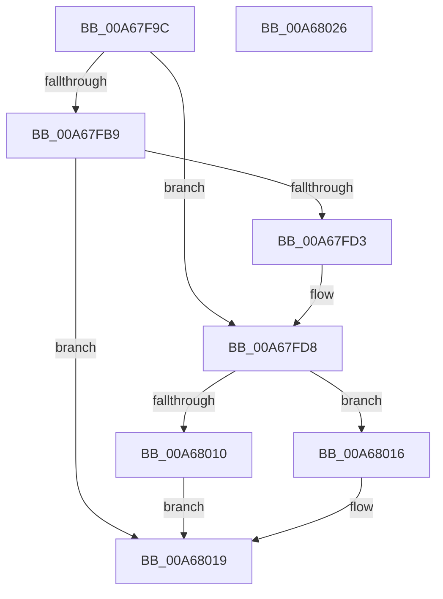

# sub_00A67F9C

- RVA: `0x00A67F9C`–`0x00A68027` (길이 `139` bytes)
- VA: `0x0000000140A67F9C`
- 실행 섹션: `PAGE`
- PDB 이름 있음: `아니요`; PDB Function 태그: `아니요`
- unwind 정보 RVA: `0x000B3D80`
- 디코드: `42`개 명령, `139/139` bytes 표시
- 미해석 바이트: `0` (있으면 어셈블리에 `.byte`로 보존)

> 이 문서는 커널 이미지의 기계어와 PDB 기호를 분석해 생성했습니다. 4번과 5번은 함수 원형과 자료형을 바이너리 사용 방식에서 추정한 C 해석이며 원본 소스 복구 결과는 아닙니다.

## 1. Dependencies

- 직접 호출 지점: **3**; 고유 호출 대상: **3**
- 직접 호출자로 확인된 함수: **2**
- RIP 상대 이미지 참조: **0**

### Outgoing calls
- `0x00A67FC8` → [sub_008D3DC0](../8D/Unknown_function_008D3DC0.md) (function, `0x008D3DC0`)
- `0x00A68002` → [memcpy](../../text/6C/memcpy_function_006C6840.md) (function, `0x006C6840`)
- `0x00A68007` → [Feature_58333519__private_IsEnabledDeviceUsageNoInline](../../text/4F/Feature_58333519__private_IsEnabledDeviceUsageNoInline_function_004F5D4C.md) (function, `0x004F5D4C`)

### Direct callers
- [WbHeapExecutionUnloadModule](WbHeapExecutionUnloadModule_function_00A67D74.md) at `0x00A67E55`
- [sub_00A67E80](Unknown_function_00A67E80.md) at `0x00A67F7E`

### Static image references
- 디코드된 RIP-relative 메모리 참조가 없습니다.

## 2. Other-region calls and transfers

- 다른 실행 섹션으로 향하는 call: **2**
  - `0x00A68002` → [memcpy](../../text/6C/memcpy_function_006C6840.md) (`PAGE` → `.text`)
  - `0x00A68007` → [Feature_58333519__private_IsEnabledDeviceUsageNoInline](../../text/4F/Feature_58333519__private_IsEnabledDeviceUsageNoInline_function_004F5D4C.md) (`PAGE` → `.text`)
- 별도 외부 분기/꼬리 이동을 확인하지 못했습니다.

## 3. Assembly (complete function range)

```asm
00A67F9C  48 89 5C 24 08                  mov qword ptr [rsp + 8], rbx
00A67FA1  44 89 4C 24 20                  mov dword ptr [rsp + 0x20], r9d
00A67FA6  57                              push rdi
00A67FA7  48 83 EC 30                     sub rsp, 0x30
00A67FAB  33 FF                           xor edi, edi
00A67FAD  45 8B D9                        mov r11d, r9d
00A67FB0  48 8B D9                        mov rbx, rcx
00A67FB3  41 83 F9 FF                     cmp r9d, -1
00A67FB7  75 1F                           jne 0x140a67fd8
00A67FB9  4C 8B 4C 24 60                  mov r9, qword ptr [rsp + 0x60]
00A67FBE  48 8D 44 24 58                  lea rax, [rsp + 0x58]
00A67FC3  48 89 44 24 20                  mov qword ptr [rsp + 0x20], rax
00A67FC8  E8 F3 BD E6 FF                  call 0x1408d3dc0
00A67FCD  8B F8                           mov edi, eax
00A67FCF  85 C0                           test eax, eax
00A67FD1  78 46                           js 0x140a68019
00A67FD3  44 8B 5C 24 58                  mov r11d, dword ptr [rsp + 0x58]
00A67FD8  44 8B 13                        mov r10d, dword ptr [rbx]
00A67FDB  41 8D 53 01                     lea edx, [r11 + 1]
00A67FDF  4C 8B 4B 10                     mov r9, qword ptr [rbx + 0x10]
00A67FE3  44 8B 43 04                     mov r8d, dword ptr [rbx + 4]
00A67FE7  45 2B C3                        sub r8d, r11d
00A67FEA  41 0F AF D2                     imul edx, r10d
00A67FEE  41 FF C8                        dec r8d
00A67FF1  45 0F AF C2                     imul r8d, r10d
00A67FF5  45 0F AF D3                     imul r10d, r11d
00A67FF9  49 03 D1                        add rdx, r9
00A67FFC  41 8B CA                        mov ecx, r10d
00A67FFF  49 03 C9                        add rcx, r9
00A68002  E8 39 E8 C5 FF                  call 0x1406c6840
00A68007  E8 40 DD A8 FF                  call 0x1404f5d4c
00A6800C  85 C0                           test eax, eax
00A6800E  74 06                           je 0x140a68016
00A68010  F0 FF 4B 04                     lock dec dword ptr [rbx + 4]
00A68014  EB 03                           jmp 0x140a68019
00A68016  FF 4B 04                        dec dword ptr [rbx + 4]
00A68019  48 8B 5C 24 40                  mov rbx, qword ptr [rsp + 0x40]
00A6801E  8B C7                           mov eax, edi
00A68020  48 83 C4 30                     add rsp, 0x30
00A68024  5F                              pop rdi
00A68025  C3                              ret
00A68026  CC                              int3
```

## 4. C-style interpretation (structured pseudocode)

```c
__int64 __fastcall sub_00A67F9C(__int64 a1, __int64 a2, __int64 a3, int a4, __int64 a5)
{
    __int64 result;
    __int64 v_r10;
    __int64 v_rdi;
    __int64 v_rsp;
    unsigned __int64 v_stack_m18;
    unsigned int v_stack_p20;
    unsigned __int64 v_stack_p8;

    v_stack_p8 = v_rbx;
    v_stack_p20 = a4;
    v_rsp = (v_rsp) - (48);
    v_rdi = 0;
    if (a4 != -1) goto loc_00A67FD8;
    v_stack_m18 = v_stack_p20;
    result = sub_008D3DC0(a1, a2, a3, a5);
    if (sign_flag) goto loc_00A68019;
loc_00A67FD8:
    a3 = (unsigned int)(((unsigned int)(*(unsigned int *)(a1 + 4))) - ((unsigned int)((unsigned int)(v_stack_p20))));
    a2 = (unsigned int)(((unsigned int)(v_stack_p20) + 1) * ((unsigned int)((unsigned int)(*(unsigned int *)(a1)))));
    a3 = (unsigned int)((a3) - 1);
    a3 = (unsigned int)((a3) * ((unsigned int)((unsigned int)(*(unsigned int *)(a1)))));
    v_r10 = (unsigned int)(((unsigned int)(*(unsigned int *)(a1))) * ((unsigned int)((unsigned int)(v_stack_p20))));
    a2 = (a2) + (*(unsigned __int64 *)(a1 + 16));
    a1 = ((unsigned int)((unsigned int)(v_r10))) + (*(unsigned __int64 *)(a1 + 16));
    result = memcpy(a1, a2, a3, *(unsigned __int64 *)(a1 + 16));
    result = Feature_58333519__private_IsEnabledDeviceUsageNoInline(a1, a2, a3, *(unsigned __int64 *)(a1 + 16));
    if ((unsigned int)(result) == 0) goto loc_00A68016;
    goto loc_00A68019;
loc_00A68016:
loc_00A68019:
    v_rsp = (v_rsp) + (48);
    return (unsigned int)((unsigned int)((unsigned int)((unsigned int)(result))));
}
```

## 5. (Beta) C Style

```c
int64_t sub_00A67F9C(void *Arg1, int64_t Arg2, int64_t Arg3, int32_t Arg4, int64_t Arg5)
{
    uint8_t *arg1 = (uint8_t *)Arg1;

    int64_t result;
    int64_t local_r10;
    int64_t local_rdi;
    int64_t local_rsp;
    uint64_t v_stack_m18;
    uint32_t v_stack_p20;
    uint64_t v_stack_p8;

    v_stack_p8 = local_rbx;
    v_stack_p20 = Arg4;
    local_rsp = (local_rsp) - (48);
    local_rdi = 0;
    if (Arg4 != -1) goto loc_00A67FD8;
    v_stack_m18 = v_stack_p20;
    result = sub_008D3DC0(Arg1, Arg2, Arg3, Arg5);
    if (sign_flag) goto loc_00A68019;
loc_00A67FD8:
    Arg3 = (uint32_t)(((uint32_t)(*(uint32_t *)(arg1 + 0x4))) - ((uint32_t)((uint32_t)(v_stack_p20))));
    Arg2 = (uint32_t)(((uint32_t)(v_stack_p20) + 1) * ((uint32_t)((uint32_t)(*(uint32_t *)(arg1)))));
    Arg3 = (uint32_t)((Arg3) - 1);
    Arg3 = (uint32_t)((Arg3) * ((uint32_t)((uint32_t)(*(uint32_t *)(arg1)))));
    local_r10 = (uint32_t)(((uint32_t)(*(uint32_t *)(arg1))) * ((uint32_t)((uint32_t)(v_stack_p20))));
    Arg2 = (Arg2) + (*(uint64_t *)(arg1 + 0x10));
    Arg1 = ((uint32_t)((uint32_t)(local_r10))) + (*(uint64_t *)(arg1 + 0x10));
    result = memcpy(Arg1, Arg2, Arg3, *(uint64_t *)(arg1 + 0x10));
    result = Feature_58333519__private_IsEnabledDeviceUsageNoInline(Arg1, Arg2, Arg3, *(uint64_t *)(arg1 + 0x10));
    if ((uint32_t)(result) == 0) goto loc_00A68016;
    goto loc_00A68019;
loc_00A68016:
loc_00A68019:
    local_rsp = (local_rsp) + (48);
    return (uint32_t)((uint32_t)((uint32_t)((uint32_t)(result))));
}
```

### 관측된 메모리 오프셋

구조체 형식이 확인되지 않은 접근은 인자 기준의 오프셋으로만 기록했습니다.

| 기준 인자 | 오프셋 표현 | 폭 (bit) | 접근 |
|---|---:|---:|---|
| `Arg1` | `+ 0x0` | `32` | `R` |
| `Arg1` | `+ 0x4` | `32` | `R` |
| `Arg1` | `+ 0x4` | `32` | `R/W` |
| `Arg1` | `+ 0x10` | `64` | `R` |

## 6. Execution-region graph

[열기: 2D/3D 그래프와 함수 탐색 컨트롤 패널](../../../control-panel.html?section=page&rva=0x00A67F9C&view=graph)

- 2D 그래프는 위에서 아래로 흐르고, 3D 그래프는 빈 공간을 드래그해 회전합니다. Shift+드래그는 이동, 휠은 확대·축소, 함수 노드 선택은 대상 보고서 이동입니다.

### Static fallback


